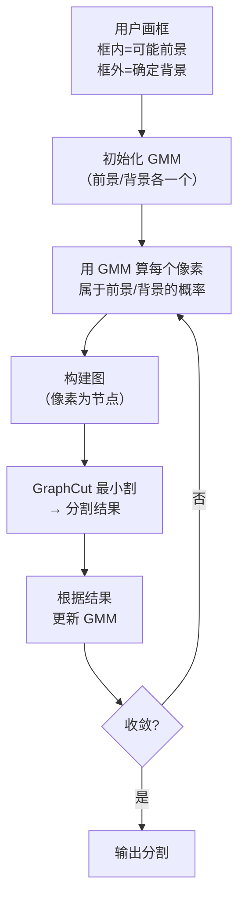
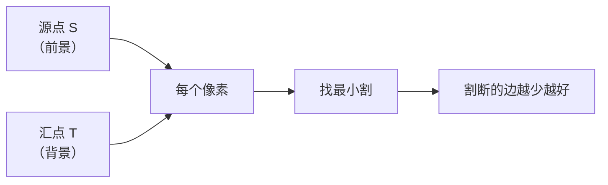
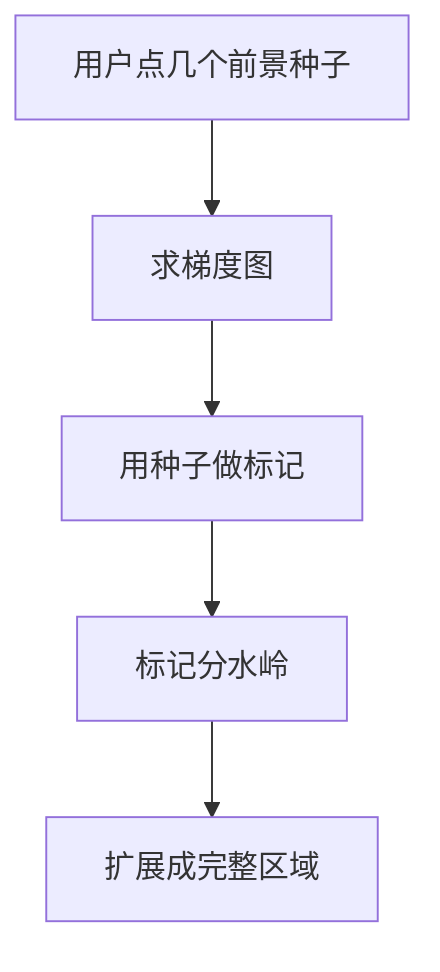
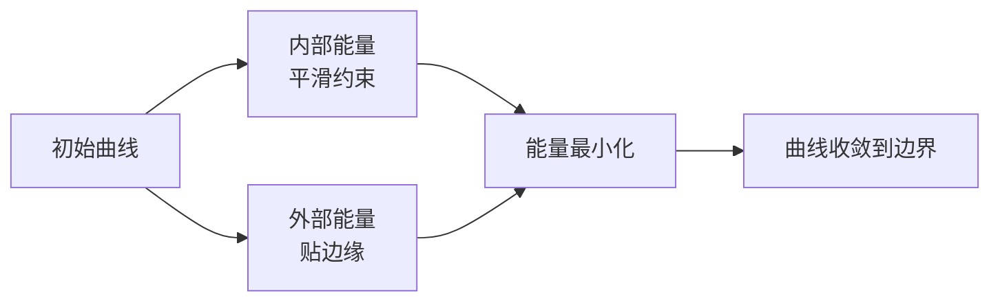
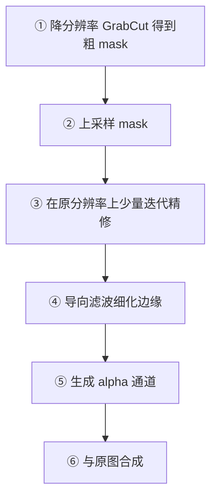
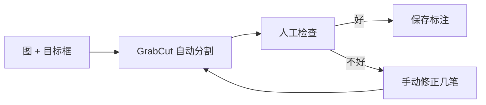

# 交互式分割

> **一句话**：用户给一点点提示（画个框、点几笔），算法把目标精确抠出来。

## 为什么需要交互式分割

**全自动分割的问题**：没有先验知识时，"什么是一个目标"很难定义。

**交互式分割的思路**：**用户提供最小提示，算法完成繁重工作**。

**生活比方**：你想让人帮你把一个箱子搬走。你不需要描述箱子的每个细节，只需要**用手指一下**。

## 交互式分割的应用

| 应用 | 说明 |
|---|---|
| **抠图/换背景** | Photoshop 的"快速选择" |
| **图像标注** | 给训练集打标签（SLIC + GrabCut 快速标注） |
| **医学影像** | 医生勾画器官轮廓 |
| **视频编辑** | 视频对象分割（首帧标注） |

## ① GrabCut（最实用）

### 算法思想

**GrabCut = GraphCut + GMM + 迭代优化**



### 三个核心组件

**① GMM（高斯混合模型）**

**思路**：用几个高斯分布来建模"前景的颜色分布"和"背景的颜色分布"。

**生活比方**：告诉你"前景有 5 个主要颜色，每个颜色呈现为一个高斯分布"。一个像素是不是前景，就看它更像哪个模型生成出来的。

| 模型 | 组件数 |
|---|---|
| 前景 GMM | 5 个高斯 |
| 背景 GMM | 5 个高斯 |

::: tip 为什么用 GMM 而不是简单阈值
**因为同一类物体的颜色不是单一的**。

一个"人"可能有肤色、衣服色（多种）、裤子色、头发色……用几个高斯混合就能覆盖这种"多峰"分布。
:::

**② GraphCut（图割）**

**思路**：把像素建图，相邻像素连边（权重 = 颜色相似度）。找一种"切断代价最小"的分法。

**生活比方**：一群人要分成两队，尽量让"好朋友"在同一队，切断的友谊最少。



**③ 迭代优化**

关键：**GMM 和分割结果互相改进**。

- 初始 GMM 基于框内/框外 → 粗糙
- 分割结果更精确 → 重新训练 GMM → 更准
- 反复 5 次左右收敛

### 代码

```python
def grabcut_segment(img, rect=None, mask=None, iters=5):
    """
    rect: (x, y, w, h) 初始框
    mask: 已有的 mask（用于细化）
    """
    h, w = img.shape[:2]

    if mask is None:
        mask = np.zeros((h, w), np.uint8)
        mode = cv2.GC_INIT_WITH_RECT
    else:
        mode = cv2.GC_INIT_WITH_MASK

    bgdModel = np.zeros((1, 65), np.float64)
    fgdModel = np.zeros((1, 65), np.float64)

    cv2.grabCut(img, mask, rect, bgdModel, fgdModel, iters, mode)

    # mask 值: 0=确定背景, 1=确定前景, 2=可能背景, 3=可能前景
    result_mask = np.where((mask == cv2.GC_FGD) | (mask == cv2.GC_PR_FGD), 255, 0).astype(np.uint8)

    return result_mask, mask
```

### mask 的四个值

| 值 | 常量 | 含义 |
|---|---|---|
| 0 | `GC_BGD` | 确定背景 |
| 1 | `GC_FGD` | 确定前景 |
| 2 | `GC_PR_BGD` | 可能背景 |
| 3 | `GC_PR_FGD` | 可能前景 |

::: tip 用 mask 做"细化"
**第一次**：用户画框 → `GC_INIT_WITH_RECT`

**第二次**：把不满意的地方手动标注（用 4 种值），然后 `GC_INIT_WITH_MASK` 再跑一次 → **逐步精修**。

```python
# ① 用户画框
mask, _ = grabcut_segment(img, rect=(100, 50, 400, 500))

# ② 用户标记"这里确实是前景"
mask[(mask == cv2.GC_BGD) & user_drawn_fg] = cv2.GC_FGD
mask[(mask == cv2.GC_PR_BGD) & user_drawn_fg] = cv2.GC_PR_FGD

# ③ 再跑一次
refined, _ = grabcut_segment(img, mask=mask)
```
:::

### 关键参数

| 参数 | 含义 | 建议 |
|---|---|---|
| `iter` | 迭代次数 | **5**（3–10） |
| `rect` | 初始框 | 略大于目标 |
| `mode` | 初始化方式 | RECT / MASK |

::: tip 框要"略大"
**框太小**：目标的一部分被划到"确定背景"，无法挽回。

**框太大**：包含太多背景，GMM 建模不准。

**建议**：框比目标大 **5%–15%**。
:::

### GrabCut 的性能

| 分辨率 | 迭代 5 次耗时 |
|---|---|
| 320×240 | ~150 ms |
| 640×480 | ~600 ms |
| 1920×1080 | **~5 s** |

**优化**：

```python
# ① 先降分辨率分割
small = cv2.resize(img, None, fx=0.25, fy=0.25)
mask_small, _ = grabcut_segment(small, rect_scaled)

# ② 上采样 mask
mask = cv2.resize(mask_small, (w, h), interpolation=cv2.INTER_NEAREST)

# ③ 可选：在原分辨率上做少量迭代精修
mask, _ = grabcut_segment(img, mask=mask, iters=2)
```

**这个"先粗后精"的流程能把 5 秒降到 0.5 秒**。

## ② GraphCut（GrabCut 的前身）

**思路**：用户直接标注前景/背景的种子点，然后做最小割。

**与 GrabCut 的区别**：

| 维度 | GraphCut | GrabCut |
|---|---|---|
| 用户输入 | 需要**多个**前景/背景点 | **一个框**即可 |
| 颜色模型 | 直方图 | **GMM** |
| 迭代 | 无 | **有** |
| 使用难度 | 高 | **低** |

**结论**：**直接用 GrabCut**。GraphCut 是理论前身，工程里不用。

## ③ 分水岭 + 标记（交互式的另一种）

**思路**：用户标记几个"确定前景"的点，算法把周围连通的区域扩展出来。



**适用**：**相邻目标需要分开**（如细胞、硬币堆）。

**代码**：

```python
def watershed_interactive(img, fg_seeds, bg_seeds=None):
    # ① 转二值
    gray = cv2.cvtColor(img, cv2.COLOR_BGR2GRAY)
    _, binary = cv2.threshold(gray, 0, 255, cv2.THRESH_BINARY_INV + cv2.THRESH_OTSU)

    # ② 形态学清理
    kernel = np.ones((3, 3), np.uint8)
    opening = cv2.morphologyEx(binary, cv2.MORPH_OPEN, kernel, iterations=2)
    sure_bg = cv2.dilate(opening, kernel, iterations=3)

    # ③ 距离变换
    dist = cv2.distanceTransform(opening, cv2.DIST_L2, 5)

    # ④ 标记
    _, markers = cv2.connectedComponents(np.uint8(dist > 0.5 * dist.max()))
    markers = markers + 1

    # ⑤ 用户标记
    markers[fg_seeds > 0] = 255      # 前景
    if bg_seeds is not None:
        markers[bg_seeds > 0] = 0    # 背景

    # ⑥ 分水岭
    markers = cv2.watershed(img, markers)
    return markers
```

## ④ 主动轮廓（Snake）

### 思路

**给一条初始曲线，让它在"内部能量"（曲线要平滑）和"外部能量"（要贴边缘）之间找平衡**。



**生活比方**：一根有弹性的橡皮筋套在物体上，会自己收紧贴合。

### 优势与局限

| 优势 | 局限 |
|---|---|
| 结果**平滑连续** | 需要好的初始位置 |
| **亚像素精度** | 对凹陷边界效果差 |
| 不产生散点 | 拓扑不能变（不能分裂） |

**改进：水平集（Level Set）** —— 用高维曲面的零水平集表示曲线，可以自然处理拓扑变化（Chan-Vese 模型）。

## 四种方法对比

| 方法 | 用户输入 | 速度 | 适用 |
|---|---|---|---|
| **GrabCut** | 一个框 | 中 | **通用抠图** |
| GraphCut | 多个点 | 中 | 理论参考 |
| 分水岭+标记 | 前景种子 | **快** | **分离粘连目标** |
| Snake | 初始轮廓 | 慢 | 平滑边界、医学 |

## 抠图后处理（重要）

**GrabCut 的边缘往往毛糙**，尤其是头发、毛发、半透明物体。


### 边缘细化技巧

**① 导向滤波保边平滑**

```python
# 用原图作为导向图，让 edge 贴着原图边缘
guide = cv2.cvtColor(img, cv2.COLOR_BGR2GRAY)
refined_alpha = cv2.ximgproc.guidedFilter(guide, alpha, radius=8, eps=1e-3)
```

**② 腐蚀 + 模糊 + 阈值（柔化边缘）**

```python
kernel = np.ones((3, 3), np.uint8)
eroded = cv2.erode(mask, kernel, iterations=1)
blurred = cv2.GaussianBlur(eroded, (5, 5), 2)
# 得到带过渡的 alpha 通道
```

**③ close-form matting（高级，效果最好）**

需要额外工具库（如 `pymatting`），能处理头发等复杂边缘。

::: tip 一个实用的完整抠图流程


:::

## 常见踩坑

::: danger 坑 1：框画得太小
**现象**：目标边缘被切掉一块，怎么调都回不来。

**根因**：框外的像素被标为**确定背景**（`GC_BGD`），GrabCut **永远不会**把它划成前景。

**解决**：**框要略大于目标**（建议大 10%）。
:::

::: danger 坑 2：前景和背景颜色接近
**现象**：分割结果混在一起。

**根因**：GMM 无法区分颜色相近的两类。

**解决**：
- 用 `GC_INIT_WITH_MASK` **手动标注**一些确定的前景/背景像素
- 换用**基于边缘**的方法
- 或者**换个背景拍照**（如果条件允许）
:::

::: danger 坑 3：GrabCut 太慢
**现象**：1080p 图跑 5 秒。

**解决**：**先降分辨率**（0.25×）分割，再上采样 + 少量迭代精修。**能提速 10 倍，质量几乎无损**。
:::

::: danger 坑 4：忘了转图像格式
**现象**：`cv2.grabCut` 报错。

**解决**：
- 图像必须是 **8UC3**（三通道 uint8）
- 如果是灰度图，先转 BGR：`cv2.cvtColor(gray, cv2.COLOR_GRAY2BGR)`
:::

::: danger 坑 5：`bgdModel` / `fgdModel` 形状错
**现象**：报错 `Expected 65 columns`。

**解决**：必须是 `np.zeros((1, 65), np.float64)`。

**注意**：这两个是**内部状态**，每次调用新图时应重置（除非你要继续上一次的优化）。
:::

::: danger 坑 6：`mask` 值混淆
**现象**：结果完全反了（前景变背景）。

**根因**：把 mask 值的含义搞错。

**记忆**：

| 值 | 含义 | 记忆法 |
|---|---|---|
| 0 | 确定背景 | "0 就是没有" |
| 1 | 确定前景 | "1 就是有" |
| 2 | 可能背景 | "2 是 0 的加号版本" |
| 3 | 可能前景 | "3 是 1 的加号版本" |

**判定前景的常用写法**：

```python
fg_mask = np.where((mask == 1) | (mask == 3), 255, 0)
# 或
fg_mask = np.where((mask == cv2.GC_FGD) | (mask == cv2.GC_PR_FGD), 255, 0)
```
:::

## 应用：快速标注数据集

**思路**：交互式分割 + 少量人工修正 → 快速生成分割标注。



**效率**：比完全手绘轮廓**快 5–10 倍**。

**这也是传统 CV 在深度学习时代的**重要用途**——**生产训练数据**。
:::

## 相关链接

- [④ 图像分割分支](/branches/segmentation/)
- [区域与聚类分割](/branches/segmentation/region-clustering)
- [形态学操作](/branches/image-processing/morphology)
- [返回图像分割分支](/branches/segmentation/)
