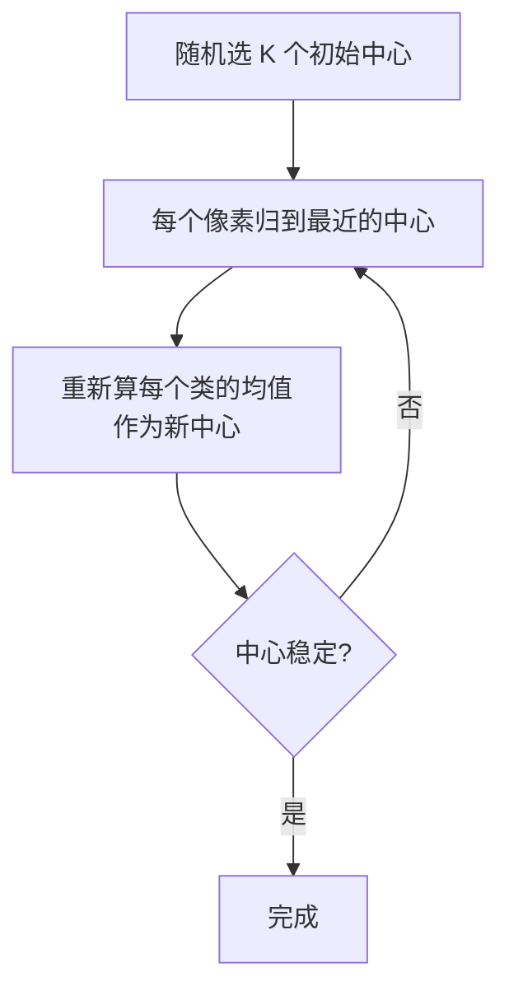
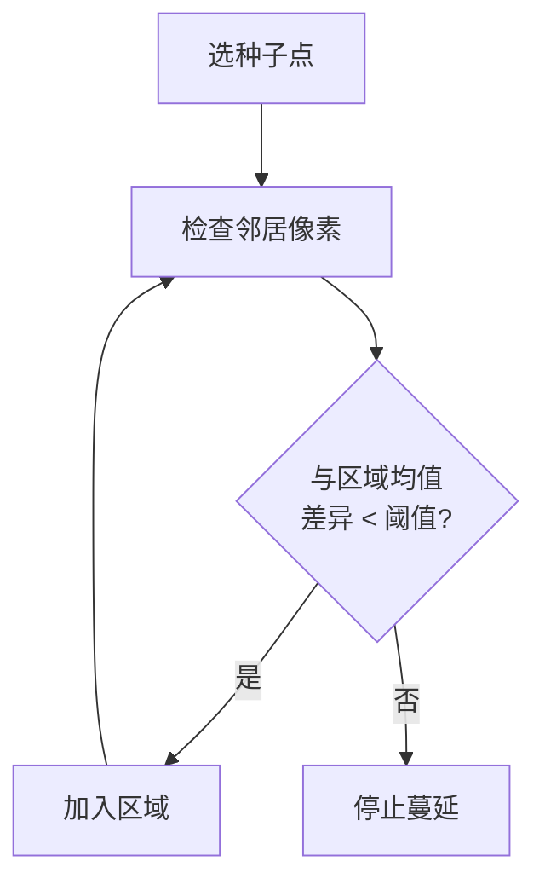
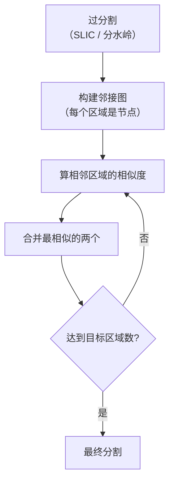
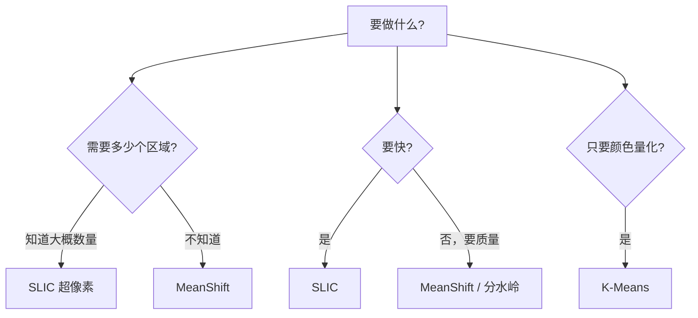

# 区域与聚类分割

> **一句话**：不看「单个像素的亮度」，而看「像素之间的关系」，把图像分成连贯的块。

## 为什么需要区域/聚类方法

**阈值法的局限**：只看像素值，不看位置。


**区域/聚类方法的优势**：**同时考虑颜色和空间位置**。

## ① K-Means 颜色聚类

### 思路

**把每个像素的 (R,G,B) 当成三维空间中的一个点，聚成 K 类**。


**生活比方**：把一盒彩笔按颜色分成 K 堆。分完每堆用一个代表色替换，就完成了"颜色量化"。

### 算法



### 代码

```python
def kmeans_segment(img, K=3):
    # 转成 float32 并展平
    Z = img.reshape((-1, 3)).astype(np.float32)

    # 停止条件：达到精度或最大迭代
    criteria = (cv2.TERM_CRITERIA_EPS + cv2.TERM_CRITERIA_MAX_ITER, 10, 1.0)

    # K-Means
    ret, labels, centers = cv2.kmeans(
        Z, K, None, criteria, 10,
        cv2.KMEANS_PP_CENTERS      # 用 kmeans++ 初始化（比随机好）
    )

    # 用中心色替换
    centers = np.uint8(centers)
    result = centers[labels.flatten()].reshape(img.shape)
    return result, labels.reshape(img.shape[:2]), centers
```

::: tip 为什么用 KMEANS_PP_CENTERS
**随机初始化可能落到很差的局部最优**（比如两个中心挤在一起）。

**kmeans++** 让初始中心尽量分散：第一个随机选，后续每个都按"距离已有中心越远概率越大"来选。

**代价几乎为零，效果明显更好**。
:::

### K 怎么选

| K 值 | 效果 |
|---|---|
| 2 | 前景/背景二分 |
| 3–5 | **常用范围** |
| 10+ | 过度细分，意义不大 |

**方法**：**看直方图有几个峰**，或**用肘部法（elbow method）**（画类内误差 vs K，找拐点）。

### K-Means 的局限

::: warning K-Means 的三个问题
1. **必须预先指定 K** —— 不知道有几个类时很难办
2. **只看颜色不看位置** —— 同色分散区域会被聚到一起
3. **对初始值敏感** —— 用 kmeans++ 缓解，但不彻底
4. **对噪声敏感** —— 用均值，离群值会拉偏中心
:::

**改进**：加上**空间坐标**作为额外维度。

```python
# 把 (x, y) 也加进去（需要归一化）
h, w = img.shape[:2]
ys, xs = np.mgrid[0:h, 0:w]
# 归一化空间坐标到 0-255 范围
features = np.stack([
    ys / h * 255,
    xs / w * 255,
    img[:, :, 0].astype(float),
    img[:, :, 1].astype(float),
    img[:, :, 2].astype(float)
], axis=2).reshape(-1, 5).astype(np.float32)
```

**代价**：维度上升，速度变慢。

## ② MeanShift（均值漂移）

### 思路

**每个像素沿着"密度梯度"向上移动，最终收敛到同一个峰值的像素归为一类**。


**生活比方**：一大群人，每个人往"周围人最密的方向"走，最后聚成几堆，每堆就是一个区域。

### 优势

| 优势 | 说明 |
|---|---|
| **不需要指定类数** | 自动决定 |
| **同时考虑颜色和空间** | 分割块连贯 |
| **边界自然** | 不产生锯齿 |
| 对光照渐变鲁棒 | 因为基于密度 |

### 代码

```python
# 简单用法：颜色平滑 + 分割
shifted = cv2.pyrMeanShiftFiltering(
    img,
    sp=10,      # 空间窗口半径
    sr=30,      # 颜色窗口半径
    maxLevel=1
)
```

### 参数

| 参数 | 含义 | 建议 | 影响 |
|---|---|---|---|
| `sp` | 空间半径 | 10–20 | 越大越连贯，越慢 |
| `sr` | 颜色半径 | 20–40 | 越大类越少，越平滑 |
| `maxLevel` | 金字塔层数 | 1–2 | 越大越快，越粗 |

::: tip 参数直觉
**`sp` 控制"空间上多远算相邻"**：太小红块碎裂，太大整个图糊成一块。

**`sr` 控制"颜色差多少算不同"**：
- 太小 → 分得很细（每个颜色梯度都成一块）
- 太大 → 所有相似颜色合并

**实践中**：`sp=10, sr=30` 是个不错的起点。
:::

### MeanShift 的性能

**Problem**：`pyrMeanShiftFiltering` **很慢**。

| 分辨率 | 耗时 |
|---|---|
| 320×240 | ~100 ms |
| 640×480 | ~400 ms |
| 1920×1080 | **~3 s** |

**解决**：
- **先降分辨率**处理，再上采样
- 或用 **SLIC 超像素**替代（快得多）

## ③ SLIC 超像素

### 思路

**把图像切成大小均匀、颜色相近的小块（超像素）**，作为后续处理的单位。


**SLIC 的三个特点**：

| 特点 | 说明 |
|---|---|
| **紧凑** | 超像素形状规则，不像 MeanShift 那样形状任意 |
| **均匀** | 每个超像素大小接近 |
| **快** | 线性复杂度 |

### 距离度量

SLIC 用的距离同时考虑颜色和空间：

$$ D = d_{color} + \frac{m}{S} d_{spatial} $$

| 符号 | 含义 |
|---|---|
| $d_{color}$ | 颜色（Lab 空间）距离 |
| $d_{spatial}$ | 空间距离 |
| $S$ | 超像素的期望边长 |
| **$m$** | **紧凑度参数**（关键） |

**`m` 的作用**：

| m | 效果 |
|---|---|
| 小（1–5） | 超像素形状不规则，**紧贴边界** |
| 中（10） | 平衡 |
| 大（20+） | 超像素方正，**不贴边界** |

**生活比方**：`m` 决定"超像素是追求形状方正，还是追求颜色一致"。

### 代码

```python
from skimage.segmentation import slic, mark_boundaries
from skimage import img_as_float

image = img_as_float(img)
segments = slic(
    image,
    n_segments=200,       # 期望的超像素数量
    compactness=10,       # m 参数
    sigma=1,              # 预处理高斯 sigma
    start_label=0
)

# 可视化
boundaries = mark_boundaries(image, segments)
```

::: warning OpenCV 里没有 SLIC
**SLIC 在 OpenCV 的 `ximgproc` 扩展模块里**（需要 `opencv-contrib-python`）：

```python
import cv2
slic = cv2.ximgproc.createSuperpixelSLIC(img, algorithm=cv2.ximgproc.SLIC, region_size=20, ruler=10)
slic.iterate(10)
labels = slic.getLabels()
```

**不想装 contrib 就用 `skimage`**（如上代码）。
:::

### 用途

| 用途 | 说明 |
|---|---|
| **加速后续处理** | 200 个超像素 vs 200 万像素 |
| **分割预处理** | 在超像素图上做区域合并 |
| **显著性检测** | 每个超像素算一个特征 |
| **弱监督标注** | 标注超像素而非像素 |

## ④ 区域生长

### 思路

**从种子点开始，不断把"跟当前区域相似"的邻居像素加进来**。



**生活比方**：在图上滴一滴水，水沿着**颜色相近**的地方蔓延开，遇到颜色突变就停下。

### 关键问题

| 问题 | 说明 |
|---|---|
| **种子怎么选** | 手动 / 自动（局部极小值 / 网格） |
| **相似度判据** | 与**种子**比，还是与**区域均值**比？（后者更好） |
| **连通性** | 4 邻域 or 8 邻域 |

### 代码（简易实现）

```python
def region_grow(img, seed, threshold=15):
    h, w = img.shape[:2]
    visited = np.zeros((h, w), bool)
    region = np.zeros((h, w), np.uint8)

    # 用队列做广度优先
    from collections import deque
    q = deque([seed])
    visited[seed] = True
    seed_val = float(img[seed])

    while q:
        y, x = q.popleft()
        region[y, x] = 255

        for dy, dx in [(-1,0), (1,0), (0,-1), (0,1)]:
            ny, nx = y + dy, x + dx
            if 0 <= ny < h and 0 <= nx < w and not visited[ny, nx]:
                if abs(float(img[ny, nx]) - seed_val) < threshold:
                    visited[ny, nx] = True
                    q.append((ny, nx))

    return region
```

::: warning 这种朴素实现的问题
**现象**：从亮区生长，遇到一个稍暗的过渡像素就停下来了。

**根因**：用"与种子值比较"。如果区域内部有渐变，靠边的像素会逐渐偏离种子值。

**解决**：用"与**当前区域均值**比较"，让判据跟着区域演化。

**更好的方法**：用**区域邻接图（RAG）合并**算法，全局考虑区域相似度。
:::

## ⑤ 区域邻接图合并（RAG）

### 思路

**先过分割**（切成很多小块），然后**按相似度逐步合并**。



**这是"自底向上"的分割思路**，和区域生长的"自顶向下"不同。

**优势**：不用选种子点，全自动。

## 四种方法对比

| 维度 | K-Means | MeanShift | SLIC | 区域生长 |
|---|---|---|---|---|
| 需指定类数 | ✅ 需要 K | ❌ 不需要 | ✅ 需要（数量） | ❌ 不需要 |
| 考虑空间 | ❌（除非加坐标） | ✅ | ✅ | ✅ |
| 速度 | 快 | **很慢** | **快** | 中 |
| 块连贯性 | 差 | **好** | **好** | 好 |
| 形状规则 | — | 任意 | **紧凑** | 任意 |
| 主要用途 | 颜色量化 | 分割 | **加速预处理** | 交互式分割 |

## 选型决策



## 常见踩坑

::: danger 坑 1：K-Means 忘了转 float32
**现象**：`cv2.kmeans` 报错 `Unsupported depth`。

**解决**：

```python
Z = img.reshape((-1, 3)).astype(np.float32)      # ✅ 必须 float32
```
:::

::: danger 坑 2：MeanShift 太慢
**现象**：1080p 图跑 MeanShift 要几秒。

**解决**：
- **先降采样到 480p 或更小**
- 处理完后**用最近邻上采样**类别标签
- 或用 **SLIC 替代**（快 10–50 倍）
:::

::: danger 坑 3：K-Means 结果每次不一样
**现象**：同样的图跑两次，结果不同。

**根因**：**随机初始化**。

**解决**：
- 用 `cv2.KMEANS_PP_CENTERS`（kmeans++）
- 或设 `cv2.setRNGSeed(0)` 固定随机种子

```python
cv2.setRNGSeed(42)
```
:::

::: danger 坑 4：SLIC 的 `n_segments` 含义被误解
**现象**：设了 `n_segments=200` 但得到 250 个区域。

**说明**：`n_segments` 是**期望数量**，实际可能略有偏差（因为按网格划分后再迭代）。

**同时**，`compactness` 大时超像素更方正，数量更接近设定值。
:::

::: danger 坑 5：区域生长从"过亮"的点开始
**现象**：生长出来的区域是整个亮区，包含了不该有的部分。

**解决**：**种子的选择很关键**。多选几个种子，每个独立生长，然后合并。
:::

## 与深度学习的衔接

| 传统方法 | 现状 |
|---|---|
| **SLIC 超像素** | **仍在用**（加速、弱监督、显著性） |
| K-Means 颜色量化 | 仍用（图像压缩、风格化） |
| MeanShift | 少用（太慢），但思想保留 |
| 区域生长 | 交互式分割中用 |
| RAG 合并 | 思想被 Region Proposal 继承 |

::: tip 一个有意思的传承
**RAG（区域邻接图）合并的思想，在深度学习的"区域提议网络（RPN）"里有回声**：

先过分割 → 再按相似度合并 → 得到候选区域。

只不过深度学习用**学习到的特征**判断"该不该合并"。
:::

## 相关链接

- [④ 图像分割分支](/branches/segmentation/)
- [交互式分割（GrabCut）](/branches/segmentation/interactive)
- [滤波与卷积](/branches/image-processing/filtering)
- [返回图像分割分支](/branches/segmentation/)
