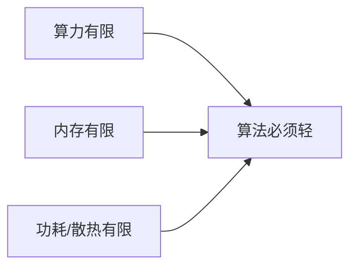
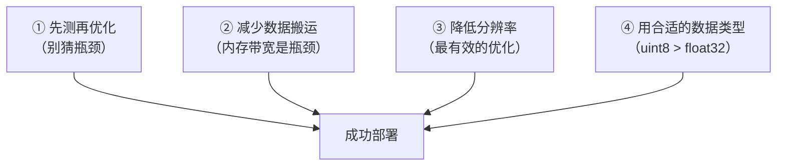
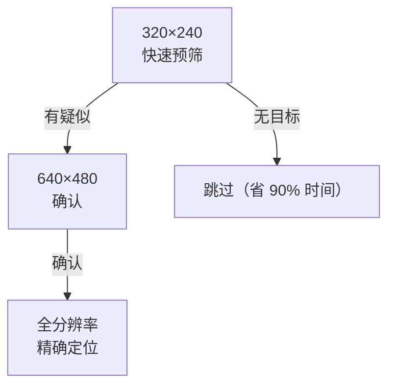
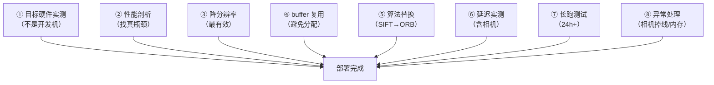

# 案例：嵌入式边缘部署

> **场景**：把传统 CV 算法部署到只有几百 MB 内存、没有 GPU 的设备上，还要跑 30 fps。

## 目标设备画像

| 设备 | CPU | 内存 | GPU | 典型场景 |
|---|---|---|---|---|
| **树莓派 5** | 4×A76 2.4GHz | 4–8 GB | 有（弱） | 门禁、宠物识别 |
| **瑞芯微 RK3588** | 4×A76 + 4×A55 | 4–16 GB | NPU 6 TOPS | 边缘盒子 |
| **ESP32-CAM** | 单核 240MHz | **520 KB** | 无 | 极简识别 |
| **Jetson Nano** | 4×A57 | 4 GB | 128 核 GPU | 小型 AI 设备 |
| **工控机** | i5/i7 | 8–16 GB | 无 | 产线检测 |

**共性约束**：



## 核心原则



| 原则 | 说明 |
|---|---|
| **先测再优化** | **别凭直觉猜哪里慢** |
| **降分辨率优先** | 从 1080p → 480p，**计算量降 5 倍** |
| **少拷贝** | 每次 `.copy()` / `cvtColor` 都是内存带宽成本 |
| **用整数运算** | `uint8` 比 `float32` 快 2–4 倍 |
| **避免动态分配** | 循环内不创建新数组（复用 buffer） |

## ① 必做的性能剖析

```python
import time
import numpy as np

class Profiler:
    """朴素但有效的性能剖析器"""
    def __init__(self):
        self.records = {}

    def __call__(self, name):
        return _Timer(self, name)

    def report(self):
        print(f"{'环节':<20} {'中位(ms)':>10} {'P99(ms)':>10} {'占比':>8}")
        print("-" * 52)
        total = sum(np.median(v) for v in self.records.values())
        for name, times in sorted(self.records.items(),
                                  key=lambda x: -np.median(x[1])):
            med = np.median(times)
            p99 = np.percentile(times, 99)
            print(f"{name:<20} {med:>10.2f} {p99:>10.2f} {med/total*100:>7.1f}%")
        print("-" * 52)
        print(f"{'总计':<20} {total:>10.2f}")


class _Timer:
    def __init__(self, profiler, name):
        self.profiler = profiler
        self.name = name

    def __enter__(self):
        self.t0 = time.perf_counter()
        return self

    def __exit__(self, *args):
        dt = (time.perf_counter() - self.t0) * 1000
        self.profiler.records.setdefault(self.name, []).append(dt)


# 使用
prof = Profiler()

for _ in range(200):
    with prof('cvtColor'):
        gray = cv2.cvtColor(frame, cv2.COLOR_BGR2GRAY)
    with prof('blur'):
        blurred = cv2.GaussianBlur(gray, (5, 5), 1.5)
    with prof('canny'):
        edges = cv2.Canny(blurred, 50, 150)

prof.report()
```

**典型输出**：

```
环节                     中位(ms)    P99(ms)      占比
----------------------------------------------------
cvtColor                   3.21       4.10      45.2%
canny                      2.87       3.65      40.4%
blur                       1.02       1.35      14.4%
----------------------------------------------------
总计                       7.10
```

**发现**：**`cvtColor` 竟然是最大开销！**（很多人会以为 Canny 最慢）

**这告诉我们**：**必须测**。

::: tip 常见"意外"瓶颈
| 环节 | 为什么慢 |
|---|---|
| **`cvtColor`** | 全图内存读写（带宽受限） |
| **`medianBlur`** | 排序算法，大核时极慢 |
| **`bilateralFilter`** | 每个像素非线性计算 |
| **`warpAffine`** | 插值 + 随机访问 |
| **`np.astype(np.float32)`** | 全图类型转换 |
| **`.copy()`** | 整块内存复制 |

**这些"看起来便宜"的操作，在边缘设备上常常是瓶颈**。
:::

## ② 降低分辨率（最有效的优化）

**计算量大致与像素数成正比**：

| 分辨率 | 像素数 | 相对计算量 |
|---|---|---|
| 1920×1080 | 2.07 M | **4.5×** |
| 1280×720 | 0.92 M | 2.0× |
| **640×480** | **0.31 M** | **1.0×** |
| 320×240 | 0.077 M | 0.25× |

```python
# 策略：处理用低分辨率，输出用原分辨率
def process_pipeline(frame, scale=0.5):
    h, w = frame.shape[:2]

    # ① 降采样处理
    small = cv2.resize(frame, (int(w*scale), int(h*scale)),
                       interpolation=cv2.INTER_AREA)

    # ② 在低分辨率上做检测
    gray = cv2.cvtColor(small, cv2.COLOR_BGR2GRAY)
    boxes_small = detect(gray)

    # ③ 坐标映射回原图
    boxes = [(int(x/scale), int(y/scale), int(bw/scale), int(bh/scale))
             for x, y, bw, bh in boxes_small]

    # ④ 在原分辨率上画框输出
    for x, y, bw, bh in boxes:
        cv2.rectangle(frame, (x, y), (x+bw, y+bh), (0, 255, 0), 2)

    return frame, boxes
```

::: tip 降采样要用 `INTER_AREA`
**缩小图像时，`INTER_AREA` 的效果最好**（它是区域平均，等价于低通滤波 + 采样）。

| 插值方式 | 缩小时效果 |
|---|---|
| `INTER_NEAREST` | 差（混叠） |
| `INTER_LINEAR` | 中 |
| **`INTER_AREA`** | **最好**（抗混叠） |
| `INTER_CUBIC` | 好但慢 |

**放大时反过来用 `INTER_LINEAR` 或 `INTER_CUBIC`**。
:::

### 多级分辨率策略



**效果**：**大部分帧在最低级就"无目标"跳过**，平均耗时大幅下降。

## ③ 减少内存拷贝

```python
# ❌ 慢：多次隐式拷贝
def slow(img):
    gray = cv2.cvtColor(img, cv2.COLOR_BGR2GRAY)      # 新分配
    gray2 = gray.copy()                                # 新分配
    blur = cv2.GaussianBlur(gray2, (5,5), 0)          # 新分配
    return blur

# ✅ 快：复用 buffer
class BufferPool:
    def __init__(self, shape):
        self.gray = np.empty(shape[:2], dtype=np.uint8)
        self.tmp = np.empty(shape[:2], dtype=np.uint8)

    def process(self, img):
        cv2.cvtColor(img, cv2.COLOR_BGR2GRAY, dst=self.gray)   # 写入已有 buffer
        cv2.GaussianBlur(self.gray, (5,5), 0, dst=self.tmp)
        return self.tmp
```

**`dst=` 参数能避免内存分配**：

```python
# OpenCV 大部分函数支持 dst 参数
cv2.cvtColor(src, code, dst=dst)
cv2.GaussianBlur(src, ksize, sigmaX, dst=dst)
cv2.Canny(src, t1, t2, dst=dst)
cv2.resize(src, dsize, dst=dst)
cv2.absdiff(src1, src2, dst=dst)
```

**边缘设备上，避免分配的效果可以达到 20–40% 加速**。

## ④ 数据类型优化

| 类型 | 内存/像素 | 速度 |
|---|---|---|
| **`np.uint8`** | 1 B | **最快** |
| `np.int16` | 2 B | 中 |
| `np.float32` | 4 B | 慢（2–4×） |
| `np.float64` | 8 B | 最慢 |

```python
# ❌ 慢：全图转 float
gray_f = gray.astype(np.float32)
result = gray_f * 1.5

# ✅ 快：用整数运算（等效于乘 1.5）
result = cv2.convertScaleAbs(gray, alpha=1.5, beta=0)

# ✅ 或者用查找表（LUT）
lut = np.clip(np.arange(256) * 1.5, 0, 255).astype(np.uint8)
result = cv2.LUT(gray, lut)
```

::: tip 查找表（LUT）是免费加速
**任何"逐像素的单调映射"都可以用 LUT**：

```python
lut = np.clip(np.arange(256) * 1.2 + 10, 0, 255).astype(np.uint8)
out = cv2.LUT(gray, lut)
```

**适用**：亮度调整、对比度拉伸、Gamma 校正、二值化查询。

**速度**：**只要一次查表，比浮点运算快好几倍**。
:::

## ⑤ 算法层面的优化

### 用更便宜的等价算法

| 昂贵操作 | 便宜替代 | 代价 |
|---|---|---|
| `bilateralFilter` | `medianBlur(3)` | 边缘保持略差 |
| `GaussianBlur(大核)` | 两次小核 或 `boxFilter` | 近似高斯 |
| `matchTemplate` 全搜索 | 金字塔粗到细 | 可能漏检 |
| `HoughLines` | LSD / 快速霍夫 | 参数调整 |
| 稠密光流 | **稀疏 LK** | 只有稀疏流 |
| SIFT | **ORB** | 精度略降，**快 10×** |
| `cornerHarris` | `goodFeaturesToTrack` | 类似 |

::: tip `cv2.medianBlur` 的 O(1) 特性
**`medianBlur` 用 `blockSize` 很大时极慢**（O(n·k²)）。

**但 OpenCV 对 `blockSize ≤ 5` 有特殊优化**（直方图滑动，O(1) per pixel）。

**所以**：

- `medianBlur(img, 3)` 或 `medianBlur(img, 5)` → **快**
- `medianBlur(img, 7)` 及以上 → **慢几十倍**

**如果要大核中值滤波，考虑用形态学替代**。
:::

### 用形态学替代卷积

```python
# 想"取局部最小值"（如暗点检测）
# ❌ 慢：排序窗口
# ✅ 快：形态学腐蚀
dark_spots = cv2.erode(gray, np.ones((5,5), np.uint8))

# 想"取局部最大值"（如亮点检测）
bright_spots = cv2.dilate(gray, np.ones((5,5), np.uint8))
```

**形态学是"可分离的"**（矩形核可拆成横竖两次），**极快**。

### 积分图（快速区域统计）

**任何"矩形区域求和"都可以 O(1)**：

```python
integral = cv2.integral(gray)       # 积分图

def rect_sum(integral, x, y, w, h):
    """O(1) 求矩形区域的和"""
    return (integral[y+h, x+w] - integral[y, x+w]
            - integral[y+h, x] + integral[y, x])

def rect_mean(integral, x, y, w, h):
    return rect_sum(integral, x, y, w, h) / (w * h)
```

**这就是 Haar 特征（Viola-Jones 人脸检测）能实时的关键**。

## ⑥ 多线程与流水线


```python
import threading
import queue

class Pipeline:
    def __init__(self, process_fn, maxsize=3):
        self.q_in = queue.Queue(maxsize=maxsize)
        self.q_out = queue.Queue(maxsize=maxsize)
        self.process_fn = process_fn
        self.running = True

        self.t_worker = threading.Thread(target=self._worker, daemon=True)
        self.t_worker.start()

    def _worker(self):
        while self.running:
            try:
                frame = self.q_in.get(timeout=0.1)
            except queue.Empty:
                continue
            result = self.process_fn(frame)
            try:
                self.q_out.put(result, timeout=0.1)
            except queue.Full:
                pass

    def submit(self, frame):
        try:
            self.q_in.put_nowait(frame)
        except queue.Full:
            pass        # 丢帧（实时系统应该丢帧而不是卡住）

    def get_result(self):
        try:
            return self.q_out.get_nowait()
        except queue.Empty:
            return None
```

::: tip 实时系统的关键：**丢帧而不是卡住**
**队列满了应该丢帧**（`put_nowait` 抛异常就忽略）。

**为什么**：

- **卡住 = 延迟无限增长**（画面越来越滞后）
- **丢帧 = 保持实时**（画面永远是最新的）

**这是实时视觉系统的铁律**。
:::

### 利用 OpenCV 内置多线程

```python
# OpenCV 默认用多线程（内部用 TBB/OpenMP）
cv2.setNumThreads(4)        # 限制线程数（避免和主程序抢）

# ❌ 过度并发反而变慢（线程切换开销）
cv2.setNumThreads(0)        # 0 = 禁用多线程（有时更快）
```

**实测建议**：**在单帧延迟敏感的场景，试试 `setNumThreads(0)`**——多核并行在贵操作上收益明显，但在小图上线程开销更大。

## ⑦ 模型/数据文件优化

| 项 | 优化 |
|---|---|
| 模板图 | **降分辨率存储**（匹配时不需要高精度） |
| 特征库 | **用二进制格式**（不要 JSON/CSV） |
| SVM 模型 | 转成 **`.xml`/`.bin`**（OpenCV 原生格式） |
| 查找表 | 预计算后存文件，**启动时加载** |

```python
# SVM 模型存储（比 pickle 快且跨平台）
svm.save('model.xml')
svm = cv2.ml.SVM_load('model.xml')

# numpy 数组存储
np.save('features.npy', features)       # 比 CSV 快 10×
features = np.load('features.npy')
```

## ⑧ 一份完整的最小示例

```python
"""
嵌入式车牌区域检测（轻量版）
- 输入：摄像头 640×480 灰度
- 输出：车牌框
- 目标：树莓派 4 上 > 25 fps
"""
import cv2
import numpy as np
import time

class PlateDetector:
    def __init__(self):
        self.gray = None
        self.blur = None
        self.sobel_x = None
        self.morph = None

        # 初始化时分配 buffer（避免运行时分配）
        self.kernel_h = cv2.getStructuringElement(cv2.MORPH_RECT, (17, 5))
        self.kernel_v = cv2.getStructuringElement(cv2.MORPH_RECT, (5, 17))

    def _ensure_buffers(self, shape):
        """确保 buffer 尺寸匹配（只在尺寸变化时分配）"""
        if self.gray is None or self.gray.shape != shape:
            self.gray = np.empty(shape, dtype=np.uint8)
            self.blur = np.empty(shape, dtype=np.uint8)
            self.sobel_x = np.empty(shape, dtype=np.uint8)
            self.morph = np.empty(shape, dtype=np.uint8)

    def detect(self, frame):
        h, w = frame.shape[:2]
        self._ensure_buffers((h, w))

        # ① 灰度（写入已有 buffer）
        cv2.cvtColor(frame, cv2.COLOR_BGR2GRAY, dst=self.gray)

        # ② 轻量模糊
        cv2.blur(self.gray, (3, 3), dst=self.blur)

        # ③ Sobel 水平边缘（车牌是垂直线密集区）
        sobel = cv2.Sobel(self.blur, cv2.CV_16S, 1, 0, ksize=3)
        cv2.convertScaleAbs(sobel, dst=self.sobel_x, alpha=1, beta=0)

        # ④ 二值化
        _, binary = cv2.threshold(self.sobel_x, 0, 255,
                                  cv2.THRESH_BINARY + cv2.THRESH_OTSU)

        # ⑤ 形态学：先闭后开（连接字符 + 去噪）
        closed = cv2.morphologyEx(binary, cv2.MORPH_CLOSE, self.kernel_h)
        cleaned = cv2.morphologyEx(closed, cv2.MORPH_OPEN, self.kernel_h)

        # ⑥ 找轮廓 + 筛选
        contours, _ = cv2.findContours(cleaned, cv2.RETR_EXTERNAL,
                                       cv2.CHAIN_APPROX_SIMPLE)
        plates = []
        for cnt in contours:
            x, y, bw, bh = cv2.boundingRect(cnt)
            ar = bw / float(bh)
            area = bw * bh
            # 车牌宽高比 2.5–5.5，面积不能太小
            if 2.5 < ar < 5.5 and area > 500:
                plates.append((x, y, bw, bh))

        return plates


def main():
    cap = cv2.VideoCapture(0)
    cap.set(cv2.CAP_PROP_FRAME_WIDTH, 640)
    cap.set(cv2.CAP_PROP_FRAME_HEIGHT, 480)
    cap.set(cv2.CAP_PROP_FPS, 30)

    detector = PlateDetector()

    fps_times = []
    while True:
        t0 = time.perf_counter()

        ret, frame = cap.read()
        if not ret:
            break

        plates = detector.detect(frame)

        for x, y, w, h in plates:
            cv2.rectangle(frame, (x, y), (x+w, y+h), (0, 255, 0), 2)

        # 显示 FPS
        dt = time.perf_counter() - t0
        fps_times.append(dt)
        if len(fps_times) > 30:
            fps_times.pop(0)
        fps = 1.0 / (np.mean(fps_times) + 1e-6)
        cv2.putText(frame, f"FPS: {fps:.1f}", (10, 30),
                    cv2.FONT_HERSHEY_SIMPLEX, 0.7, (0, 0, 255), 2)

        cv2.imshow('Plate Detection', frame)
        if cv2.waitKey(1) & 0xFF == ord('q'):
            break

    cap.release()
    cv2.destroyAllWindows()


if __name__ == '__main__':
    main()
```

## 常见踩坑

::: danger 坑 1：在开发机上"跑得很快"
**现象**：在 i7 上跑 5 ms，移植到树莓派上 200 ms。

**根因**：**i7 有 AVX2/AVX512 SIMD，树莓派只有 NEON，且主频低得多**。

**解决**：

- **一定要在目标硬件上测**
- 用 **`cv2.getBuildInformation()`** 检查 SIMD 支持

```python
info = cv2.getBuildInformation()
# 查找 CPU_DISPATCH / SIMD 相关行
for line in info.split('\n'):
    if 'SIMD' in line or 'NEON' in line or 'AVX' in line:
        print(line)
```

::: tip 树莓派上编译优化版 OpenCV
**默认 `pip install opencv-python` 在树莓派上是通用版本**（无 NEON 优化）。

**想榨性能**：**自己编译**，加上：

```
-D ENABLE_NEON=ON
-D ENABLE_VFPV3=ON
-D CMAKE_BUILD_TYPE=RELEASE
-D WITH_TBB=ON
```

**实测可提升 2–3×**（代价是编译要几小时）。
:::

::: danger 坑 2：忘了 `setNumThreads` 的影响
**现象**：多线程环境下更慢了。

**根因**：**OpenCV 内部多线程 + 你的多线程 → 线程超订（oversubscription）**。

**解决**：

```python
# 你已经用了多线程，就限制 OpenCV 内部线程
cv2.setNumThreads(1)

# 或者只用 OpenCV 的内部多线程
cv2.setNumThreads(4)
```
:::

::: danger 坑 3：在循环里创建 numpy 数组
**现象**：跑几小时后内存耗尽，或者 GC 停顿明显。

**根因**：**每帧创建多个大数组**。

**解决**：**在循环外分配，循环内复用**（见上文 BufferPool）。
:::

::: danger 坑 4：用 JPEG 编码做实时输出
**现象**：FPS 上不去。

**根因**：**JPEG 编码很贵**（特别是高质量时）。

**解决**：

- **降低 JPEG 质量**（`cv2.IMWRITE_JPEG_QUALITY` 设 70）
- **降低输出分辨率**
- **用 MJPEG 流**（相机端编码）
- **只在需要时编码**（如根本没变化就跳过）

```python
encode_param = [int(cv2.IMWRITE_JPEG_QUALITY), 70]
_, buf = cv2.imencode('.jpg', frame, encode_param)     # 70 质量
```
:::

::: danger 坑 5：忽视了相机本身的延时
**现象**：算法 5 ms，但端到端延迟 100 ms。

**根因**：**相机缓冲**（`CAP_PROP_BUFFERSIZE`）。

**解决**：

```python
cap = cv2.VideoCapture(0)
cap.set(cv2.CAP_PROP_BUFFERSIZE, 1)     # 只缓存 1 帧（最小延迟）
```

**并且**：**用硬件触发而不是软件轮询**（在产线场景）。

**先测端到端延迟，别只测算法时间**。
:::

::: danger 坑 6：SSD 卡 / 存储寿命
**现象**：设备跑几个月后 SD 卡坏了。

**根因**：**持续写日志/图片到 SD 卡**。

**解决**：

- **用 tmpfs / RAM disk** 存临时文件
- **限制日志大小**（滚动日志）
- **只在异常时存图**
- **用工业级 SD 卡**（或 eMMC）
:::

## 部署清单



| 检查项 | 目标 |
|---|---|
| 单帧耗时 | < 33 ms（30fps） |
| **P99 耗时** | **< 50 ms**（抖动量） |
| 内存占用 | 稳定（**不增长**） |
| CPU 占用 | < 70%（留余量） |
| 端到端延迟 | < 100 ms |
| 长跑 | 24 h 无异常 |

::: tip 必须做 24 小时长跑测试
**短时间测试永远发现不了**：

- **内存泄漏**（缓慢增长）
- **发热降频**（跑热了变慢）
- **相机漂移**（自动曝光/白平衡慢慢跑偏）
- **时序问题**（偶发的队列溢出）

**24 小时是底线**（最好 72 小时）。
:::

## 相关链接

- [传统检测分支](/branches/detection/)
- [工业缺陷检测案例](/cases/industrial-defect)
- [特征匹配：ORB](/branches/feature-matching/descriptors)
- [返回案例索引](/cases/)
