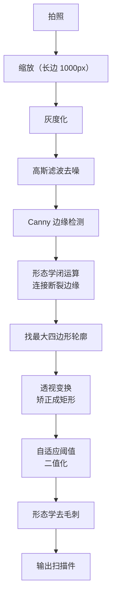
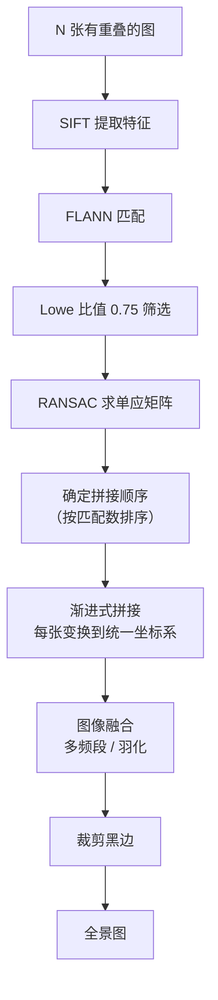
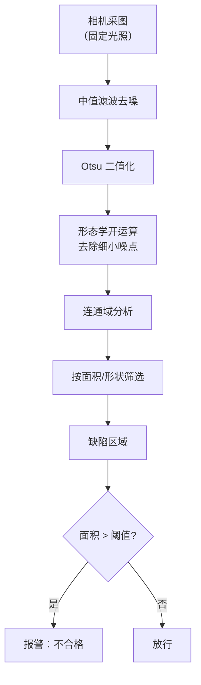
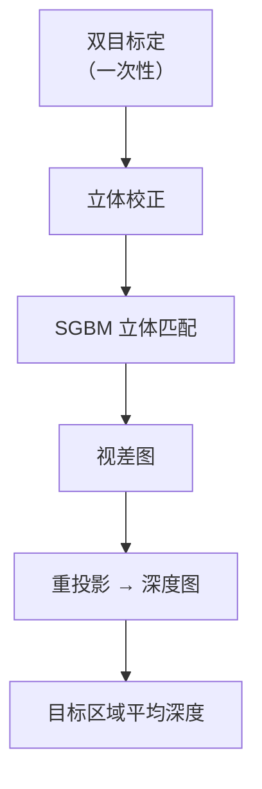
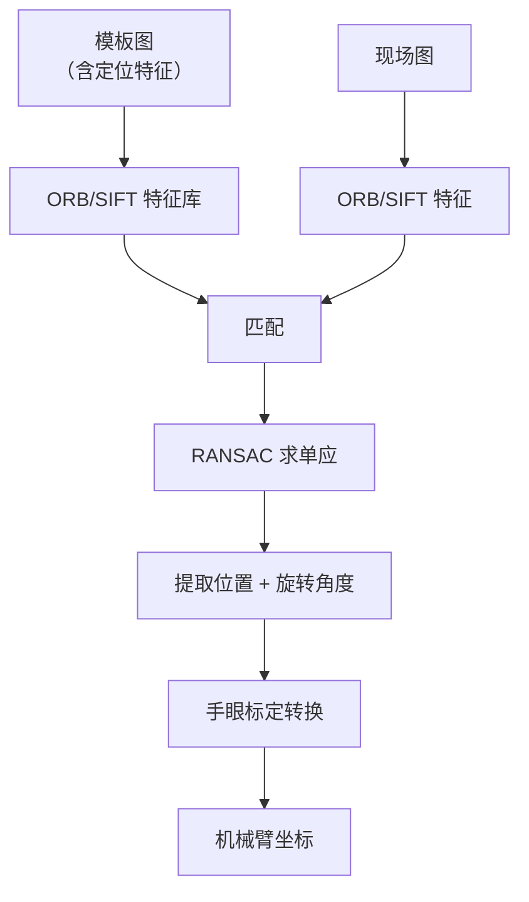
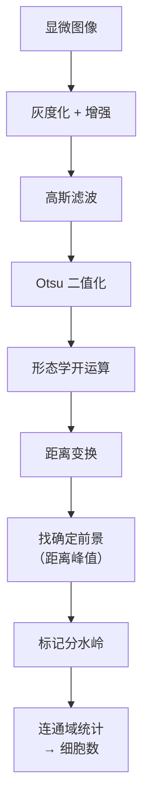
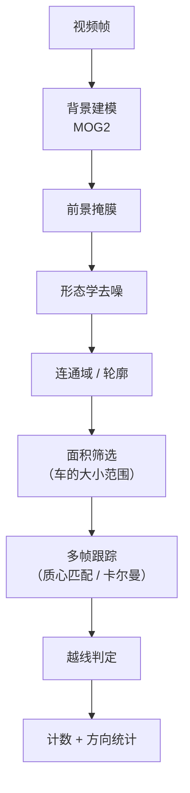
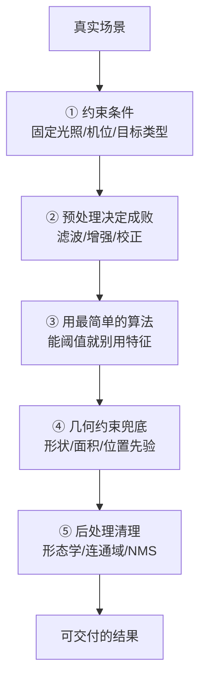

# 实战案例

> 每个案例都是**完整可跑的工程流程**，从输入图像到最终结果，包含参数选择、踩坑与优化。全部基于传统 CV，**无需 GPU**。

## 案例索引

| # | 案例 | 涉及分支 | 难度 | 典型算力 |
|---|---|---|---|---|
| 1 | [文档扫描仪](#案例-1文档扫描仪) | ①④ | ⭐ | 手机可跑 |
| 2 | [全景图拼接](#案例-2全景图拼接) | ②③ | ⭐⭐⭐ | CPU 秒级 |
| 3 | [行人检测监控](#案例-3行人检测监控) | ⑤ | ⭐⭐ | CPU 可实时 |
| 4 | [工业缺陷检测](#案例-4工业缺陷检测) | ①④ | ⭐⭐ | 嵌入式可跑 |
| 5 | [双目测距](#案例-5双目测距) | ⑥ | ⭐⭐⭐⭐ | CPU 可实时 |
| 6 | [视觉定位抓取](#案例-6视觉定位抓取) | ②③⑥ | ⭐⭐⭐ | 实时 |
| 7 | [细胞计数](#案例-7细胞计数) | ①④ | ⭐⭐⭐ | CPU 秒级 |
| 8 | [交通视频车流量统计](#案例-8交通视频车流量统计) | ①④⑤ | ⭐⭐⭐ | CPU 可实时 |

---

## 案例 1：文档扫描仪

> 用手机拍一张倾斜、光照不均的纸质文档，把它变成**方正、干净的黑白扫描件**。

### 完整流程



### 关键技术点

**① 找文档轮廓**

```python
# 用面积最大的四边形轮廓
contours, _ = cv2.findContours(closed, cv2.RETR_EXTERNAL, cv2.CHAIN_APPROX_SIMPLE)
for c in sorted(contours, key=cv2.contourArea, reverse=True)[:5]:
    peri = cv2.arcLength(c, True)
    approx = cv2.approxPolyDP(c, 0.02 * peri, True)
    if len(approx) == 4:      # 找到四边形
        doc_contour = approx
        break
```

**② 透视校正**

```python
def order_points(pts):
    """把四个点排成：左上、右上、右下、左下"""
    rect = np.zeros((4, 2), dtype="float32")
    s = pts.sum(axis=1)
    rect[0] = pts[np.argmin(s)]     # 左上（和最小）
    rect[2] = pts[np.argmax(s)]     # 右下（和最大）
    diff = np.diff(pts, axis=1)
    rect[1] = pts[np.argmin(diff)]  # 右上（差最小）
    rect[3] = pts[np.argmax(diff)]  # 左下（差最大）
    return rect

rect = order_points(doc_contour.reshape(4, 2))
(tl, tr, br, bl) = rect

# 计算目标尺寸（宽取上下边最大值，高取左右边最大值）
width = max(np.linalg.norm(br - bl), np.linalg.norm(tr - tl))
height = max(np.linalg.norm(tr - br), np.linalg.norm(tl - bl))

dst = np.array([[0, 0], [width-1, 0], [width-1, height-1], [0, height-1]], dtype="float32")
M = cv2.getPerspectiveTransform(rect, dst)
warped = cv2.warpPerspective(img, M, (int(width), int(height)))
```

见 [① 图像处理分支](/branches/image-processing/) 与 [④ 图像分割分支](/branches/segmentation/)。

### 参数速查

| 环节 | 参数 | 建议 |
|---|---|---|
| 缩放 | 长边 | 1000 px（平衡速度与精度） |
| 高斯滤波 | ksize | (5, 5) |
| Canny | 阈值 | 75, 200 |
| 形态学 | 核 | 5×5，闭运算 |
| 自适应阈值 | blockSize, C | 11, 2 |

### 踩过的坑

::: danger 坑 1：边缘检测不到完整文档轮廓
**现象**：文档放在深色桌面上，角落边缘弱，Canny 断裂。

**解决**：
- 先**提高对比度**（CLAHE）
- 用**形态学闭运算**连接断裂（核 5×5 或 7×7）
- 换用**颜色/亮度差**找轮廓（文档区域通常整体更亮）
:::

::: danger 坑 2：拍到了多余背景
**现象**：除文档外，桌面上还有另一张纸，被误认为文档。

**解决**：按**面积最大**优先；若两张纸都很大，加入**长宽比约束**（文档接近 A4 的 1:1.414）。
:::

::: danger 坑 3：二值化后文字断裂
**现象**：自适应阈值的 `blockSize` 太小，笔画中间被挖空。

**解决**：`blockSize` 加大到 15–25；或先做**背景光照估计**（大核高斯模糊后相除）。
:::

::: tip 为什么不用深度学习
**文档扫描是规则性极强的任务**（文档是四条边的四边形）。传统方法：

- 不需要训练数据
- 不需要 GPU
- 在手机上就能实时跑
:::

---

## 案例 2：全景图拼接

> 手机水平扫一圈拍 N 张有重叠的照片，拼成一张超宽全景图。

### 完整流程



### 核心代码

```python
def stitch_pair(img1, img2):
    sift = cv2.SIFT_create(nfeatures=2000)
    kp1, des1 = sift.detectAndCompute(img1, None)
    kp2, des2 = sift.detectAndCompute(img2, None)

    flann = cv2.FlannBasedMatcher(dict(algorithm=1, trees=5), dict(checks=50))
    raw = flann.knnMatch(des1, des2, k=2)

    # Lowe 比值法
    good = [m for m, n in raw if m.distance < 0.75 * n.distance]
    if len(good) < 10:
        return None

    src = np.float32([kp1[m.queryIdx].pt for m in good]).reshape(-1, 1, 2)
    dst = np.float32([kp2[m.trainIdx].pt for m in good]).reshape(-1, 1, 2)

    # RANSAC 求单应矩阵
    H, mask = cv2.findHomography(src, dst, cv2.RANSAC, 5.0)

    # 把两图变换到同一画布
    h1, w1 = img1.shape[:2]
    h2, w2 = img2.shape[:2]
    canvas_w = w1 + w2
    canvas_h = max(h1, h2)

    # 平移 img2 到画布右侧
    T = np.array([[1, 0, w1], [0, 1, 0], [0, 0, 1]], dtype=np.float64)
    warped = cv2.warpPerspective(img1, T @ H, (canvas_w, canvas_h))
    warped[0:h2, w1:w1+w2] = img2     # 叠加原图

    return warped
```

### 融合方式对比

| 方式 | 效果 | 复杂度 |
|---|---|---|
| 直接覆盖 | 有明显接缝 | 极低 |
| **线性羽化** | 接缝淡化 | 低 |
| 多频段融合 | **几乎无缝** | 高 |
| 简单平均 | 有鬼影 | 极低 |

**线性羽化的实现**：

```python
def blend_linear(img1, img2, overlap_w):
    """在重叠区域做线性过渡"""
    alpha = np.linspace(0, 1, overlap_w)[None, :, None]
    blended = img1[:, -overlap_w:] * (1 - alpha) + img2[:, :overlap_w] * alpha
    return np.hstack([img1[:, :-overlap_w], blended.astype(np.uint8), img2[:, overlap_w:]])
```

### 参数速查

| 环节 | 参数 | 建议 |
|---|---|---|
| SIFT 特征数 | nfeatures | 2000–5000 |
| FLANN | trees, checks | 5, 50 |
| Lowe 比值 | ratio | **0.75** |
| RANSAC | 重投影阈值 | 3.0–5.0 |
| 最小匹配数 | 判定有效 | ≥ 10 |

### 踩过的坑

::: danger 坑 1：接缝处有"鬼影"
**现象**：重叠区域出现重影（同一个物体出现两次）。

**根因**：
- 用**单应矩阵**假设「场景是平面」或「相机只旋转不移动」
- 如果有**运动物体**（行人、车）或**视差**（近景远景），就会出现鬼影

**解决**：
- 拍摄时**相机原地旋转**（不移动位置）
- 拍摄时**避开运动物体**
- 用多频段融合弱化鬼影
- 用 **Autostitch / OpenCV Stitcher** 类（含 seam finding）
:::

::: danger 坑 2：匹配数够但拼接错乱
**现象**：RANSAC 求出的 H 明显错误，图像歪掉。

**根因**：**匹配点分布过于集中**（都在图像一小块）。

**解决**：
- 检查 `mask.sum()`（内点数），要求 **> 30**
- 检查内点在图像上的分布范围
- 降低比值阈值到 0.7 提高匹配质量
:::

::: danger 坑 3：拼接后出现黑色区域
**现象**：变换后画布有黑边。

**解决**：拼接完做**边界裁剪**：

```python
gray = cv2.cvtColor(result, cv2.COLOR_BGR2GRAY)
_, thresh = cv2.threshold(gray, 1, 255, cv2.THRESH_BINARY)
contours, _ = cv2.findContours(thresh, cv2.RETR_EXTERNAL, cv2.CHAIN_APPROX_SIMPLE)
x, y, w, h = cv2.boundingRect(max(contours, key=cv2.contourArea))
cropped = result[y:y+h, x:x+w]
```

### 性能

| 图像数 | 分辨率 | 耗时（CPU） |
|---|---|---|
| 3 张 | 1920×1080 | 2–4 s |
| 10 张 | 1920×1080 | 8–20 s |
| 10 张 | 降采样至 800px | 1–2 s |

::: tip 提速关键
**先降采样做完拼接参数求解，再把参数应用回原分辨率**。
:::

---

## 案例 3：行人检测监控

> 路口监控实时检测行人，输出稳定轨迹。

详见 [HOG+SVM 踩坑与调参](/algorithms/hog-svm/painpoints)。

### 流程速览


### 优化前后

| 配置 | 单帧耗时 |
|---|---|
| 全图 + 默认参数 | 230 ms |
| ROI + 降分辨率 + scale=1.1 | **22 ms** |
| ROI + 480p + 帧间差分筛选 | 15 ms |

::: tip 关键结论
**传统 CV 在人脸/行人检测上，配合 ROI 约束，CPU 就能做到实时**。这是深度学习方法在没有 GPU 时做不到的。
:::

---

## 案例 4：工业缺陷检测

> 流水线上检测零件表面划痕、污点、缺料。

### 完整流程



### 核心代码

```python
def detect_defects(img, area_threshold=50):
    gray = cv2.cvtColor(img, cv2.COLOR_BGR2GRAY)

    # 去噪
    gray = cv2.medianBlur(gray, 5)

    # Otsu 二值化
    _, binary = cv2.threshold(gray, 0, 255, cv2.THRESH_BINARY_INV + cv2.THRESH_OTSU)

    # 形态学去噪
    kernel = cv2.getStructuringElement(cv2.MORPH_ELLIPSE, (3, 3))
    cleaned = cv2.morphologyEx(binary, cv2.MORPH_OPEN, kernel, iterations=1)

    # 连通域分析
    num, labels, stats, centroids = cv2.connectedComponentsWithStats(cleaned)

    defects = []
    for i in range(1, num):     # 跳过背景
        area = stats[i, cv2.CC_STAT_AREA]
        if area > area_threshold:
            x = stats[i, cv2.CC_STAT_LEFT]
            y = stats[i, cv2.CC_STAT_TOP]
            w = stats[i, cv2.CC_STAT_WIDTH]
            h = stats[i, cv2.CC_STAT_HEIGHT]
            defects.append((x, y, w, h, area, centroids[i]))

    return defects
```

### 关键设计

| 设计 | 原因 |
|---|---|
| **固定光照** | 阈值法对光照极敏感，必须控制光源 |
| **固定相机位置** | 保证同一基准 |
| **中值滤波** | 去椒盐噪声且不模糊边缘 |
| `THRESH_BINARY_INV` | 缺陷通常是暗的（划痕、污点） |
| **椭圆核** | 比方形核更贴合自然形状 |
| **面积阈值** | 过滤噪声，避免误报 |

### 踩过的坑

::: danger 坑 1：光照波动导致误报
**现象**：换了一批灯管，或者电压波动，阈值失效。

**解决**：
- **用固定光源 + 恒流电源**
- **周期性重新标定阈值**
- 改用**参考图差分法**：先存一张「合格品」图，检测时做**绝对差**，只看差异区域
:::

::: danger 坑 2：合格品本身的纹理被误判
**现象**：零件表面有正常纹理（如拉丝纹），被当成缺陷。

**解决**：
- **方向性滤波**（Gabor）区分纹理方向
- 用**频率域分析**（正常纹理是有规律的，缺陷是无规律的）
- **训练分类器**区分
:::

::: danger 坑 3：缺陷面积很小
**现象**：微小划痕（几个像素）漏检。

**解决**：
- 用**高分辨率相机**
- 用**局部对比度增强**（CLAHE）
- 降低面积阈值（但要平衡误报）
:::

::: tip 为什么工业视觉大量使用传统方法
1. **实时性**：产线节拍 0.1–1 s，深度学习往往不够
2. **可解释性**：出问题时能定位到哪步，深度学习是黑箱
3. **稳定性**：不需要训练数据、不会漂移
4. **成本**：不需要 GPU、不需要标注
:::

---

## 案例 5：双目测距

> 用双目相机测前方物体的距离。

详见 [⑥ 几何视觉分支](/branches/geometry/)。

### 完整流程



### 标定代码

```python
# 准备棋盘格 3D 点
objp = np.zeros((6*9, 3), np.float32)
objp[:, :2] = np.mgrid[0:9, 0:6].T.reshape(-1, 2) * square_size

# 分别标定两个相机得到 K1, d1, K2, d2
# 然后双目标定
ret, K1, d1, K2, d2, R, T, E, F = cv2.stereoCalibrate(
    objpoints, imgpoints1, imgpoints2,
    None, None, None, None,
    img_size,
    flags=cv2.CALIB_FIX_INTRINSIC
)

# 立体校正
R1, R2, P1, P2, Q, _, _ = cv2.stereoRectify(
    K1, d1, K2, d2, img_size, R, T,
    alpha=0              # 0=裁剪所有黑边
)
```

### 测距代码

```python
# 立体匹配
stereo = cv2.StereoSGBM_create(
    minDisparity=0,
    numDisparities=16*4,    # 必须是 16 的倍数
    blockSize=11,
    P1=8*3*11**2,
    P2=32*3*11**2,
    disp12MaxDiff=1,
    uniquenessRatio=15,
    speckleWindowSize=100,
    speckleRange=32
)
disparity = stereo.compute(left_rect, right_rect).astype(np.float32) / 16.0

# 视差 → 3D 点
points_3d = cv2.reprojectImageTo3D(disparity, Q)

# 某点距离
z = points_3d[y, x][2]
```

### 参数速查

| 参数 | 含义 | 建议 |
|---|---|---|
| `numDisparities` | 视差范围 | 16 的倍数，越大越远 |
| `blockSize` | 匹配块大小 | 奇数，5–21 |
| `uniquenessRatio` | 唯一性余量 | 10–15 |
| `speckleWindowSize` | 斑点滤波窗口 | 100 |
| `speckleRange` | 斑点范围 | 32 |
| `disp12MaxDiff` | 左右一致性差 | 1–2 |

### 踩过的坑

::: danger 坑 1：标定后测距不准
**现象**：本来 1 米的距离，测出来 1.3 米。

**根因**：
- 标定板**画得不平/尺寸不准**
- 标定板**角度覆盖不足**（没拍够倾斜角度）
- `square_size` **单位搞错**（用了 mm 但以为是 cm）

**解决**：重投影误差要 **< 0.5 px**；标定板必须**平整**（粘贴在硬板上）。
:::

::: danger 坑 2：大面无纹理区域（白墙）测不出
**现象**：视差图在这些区域是空洞或噪声。

**解决**：
- **投射散斑纹理**（结构光的思路）
- 用**SGBM 的平滑约束**
- 接受这些区域无法测距
:::

::: danger 坑 3：远处测距误差极大
**现象**：1 米时误差 1 cm，5 米时误差 50 cm。

**根因**：**误差 ∝ Z²/(fB)**

**解决**：
- **增大基线 B**
- **用长焦镜头**（增大 f）
- 远处改用**单目深度估计**（学习式）辅助
:::

::: tip 双目的适用边界
| 距离 | 适合度 |
|---|---|
| 0.3–3 m | ✅ 最佳 |
| 3–10 m | ⚠️ 需要长基线 |
| > 10 m | ❌ 不推荐 |
:::

---

## 案例 6：视觉定位抓取

> 机械臂抓取流水线上的零件，需要知道零件的位置和角度。

### 流程



### 核心代码

```python
def locate_object(scene_img, template_img):
    orb = cv2.ORB_create(nfeatures=1000)
    kp1, des1 = orb.detectAndCompute(template_img, None)
    kp2, des2 = orb.detectAndCompute(scene_img, None)

    # ORB 用汉明距离
    bf = cv2.BFMatcher(cv2.NORM_HAMMING, crossCheck=True)
    matches = sorted(bf.match(des1, des2), key=lambda x: x.distance)

    # 取最好的 N 个
    matches = matches[:50]

    src = np.float32([kp1[m.queryIdx].pt for m in matches]).reshape(-1, 1, 2)
    dst = np.float32([kp2[m.trainIdx].pt for m in matches]).reshape(-1, 1, 2)

    H, mask = cv2.findHomography(src, dst, cv2.RANSAC, 5.0)
    if H is None or mask.sum() < 10:
        return None

    # 模板中心与方向向量变换
    h, w = template_img.shape[:2]
    center = np.float32([[w/2, h/2]]).reshape(-1, 1, 2)
    direction = np.float32([[w/2, h/2 - 50]]).reshape(-1, 1, 2)

    new_center = cv2.perspectiveTransform(center, H)[0][0]
    new_dir = cv2.perspectiveTransform(direction, H)[0][0]

    # 旋转角度
    angle = np.degrees(np.arctan2(new_dir[1] - new_center[1],
                                  new_dir[0] - new_center[0])) + 90

    return {
        'x': new_center[0],
        'y': new_center[1],
        'angle': angle,
        'inliers': int(mask.sum())
    }
```

### 关键点

| 要点 | 说明 |
|---|---|
| **模板要有丰富纹理** | 纯色零件无法用特征法，改用轮廓匹配 |
| **特征数适中** | 1000 个左右，太多会慢 |
| **内点数是可靠性指标** | < 10 个内点不要信任结果 |
| **手眼标定** | 相机坐标 → 机械臂坐标的转换矩阵 |
| **亚像素细化** | 需要高精度时用 `cornerSubPix` |

### 踩过的坑

::: danger 坑 1：纯色/对称零件定位不稳
**现象**：零件表面没有纹理，ORB 找不到特征点。

**解决**：
- **模板匹配 + 旋转搜索**：`cv2.matchTemplate` 在多个旋转角度上试
- **轮廓匹配**：`cv2.matchShapes` 用 Hu 矩
- **加标记**：在工装上贴 ArUco 码，直接识别
:::

::: danger 坑 2：光照变化导致匹配失败
**现象**：白天能定位，晚上或者换灯后就失败。

**解决**：
- ORB 对光照**有一定鲁棒性**（用了 BRIEF 的描述子二值比较）
- 但**极端光照变化会失效**
- 用**固定光源**；或改用**归一化互相关匹配**（对线性光照变化不敏感）
:::

::: danger 坑 3：角度计算有 ±180° 歧义
**现象**：角度偶尔会突然跳 180 度。

**解决**：
- 角度用**方向向量**算（如上代码），而非只用单点
- 加**连续性约束**（与上一帧角度差太大则视为错误）
- 用**角度直方图**投票
:::

---

## 案例 7：细胞计数

> 显微镜下数细胞，细胞会互相粘连。

### 流程



### 核心代码

```python
def count_cells(img, min_area=20):
    gray = cv2.cvtColor(img, cv2.COLOR_BGR2GRAY)
    gray = cv2.GaussianBlur(gray, (5, 5), 0)

    _, thresh = cv2.threshold(gray, 0, 255, cv2.THRESH_BINARY_INV + cv2.THRESH_OTSU)

    # 形态学去噪
    kernel = np.ones((3, 3), np.uint8)
    opening = cv2.morphologyEx(thresh, cv2.MORPH_OPEN, kernel, iterations=2)

    # 确定背景
    sure_bg = cv2.dilate(opening, kernel, iterations=3)

    # 确定前景：距离变换的峰值区域
    dist = cv2.distanceTransform(opening, cv2.DIST_L2, 5)
    _, sure_fg = cv2.threshold(dist, 0.4 * dist.max(), 255, 0)
    sure_fg = np.uint8(sure_fg)

    # 未知区域
    unknown = cv2.subtract(sure_bg, sure_fg)

    # 标记
    _, markers = cv2.connectedComponents(sure_fg)
    markers = markers + 1
    markers[unknown == 255] = 0

    # 分水岭
    img_color = cv2.cvtColor(gray, cv2.COLOR_GRAY2BGR)
    markers = cv2.watershed(img_color, markers)

    # 统计
    count = 0
    for label in np.unique(markers):
        if label <= 1:      # 0=未知, 1=背景
            continue
        area = np.sum(markers == label)
        if area >= min_area:
            count += 1

    return count, markers
```

### 距离变换阈值的影响

| 阈值系数 | 效果 |
|---|---|
| 0.2 × max | 前景大，粘连细胞可能合并 |
| **0.4 × max** | **推荐起点** |
| 0.6 × max | 前景小，可能过度分割 |

::: tip 怎么调这个阈值
**观察距离变换图的直方图**——好的阈值应该正好把「细胞中心」和「细胞边缘」分开。

也可以**遍历多个阈值，观察计数稳定性**，选计数变化平缓的那个。
:::

### 踩过的坑

::: danger 坑 1：过分割（一个细胞数成两个）
**现象**：细胞内部纹理导致距离变换有多个峰值。

**解决**：
- **先平滑**（高斯/中值）再距离变换
- **提高距离阈值**（只保留最显著的峰值）
- **合并靠得太近的标记**
:::

::: danger 坑 2：欠分割（两个细胞并成一个）
**现象**：粘连紧密的细胞被数成一个。

**解决**：
- **降低距离阈值**
- **提高图像分辨率**（拍摄时）
- 用**区域面积估计**：总面积 / 单个平均面积
- 尝试 **Hough 圆检测**（圆形细胞）
:::

::: tip 准确性的现实预期
**传统方法做细胞计数，准确率通常在 ±5%–15%**。

- 细胞形态均匀、黏连少 → 可达 ±5%
- 形态差异大、严重黏连 → 误差可能 > 20%

需要更高精度时，用**深度学习实例分割**。但传统方法胜在**无需标注、无需训练**。
:::

---

## 案例 8：交通视频车流量统计

> 摄像头俯拍车道，统计经过的车辆数和方向。

### 流程



### 背景建模代码

```python
# MOG2 背景建模（高斯混合模型）
backSub = cv2.createBackgroundSubtractorMOG2(
    history=500,
    varThreshold=16,
    detectShadows=False       # 关掉阴影检测（提速）
)

cap = cv2.VideoCapture('traffic.mp4')
while True:
    ret, frame = cap.read()
    if not ret:
        break

    fgmask = backSub.apply(frame)

    # 形态学清理
    kernel = cv2.getStructuringElement(cv2.MORPH_ELLIPSE, (5, 5))
    fgmask = cv2.morphologyEx(fgmask, cv2.MORPH_OPEN, kernel)
    fgmask = cv2.morphologyEx(fgmask, cv2.MORPH_CLOSE, kernel)

    # 找轮廓
    contours, _ = cv2.findContours(fgmask, cv2.RETR_EXTERNAL, cv2.CHAIN_APPROX_SIMPLE)
    for c in contours:
        area = cv2.contourArea(c)
        if 500 < area < 50000:      # 车辆面积范围
            x, y, w, h = cv2.boundingRect(c)
            # 可以用质心跟踪 + 越线判定
```

### 关键参数

| 环节 | 参数 | 建议 |
|---|---|---|
| MOG2 | `history` | 500（~20 秒 @25FPS） |
| MOG2 | `varThreshold` | 16–36 |
| MOG2 | `detectShadows` | False（提速） |
| 形态学 | 核 | 椭圆 5×5 |
| 面积筛选 | 下限 | 500（滤掉噪声） |
| 面积筛选 | 上限 | 50000（滤掉光照突变） |

### 越线计数

```python
# 定义一条计数线
line_y = 300

# 跟踪车辆质心，判断是否穿越
tracks = {}    # id -> 历史质心列表

def check_crossing(track_id, centroids, line_y):
    if len(centroids) < 2:
        return None
    prev_y, curr_y = centroids[-2][1], centroids[-1][1]
    if prev_y < line_y <= curr_y:
        return 'down'
    elif prev_y > line_y >= curr_y:
        return 'up'
    return None
```

### 踩过的坑

::: danger 坑 1：行驶的车辆产生"拖影"
**现象**：一辆车被检测成多个目标（因为车辆移动，旧位置还没从背景模型中淡出）。

**解决**：
- **调小 `history`**（让背景更新更快）
- 用**更严格的面积筛选**
- 用**跟踪 + 去重**（同一轨迹只算一次）
:::

::: danger 坑 2：光照突变导致全屏前景
**现象**：云遮太阳、开关灯时，整屏都是"前景"。

**解决**：
- **面积筛选上限**（排除超大面积）
- **限制最大前景比例**（超过 50% 画面则忽略该帧）
- **用 `detectShadows=True`**（代价是慢一点）
:::

::: danger 坑 3：车辆互相遮挡时跟丢
**现象**：两车并排时，轨迹合并成一条。

**解决**：
- 用**卡尔曼滤波**预测位置
- 用**匈牙利算法**做轨迹-检测关联
- 接受部分损失，用**其他帧的统计**平均
:::

::: tip 传统方法做车流量的优势
| 维度 | 传统（背景建模） | 深度学习 |
|---|---|---|
| 训练数据 | **不需要** | 需要大量标注 |
| GPU | **不需要** | 通常需要 |
| 算力 | 极低 | 中高 |
| 固定场景 | **效果好** | 效果好 |
| 场景变化 | 需重新调参 | 泛化性好 |

**固定机位的车流量统计，传统方法在成本上有压倒性优势**。
:::

---

## 案例总结：共同的成功模式



::: tip 五条通用经验

**① 约束是朋友**
固定光照、固定机位、固定目标类型——每加一个约束，问题就简单一个数量级。深度学习不依赖约束，但也因此需要大量数据。

**② 预处理占 80% 工作量**
真实项目里，调通预处理（光照校正、去噪、ROI）比选算法重要得多。

**③ 从简单开始**
先试阈值 + 形态学。能解决就不要上特征匹配。传统 CV 的最大优势就是**简单可靠**。

**④ 用先验知识兜底**
面积范围、长宽比、位置范围——这些几何先验能过滤掉大量误检。

**⑤ 后处理和算法同等重要**
NMS、连通域筛选、轨迹平滑——这些"收尾"工作决定了最终结果的质量。
:::

## 相关链接

- [① 图像处理分支](/branches/image-processing/)
- [② 特征检测分支](/branches/feature-detection/)
- [③ 特征匹配分支](/branches/feature-matching/)
- [④ 图像分割分支](/branches/segmentation/)
- [⑤ 传统目标检测分支](/branches/detection/)
- [⑥ 几何视觉分支](/branches/geometry/)
- [HOG+SVM 踩坑与调参](/algorithms/hog-svm/painpoints)
