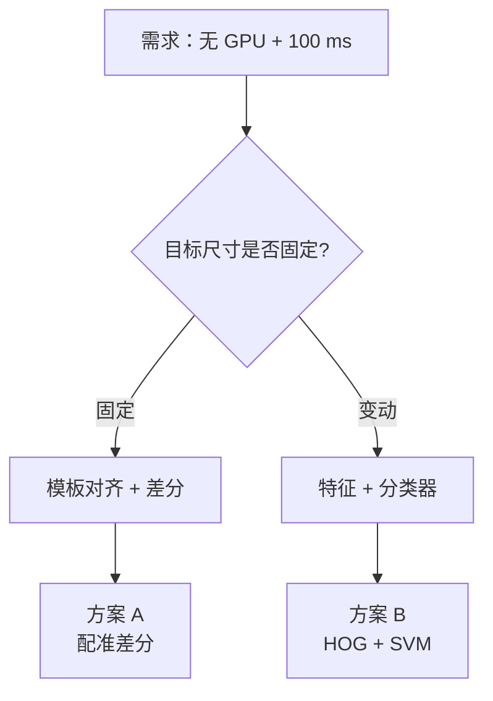
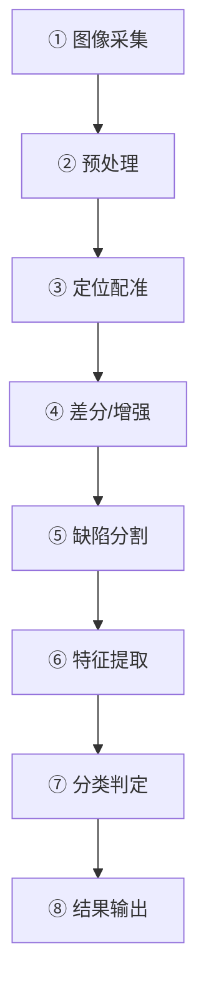
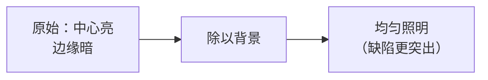
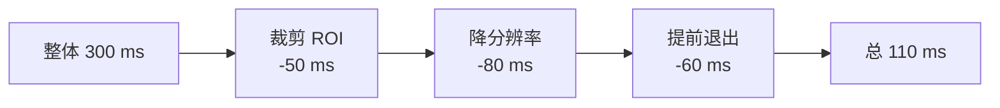

# 案例：工业零件缺陷检测

> **场景**：产线上的金属零件，需要在 100 ms 内判断表面有无划痕、凹坑、毛刺。

## 需求与约束

| 维度 | 要求 |
|---|---|
| **检测目标** | 划痕 / 凹坑 / 毛刺 / 污渍 |
| **节拍** | **100 ms / 件**（10 件/秒） |
| **硬件** | **无 GPU，工控机（i5）** |
| **环境** | 车间照明（有波动） |
| **误检率** | < 1% |
| **漏检率** | < 0.1% |

**关键约束**：**无 GPU**。这就是传统 CV 的主场。

## 方案选型



| 方案 | 速度 | 鲁棒性 | 适用 |
|---|---|---|---|
| **配准差分** | **极快（<20 ms）** | 依赖配准精度 | **位置固定的零件** |
| **特征 + SVM** | 中（30–80 ms） | **好** | 有变化的目标 |
| 深度学习 | 慢（需 GPU） | 最好 | **不符合本约束** |

**本例选：配准差分为主 + 特征分类兜底**。

## 完整流水线



### ① 图像采集

**要点**：

| 要点 | 说明 |
|---|---|
| **固定光源** | 环形光 / 同轴光，**避免环境光干扰** |
| **固定相机** | 三脚架 / 固定支架 |
| **固定曝光** | **手动曝光和白平衡**（不要自动！） |
| **触发同步** | 硬件触发，与产线同步 |

::: danger 最大的坑：用了自动曝光
**现象**：同一批次零件，检测结果忽好忽坏。

**根因**：**自动曝光让不同图像的亮度不一致**，阈值和差分全部失效。

**解决**：**手动锁定曝光、增益、白平衡**。

**这是工业视觉的第一原则**。
:::

### ② 预处理

```python
def preprocess(img):
    # ① 转灰度
    gray = cv2.cvtColor(img, cv2.COLOR_BGR2GRAY)

    # ② ROI 裁剪（只看零件区域，省时间）
    roi = gray[y0:y1, x0:x1]

    # ③ 光照不均匀校正（重要！）
    # 大核模糊得到"背景照明"
    bg = cv2.GaussianBlur(roi, (0, 0), sigmaX=51)
    # 原图 / 背景 = 去掉照明影响
    corrected = cv2.divide(roi.astype(np.float32), bg.astype(np.float32) + 1e-6)
    corrected = np.clip(corrected * 128, 0, 255).astype(np.uint8)

    # ④ 去噪
    denoised = cv2.bilateralFilter(corrected, 5, 50, 50)

    return denoised
```

**光照校正的效果**：



::: tip 为什么用"除以背景"而不是"减背景"
**减法只能去掉"加性"干扰**（背景亮度叠加）。

**除法能去掉"乘性"干扰**（光照不均导致的亮度比例变化）。

**光照不均本质是乘性的**：$I_{obs} = I_{true} \times L_{illum}$

**所以除法更对**（`cv2.divide`），这也是工业视觉的常用技巧。
:::

### ③ 定位配准

**目的**：**消除零件的位置偏差**（每次放置的位置有几毫米误差）。

```python
def align(gray, template_ref, roi_center, search_radius=30):
    """用模板匹配定位零件，返回偏移量"""
    cx, cy = roi_center
    # 在参考位置附近搜索
    search = gray[cy-search_radius:cy+search_radius,
                  cx-search_radius:cx+search_radius]

    res = cv2.matchTemplate(search, template_ref, cv2.TM_CCOEFF_NORMED)
    _, max_val, _, max_loc = cv2.minMaxLoc(res)

    dx = max_loc[0] - search_radius
    dy = max_loc[1] - search_radius

    return dx, dy, max_val
```

**配准方法选择**：

| 方法 | 速度 | 精度 | 适用 |
|---|---|---|---|
| **模板匹配** | **快** | 像素级 | 平移偏移 |
| 相位相关（`phaseCorrelate`） | 快 | **亚像素** | 纯平移 |
| **ECC** | 慢 | 亚像素 | 平移+旋转+缩放 |
| 特征点 + 单应 | 中 | 亚像素 | 大变形 |
| **形状匹配** | 中 | — | 有无纹理都可 |

::: tip 亚像素配准：`phaseCorrelate`
**如果只需要平移配准，`cv2.phaseCorrelate` 又快又准**。

```python
# 返回亚像素级偏移，精度可达 0.1 px
(dx, dy), response = cv2.phaseCorrelate(
    np.float32(ref_roi), np.float32(cur_roi)
)
```

**原理**：**傅里叶变换的相位谱与平移量成正比**，所以从相位谱就能直接算偏移。

**优势**：

- **亚像素精度**（无需插值）
- **对均匀照明变化鲁棒**（相位不受亮度缩放影响）
- **速度快**（FFT 后就是点乘）
:::

**对齐后做差分**：

```python
def difference_check(aligned_img, ref_img, thresh=25):
    """对齐后差分，提取异常区域"""
    # ① 差分（取绝对值）
    diff = cv2.absdiff(aligned_img, ref_img)

    # ② 去噪（去掉配准残差）
    diff = cv2.medianBlur(diff, 5)

    # ③ 阈值分割
    _, mask = cv2.threshold(diff, thresh, 255, cv2.THRESH_BINARY)

    # ④ 形态学去噪 + 连接
    kernel = cv2.getStructuringElement(cv2.MORPH_ELLIPSE, (5, 5))
    mask = cv2.morphologyEx(mask, cv2.MORPH_OPEN, kernel)     # 去小噪点
    mask = cv2.morphologyEx(mask, cv2.MORPH_CLOSE, kernel, iterations=2)  # 连接

    return mask
```

**阈值 `thresh` 怎么定**：

```python
def auto_threshold(valid_parts):
    """用一批已知合格零件自动标定阈值"""
    all_diffs = []
    for part in valid_parts:
        d = cv2.absdiff(part, ref_img)
        all_diffs.append(d.ravel())

    all_diffs = np.concatenate(all_diffs)
    # 取 99.9 百分位（允许极少数正常波动）
    thresh = np.percentile(all_diffs, 99.9)
    return max(thresh, 10)      # 设一个下限，防止太灵敏
```

::: tip 用"合格样品"标定阈值，而不是拍脑袋
**正确做法**：

1. 采集 **100+ 个已知合格的零件**
2. 每个都做差分
3. 取 **99.9 百分位**作为阈值
4. **用另一批合格样品验证误检率**

**这样阈值是有统计依据的**，不是"我试了一下 25 感觉不错"。

**并且随着产线运行，可以持续更新这个阈值**（自适应）。
:::

### ④ 缺陷分割与特征提取

```python
def extract_defect_features(mask, gray):
    """对每个缺陷区域提取特征"""
    contours, _ = cv2.findContours(mask, cv2.RETR_EXTERNAL, cv2.CHAIN_APPROX_SIMPLE)

    features_list = []
    for cnt in contours:
        area = cv2.contourArea(cnt)
        if area < 5:            # 太小的不算
            continue

        # ① 几何特征
        x, y, w, h = cv2.boundingRect(cnt)
        rect = cv2.minAreaRect(cnt)        # 最小外接矩形
        (cx, cy), (rw, rh), angle = rect

        perimeter = cv2.arcLength(cnt, True)
        circularity = 4 * np.pi * area / (perimeter ** 2 + 1e-6)
        elongation = max(rw, rh) / (min(rw, rh) + 1e-6)

        # ② 灰度特征
        mask_cnt = np.zeros_like(gray)
        cv2.drawContours(mask_cnt, [cnt], -1, 255, -1)
        mean_val = cv2.mean(gray, mask=mask_cnt)[0]

        # ③ 对比度特征（缺陷区域 vs 周边）
        dilate_k = cv2.getStructuringElement(cv2.MORPH_ELLIPSE, (15, 15))
        surround = cv2.dilate(mask_cnt, dilate_k) - mask_cnt
        surround_mean = cv2.mean(gray, mask=surround)[0]
        contrast = abs(mean_val - surround_mean)

        features_list.append({
            'area': area,
            'circularity': circularity,
            'elongation': elongation,
            'contrast': contrast,
            'mean_gray': mean_val,
            'bbox': (x, y, w, h),
            'center': (cx, cy),
        })

    return features_list
```

**特征与缺陷类型的对应**：

| 缺陷 | 面积 | 圆形度 | 细长比 | 对比度 |
|---|---|---|---|---|
| **划痕** | 小-中 | **低（0.1–0.4）** | **高（> 5）** | 中-高 |
| **凹坑** | 中 | 高（0.6–0.9） | 低（~1） | 中 |
| **毛刺** | 小 | 低 | 高 | 高 |
| **污渍** | 大 | 中 | 中 | **低** |

::: tip 特征工程的精髓：找"区分性"
**好的特征让简单分类器也能工作**。

**划痕的关键特征**：**细长比高**（elongation > 5）
**污渍的关键特征**：**对比度低**（因为是渐变的）

**如果只用面积**，划痕和污渍分不开。

**这就是特征工程**：**根据物理直觉挑出有区分度的量**。
:::

### ⑤ 分类判定

**方案一：规则判定（最快，可解释）**

```python
def rule_classify(feat, config):
    """基于规则的缺陷分类"""
    if feat['area'] < config['min_area']:
        return 'PASS'                       # 太小，忽略

    if feat['contrast'] < config['min_contrast']:
        return 'PASS'                       # 对比度不足，可能是噪声

    if feat['elongation'] > 5 and feat['circularity'] < 0.4:
        return 'SCRATCH'                    # 划痕
    if feat['circularity'] > 0.6 and feat['contrast'] > 30:
        return 'PIT'                        # 凹坑
    if feat['area'] > 500 and feat['contrast'] < 20:
        return 'STAIN'                      # 污渍
    if feat['elongation'] > 4 and feat['contrast'] > 50:
        return 'BURR'                       # 毛刺

    return 'UNKNOWN'
```

**方案二：SVM 分类（更鲁棒）**

```python
from sklearn.svm import SVC
from sklearn.preprocessing import StandardScaler

# 训练（离线，用标注好的缺陷样本）
X_train = np.array([[f['area'], f['circularity'], f['elongation'],
                     f['contrast'], f['mean_gray']] for f in train_feats])
y_train = np.array(train_labels)

scaler = StandardScaler()
X_scaled = scaler.fit_transform(X_train)

svm = SVC(kernel='rbf', C=10, gamma='scale', probability=True)
svm.fit(X_scaled, y_train)

# 推理（在线）
def svm_classify(feat):
    x = np.array([[feat['area'], feat['circularity'], feat['elongation'],
                   feat['contrast'], feat['mean_gray']]])
    x_scaled = scaler.transform(x)
    proba = svm.predict_proba(x_scaled)[0]
    return svm.classes_[np.argmax(proba)], max(proba)
```

| 方案 | 优点 | 缺点 |
|---|---|---|
| **规则** | 快、可解释、易调试 | 需要人工设计阈值 |
| **SVM** | **更鲁棒、自动学阈值** | 需要标注数据 |

::: tip 推荐的实践组合
**先用规则跑通，再用 SVM 替换**。

**原因**：

1. **规则能让你快速得到 baseline**，并且**可视化调试**（知道为什么判错）
2. **规则的失败案例就是 SVM 的宝贵训练数据**
3. **SVM 上线后，规则可以作为"安全兜底"**（如面积超大的必定是缺陷，不管 SVM 怎么判）

**这种"规则 + 学习"的混合方案在工业界最常见**。
:::

## 性能优化

**目标：100 ms / 件**



**优化手段**：

| 手段 | 加速 | 说明 |
|---|---|---|
| **ROI 裁剪** | 2–5× | 只看零件区域 |
| **降分辨率** | 2–4× | 缺陷够大就行 |
| **提前退出** | 不定 | 发现明确缺陷立即返回 |
| **多线程** | 2–4× | 采集与处理流水线并行 |
| **SIMD 优化** | 1.5–3× | OpenCV 已内置 |
| **减少中间拷贝** | 10–30% | 复用 buffer |

**实测代码**：

```python
import time

class DefectInspector:
    def __init__(self, ref_img, config):
        self.ref = ref_img
        self.config = config
        self.timing = {}

    def inspect(self, img):
        t0 = time.perf_counter()

        # ① 预处理
        gray = cv2.cvtColor(img, cv2.COLOR_BGR2GRAY)
        roi = gray[self.y0:self.y1, self.x0:self.x1]
        t1 = time.perf_counter()

        # ② 配准（用相位相关，亚像素且快）
        (dx, dy), _ = cv2.phaseCorrelate(
            np.float32(self.ref_roi), np.float32(roi)
        )
        M = np.float32([[1, 0, dx], [0, 1, dy]])
        aligned = cv2.warpAffine(roi, M, (roi.shape[1], roi.shape[0]),
                                 flags=cv2.INTER_LINEAR)
        t2 = time.perf_counter()

        # ③ 差分
        diff = cv2.absdiff(aligned, self.ref_roi)
        diff = cv2.medianBlur(diff, 3)
        _, mask = cv2.threshold(diff, self.config['thresh'], 255, cv2.THRESH_BINARY)
        t3 = time.perf_counter()

        # ④ 形态学
        k = cv2.getStructuringElement(cv2.MORPH_ELLIPSE, (3, 3))
        mask = cv2.morphologyEx(mask, cv2.MORPH_OPEN, k)
        t4 = time.perf_counter()

        # ⑤ 特征 + 判定
        feats = extract_defect_features(mask, aligned)
        defects = [f for f in feats if rule_classify(f, self.config) != 'PASS']
        t5 = time.perf_counter()

        self.timing = {
            'preprocess': (t1-t0)*1000,
            'align': (t2-t1)*1000,
            'diff': (t3-t2)*1000,
            'morph': (t4-t3)*1000,
            'classify': (t5-t4)*1000,
            'total': (t5-t0)*1000,
        }

        return len(defects) == 0, defects
```

::: tip 一定要做性能剖析（profiling）
**别猜哪里慢，要测**。

```python
# 跑 100 次取中位数
times = []
for _ in range(100):
    inspector.inspect(test_img)
    times.append(inspector.timing['total'])
print(f"中位耗时: {np.median(times):.1f} ms")
print(f"P99 耗时: {np.percentile(times, 99):.1f} ms")
```

**实践中最意外的瓶颈**：

- **`medianBlur` 在大图上很慢**（用 `blockSize=3` 或换 `boxFilter`）
- **`bilateralFilter` 极慢**（非必要不用）
- **`warpAffine` 的插值方式**（`INTER_NEAREST` 比 `INTER_LINEAR` 快 2×）
- **内存拷贝**（`.copy()` 和 numpy 切片）
:::

## 结果可视化与追溯

**工业场景必须能"追溯"**：出问题时能翻出当时的图像和判定。

```python
def save_result(img, aligned, mask, defects, result, save_dir):
    """保存检测结果（用于追溯）"""
    vis = cv2.cvtColor(aligned, cv2.COLOR_GRAY2BGR)

    for d in defects:
        x, y, w, h = d['bbox']
        cv2.rectangle(vis, (x, y), (x+w, y+h), (0, 0, 255), 2)
        cv2.putText(vis, f"{d['type']}", (x, y-5),
                    cv2.FONT_HERSHEY_SIMPLEX, 0.5, (0, 0, 255), 1)

    # 拼成对比图：原图 | 差分 | 结果
    panel = np.hstack([aligned, mask, vis])

    ts = time.strftime('%Y%m%d_%H%M%S')
    status = 'OK' if result else 'NG'
    cv2.imwrite(f"{save_dir}/{ts}_{status}.jpg", panel)

    # 只保存 NG 的（节省存储）
    # 或者保存所有（用于后续分析误检）
```

## 误检的常见来源

::: danger 五类常见误检
| 误检来源 | 表现 | 解决 |
|---|---|---|
| **配准残差** | 边缘出现细线 | 提高配准精度 / 在边缘区域放宽阈值 |
| **光照波动** | 整片响应 | 光照校正 / 锁曝光 |
| **振动** | 随机的条纹 | 硬件加固 / 提高帧率取多帧 |
| **零件表面纹理** | 固定位置的假缺陷 | **用多个合格样品建立"允许的纹理掩码"** |
| **灰尘** | 移动的小点 | 定期清洁 / 提高最小面积阈值 |

**"用多个样品建立允许纹理"的代码**：

```python
def build_allowed_mask(valid_samples, ref, thresh):
    """建立"允许的差异"掩码（如固定纹理、允许的形变）"""
    accum = np.zeros_like(ref, dtype=np.float32)
    for s in valid_samples:
        d = cv2.absdiff(s, ref)
        accum = np.maximum(accum, d)

    # 允许范围内的差异都标为"允许"
    allowed = (accum < thresh).astype(np.uint8) * 255

    # 腐蚀一点，容错
    k = cv2.getStructuringElement(cv2.MORPH_ELLIPSE, (3, 3))
    allowed = cv2.erode(allowed, k)
    return allowed
```
:::

## 方案总结

| 环节 | 方案 | 关键点 |
|---|---|---|
| 采集 | 固定光源 + 手动曝光 | **别用自动曝光** |
| 预处理 | 光照校正（除法）+ 双边滤波 | 除法比减法对 |
| 配准 | 相位相关 | 亚像素、快 |
| 差分 | absdiff + 阈值 | 阈值用合格样品标定 |
| 分割 | 形态学开闭 | 去掉噪声、连接断裂 |
| 特征 | 面积/圆形度/细长比/对比度 | **找有区分度的量** |
| 分类 | 规则 → SVM | 规则先跑通 |
| 追溯 | 保存对比图 | 工业必需 |

::: tip 为什么传统 CV 在这个场景至今无法被替代
| 维度 | 传统 CV | 深度学习 |
|---|---|---|
| **硬件成本** | **几百元工控机** | 需 GPU（数千元起） |
| **速度** | **10–50 ms** | 20–100 ms（GPU） |
| **可解释性** | **每一步都可视化调试** | 黑盒 |
| **样本需求** | **几个到几百个** | 数千到数万 |
| **调参** | **明确（阈值/形状）** | 大量超参 |

**在"缺陷类型明确、位置可控、节拍要求高"的场景，传统 CV 是性价比之王**。

**这也是为什么"传承"不是"淘汰"**：**不同场景各有主场**。
:::

## 相关链接

- [图像处理分支](/branches/image-processing/)
- [形态学操作](/branches/image-processing/morphology)
- [阈值分割](/branches/image-processing/thresholding)
- [传统检测分支](/branches/detection/)
- [边缘部署案例](/cases/edge-deployment)
- [返回案例索引](/cases/)
