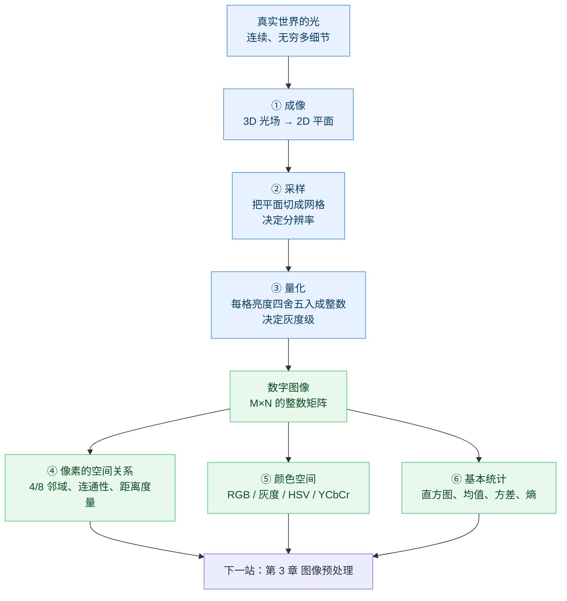
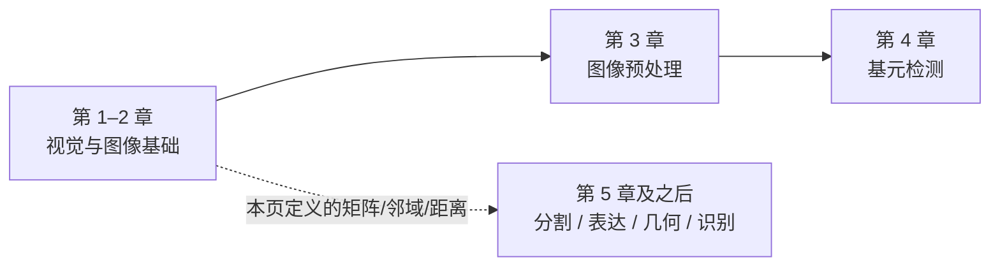

# 第 1–2 章 · 视觉与图像基础（预备篇）

> **白话一句话**：在看懂任何「高级算法」之前，得先搞明白一件事——**图像本身不过是一大张数字表格**，每个格子里放一个亮度值。
> **所属层次**：🟦 预备知识（先修，后面所有章节的地基）
> **横轴分支**：[图像处理](/branches/image-processing/)
> **上一篇**：无，这是起点 ｜ **下一篇**：[第 3 章 · 图像预处理](/chapters/ch03-preprocessing)

---

## 先回答：为什么章体系是「从第 3 章开始」的？

本站章体系**严格对齐章毓晋《计算机视觉教程》**。那本教材一共 15 章，前两章是**绪论 + 数字图像基础**，属于"打地基"的预备内容：

| 教材章 | 讲什么 | 本站怎么处理 |
|---|---|---|
| 第 1 章 | 绪论：什么是计算机视觉，与图像处理 / 模式识别 / 机器学习是什么关系 | 合并在本页 |
| 第 2 章 | 视觉与图像基础：成像、数字化、颜色、像素之间的空间关系 | 合并在本页 |
| 第 3–15 章 | **技术主体**：预处理 → 基元 → 分割 → 表达 → 纹理 → 形状 → 立体 → 三维 → 运动 → 识别 → 匹配 → 行为 → 场景 | 一章一页，共 13 页 |

所以站内章节从「第 3 章」起步**不是漏了**——技术主体确实从第 3 章开始。为了让阅读节奏不别扭，我们把教材第 1–2 章里**后面天天要用的那部分知识**单独整理成本页，作为**预备篇**。

::: tip 一句话理解
**不读这一页，后面每一页都会卡壳**——因为所有算法处理的"输入"，都是这一页定义的那张"数字表格"。
:::

---

## 这一部分要解决什么问题

**核心问题**：**一张真实世界的画面，究竟是怎么变成计算机能算的"数"的？**

一台相机不会"看见"东西，它只会做一件事：把每个感光点收到的**光强**变成一个**电信号**，再变成**一个整数**。于是三维世界的连续光场，被切成了一张规则的二维整数网格——这就是**数字图像**。

明白了"图像 = 数字表格"，你就同时理解了三件事：

1. **为什么几乎每个算法都要先灰度化**：彩色是 3 张表格叠在一起，先压成 1 张更好算。
2. **为什么会有"分辨率"和"噪声"**：表格切得越粗（分辨率低）、每格的四舍五入越糙（量化），丢掉的细节就越多。
3. **为什么"邻域"这么重要**：既然是一个规整的网格，每个像素就天然有上下左右的"邻居"，一切滤波、边缘、连通分析都建立在这个网格上。

---

## 内容地图



---

## 一、成像：三维世界怎么落到一张平面上

### 最朴素的模型——针孔成像

把相机想象成一个**密封的暗盒**，正面扎一个针尖大的小孔，背面贴一张感光纸。外部世界里每一个发光点，穿过小孔后都会在背面纸上落成**唯一一个亮点**。这就是**针孔模型（pinhole model）**。

它带来了三个后面天天要用的结论：

- **透视投影**：远处的物体成像更小——"近大远小"。这就是为什么深度估计（第 9–10 章）能从"同一物体在两幅图里大小不同"反推距离。
- **灭点**：现实中的平行线（比如伸向远方的铁轨）在图像里会交于一点。相机标定（第 10 章）就靠这个把"图像坐标"和"世界坐标"对上号。
- **单应变换**：拍一个平面（棋盘、马路、书页）时，图像平面与世界平面之间是一个可逆的 3×3 矩阵关系——这就是后面 [单应矩阵](/algorithms/homography) 的由来。

> **生活化比方**：针孔模型就像"眯着眼睛看东西"。孔径越小，画面越清晰但越暗；孔径越大，越亮但越糊——这个"清晰度 vs 亮度"的矛盾，正是后面"光圈/景深/模糊"话题的根。

### 从"光线"到"像素值"：两次数不清的离散化

- **成像**：3D → 2D，这一步只是投影，还是连续的。
- **采样（sampling）**：把连续的 2D 光强切成一格一格的网格，格子数就是**分辨率**（比如 1920×1080 表示横向 1920 格、纵向 1080 格）。
- **量化（quantization）**：每个格子里的光强是连续值，得四舍五入成一个整数，可用整数范围就是**灰度级**（8 位 = 0~255，共 256 级）。

---

## 二、采样与量化：图像质量的"两条命根子"

| 环节 | 决定什么 | 砍得太狠会怎样 | 常见系数 |
|---|---|---|---|
| **采样** | 空间分辨率（能看清多小的东西） | 出现**马赛克**、锯齿；细节直接消失 | 像素间距、dpi |
| **量化** | 灰度分辨率（能区分多细的明暗差） | 出现**假轮廓（伪影）**，平滑渐变成色带 | 8 位（256 级）最常见 |

### 一条绕不开的定理：奈奎斯特采样定理

如果一个画面里最高的变化频率是 `f_max`，那么采样密度必须大于 `2·f_max`，否则**高频信息会伪装成低频**混进结果——这就叫**混叠（aliasing）**。

> **生活化比方**：这就是为什么**车轮在视频里会倒转**。电影每秒只"看"24 次，转得太快的轮辐每次都被拍在"错一点点"的位置，人眼就被骗成了倒转。图像里的**摩尔纹**（拍屏幕时的彩色波纹）是同一个原理。

工程上对应的动作就是：**放大图像前先模糊**（去掉超过新采样率能表达的高频），缩小图像时做**抗混叠**（area / Lanczos 重采样）。OpenCV 里 `resize` 的 `INTER_AREA` 就是为缩小设计的。

---

## 三、像素之间的空间关系：网格上的"邻里学"

图像是网格，于是每个像素有了固定位置的邻居。这一节的名词后面出现频率极高，值得记牢：

### 邻域

| 名称 | 包含哪些邻居 | 别名 | 常见用途 |
|---|---|---|---|
| **4 邻域** | 上、下、左、右（`(i±1,j)`、`(i,j±1)`） | N4 | 梯度、边缘检测 |
| **8 邻域** | 4 邻域 + 4 个对角 | N8 | 连通域、形态学膨胀 |
| **对角邻域** | 仅 4 个对角 | ND | 细化、骨架 |

### 连通性

两个像素"连在一起"要同时满足：**① 位置相邻（在选定的邻域里）② 灰度值满足相似准则（比如都在同一个阈值区间内）**。由此得到：

- **连通域（connected component）**：一组互相连通的前景像素构成一个"块"。数一数有几个块、每块多大，就是最基础的**目标计数与面积测量**——就是 [连通域分析](/algorithms/connected-components) 在干的事。
- **4 连通 vs 8 连通**：用 8 连通会让斜线方向的像素"黏"成一团，用 4 连通又容易把细斜线"切断"。二者选哪个，取决于你要"粘连"还是"分离"。

### 距离度量（量两个像素"隔多远"）

| 度量 | 定义 | 直觉 | 别称 |
|---|---|---|---|
| **欧氏距离** | `√(Δx² + Δy²)` | 直线距离，"飞过去" | L2 |
| **城区距离** | `|Δx| + |Δy|` | 只能横平竖直走，"出租车绕街区" | 曼哈顿距离 / L1 |
| **棋盘距离** | `max(|Δx|, |Δy|)` | 允许走对角，"王在棋盘上走" | 切比雪夫距离 / L∞ |

> **生活化比方**：把像素当成城市里的路口。欧氏距离是直升机航拍距离，城区距离是出租车必须按街道走的路程，棋盘距离是国王一次能走对角线时最短的步数。**它们仨在用圆形/菱形/方形做形态学结构元素时会造成明显不同的结果**——这就是为什么 [形态学](/algorithms/morphology) 文档里总在强调"结构元素的形状"。

---

## 四、颜色空间：换个坐标看同一幅画

彩色图像本质是 **3 张叠在一起的灰度图**（三个通道）。通道怎么定义，就是"颜色空间"的问题：

| 颜色空间 | 三个分量 | 直觉 | 什么时候用 |
|---|---|---|---|
| **RGB** | 红、绿、蓝 | 显示器发光的三原色 | 显示、存储 |
| **灰度 Y** | 单通道亮度 | 只关心明暗 | 几乎所有算法的第一步 |
| **HSV / HSL** | 色相、饱和度、明度 | "什么颜色 / 多鲜艳 / 多亮" | 颜色分割、按颜色追踪（比 RGB 稳压光照变化） |
| **YCbCr** | 亮度 + 两个色差 | 把"亮度"和"颜色"拆开 | 视频压缩（JPEG/MPEG）、肤色检测 |

**灰度化**是最常用的降维操作，标准公式（ITU-R BT.601）是**加权平均**而不是简单取平均：

```
Y = 0.299·R + 0.587·G + 0.114·B
```

> **为什么加权？** 因为人眼对**绿色**最敏感、对**蓝色**最迟钝。按这个权重压出来的灰度图，看起来最接近"人眼以为的明暗"。要是三个通道简单除以 3，绿色物体就会显得偏暗，与人的感受不符。

**为什么几乎都先灰度化？** 三个理由：① 计算量直接降到 1/3；② 很多经典特征（梯度、边缘、纹理）本就定义在单通道上；③ 去掉颜色能规避"光照色偏"带来的干扰。

---

## 五、基本统计：用几个数字概括一张图

### 直方图

**灰度直方图**统计"每个灰度值出现了多少个像素"。它丢了所有空间信息，却能一眼看出这张图**是偏暗、偏亮、还是对比度不足**。

- **双峰直方图**（前景一堆、背景一堆、中间是谷）→ 一眼就知道适合**阈值分割**，[Otsu](/algorithms/otsu) 就是自动找那个谷底的算法。
- **单峰窄峰**（都挤在中间一小段）→ 对比度太低，该做**直方图均衡化 / CLAHE**。

### 常用统计量

| 统计量 | 含义 | 典型用途 |
|---|---|---|
| **均值** | 平均亮度 | 判断曝光、做背景亮度归一化 |
| **方差 / 标准差** | 明暗反差有多大 | 判断对比度，做纹理粗糙度描述 |
| **熵** | 信息量 / 混乱程度 | 评价图像信息量、选最优阈值 |
| **累积分布（CDF）** | 小于等于某灰度的像素比例 | 直方图均衡化的核心（把 CDF 当映射函数） |

> **生活化比方**：直方图就像"全班成绩分布图"。均值是平均分，方差是"分数拉得开不开"，双峰说明"班里有明显两拨人"。老师（算法）拿到这张图，立刻知道该"补差"还是"拔高"。

---

## 六、图像类型一览

| 类型 | 每像素存什么 | 常见位深 | 典型场景 |
|---|---|---|---|
| **二值图** | 0 或 1（黑/白） | 1 位 | 掩膜、形态学结果、阈值输出 |
| **灰度图** | 一个亮度值 | 8 / 16 位 | 绝大多数算法的输入 |
| **彩色图** | 三个通道 | 8 位×3 | 原图、展示 |
| **带透明通道** | +Alpha | 8 位×4 | PNG、UI 素材 |
| **多光谱 / 高光谱** | 几十上百个通道 | 视传感器而定 | 遥感、农业、工业分选 |
| **深度图** | 每像素到相机的距离 | 16 位 / 32 位浮点 | 第 9–10 章立体视觉的产物 |

---

## 和后面章节的关系



本页的每一条知识，都会在后面反复出现：**采样**决定金字塔能不能建、**量化**决定直方图有几根柱、**邻域**决定滤波核长什么样、**距离度量**决定形态学与聚类怎么算、**颜色空间**决定颜色分割能不能抗光照。

---

## 经典论文与参考

::: warning 说明
第 1–2 章属于**教科书级基础知识**，内容稳定、没有"某年某篇论文首创"的单一出处，所以本站**没有为它挂本体论文实例**。下面列的是绕不开的经典参考。
:::

- **采样定理**：C. E. Shannon, *Communication in the Presence of Noise*, Proc. IRE, 1949 —— 奈奎斯特–香农采样定理的奠基文献。
- **颜色科学**：CIE 1931 色度系统 —— 今天所有颜色空间的共同祖先。
- **成像几何**：O. Faugeras, *Three-Dimensional Computer Vision: A Geometric Viewpoint*, MIT Press, 1993 —— 投影几何与相机模型的经典教材。
- **综合教材**：R. Gonzalez & R. Woods, *Digital Image Processing* —— 采样、量化、直方图、邻域这套基础知识的全球通用标准参考。

---

## 工业上怎么用

这些"基础"在产线上每天都在救火：

| 工序动作 | 背后用到的本页知识 |
|---|---|
| **换镜头 / 调视野** | 采样：视野越大、同样像素数下分辨率越低，小缺陷就抓不住 |
| **选相机位深** | 量化：8 位在弱对比缺陷（如浅划痕）上不够用，要上 10/12 位 |
| **拍照前先模糊一下** | 抗混叠：直接缩小图像会产生摩尔纹，污染质检结果 |
| **数零件个数 / 量面积** | 连通域 + 距离度量：数连通块、算像素数再折算实际面积 |
| **按颜色分拣** | 颜色空间：从 RGB 转到 HSV / Lab 再设阈值，才能扛住车间灯光波动 |
| **判断图像能不能用** | 直方图 + 均值方差：曝光、对比度不达标直接报警，别让算法背锅 |

---

## 工程实现要点

- **灰度化别用"三通道取平均"**：请用 `0.299/0.587/0.114` 加权（OpenCV 的 `cvtColor(..., COLOR_BGR2GRAY)` 就是这个权重）。顺带注意 **OpenCV 默认通道顺序是 BGR，不是 RGB**，这是新手第一大坑。
- **缩小图像优先 `INTER_AREA`**：它等价于按面积加权平均，天然抗混叠；`INTER_LINEAR` 只是简单插值，缩小时容易产生摩尔纹。
- **放大图像先考虑 `INTER_CUBIC` / `LANCZOS4`**，但把放大的图再缩小回来，信息是回不来的——**分辨率一旦丢掉就永久丢失**。
- **做阈值/统计前先看清数据类型**：`uint8`（0–255）和 `float32`（0–1 或 0–255）混用，是"结果全黑或全白"的头号原因。本站在 Playground 里也专门做了归一化处理。
- **坐标系方向要统一**：图像坐标 `(行 y, 列 x)` 与"笛卡尔坐标"顺序相反，而且 **y 轴向下**。写几何算法时反复确认这一点，能省掉一半的调试时间。

---

## 三个常见误区

::: danger 误区 1：像素 = 一个"小方块"
严格来说，采样后的值定义在**格点**上，整数坐标处的灰度值才是"真值"，两个整数坐标之间的值是插值猜出来的。所以"把一个像素放大 8 倍看"其实毫无信息量——它只是把同一个数字铺开。
:::

::: danger 误区 2：分辨率越高越好
分辨率翻倍，像素数变 4 倍，算力和耗时也近似翻 4 倍。而**如果光学系统本身分辨不出那个细节，堆像素只是把模糊拍得更清楚**。工业上正确做法是"让缺陷在该分辨率下至少占 3–5 个像素"，够用即止。
:::

::: danger 误区 3：灰度化是"无损的顺手操作"
灰度化会丢掉全部颜色信息，且不可逆。有些缺陷（如色差、锈斑、线缆颜色）**在灰度下根本看不见**，必须先分流到颜色空间处理。所以"先无脑灰度化"并不总是对的。
:::

---

## 学完这一部分你能做什么

- ✅ 说清一张照片从"光"到"数"的全过程，知道分辨率、灰度级、噪声各自从哪来。
- ✅ 熟练使用 4/8 邻域、连通域、三种距离度量这套语言，看懂后面所有算法在说什么。
- ✅ 在 RGB / 灰度 / HSV / YCbCr 之间正确切换，并知道什么时候**不该**灰度化。
- ✅ 会看直方图和均值方差，判断一张图"能不能直接喂给算法"。
- ✅ 为 [第 3 章 图像预处理](/chapters/ch03-preprocessing) 做好准备——那一章本质上就是"针对本页这些缺陷（噪声、光照、对比度）逐项开药方"。
