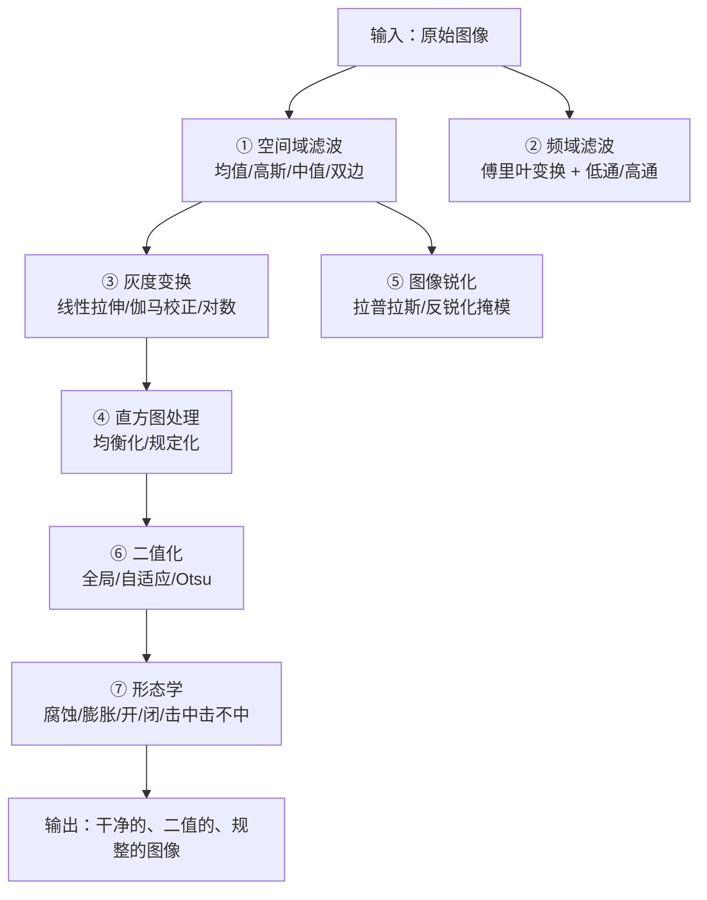

# 第3章 · 图像预处理

> **白话一句话**：把拍到的照片「打扫干净」——擦掉噪点、调匀亮度、掰正畸变，好让后面的算法干活。
> **所属层次**：🟦 低层视觉（像素 → 基元）
> **横轴分支**：[图像处理](/branches/image-processing/)
> **上一篇**：第2章 视觉与图像基础（教材基础篇） ｜ **下一篇**：[第4章 基元检测](/chapters/ch04-primitives)

---

## 这一章要解决什么问题

**核心问题**：**怎么让一张图像变得「好用」？**

真实拍出来的图从来不是干净的：传感器有热噪声、光线忽明忽暗、镜头有畸变、对比度低得看不清细节。如果直接把这样的图丢给 Canny 或 Otsu，结果一定是一塌糊涂。

所以预处理的作用是**当「清洁工 + 化妆师」**：把算法不喜欢的成分去掉，把算法需要的特征放大。

::: tip 一句话理解
**预处理决定了后续所有环节的天花板。** 工业视觉里 80% 的「算法效果不好」，根因不在算法，而在预处理没做好。
:::

---

## 内容地图



**七个板块，两条主线**：

- **主线一：去掉不想要的** —— 滤波（去噪）、形态学（去毛刺）
- **主线二：放大想要的** —— 灰度变换、直方图、锐化、二值化

---

## 代表算法清单

| 算法 / 算子 | 白话理解 | 本站入口 |
|---|---|---|
| **均值 / 高斯滤波** | 拿周围像素「平均一下」，让画面变柔和 | [滤波与卷积](/branches/image-processing/filtering) |
| **中值滤波** | 排序取中间值，专治「椒盐噪点」 | [滤波与卷积](/branches/image-processing/filtering) |
| **双边滤波** | 平滑的同时保住边缘——「只抹平同一块区域内部」 | [滤波与卷积](/branches/image-processing/filtering) |
| **直方图均衡化** | 把挤在一堆的亮度值「拉开」，对比度立刻变好 | [滤波与卷积](/branches/image-processing/filtering) |
| **灰度变换 / 伽马校正** | 整体调亮调暗，或压暗高光、提亮暗部 | [滤波与卷积](/branches/image-processing/filtering) |
| **Otsu 大津法** | 自动找一个最好的黑白分界线 | [阈值分割](/branches/image-processing/thresholding) |
| **自适应阈值** | 每个小区域单独算阈值，专治光照不均 | [阈值分割](/branches/image-processing/thresholding) |
| **形态学开闭运算** | 先腐蚀后膨胀去小噪点；先膨胀后腐蚀填小洞 | [形态学操作](/branches/image-processing/morphology) |
| **傅里叶变换** | 把图像看成「各种条纹的叠加」，在频域里做手术 | [滤波与卷积](/branches/image-processing/filtering) |

---

## 经典论文

| 年份 | 论文 | 作者 | 贡献 |
|---|---|---|---|
| 1979 | *A Threshold Selection Method from Gray-Level Histograms* | 大津展之（Otsu） | 提出了至今最常用的自动阈值法 | 
| 1968 | *A 3×3 Isotropic Gradient Operator for Image Processing* | Sobel & Feldman | 边缘/梯度算子的经典源头（第4章会细讲） |
| 1995 | *Bilateral Filtering for Gray and Color Images* | Tomasi & Manduchi | 保边滤波的奠基之作 |
| 1980 | *Image Enhancement by Histogram Transformation* | Hummel | 直方图均衡化的理论完善 |

> 📌 **本站本体实例**：[Otsu 算法](/ontology/instances) ｜ [论文实例索引](/ontology/instances)

---

## 工业上怎么用

| 场景 | 典型预处理链 | 为什么 |
|---|---|---|
| **零件尺寸测量** | 中值滤波 → 灰度拉伸 → 自适应阈值 → 形态学闭 | 去毛刺、保证边缘位置准确，测量误差才能进 1 像素 |
| **产品表面缺陷** | 高斯滤波 → 背景差分 → Otsu → 开运算 | 先把纹理噪声压掉，缺陷才浮出来 |
| **OCR / 文档扫描** | 灰度化 → 伽马校正 → 自适应阈值 → 去噪 | 解决「照片一边亮一边暗」的问题 |
| **嵌入式低算力** | 只用 3×3 中值 / 形态学，跳过频域 | 频域要 FFT，算力和内存都吃不消 |

---

## 工程实现要点

```python
import cv2
import numpy as np

# ① 去噪：椒盐 → 中值；高斯噪声 → 高斯/双边
blur = cv2.medianBlur(gray, 3)

# ② 直方图均衡化（对比度）
eq = cv2.equalizeHist(blur)
# 更好的选择：CLAHE，分块均衡，不会把噪点也一起放大
clahe = cv2.createCLAHE(clipLimit=2.0, tileGridSize=(8, 8)).apply(blur)

# ③ 二值化：Otsu 自动求阈值
_, binary = cv2.threshold(blur, 0, 255, cv2.THRESH_BINARY + cv2.THRESH_OTSU)

# ④ 形态学：先开后闭
kernel = cv2.getStructuringElement(cv2.MORPH_ELLIPSE, (5, 5))
opened = cv2.morphologyEx(binary, cv2.MORPH_OPEN, kernel)
closed = cv2.morphologyEx(opened, cv2.MORPH_CLOSE, kernel)
```

详细参数与坑，见 [滤波与卷积](/branches/image-processing/filtering)、[阈值分割](/branches/image-processing/thresholding)、[形态学操作](/branches/image-processing/morphology)。

---

## 三个常见误区

- **❌ 一上来就上复杂算法**。工业现场最有效的预处理往往是最朴素的：**换个打光方式**比改十行代码有用得多。
- **❌ 高斯核开得越大越「干净」**。核越大越模糊，边缘定位误差越大——测量任务里这是致命的。
- **❌ 均衡化能解决一切光照问题**。均衡化会同时放大噪点，而且对「局部光照不均」无能为力，这种要上 CLAHE 或自适应阈值。

---

## 学完这一章你能做什么

✅ 把一张脏图变成「算法能吃」的干净图
✅ 用形态学把二值图修得规整、连通
✅ 判断「效果不好」到底是预处理的问题还是算法的问题

**下一章**：[第4章 基元检测](/chapters/ch04-primitives) —— 图干净了，接下来就该**找出里面的结构**。
