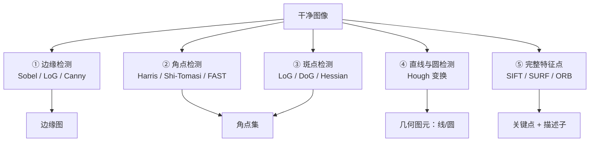

# 第4章 · 基元检测

> **白话一句话**：在清理干净的图里，**找出最基础的「零件」**——边缘、角点、直线、圆、斑点。
> **所属层次**：🟦 低层视觉（像素 → 基元）
> **横轴分支**：[特征检测](/branches/feature-detection/)
> 
## 🎮 动手玩一玩本章核心概念

🖱 动手体验：Sobel 梯度算子怎么找到边缘、Harris 怎么找到角点

<ClientOnly>
<MathVisualizer initialTab="grad" compact />
</ClientOnly>

**上一篇**：[第3章 图像预处理](/chapters/ch03-preprocessing) ｜ **下一篇**：[第5章 目标分割](/chapters/ch05-segmentation)

---

## 这一章要解决什么问题

**核心问题**：**图像里哪些位置「有结构」？**

一张图有几十万像素，绝大多数位置是平坦无信息的（比如白墙）。**「基元」就是那些携带信息的像素点**：物体轮廓上的边缘、两条边的交角、直的边线、圆的轮廓、局部亮暗对比强烈的斑点。

算法只对这些「有结构的少数点」感兴趣——**这一步把几十万像素压缩到几百上千个候选，是整个 CV 链条里最重要的一次「降维」**。

::: tip 一句话理解
**基元检测 = 给图像「划重点」。** 后面所有环节（匹配、分割、检测、重建）都是在这些重点上展开的。
:::

---

## 内容地图



**五类基元，对应五类「结构」**：

| 基元 | 是什么 | 一句话判据 |
|---|---|---|
| **边缘** | 亮度突变的一条线 | 一阶导数（梯度）大 |
| **角点** | 两个方向都有突变的点 | 沿任意方向移动，亮度都变化大 |
| **斑点** | 局部亮暗的「团块」 | 二阶导数（拉普拉斯）响应大 |
| **直线/圆** | 贯通性的几何形状 | 参数空间里投票聚堆（Hough） |
| **特征点** | 尺度/旋转都不变的稳定点 | 多尺度下都能被稳定检出 |

---

## 代表算法清单

| 算法 | 白话理解 | 年份 | 本站入口 |
|---|---|---|---|
| **Sobel** | 拿一个「左减右」的小模板扫过去，哪里差得大哪里就是边 | 1968 | [边缘检测](/branches/feature-detection/edges) |
| **Laplacian / LoG** | 用二阶导找边，比一阶导更精细但更怕噪声 | — | [边缘检测](/branches/feature-detection/edges) |
| **Canny** | 边缘检测的黄金标准：降噪 + 梯度 + 非极大值抑制 + 双阈值 | 1986 | [📄 Canny 完整档案](/algorithms/canny/) |
| **Harris 角点** | 看一个小窗口往各个方向挪，亮度变化都大就是角点 | 1988 | [角点检测](/branches/feature-detection/corners) |
| **Shi-Tomasi** | Harris 的改良版，判据更简单、对跟踪更友好 | 1994 | [角点检测](/branches/feature-detection/corners) |
| **FAST** | 只比周围一圈像素，快得离谱，专为实时准备 | 2006 | [角点检测](/branches/feature-detection/corners) |
| **DoG / LoG 斑点** | 在不同尺度上找「团块」，顺便确定了尺度 | — | [斑点与特征点](/branches/feature-detection/blobs) |
| **Hough 变换** | 把所有点往参数空间里投票，票数最高的参数就是那条线/圆 | 1962 | [边缘检测](/branches/feature-detection/edges) |
| **SIFT 关键点** | 找那种「换角度、换远近都还在」的超稳点 | 2004 | [📄 SIFT 完整档案](/algorithms/sift/) |

---

## 经典论文

| 年份 | 论文 | 作者 | 贡献 |
|---|---|---|---|
| 1968 | *A 3×3 Isotropic Gradient Operator* | Sobel & Feldman | 梯度算子的经典源头 |
| 1986 | *A Computational Approach to Edge Detection* | John Canny | 定义了「好边缘」的三准则 | 
| 1988 | *A Combined Corner and Edge Detector* | Harris & Stephens | 角点检测的里程碑 |
| 2004 | *Distinctive Image Features from Scale-Invariant Keypoints* | David Lowe | SIFT，尺度不变特征的标杆 |
| 2006 | *Machine Learning for High-Speed Corner Detection* | Rosten & Drummond | FAST，重新定义了「快」 |

> 📌 **本站本体实例**：[Canny](/ontology/instances) ｜ [SIFT](/ontology/instances) ｜ [FAST 概念](/ontology/instances)

---

## 工业上怎么用

| 场景 | 选哪类基元 | 为什么 |
|---|---|---|
| **零件轮廓测量** | Canny + 亚像素精定位 | 定位精度直接决定测量精度 |
| **标定板角点提取** | Harris / Shi-Tomasi | 棋盘格角点最稳，可到亚像素 |
| **工件定位与抓取** | 模板匹配 + 角点 | 快速找到工件位置和角度 |
| **二维码/条码定位** | Hough 直线 / 轮廓 | 先找四条边，再做透视校正 |
| **SLAM / 视觉里程计** | ORB / FAST + 角点跟踪 | 要极快，宁可精度稍低 |
| **图像拼接** | SIFT / SURF 关键点 | 尺度旋转不变，跨视角也能匹配 |

---

## 工程实现要点

```python
import cv2

# 边缘：Canny（推荐先高斯轻模糊）
edges = cv2.Canny(img, 50, 150, apertureSize=3, L2gradient=True)

# 角点：Shi-Tomasi（比 Harris 好调，常用于跟踪）
corners = cv2.goodFeaturesToTrack(gray, maxCorners=200, qualityLevel=0.01,
                                  minDistance=10, blockSize=3)

# 直线：概率霍夫
lines = cv2.HoughLinesP(edges, 1, np.pi / 180, threshold=80,
                        minLineLength=50, maxLineGap=10)

# 关键点：SIFT（注意 2020 年后专利已过期，可放心用）
sift = cv2.SIFT_create(nfeatures=0, contrastThreshold=0.04)
kp, desc = sift.detectAndCompute(gray, None)
```

::: warning 最常踩的坑
**做测量任务时，绝对不要用 Canny 的默认高低阈值。** 阈值一变，边缘位置整体内外漂移，尺寸就测不准。测距场景建议用**亚像素边缘**或**先用 Otsu 自动定阈值**。详见 [Canny 踩坑](/algorithms/canny/painpoints)。
:::

---

## 三个常见误区

- **❌ 边缘检测器越高级越好**。Canny 是通用最优解，但如果只是找直边，Sobel + Hough 更快更省。
- **❌ 检出越多点越好**。基元太多会拖慢后面所有环节，还会引入大量误匹配。**「少而准」永远优于「多而杂」**。
- **❌ 忽略尺度**。同一物体在远近不同的拍摄距离下，边缘粗细、角点密度完全不同——这就是为什么要有 SIFT 这类**尺度不变**特征。

---

## 学完这一章你能做什么

✅ 从图里准确找出边缘、角点、直线、圆
✅ 根据任务精度/速度要求，选对基元类型和检测器
✅ 理解「为什么 SIFT 比 Harris 更适合跨视角匹配」

**下一章**：[第5章 目标分割](/chapters/ch05-segmentation) —— 有了点线，接下来要**把整块目标抠出来**。
