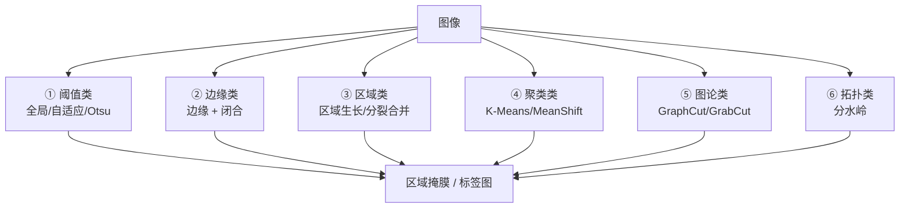

# 第5章 · 目标分割

> **白话一句话**：把画面里的目标**「抠出来」**——哪些像素属于物体，哪些属于背景，一刀切清楚。
> **所属层次**：🟩 中层视觉（基元 → 目标）
> **横轴分支**：[图像分割](/branches/segmentation/)
> **上一篇**：[第4章 基元检测](/chapters/ch04-primitives) ｜ **下一篇**：[第6章 目标表达和描述](/chapters/ch06-representation)

---

## 这一章要解决什么问题

**核心问题**：**哪些像素属于同一个物体？**

第4章找的是「点」（边缘、角点），这一章要的是「面」——把一整个物体从背景里切出来，得到一个**区域掩膜（mask）**。这是从「像素级」跨到「目标级」的关键一跃。

::: tip 一句话理解
**分割 = 从「看像素」升级到「看物体」。** 分割之后，每个物体才成为一个独立对象，才能被描述、比对、识别。
:::

---

## 内容地图



**六种思路，本质不同**：

| 思路 | 判据 | 特点 |
|---|---|---|
| **阈值类** | 灰度是否超过某个值 | 最快最简单，但对光照敏感 |
| **边缘类** | 边缘围起来的封闭区域 | 依赖边缘连通性 |
| **区域类** | 邻域像素是否「像」 | 从种子点往外长 |
| **聚类类** | 特征空间里是否靠近 | 不需要空间连通假设 |
| **图论类** | 全局能量最小化 | 交互式最常用，效果最好但最慢 |
| **拓扑类** | 灰度当作地形高度，找盆地 | 能分开粘连物体 |

---

## 代表算法清单

| 算法 | 白话理解 | 年份 | 本站入口 |
|---|---|---|---|
| **全局阈值 / 双峰法** | 图上只有明暗两类东西，中间画条线就分开了 | — | [阈值分割](/branches/image-processing/thresholding) |
| **Otsu 大津法** | 自动找出让「两类之间差别最大」的那条线 | 1979 | [阈值分割](/branches/image-processing/thresholding) |
| **自适应阈值** | 把图切成小块，每块单独算阈值，专治光照不均 | — | [阈值分割](/branches/image-processing/thresholding) |
| **区域生长** | 从种子点开始，跟它像的邻居就并进来，一路长成一片 | — | [区域与聚类分割](/branches/segmentation/region-clustering) |
| **K-Means 分割** | 把颜色聚成 K 堆，每堆算一类 | — | [区域与聚类分割](/branches/segmentation/region-clustering) |
| **MeanShift** | 让每个点往最密的方向漂移，最后聚成峰 | 2002 | [区域与聚类分割](/branches/segmentation/region-clustering) |
| **分水岭 Watershed** | 把灰度当地形，往低处灌水，水汇合处就是分界线 | 1979 | [区域与聚类分割](/branches/segmentation/region-clustering) |
| **GraphCut / GrabCut** | 你圈个大致框，算法算「怎么切最省能量」 | 2004 | [交互式分割](/branches/segmentation/interactive) |

---

## 经典论文

| 年份 | 论文 | 作者 | 贡献 |
|---|---|---|---|
| 1979 | *A Threshold Selection Method from Gray-Level Histograms* | Otsu | 自动阈值法，至今工业首选 |
| 1979 | *A Computational Approach to Edge Detection*（分割视角） | Canny | 为「边缘闭合」提供基础 |
| 2002 | *Mean Shift: A Robust Approach Toward Feature Space Analysis* | Comaniciu & Meer | 均值漂移，聚类分割与跟踪的基石 |
| 2004 | *"GrabCut": Interactive Foreground Extraction Using Iterated Graph Cuts* | Rother, Kolmogorov, Blake | 交互式分割的标杆，PS「快速选择」的算法内核 |

> 📌 **本站本体实例**：[Otsu](/ontology/instances) ｜ [区域与聚类分割](/branches/segmentation/region-clustering)

---

## 工业上怎么用

| 场景 | 选哪种思路 | 为什么 |
|---|---|---|
| **产品缺陷区域提取** | Otsu 阈值 + 形态学 + 连通域 | 快、稳定、可解释，产线上毫秒级 |
| **背景替换 / 抠图** | GrabCut（交互式） | 质量优先，人工只需框一下 |
| **粘连物体分开** | 分水岭 + 距离变换 | 能切开挨在一起的药片、硬币 |
| **细胞/颗粒计数** | 自适应阈值 + 距离变换 + 分水岭 | 数量统计的标准做法 |
| **布料/纸张瑕疵** | 背景建模差分 + 阈值 | 先学「正常长什么样」，再看哪里不一样 |
| **农产品分级** | K-Means 颜色聚类 | 靠颜色分类最简单直接 |

---

## 工程实现要点

```python
import cv2
import numpy as np

# ① 阈值类：Otsu
_, binary = cv2.threshold(gray, 0, 255, cv2.THRESH_BINARY + cv2.THRESH_OTSU)

# ② 自适应阈值（光照不均时用）
adaptive = cv2.adaptiveThreshold(gray, 255, cv2.ADAPTIVE_THRESH_GAUSSIAN_C,
                                 cv2.THRESH_BINARY, blockSize=35, C=5)

# ③ 分水岭（先做距离变换，避免过分割）
dist = cv2.distanceTransform(binary, cv2.DIST_L2, 3)
_, sure_fg = cv2.threshold(dist, 0.5 * dist.max(), 255, 0)

# ④ GrabCut（交互式）
mask = np.zeros(gray.shape, np.uint8)
mask[50:400, 50:400] = cv2.GC_PR_FGD   # 收缩的框
mask[100:350, 100:350] = cv2.GC_FGD
cv2.grabCut(img, mask, None, bgdModel, fgdModel, 5, cv2.GC_INIT_WITH_MASK)
```

::: warning 最常踩的坑
**分水岭不加距离变换，一定会「过分割」**——一个物体被切成几十块。必须先做距离变换找到「每个物体的内心」，再以它为种子灌水。详见 [区域与聚类分割](/branches/segmentation/region-clustering)。
:::

---

## 三个常见误区

- **❌ 以为分割是「一步到位」的**。工业上最可靠的分割从来是**组合拳**：阈值定大致区域 → 形态学修边 → 距离变换 → 分水岭切粘连。
- **❌ 忽略「打光」对分割的决定作用**。分割效果一半靠算法，一半靠打光：背光做轮廓分割、同轴光做表面平整检测——**先想清楚打光，再选算法**。
- **❌ 把 GrabCut 用到在线检测上**。GrabCut 是交互式算法，单张图要几百毫秒到秒级，**只适合离线/半自动场景**。

---

## 学完这一章你能做什么

✅ 把目标从背景中切出来，得到干净的掩膜
✅ 分开粘连在一起的多个物体
✅ 根据「自动化程度」和「质量要求」在阈值/聚类/图论之间选型

**下一章**：[第6章 目标表达和描述](/chapters/ch06-representation) —— 目标抠出来了，接下来要**给它建档立卡，变成一串可比较的数字**。
