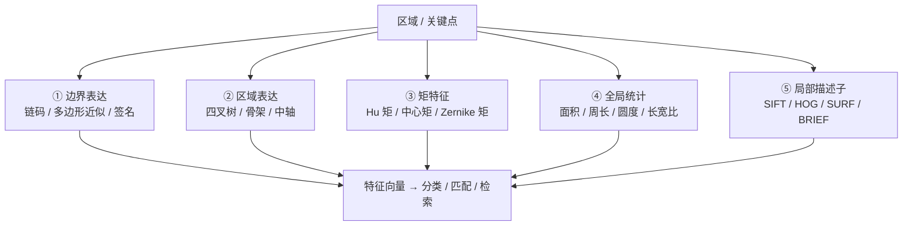

# 第6章 · 目标表达和描述

> **白话一句话**：给抠出来的目标**「建档立卡」**——用一串数字说清楚它长什么样、在哪、多大、什么形状。
> **所属层次**：🟩 中层视觉（基元 → 目标）
> **横轴分支**：[特征检测](/branches/feature-detection/) + [特征匹配](/branches/feature-matching/)（**跨分支**）
> **上一篇**：[第5章 目标分割](/chapters/ch05-segmentation) ｜ **下一篇**：[第7章 纹理分析](/chapters/ch07-texture)

---

## 这一章要解决什么问题

**核心问题**：**怎么把一块区域变成一串可比较的特征数？**

第5章得到了一个「区域」——但它还是一堆像素。计算机没法直接比较两个区域像不像，必须把它们**转成定长的数字向量（描述子）**，才能算距离、做分类、做检索。

::: tip 一句话理解
**这一章是传统 CV 的「特征工程」主战场。** 深度学习之前的三十年，CV 的核心竞争力就是「能不能设计出好的手工描述子」。
:::

::: warning 为什么这一章是「横切章」
章体系把「表达和描述」单独拎出来当一章，是非常聪明的设计：**它不是某个任务，而是一种通用能力**。特征检测（第4章）负责「找点」，本章负责「把点/区域变成数值」，然后第12章识别、第13章匹配都来消费这些数值。
:::

---

## 内容地图



**两条路线**：

- **形状/区域特征**（① ② ③ ④）：描述「这坨东西的形状」，**可解释性强**，常用于尺寸测量、形状分类。
- **局部描述子**（⑤）：描述「这个点周围长什么样」，**抗光照/视角变化**，常用于匹配和识别。

---

## 代表算法清单

| 特征 / 描述子 | 白话理解 | 维度 | 本站入口 |
|---|---|---|---|
| **链码（Freeman Chain Code）** | 沿着边界走一圈，记下「下一步朝哪拐」 | 变长 | [形状分析](/chapters/ch08-shape) |
| **Hu 七不变矩** | 七个数字描述形状，**平移/旋转/缩放都不变** | 7 | [形状分析](/chapters/ch08-shape) |
| **Zernike 矩** | 比 Hu 矩更强，能重建形状，但计算贵 | 可调 | [形状分析](/chapters/ch08-shape) |
| **骨架 / 中轴** | 把形状「烧」到只剩中线，像火柴棍 | 变长 | [形状分析](/chapters/ch08-shape) |
| **HOG 梯度方向直方图** | 把区域切成小格，每格统计「梯度都朝哪」 | 可调 | [📄 HOG+SVM 完整档案](/algorithms/hog-svm/) |
| **SIFT 描述子** | 在关键点周围统计 16 个格子 × 8 个方向的梯度 | 128 | [📄 SIFT 完整档案](/algorithms/sift/) |
| **SURF 描述子** | SIFT 的加速版，用盒式滤波+积分图 | 64/128 | [特征匹配 → 描述子](/branches/feature-matching/descriptors) |
| **BRIEF / ORB 描述子** | 不统计梯度，只随机比两个点谁亮，用 0/1 串表示 | 256 bit | [特征匹配 → 描述子](/branches/feature-matching/descriptors) |

---

## 经典论文

| 年份 | 论文 | 作者 | 贡献 |
|---|---|---|---|
| 1961 | *Visual Pattern Recognition by Moment Invariants* | Hu | 七不变矩，形状描述的开山之作 |
| 2004 | *Distinctive Image Features from Scale-Invariant Keypoints* | Lowe | SIFT 描述子（128 维直方图），至今最经典 |
| 2005 | *Histograms of Oriented Gradients for Human Detection* | Dalal & Triggs | HOG，行人检测的手工特征之王 |
| 2006 | *SURF: Speeded Up Robust Features* | Bay et al. | 用积分图和盒式滤波把 SIFT 提速数倍 |
| 2010 | *BRIEF: Binary Robust Independent Elementary Features* | Calonder et al. | 二进制描述子，匹配速度提升一个数量级 |

> 📌 **本站本体实例**：[HOG 概念](/ontology/instances) ｜ [二进制描述子](/ontology/instances) ｜ [块归一化](/ontology/instances)

---

## 工业上怎么用

| 任务 | 用哪类描述 | 理由 |
|---|---|---|
| **零件尺寸/形状分选** | Hu 矩 + 面积/周长/圆度 | 便宜、可解释，产线 MCU 都能跑 |
| **OCR 字符识别** | 投影特征 + HOG | 字符形状规整，HOG 表现极好 |
| **行人/车辆检测** | HOG | 梯度方向对衣着颜色不敏感 |
| **图像拼接 / SLAM** | SIFT / ORB | 要跨视角、跨尺度稳 |
| **PCB 元件极性检测** | 局部二值模式 + 模板 | 元件小、纹理明确 |

---

## 工程实现要点

```python
import cv2
import numpy as np

# ① Hu 矩（形状描述）
contours, _ = cv2.findContours(binary, cv2.RETR_EXTERNAL, cv2.CHAIN_APPROX_SIMPLE)
cnt = max(contours, key=cv2.contourArea)
M = cv2.moments(cnt)
hu = cv2.HuMoments(M).flatten()
# 关键：Hu 矩数值跨度极大，必须取对数再归一化
hu_log = -np.sign(hu) * np.log10(np.abs(hu) + 1e-30)

# ② HOG（用内置的 HOGDescriptor）
hog = cv2.HOGDescriptor()
desc = hog.compute(img, winStride=(8, 8))   # 关键：窗口与训练时一致

# ③ SIFT 描述子（默认 128 维）
sift = cv2.SIFT_create()
kp, desc = sift.detectAndCompute(gray, None)   # desc 形状 (N, 128)
```

::: warning 最常踩的坑
**Hu 矩直接拿去算欧氏距离是无效的**——前几个矩的数量级差 10 个幂次以上，必须**取对数**后再比较。详见 [踩坑实例](/ontology/instances)。另外 HOG 的 `winStride` / 窗口大小**必须和训练时完全一致**，否则特征维度对不上，模型直接报错。
:::

---

## 三个常见误区

- **❌ 描述子维度越高越好**。128 维 SIFT 比 256 维更慢、内存更大，很多任务 ORB 的 32 字节就够了。**够用就好**。
- **❌ 忘了归一化**。描述子的数值范围差异极大，不做归一化（L2 归一化 / 取对数）就去做距离计算，等于在用错误的度量。
- **❌ 只想着「匹配」**。这一章的特征同样是**分类器的输入**——HOG+SVM 那条线就是「HOG 描述子 + 线性 SVM」。

---

## 学完这一章你能做什么

✅ 把任意区域/关键点转成定长特征向量
✅ 在「抗不变性」和「计算成本」之间做正确取舍
✅ 理解 HOG、SIFT 描述子为什么是那个样子

**下一章**：[第7章 纹理分析](/chapters/ch07-texture) —— 形状说完了，接下来看**表面的花纹和手感**。
