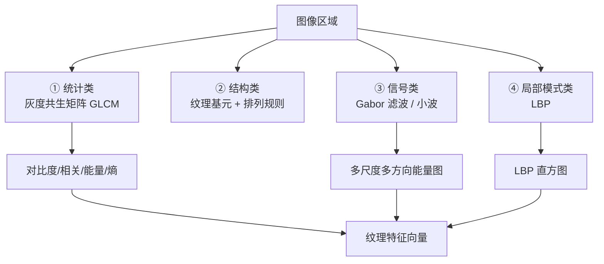

# 第7章 · 纹理分析

> **白话一句话**：量一量表面的**「花纹和手感」**——是光滑的、粗糙的、还是织纹的。
> **所属层次**：🟩 中层视觉（基元 → 目标）
> **横轴分支**：[特征匹配](/branches/feature-matching/)（**跨分支**）
> **上一篇**：[第6章 目标表达和描述](/chapters/ch06-representation) ｜ **下一篇**：[第8章 形状分析](/chapters/ch08-shape)

---

## 这一章要解决什么问题

**核心问题**：**这块区域的表面是什么质感？**

「形状」说的是物体的外轮廓，「纹理」说的是**内部的表面图案**。同一块布，颜色可能一样、形状也一样，但平纹和斜纹是两种不同的纹理——工业上「布面瑕疵检测」「金属拉丝方向」「木纹等级」全靠纹理分析。

::: tip 一句话理解
**纹理 = 图像的「局部统计规律」。** 它没法用「一个点在哪」描述，只能用「这一片区域的像素怎么彼此相关」来描述。
:::

---

## 内容地图



**四条技术路线**：

| 路线 | 代表 | 白话 |
|---|---|---|
| **统计** | GLCM | 数一数「相邻像素灰度组合」出现了多少次 |
| **结构** | 纹理基元 | 把纹理看成「小图块重复排列」 |
| **信号** | Gabor / 小波 | 用一组不同频率方向的滤波器去「拆」纹理 |
| **局部模式** | LBP | 看每个像素和周围一圈谁大谁小，编码成 8 位二进制 |

---

## 代表算法清单

| 算法 | 白话理解 | 年份 | 维度 | 入口 |
|---|---|---|---|---|
| **灰度共生矩阵 GLCM** | 统计「灰度 a 旁边是多灰度 b」出现了几次，得到一张表，再从表上算 4 个指标 | 1973 | 4–20 | [分支：描述子匹配](/branches/feature-matching/descriptors) |
| **LBP 局部二值模式** | 每个像素和周围 8 个邻居比大小，大了记 1 小了记 0，拼成一个字节 | 1994 | 59–256 | [分支：描述子匹配](/branches/feature-matching/descriptors) |
| **Gabor 滤波** | 用「方向 + 频率」各一组滤波器扫图，哪个方向的纹路强就响应大 | 1946/1980s | 40+ | [滤波与卷积](/branches/image-processing/filtering) |
| **小波纹理** | 把图像一层层分解成大波小波，各尺度统计能量 | 1989 | 可调 | [滤波与卷积](/branches/image-processing/filtering) |
| **Tamura 特征** | 粗糙度/对比度/方向性/线状度/规则度/粗略度 六个指标 | 1978 | 6 | — |

**明星是 LBP**：计算简单、对光照变化不敏感、几乎没有参数要调，是工业纹理检测的默认首选。

---

## 经典论文

| 年份 | 论文 | 作者 | 贡献 |
|---|---|---|---|
| 1973 | *Textural Features for Image Classification* | Haralick et al. | GLCM，纹理统计特征的奠基之作 |
| 1978 | *Textural Features Corresponding to Visual Perception* | Tamura et al. | 六个**符合人眼感知**的纹理指标 |
| 1994 | *Face Recognition with Local Binary Patterns*（LBP 系统化） | Ojala et al. | LBP，最实用的纹理算子 |
| 2002 | *Multiresolution Gray-Scale and Rotation Invariant Texture Classification with LBP* | Ojala et al. | 旋转不变 LBP（LBPⁱʳⁱ），工业版的标准 |
| 1989 | *A Theory for Multiresolution Signal Decomposition: The Wavelet Representation* | Mallat | 小波多分辨率分析理论 |

> 📌 **本站本体实例**：[直方图概念](/ontology/instances) ｜ [库：scikit-image](/ontology/instances)

---

## 工业上怎么用

| 场景 | 用哪条路线 | 为什么 |
|---|---|---|
| **布面瑕疵检测** | LBP + 区域统计 | 布料纹理规律性强，LBP 对光照漂移不敏感 |
| **金属表面粗糙度分级** | GLCM 的对比度/能量 | 粗糙度直接对应灰度空间相关性 |
| **木纹方向识别** | Gabor 滤波器组 | 需要「方向选择性」 |
| **纺织品类别分类** | GLCM + SVM | 统计特征维度低，分类器好训 |
| **印刷品缺陷（漏印/脏点）** | 局部方差 + 形态学 | 缺陷表现为「局部纹理被破坏」 |
| **食品表面检查（饼干脆度）** | 小波能量 + 统计 | 多尺度都能看 |

---

## 工程实现要点

```python
import cv2
import numpy as np
from skimage.feature import local_binary_pattern, graycomatrix, graycoprops

# ① LBP（均匀模式，59 维直方图）
lbp = local_binary_pattern(gray, P=8, R=1, method='uniform')
hist, _ = np.histogram(lbp.ravel(), bins=np.arange(0, 60), range=(0, 59))
hist = hist.astype('float'); hist /= hist.sum()   # 归一化成概率分布

# ② GLCM（4 个方向，取平均更稳）
glcm = graycomatrix(gray, distances=[1], angles=[0, np.pi/4, np.pi/2, 3*np.pi/4],
                    levels=256, symmetric=True, normed=True)
contrast  = graycoprops(glcm, 'contrast').mean()
energy    = graycoprops(glcm, 'energy').mean()
homog     = graycoprops(glcm, 'homogeneity').mean()
corr      = graycoprops(glcm, 'correlation').mean()
feat = np.array([contrast, energy, homog, corr])

# ③ Gabor 滤波器组（多方向多频率）
kernels = [cv2.getGaborKernel((21,21), sigma=4, theta=t, lambd=10, gamma=0.5,
                              psi=0, ktype=cv2.CV_32F)
           for t in np.arange(0, np.pi, np.pi/6)]
responses = [cv2.filter2D(gray, cv2.CV_32F, k) for k in kernels]
```

::: warning 最常踩的坑
**GLCM 的 `levels` 千万别直接设 256 去跑大图**——矩阵是 256×256，量化太细统计量会不稳定。工程上通常**先把灰度量化到 8/16 级**再做 GLCM。另外 GLCM **必须多方向取平均**，单一方向的结果毫无代表性。
:::

---

## 三个常见误区

- **❌ 把纹理和颜色混为一谈**。纹理描述的是「空间排列规律」，不是「平均颜色」。彩色特征请用颜色直方图。
- **❌ 直接对整幅图算一个全局纹理特征**。纹理是**局部**属性，应该先分块（或滑动窗口）再统计，否则布面上一处瑕疵会被整幅图平均掉。
- **❌ 忽略「尺度」**。同一块布，近看是粗糙的，远看是光滑的——纹理特征必须和拍摄尺度绑定，换镜头就得重新标定。

---

## 学完这一章你能做什么

✅ 用 LBP / GLCM 量化表面质感，做纹理分类和瑕疵检测
✅ 用 Gabor / 小波做多尺度多方向纹理分析
✅ 理解「为什么纹理检测要分块统计」

**下一章**：[第8章 形状分析](/chapters/ch08-shape) —— 表面看完了，回到**物体的外形**。
