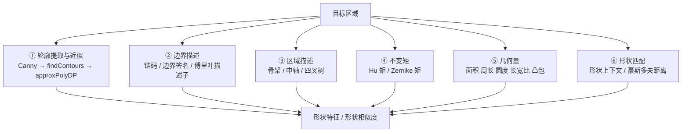

# 第8章 · 形状分析

> **白话一句话**：量一量物体的**「外形」**——是圆的还是方的，边上有几个角，胖瘦比例是多少。
> **所属层次**：🟩 中层视觉（基元 → 目标）
> **横轴分支**：[图像分割](/branches/segmentation/)（**跨分支**）
> **上一篇**：[第7章 纹理分析](/chapters/ch07-texture) ｜ **下一篇**：[第9章 立体视觉](/chapters/ch09-stereo)

---

## 这一章要解决什么问题

**核心问题**：**这个物体长什么样？**

第5章抠出了目标的「一整块」，这一章要把它的**轮廓外形**变成可计算、可比较、最好还**不受平移/旋转/缩放影响**的数字。工业上的「形状分选」「异物识别」「缺陷归类」全靠这一章。

::: tip 一句话理解
**形状分析 = 把「长相」变成「指纹」。** 目标是：同一个零件，不管放在视野哪个位置、转到什么角度、离镜头多远，算出来的形状特征都应该几乎一样。
:::

---

## 内容地图



**六个层次，由粗到细**：最粗的是「面积/周长」这类几何量，最细的是「形状上下文」这种能描述轮廓细节的方法。

---

## 代表算法清单

| 算法 | 白话理解 | 不变性 | 入口 |
|---|---|---|---|
| **多边形近似（Douglas-Peucker）** | 用尽量少的直线段画出轮廓，保留拐点 | — | [形状（本章 ⑤）](#) |
| **Freeman 链码** | 沿轮廓走一圈，记录每一步朝 8 个方向的哪个 | 平移 | [分支：区域与聚类分割](/branches/segmentation/region-clustering) |
| **边界签名** | 把「到质心的距离」随角度画成一条曲线 | 平移 | — |
| **傅里叶描述子** | 对边界做傅里叶变换，前面几个低频系数就代表形状 | 平移 | — |
| **Hu 七不变矩** | 七个数字描述形状，平移旋转缩放都不变 | 平移+旋转+缩放 | [📘 第6章](/chapters/ch06-representation) |
| **Zernike 矩** | 正交矩，能重建形状、抗噪更好，但更慢 | 平移+旋转 | — |
| **骨架 / 中轴** | 把形状「烧」得只剩中线，看分支结构 | — | — |
| **凸包 + 凸缺陷** | 找能包住形状的最小凸多边形，凹进去的部分就是缺陷 | 平移 | — |
| **形状上下文（Shape Context）** | 以每个边界点为原点统计周围点的分布，比对两形状的匹配代价 | 平移+缩放 | — |
| **豪斯多夫距离** | 两形状「最不匹配的那对点」的距离 | 平移 | — |

---

## 经典论文

| 年份 | 论文 | 作者 | 贡献 |
|---|---|---|---|
| 1961 | *Visual Pattern Recognition by Moment Invariants* | Hu | 七不变矩，形状特征的起点 |
| 1972 | *Fourier Descriptors for Unclosed Curves*（傅里叶描述子系统化） | Zahn & Roskies | 用频域系数描述边界 |
| 1973 | *Algorithms for the Reduction of the Number of Points Required to Represent a Digitized Line* | Douglas & Peucker | 多边形近似，今天所有 `approxPolyDP` 的祖宗 |
| 2002 | *Shape Matching and Object Recognition Using Shape Contexts* | Belongie et al. | 形状上下文，形状匹配的里程碑 |

> 📌 **本站本体实例**：[概念：直方图](/ontology/instances) ｜ [概念索引](/ontology/instances)

---

## 工业上怎么用

| 场景 | 用什么 | 为什么 |
|---|---|---|
| **零件形状分选** | Hu 矩 + 圆度/长宽比 | 快、可解释，MCU 也能跑 |
| **异物/毛刺检测** | 凸包 + 凸缺陷 | 毛刺就是「凸包外多出来的一小块」 |
| **零件定向（摆正）** | 最小外接矩形 `minAreaRect` | 直接拿到角度，反向旋转即可摆正 |
| **药片/胶囊数量与破损** | 轮廓面积 + 圆度 + `minEnclosingCircle` | 破损药片圆度会掉下来 |
| **字符识别前处理** | 骨架 + 投影 | 归一化字符形状 |
| **形状检索** | 形状上下文 / 傅里叶描述子 | 跨尺度、跨旋转检索 |

---

## 工程实现要点

```python
import cv2
import numpy as np

contours, _ = cv2.findContours(binary, cv2.RETR_EXTERNAL, cv2.CHAIN_APPROX_SIMPLE)
for cnt in contours:
    area = cv2.contourArea(cnt)
    if area < 100:            # 过滤小噪点，这一步必不可少
        continue

    peri = cv2.arcLength(cnt, True)

    # ① 圆度：4π·面积/周长²，圆 = 1
    circularity = 4 * np.pi * area / (peri * peri + 1e-9)

    # ② 多边形近似（精度 = 0.02 × 周长）
    approx = cv2.approxPolyDP(cnt, 0.02 * peri, True)
    n_vertex = len(approx)     # 顶点数 → 直接判断三角/矩形/多边形

    # ③ 最小外接矩形与角度
    (cx, cy), (w, h), angle = cv2.minAreaRect(cnt)

    # ④ 凸包与凸缺陷（找毛刺/凹陷）
    hull = cv2.convexHull(cnt, returnPoints=False)
    defects = cv2.convexityDefects(cnt, hull)

    # ⑤ Hu 矩（务必取对数）
    hu = cv2.HuMoments(cv2.moments(cnt)).flatten()
    hu = -np.sign(hu) * np.log10(np.abs(hu) + 1e-30)
```

::: warning 最常踩的坑
**`approxPolyDP` 的 epsilon 直接决定顶点数**——epsilon 设大了，矩形变成三角形；设小了，直边被切成十几个点。**它和周长成比例，必须写 `0.01~0.03 × arcLength`，不能写死像素值。** 另外 Hu 矩必须**取对数**再算距离。
:::

---

## 三个常见误区

- **❌ 拿形状特征去要求「光照不变」**。形状特征依赖**分割质量**——分割一旦受光照影响就没边界了，所以形状分析的隐含前提是「分割要稳」。
- **❌ 只用 Hu 矩**。Hu 矩抗干扰不错，但**无法区分镜像形状**、对噪声敏感。工程上常常是「Hu 矩（粗筛）+ 点集匹配（细判）」两段式。
- **❌ 忽视「尺度归一化」**。要比较两个不同尺寸零件的形状，必须先按面积或外接框归一化，否则 Hu 矩之外的特征都在比大小。

---

## 学完这一章你能做什么

✅ 把任意形状转成抗平移/旋转/缩放的特征
✅ 用凸包、凸缺陷、圆度做缺陷与异物判断
✅ 用最小外接矩形实现零件自动摆正

**下一章**：[第9章 立体视觉](/chapters/ch09-stereo) —— 二维形状分析完了，进入**三维世界的第一步：测距离**。
