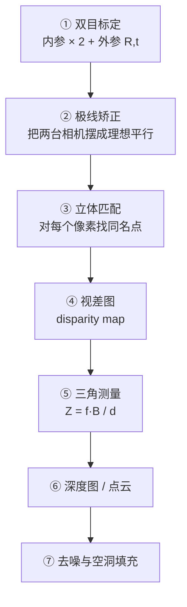

# 第9章 · 立体视觉

> **白话一句话**：像人的双眼一样，**靠「两只眼睛看到的位置差」算出物体有多远**。
> **所属层次**：🟥 高层视觉（目标 → 语义）
> **横轴分支**：[几何视觉](/branches/geometry/)
> **上一篇**：[第8章 形状分析](/chapters/ch08-shape) ｜ **下一篇**：[第10章 三维景物恢复](/chapters/ch10-3d-recovery)

---

## 这一章要解决什么问题

**核心问题**：**两张有视角差的图，怎么算出深度？**

一只眼睛看世界，你分不清「大的远物体」和「小的近物体」；两只眼睛一起看，大脑通过**视差**立刻判断出距离。立体视觉就是把这件事交给算法：**两个相机 + 匹配 + 三角测量 = 深度图**。

::: tip 一句话理解
**视差越大，物体越近；视差越小，物体越远。** 这就是立体视觉的全部核心，其余全是围绕「怎么把视差算准」做的工程。
:::

---

## 内容地图



**关键公式只有一条**（也只需要这一条）：

$$
Z = \frac{f \cdot B}{d}
$$

- $Z$ 是深度，$f$ 是焦距，$B$ 是两相机间距（基线），$d$ 是视差。

**它说明三件事**：基线 $B$ 越大，能测的深度越远、精度越高；焦距 $f$ 越大同理；**视差 $d$ 算错 1 个像素，深度误差和距离的平方成正比**——这就是为什么远距离测深特别难。

---

## 代表算法清单

| 算法 / 步骤 | 白话理解 | 入口 |
|---|---|---|
| **张正友标定法** | 拿棋盘格拍十几张照片，反推相机参数 | [相机标定与对极几何](/branches/geometry/camera-geometry) |
| **对极几何 / 基础矩阵** | 已知一个点在左图的位置，它在右图一定在某条线上 | [相机标定与对极几何](/branches/geometry/camera-geometry) |
| **极线矫正** | 把两张图「掰平」，让对应的点在同一水平线上 | [立体匹配](/branches/geometry/stereo) |
| **块匹配 SAD / NCC** | 拿一小块去另一图里找最像的位置 | [立体匹配](/branches/geometry/stereo) |
| **SGBM 半全局匹配** | OpenCV 里最实用的立体匹配算法 | [立体匹配](/branches/geometry/stereo) |
| **结构光 / 编码光** | 自己打一个已知图案，比找自然纹理可靠得多 | [立体匹配](/branches/geometry/stereo) |
| **双目 SLAM** | 一边测深一边估计相机自己怎么走 | [立体匹配与 SFM](/branches/geometry/stereo-sfm) |

---

## 经典论文

| 年份 | 论文 | 作者 | 贡献 |
|---|---|---|---|
| 1999 | *Flexible Camera Calibration by Viewing a Plane from Unknown Orientations* | 张正友 | 一张棋盘纸搞定标定，工业标准 |
| 1981 | *Random Sample Consensus*（几何验证部分） | Fischler & Bolles | RANSAC，稳健估计的基础 |
| 2003 | *Multiple View Geometry in Computer Vision* | Hartley & Zisserman | 多视图几何的圣经 |
| 2008 | *Stereo Processing by Semi-Global Matching* | Hirschmüller | SGBM，工程上最好用的立体匹配 |
| 2005 | *PatchMatch: A Randomized Correspondence Algorithm* | Barnes et al. | 随机化匹配，速度与质量的突破 |

> 📌 **本站本体实例**：[对极几何](/ontology/instances) ｜ [论文：Hartley-Zisserman](/ontology/instances) ｜ [RANSAC](/ontology/instances)

---

## 工业上怎么用

| 场景 | 技术方案 | 精度量级 |
|---|---|---|
| **双目测距 / 避障** | 双目标定 + SGBM + 滤波 | 近距离 1% 相对误差 |
| **工业 3D 测量（高精度）** | **结构光 / 激光三角**（比自然双目准得多） | 0.01–0.1 mm |
| **机器人抓取** | 结构光相机（如深度相机） | 亚毫米到毫米 |
| **箱体积测量（物流）** | 深度相机 + 点云拟合平面 | 厘米级 |
| **农业植株测高** | 双目或深度相机 | 厘米级 |
| **自动驾驶（辅助）** | 双目 + 雷达/激光融合 | 米级 |

::: tip 记住这条工程结论
**自然纹理的双目立体匹配，工业精度通常不如结构光。** 双目最大的优势是「被动、便宜、远距离」；一旦要求亚毫米精度，业界一律上**结构光或激光三角**。
:::

---

## 工程实现要点

```python
import cv2
import numpy as np

# ① 标定：棋盘格内角点 (9,6)
objp = np.zeros((6*9, 3), np.float32)
objp[:, :2] = np.mgrid[0:9, 0:6].T.reshape(-1, 2)
# ... 逐张 findChessboardCorners + cornerSubPix 得到亚像素角点 ...
ret, K1, D1, K2, D2, R, T, E, F = cv2.stereoCalibrate(
    objpoints, imgpoints1, imgpoints2, K1, D1, K2, D2, image_size,
    flags=cv2.CALIB_FIX_INTRINSIC)

# ② 极线矫正
R1, R2, P1, P2, Q, _, _ = cv2.stereoRectify(K1, D1, K2, D2, image_size, R, T,
                                            alpha=0)
map1x, map1y = cv2.initUndistortRectifyMap(K1, D1, R1, P1, image_size, cv2.CV_32FC1)

# ③ SGBM 立体匹配
left_matcher = cv2.StereoSGBM_create(
    minDisparity=0, numDisparities=128, blockSize=5,
    P1=8*5*5, P2=32*5*5, disp12MaxDiff=1,
    uniquenessRatio=10, speckleWindowSize=100, speckleRange=2,
    mode=cv2.STEREO_SGBM_MODE_SGBM_3WAY)
disparity = left_matcher.compute(rect_left, rect_right).astype(np.float32) / 16.0

# ④ 转深度：Z = f * B / d
depth = (f_pixel * baseline) / (disparity + 1e-6)
```

::: warning 最常踩的坑
**`numDisparities` 必须能被 16 整除**，而且它直接决定「最近能测多近、最远能测多远」——设小了远处的物体全部无解，视差图上一片黑洞。另外**未做极线矫正直接用 SGBM，结果全是错的**。
:::

---

## 三个常见误区

- **❌ 以为两个相机随便架就行**。基线太长近距离有盲区、太短远处测不准；两个相机**必须同步曝光**，否则动一下就错。
- **❌ 忽略标定的重要性**。标定误差会被三角测量**平方放大**，标定没做好，后面所有深度都是错的。
- **❌ 用双目去做高精度测量**。如上所述，要求亚毫米请上结构光。

---

## 学完这一章你能做什么

✅ 完成双目标定与极线矫正
✅ 用 SGBM 算出视差图并转成深度图
✅ 在「被动双目」和「主动结构光」之间做正确的工程选型

**下一章**：[第10章 三维景物恢复](/chapters/ch10-3d-recovery) —— 只有一张图，怎么还原立体？
