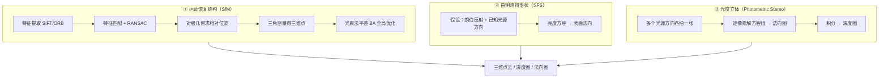

# 第10章 · 三维景物恢复

> **白话一句话**：只有单张（或几张随手拍的）照片，怎么**还原出物体的立体形状和相机的运动轨迹**。
> **所属层次**：🟥 高层视觉（目标 → 语义）
> **横轴分支**：[几何视觉](/branches/geometry/)
> 
## 🎮 动手玩一玩本章核心概念

🖱 拖动截止频率滑块：频域滤波的本质就是切掉某些频率成分

<ClientOnly>
<MathVisualizer initialTab="fourier" compact />
</ClientOnly>

**上一篇**：[第9章 立体视觉](/chapters/ch09-stereo) ｜ **下一篇**：[第11章 运动分析](/chapters/ch11-motion)

---

## 这一章要解决什么问题

**核心问题**：**只有图像，怎么倒推出 3D 几何？**

第9章需要「两台标定好的相机」这个奢侈条件。这一章解决更现实的情况：**只有一台相机、甚至只有一堆随手拍的照片**，能不能还原三维？

**三条不同路线，靠的「线索」完全不同**：

| 线索 | 方法 | 一句话 |
|---|---|---|
| **运动** | SfM（Structure from Motion） | 拿着相机边走边拍，靠「视差」倒推相机位置和三维点 |
| **明暗** | SFS（Shape from Shading） | 靠表面亮暗变化，反推表面朝哪个方向 |
| **光度** | 光度立体（Photometric Stereo） | 固定相机、换几个方向的光各拍一张，法向直接算出来 |

::: tip 一句话理解
**SfM 用「多视角」换三维；SFS 用「明暗」换三维；光度立体用「换灯」换三维。** 三者对拍摄条件的要求依次升高，得到的精度也依次升高。
:::

---

## 内容地图



---

## 代表算法清单

| 算法 / 步骤 | 白话理解 | 入口 |
|---|---|---|
| **SfM 运动恢复结构** | 一堆照片进去，相机轨迹和稀疏点云出来 | [立体匹配与 SFM](/branches/geometry/stereo-sfm) |
| **对极几何 + 八点法** | 从 8 组匹配点解出两台相机之间的几何关系 | [相机标定与对极几何](/branches/geometry/camera-geometry) |
| **三角测量** | 两条射线相交，交点就是三维点 | [对极几何](/branches/geometry/epipolar) |
| **光束法平差 BA** | 把所有相机参数和三维点一起联合优化，误差最小 | [立体匹配与 SFM](/branches/geometry/stereo-sfm) |
| **P3P / EPnP 位姿求解** | 已知若干三维点和它们的像素坐标，求相机在哪 | [相机标定与对极几何](/branches/geometry/camera-geometry) |
| **RANSAC 稳健估计** | 数据里有大量错匹配时，投票选出最一致的模型 | [鲁棒估计](/branches/feature-matching/robust-estimation) |
| **SFS 由明暗得形状** | 一个球，光从左上打来，亮在哪里就能推出表面朝向 | — |
| **光度立体** | 换四个方向的灯各拍一张，逐像素算表面法向 | — |
| **ICP 点云配准** | 两组点云互相对齐，反复「找最近点 + 求变换」 | [鲁棒估计](/branches/feature-matching/robust-estimation) |

---

## 经典论文

| 年份 | 论文 | 作者 | 贡献 |
|---|---|---|---|
| 1981 | *Random Sample Consensus* | Fischler & Bolles | RANSAC，SfM 抗错匹配的核心 |
| 1992 | *Shape and Motion from Image Streams: A Factorization Method* | Tomasi & Kanade | 因子分解法，SfM 的理论里程碑 |
| 1989 | *Shape-from-Shading: A Method for Obtaining the Shape of a Smooth Opaque Object* | Horn | SFS 的经典源头 |
| 1980 | *Photometric Method for Determining Surface Orientation from Multiple Images* | Woodham | 光度立体，精度最好的单目 3D 法 |
| 1992 | *A Method for Registration of 3-D Shapes* | Besl & McKay | ICP 点云配准 |

> 📌 **本站本体实例**：[SfM 应用](/ontology/instances) ｜ [论文：Hartley-Zisserman](/ontology/instances) ｜ [RANSAC](/ontology/instances)

---

## 工业上怎么用

| 场景 | 用哪条路线 | 为什么 |
|---|---|---|
| **文物 / 建筑数字化** | 照片 SfM（如 COLMAP） | 只需拍照，不接触文物 |
| **无人机测绘 / 正射影像** | SfM + 摄影测量 | 大范围、低成本 |
| **表面缺陷（划痕/凹坑）** | **光度立体** | 对细微凹凸极其敏感，是「表面形貌检测」的利器 |
| **浮雕/铭文数字化** | 光度立体 | 靠明暗就能恢复浮雕高度 |
| **室内三维重建（VR看房）** | SfM + 稠密重建 | 单目即可，成本低 |
| **零件表面质量分级** | 光度立体 + 法向统计 | 直接量化「表面起伏」 |

::: tip 工业上的冷门王牌
**光度立体在「表面缺陷检测」里被严重低估**。它能拍到**人眼和普通相机都看不到的细微凹凸**，而且「多拍几张换灯」在产线上完全可以做到（频闪光源，几十毫秒一轮）。详见 [工业缺陷案例](/cases/industrial-defect)。
:::

---

## 工程实现要点

```python
# SfM 主流实现：直接用 COLMAP（不要自己造轮子）
# 命令行三步：特征提取 → 匹配 → 增量式重建
# colmap feature_extractor --database_path db.db --image_path ./images
# colmap exhaustive_matcher --database_path db.db
# colmap mapper --database_path db.db --image_path ./images --output_path ./sparse

# 光度立体最小实现（假设已知光源方向 L，四张图 I1..I4）
import numpy as np
L = np.array([[ 1, 0, 1], [-1, 0, 1], [0, 1, 1], [0, -1, 1]], float)
L = L / np.linalg.norm(L, axis=1, keepdims=True)      # 单位化光源方向
I = np.stack([i1, i2, i3, i4], axis=-1).astype(float)  # 形状 H×W×4

# 逐像素解 L·g = I，得 g = ρ·n
g = np.linalg.lstsq(L.T, I.reshape(-1, 4).T, rcond=None)[0].T
g = g.reshape(*I.shape[:2], 3)

rho = np.linalg.norm(g, axis=-1)          # 反照率（颜色/材质）
n = g / (rho[..., None] + 1e-9)           # 表面法向

# 由法向积分得到深度（简单累加，实际应用需用泊松积分 / Frankot-Chellappa）
p = -n[..., 0] / (n[..., 2] + 1e-9)       # 沿 x 的斜率
q = -n[..., 1] / (n[..., 2] + 1e-9)       # 沿 y 的斜率
depth = np.cumsum(np.cumsum(...))         # 需要做二维积分，误差会累积
```

::: warning 最常踩的坑
**SfM 的精度瓶颈不在算法，而在「匹配 + RANSAC」**。错匹配会让相机位姿整体跑偏，而位姿跑偏会摧毁后面的所有三维点。所以「特征质量 + 几何验证」永远是 SfM 的第一优先级。

**光度立体的坑在积分**——法向积分误差会**累积**，必须用 Frankot-Chellappa 或泊松积分这类全局方法，简单累加会得到一张扭曲的深度图。
:::

---

## 三个常见误区

- **❌ 认为 SfM 输出就是「三维模型」**。SfM 只给**稀疏点云**（几千个点），要稠密模型还得上 MVS（多视图立体）或深度图融合。
- **❌ 只拍等间隔轨迹的照片**。SfM 需要**多角度 + 有充分重叠**，沿直线平移拍（纯平移、纯旋转）会导致退化。
- **❌ 忘了尺度**。单目 SfM 只能恢复**相对**几何，尺度是不确定的——换个相机、换组照片，整体大小完全不同，需要外部参照物（如标定杆）来定标。

---

## 学完这一章你能做什么

✅ 用 COLMAP 从一组照片重建稀疏点云和相机轨迹
✅ 用光度立体做高灵敏度表面缺陷检测
✅ 理解「为什么单目只能恢复相对结构」

**下一章**：[第11章 运动分析](/chapters/ch11-motion) —— 静态 3D 说完了，接下来看**画面里的东西怎么动**。
