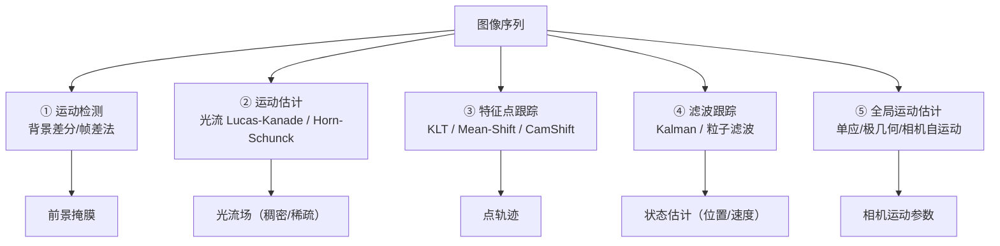

# 第11章 · 运动分析

> **白话一句话**：看画面里的东西**「动没动、往哪动、动多快」**。
> **所属层次**：🟥 高层视觉（目标 → 语义）
> **横轴分支**：[几何视觉](/branches/geometry/) + [目标检测](/branches/detection/)
> 
## 🎮 动手玩一玩本章核心概念

🖱 看 Lucas-Kanade 光流：相邻两帧之间像素怎么"跑"起来的

<ClientOnly>
<MathVisualizer initialTab="lk" compact />
</ClientOnly>

**上一篇**：[第10章 三维景物恢复](/chapters/ch10-3d-recovery) ｜ **下一篇**：[第12章 景物识别](/chapters/ch12-recognition)

---

## 这一章要解决什么问题

**核心问题**：**相邻帧之间，画面里的东西怎么动的？**

前面所有章节都在处理**静态图像**。这一章开始处理**时间维度**——两个镜头之间发生了什么，哪个像素跑到了哪里，摄像机自己在动还是物体在动。

**这一章是传统 CV 和视频分析的接口**：监控、交通、机器人导航、手势识别，全都从这里开始。

---

## 内容地图



**五件事，各有各的用途**：

| 方向 | 回答什么 | 典型用途 |
|---|---|---|
| **运动检测** | 哪些地方有东西在动 | 监控告警、人流统计 |
| **运动估计（光流）** | 每个像素往哪动 | 视觉里程计、动作识别 |
| **特征点跟踪** | 这个点跑到哪去了 | 目标跟踪、SLAM |
| **滤波跟踪** | 目标下一步会在哪 | 预测、平滑、抗遮挡 |
| **全局运动估计** | 相机自己怎么动的 | 防抖、全景、SLAM |

---

## 代表算法清单

| 算法 | 白话理解 | 年份 | 入口 |
|---|---|---|---|
| **帧差法** | 两帧直接相减，差值大的地方就是动的 | — | [区域与聚类分割](/branches/segmentation/region-clustering) |
| **背景差分 / 高斯混合模型 GMM** | 学出「正常背景长什么样」，不一样的就算动 | 1999 | [区域与聚类分割](/branches/segmentation/region-clustering) |
| **Lucas-Kanade 光流** | 假设一小块里所有像素动得一样，解出来往哪动 | 1981 | [光流](/branches/geometry/optical-flow) |
| **Horn-Schunck 光流** | 假设相邻像素动得接近，全局求解稠密光流 | 1981 | [光流](/branches/geometry/optical-flow) |
| **Farnebäck 稠密光流** | OpenCV 里最好用的稠密光流实现 | 2003 | [光流](/branches/geometry/optical-flow) |
| **KLT 跟踪** | 拿 Shi-Tomasi 角点，在下一帧里找它跑到哪 | 1981 | [光流](/branches/geometry/optical-flow) |
| **Mean-Shift / CamShift 跟踪** | 顺着颜色最密的方向找，能自适应大小 | 2002 | [光流](/branches/geometry/optical-flow) |
| **Kalman 滤波** | 用「上一时刻估计 + 这一时刻观测」预测下一步 | 1960 | — |
| **粒子滤波** | 撒一堆小粒子，谁符合观测谁权重高 | 1993 | — |
| **相机自运动 / 结构从运动** | 从全图运动反推相机自己怎么动的 | — | [立体匹配与 SFM](/branches/geometry/stereo-sfm) |

---

## 经典论文

| 年份 | 论文 | 作者 | 贡献 |
|---|---|---|---|
| 1981 | *An Iterative Image Registration Technique with an Application to Stereo Vision* | Lucas & Kanade | LK 光流，KLT 跟踪的内核 |
| 1981 | *Determining Optical Flow* | Horn & Schunck | 稠密光流的经典源头 |
| 1999 | *Adaptive Background Mixture Models for Real-Time Tracking* | Stauffer & Grimson | GMM 背景建模，监控系统的标配 |
| 2003 | *Two-Frame Motion Estimation Based on Polynomial Expansion* | Farnebäck | 实用稠密光流，OpenCV 默认实现 |
| 1993 | *A New Approach to Linear Filtering and Prediction Problems*（Kalman 1960 / 粒子滤波 1993） | Kalman / Gordon et al. | 状态估计的两大支柱 |

> 📌 **本站本体实例**：[光流](/ontology/instances) ｜ [论文：Lucas-Kanade 1981](/ontology/instances) ｜ [光流概念](/ontology/instances)

---

## 工业上怎么用

| 场景 | 技术方案 | 为什么 |
|---|---|---|
| **园区监控入侵告警** | GMM 背景建模 + 连通域 + 形态学 | 能自适应光照变化和轻微抖动 |
| **交通流量/车速估计** | 目标检测 + KLT 跟踪 + 像素–实际标定 | 用轨迹反推速度 |
| **视频防抖 / 电子稳像** | 特征点匹配 → 估计全局运动 → 反向补偿 | 先算「相机抖了多少」 |
| **Alt 无人机视觉里程计** | 光流 + IMU 融合 | 光流给位移，IMU 给姿态 |
| **传送带产品计数** | 背景差分 + 虚拟计数线 | 最快最稳的产线计数法 |
| **体育动作分析** | 稠密光流 + 统计 | 光流场能量和方向能反映动作强度 |

---

## 工程实现要点

```python
import cv2
import numpy as np

# ① 背景差分（GMM）
bg = cv2.createBackgroundSubtractorMOG2(history=500, varThreshold=16,
                                        detectShadows=False)
mask = bg.apply(frame)
mask = cv2.morphologyEx(mask, cv2.MORPH_OPEN,
                        cv2.getStructuringElement(cv2.MORPH_ELLIPSE, (3, 3)))

# ② 稀疏光流（LK）+ 跟踪
p0 = cv2.goodFeaturesToTrack(prev_gray, maxCorners=100, qualityLevel=0.3,
                             minDistance=7, blockSize=7)
p1, st, err = cv2.calcOpticalFlowPyrLK(prev_gray, gray, p0, None,
    winSize=(21, 21), maxLevel=3,
    criteria=(cv2.TERM_CRITERIA_EPS | cv2.TERM_CRITERIA_COUNT, 30, 0.01))
# 关键：用前后向一致性剔除错轨
p0r, _, _ = cv2.calcOpticalFlowPyrLK(gray, prev_gray, p1, None)
fb_err = np.linalg.norm(p0 - p0r, axis=-1).squeeze()

# ③ 稠密光流（Farnebäck）
flow = cv2.calcOpticalFlowFarneback(prev_gray, gray, None,
    0.5, 3, 15, 3, 5, 1.2, 0)
mag, ang = cv2.cartToPolar(flow[..., 0], flow[..., 1])
```

::: tip 工程上的两条铁律
1. **光流必须用「金字塔」**。单一尺度的 LK 在大位移时彻底失效，`maxLevel=3` 几乎是必设项。
2. **必须做「前后向一致性」检验**。只算正向光流会留下大量错轨，正反各算一次、要求回到原点附近，能过滤掉绝大部分错误。
:::

---

## 三个常见误区

- **❌ 以为背景差分会自动适应一切**。GMM 对「光照突变（开灯/关灯）」「树叶随风轻摆」「水面反光」都容易误报，必须配形态学 + 面积阈值 + 持续帧数确认。
- **❌ 只做光流不做跟踪**。光流给的是「瞬时速度」，跟踪给的是「持续身份」。要数人或数车，必须有跟踪环节。
- **❌ 忽略相机自身运动**。手持或晃动镜头的场景里，「整幅图都在动」——必须先估计并补偿全局运动，否则把相机抖动当成了物体运动。

---

## 学完这一章你能做什么

✅ 用背景差分做运动目标检测
✅ 用 LK/稠密光流估计运动场，并做正确的质量控制
✅ 用跟踪 + 滤波维持目标身份

**下一章**：[第12章 景物识别](/chapters/ch12-recognition) —— 会动了，接下来要**认出它到底是什么**。
