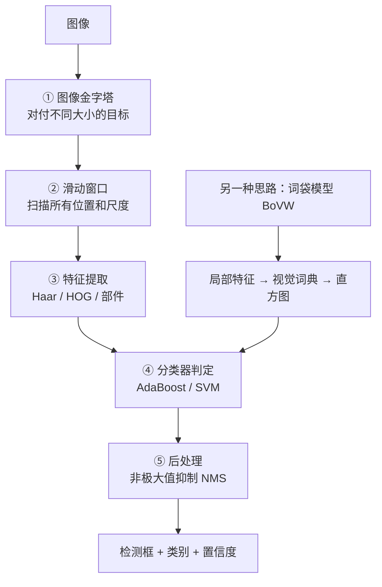

# 第12章 · 景物识别

> **白话一句话**：认出画面里的东西**「这是啥」**——它是人、是车、还是缺陷。
> **所属层次**：🟥 高层视觉（目标 → 语义）
> **横轴分支**：[目标检测](/branches/detection/)
> 
## 🎮 动手玩一玩本章核心概念

🖱 区分平坦区 / 边缘 / 角点：这是特征识别的基础判定

<ClientOnly>
<MathVisualizer initialTab="harris" compact />
</ClientOnly>

**上一篇**：[第11章 运动分析](/chapters/ch11-motion) ｜ **下一篇**：[第13章 广义匹配](/chapters/ch13-matching)

---

## 这一章要解决什么问题

**核心问题**：**图像里有没有目标、在哪、是什么？**

这是传统 CV 的**收官之作**，也是深度学习接手前最辉煌的一块。从 2001 年 Viola-Jones 让「实时人脸检测」成为可能，到 2005 年 HOG+SVM 成为行人检测标准，再到 2008 年 DPM 拿下通用物体检测——**传统检测器用十年时间，把「机器看东西」从不可能做到可用**。

::: tip 一句话理解
**传统检测 = 滑窗 + 特征 + 分类器 + 后处理。** 所有世代都用同一套骨架，区别只在「怎么让单窗口算得足够快」。
:::

::: warning 章体系的空白
章体系只用「景物识别」四个字带过这一整块，但工程上这是**最常用的一大族**。本站把它独立成 [目标检测分支](/branches/detection/)，并补了三个专页。这是「章体系」「横轴分支」互补的最好例子。
:::

---

## 内容地图



**骨架只有一套，三代三种加速手法**：

| 世代 | 年份 | 代表 | 加速手法 |
|---|---|---|---|
| 第一代 | 2001 | Viola-Jones | **积分图**（Haar 特征 O(1)）+ **级联**（早退） |
| 第二代 | 2005 | HOG+SVM | **特征复用**（重叠块只算一次）+ 线性 SVM |
| 第三代 | 2008 | DPM | HOG + **部件模型** + 级联 |
| 转型 | 2014 | R-CNN 系列 | 区域提议 + CNN |

---

## 代表算法清单

| 算法 | 白话理解 | 年份 | 本站入口 |
|---|---|---|---|
| **滑动窗口 + 积分图** | 小窗口在图上「走格子」，每停一次判断一次 | — | [滑动窗口与积分图](/branches/detection/sliding-window) |
| **Haar 特征** | 用黑白矩形块的亮度差，捕捉「眼睛比脸颊暗」这类模式 | 2001 | [经典检测器](/branches/detection/classic-detectors) |
| **AdaBoost 级联** | 很多弱分类器接力，前几关就否掉大部分窗口 | 1995/2001 | [经典检测器](/branches/detection/classic-detectors) |
| **Viola-Jones** | 第一个做到实时的通用检测框架，人脸检测的开山鼻祖 | 2001 | [📌 Viola-Jones 专页](/branches/detection/viola-jones) |
| **HOG + 线性 SVM** | 梯度方向直方图 + 线性分类器，行人检测的黄金标准 | 2005 | [📄 HOG+SVM 完整档案](/algorithms/hog-svm/) |
| **DPM 可变形部件模型** | 把物体看成「一个整体 + 若干可动部件」，能容忍形变 | 2008 | [📌 DPM 专页](/branches/detection/dpm) |
| **BoVW 词袋模型** | 把图像当成「视觉单词」的集合，像统计词频一样分类 | 2004 | [📌 BoVW 专页](/branches/detection/bovw) |
| **NMS 非极大值抑制** | 同一个目标被检出一堆框，只留最好的那个 | — | [滑动窗口与积分图](/branches/detection/sliding-window) |

---

## 经典论文

| 年份 | 论文 | 作者 | 贡献 |
|---|---|---|---|
| 2001 | *Rapid Object Detection using a Boosted Cascade of Simple Features* | Viola & Jones | 积分图 + 级联 AdaBoost，实时人脸检测 |
| 2004 | *Distinctive Image Features from Scale-Invariant Keypoints*（BoVW 基础） | Lowe | SIFT 成为词袋模型的局部特征 |
| 2005 | *Histograms of Oriented Gradients for Human Detection* | Dalal & Triggs | HOG+SVM，行人检测的标准 |
| 2006 | *Beyond Bags of Features: Spatial Pyramid Matching* | Lazebnik et al. | 空间金字塔匹配，BoVW 的关键升级 |
| 2008 | *A Discriminatively Trained, Multiscale, Deformable Part Model* | Felzenszwalb et al. | DPM，传统检测的巅峰 |

> 📌 **本站本体实例**：[Viola-Jones](/ontology/instances) ｜ [HOG+SVM](/ontology/instances) ｜ [论文：Viola-Jones 2001](/ontology/instances)

---

## 工业上怎么用

| 场景 | 传统方案 | 为什么还用它 |
|---|---|---|
| **人脸检测（门禁/考勤）** | Viola-Jones | 无需 GPU、几十毫秒、可直接跑在嵌入式 |
| **行人检测（安防）** | HOG+SVM | 特征可解释、误报可控 |
| **工业缺陷分类（有/无）** | HOG/纹理特征 + SVM | 样本少也能训，产线最稳 |
| **商标/包装识别** | SIFT + BoVW + SVM | 抗旋转、抗尺度，样本需求小 |
| **车牌定位** | Haar + 形态学 + 颜色 | 快、省、易调 |
| **渣土车/货车识别（边缘盒）** | HOG + 级联 | 无 GPU 场景的最佳选择 |

::: tip 传统检测器的真实竞争力
**样本极少 + 无 GPU + 要求可解释**——这三个条件一叠加，传统检测器至今仍是最优解。深度学习方案要几百张标注图 + 一块 GPU，而 HOG+SVM 在 50 张图上就能出可用结果。
:::

---

## 工程实现要点

```python
import cv2

# ① Viola-Jones（人脸）：直接用 OpenCV 预训练级联
face_cascade = cv2.CascadeClassifier(
    cv2.data.haarcascades + 'haarcascade_frontalface_default.xml')
faces = face_cascade.detectMultiScale(
    gray, scaleFactor=1.1, minNeighbors=5,
    minSize=(30, 30), flags=cv2.CASCADE_SCALE_IMAGE)

# ② HOG 行人检测（OpenCV 内置了训练好的 SVM）
hog = cv2.HOGDescriptor()
hog.setSVMDetector(cv2.HOGDescriptor_getDefaultPeopleDetector())
rects, weights = hog.detectMultiScale(
    img, winStride=(8, 8), padding=(8, 8), scale=1.05)
# 关键：同样的 winStride 要做一次 NMS，否则一个目标出多个框
rects = [r for r, w in zip(rects, weights) if w > 0.5]

# ③ NMS（自己实现的标准版）
def nms(boxes, scores, iou_thr=0.5):
    idxs = sorted(range(len(scores)), key=lambda i: -scores[i])
    keep = []
    while idxs:
        cur = idxs.pop(0); keep.append(cur)
        idxs = [i for i in idxs if iou(boxes[cur], boxes[i]) < iou_thr]
    return keep
```

::: warning 最常踩的坑
**HOG 行人检测的框总是「偏大 + 一目标多框」**，必须配 `winStride` 调优 + NMS。而 **Viola-Jones 的 `minNeighbors` 是效果分水岭**——设 3 误报多，设 8 会漏检侧脸。详见 [HOG+SVM 踩坑](/algorithms/hog-svm/painpoints)。
:::

---

## 三个常见误区

- **❌ 以为传统检测器「已经被淘汰」**。它在**低算力、小样本、可解释**三个维度仍然无可替代，边缘设备上大量在用。
- **❌ 把检测当成分类**。检测要**同时**定位（回归框）和识别（分类），滑窗方案的复杂性主要来自「位置和尺度」的组合爆炸。
- **❌ 忽略后处理**。NMS 的 IoU 阈值直接决定「密集目标能不能分开」——行人挨在一起时，IoU 设大了会把两个人合并成一个。

---

## 学完这一章你能做什么

✅ 用 Viola-Jones / HOG+SVM 搭建可用的实时检测器
✅ 自己实现并调优 NMS
✅ 理解传统检测「万年不变的四步骨架」

**下一章**：[第13章 广义匹配](/chapters/ch13-matching) —— 从「识别」转向「对应」：两幅图怎么对上号。
