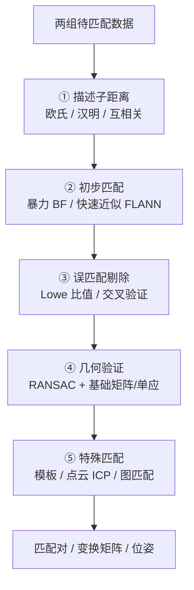

# 第13章 · 广义匹配

> **白话一句话**：把**两幅图或两组数据「对上号」**——不只是特征点匹配，还包括模板、点集、图结构、跨模态。
> **所属层次**：🟥 高层视觉（目标 → 语义）
> **横轴分支**：[特征匹配](/branches/feature-matching/)
> **上一篇**：[第12章 景物识别](/chapters/ch12-recognition) ｜ **下一篇**：[第14章 时空行为理解](/chapters/ch14-activity)

---

## 这一章要解决什么问题

**核心问题**：**怎么建立两个实体之间的对应关系？**

「匹配」听起来只是特征点的事，但章体系看得更远：**匹配是一种通用的方法论**——只要你有两组东西要建立对应，就需要匹配。

| 要匹配的东西 | 方法 |
|---|---|
| 两组特征点 | 描述子 + 比值检验 + RANSAC |
| 一张模板和一幅图 | 模板匹配（相关 / 归一化互相关） |
| 两组三维点云 | ICP |
| 两张图的形状 | 形状上下文 / 图匹配 |
| 不同模态（可见光 vs 红外） | 互信息 / 跨模态描述子 |

::: tip 一句话理解
**匹配的两大难题永远是：「怎么描述才可比」+「有错配怎么稳健」。** 前者靠描述子（第6章），后者靠 RANSAC / 鲁棒估计。
:::

---

## 内容地图



---

## 代表算法清单

| 算法 | 白话理解 | 年份 | 本站入口 |
|---|---|---|---|
| **暴力匹配 BFMatcher** | 每个点都去对方全部点里找一个最像的 | — | [描述子匹配](/branches/feature-matching/descriptors) |
| **FLANN 快速近似最近邻** | 建索引树加速，牺牲一点精度换大幅提速 | 2009 | [描述子匹配](/branches/feature-matching/descriptors) |
| **Lowe 比值检验** | 最近的距离要比次近的明显小，才算可信匹配 | 2004 | [描述子匹配](/branches/feature-matching/descriptors) |
| **交叉验证** | 你认我、我也认你，才算一对 | — | [描述子匹配](/branches/feature-matching/descriptors) |
| **RANSAC** | 随机抽最小样本算模型，票数最多的就是正解 | 1981 | [鲁棒估计](/branches/feature-matching/robust-estimation) |
| **基础矩阵 / 八点法** | 从匹配点解出两台相机的对极约束 | 1913/1981 | [对极几何](/branches/geometry/epipolar) |
| **单应矩阵** | 同一个平面在两张图之间的映射关系 | — | [单应变换](/branches/geometry/homography) |
| **模板匹配** | 拿一小块图在整个图上滑动，找最像的位置 | — | [描述子匹配](/branches/feature-matching/descriptors) |
| **ICP 迭代最近点** | 两组点云互相找最近点 → 求变换 → 再找，循环收敛 | 1992 | [鲁棒估计](/branches/feature-matching/robust-estimation) |
| **图匹配** | 把结构关系（点+边）一起匹配，比单纯点匹配更强 | — | — |

---

## 经典论文

| 年份 | 论文 | 作者 | 贡献 |
|---|---|---|---|
| 1981 | *Random Sample Consensus: A Paradigm for Model Fitting* | Fischler & Bolles | RANSAC，所有鲁棒估计的源头 |
| 2004 | *Distinctive Image Features from Scale-Invariant Keypoints* | Lowe | 比值检验 + SIFT 匹配流程 |
| 2009 | *Fast Approximate Nearest Neighbors with Automatic Algorithm Configuration* | Muja & Lowe | FLANN，大规模特征匹配的工程基础 |
| 1992 | *A Method for Registration of 3-D Shapes* | Besl & McKay | ICP，点云配准的标准方法 |
| 2003 | *Multiple View Geometry in Computer Vision* | Hartley & Zisserman | 单应、基础矩阵、极几何的统一理论 |

> 📌 **本站本体实例**：[RANSAC](/ontology/instances) ｜ [单应变换](/ontology/instances) ｜ [对极几何](/ontology/instances) ｜ [论文：Lowe 2004](/ontology/instances)

---

## 工业上怎么用

| 场景 | 匹配方案 | 关键点 |
|---|---|---|
| **图像拼接 / 全景** | SIFT/ORB → 比值检验 → 单应 + RANSAC | 至少要 4 对正确匹配 |
| **零件定位与对齐** | 模板匹配 或 特征匹配 + 单应 | 有明确图案时用模板匹配更快 |
| **PCB 元件对位** | 特征匹配 + 单应 | 需要亚像素级对齐 |
| **点云配准（3D 拼接）** | 粗配准（FGR/RANSAC）+ 精配准（ICP） | 直接 ICP 会陷入局部最优 |
| **图像检索（以图搜图）** | BoVW / 全局描述子粗筛 → 特征匹配细排 | 两阶段策略 |
| **缺陷位置比对（同产品重拍）** | 配准 → 差分 → 找异常区域 | 配准误差直接变成误报 |

---

## 工程实现要点

```python
import cv2
import numpy as np

# ① 特征 + 描述子（ORB 快，SIFT 稳）
orb = cv2.ORB_create(nfeatures=1000)
kp1, d1 = orb.detectAndCompute(img1, None)
kp2, d2 = orb.detectAndCompute(img2, None)

# ② 匹配（ORB 是二进制描述子 → 用汉明距离 + 交叉验证）
bf = cv2.BFMatcher(cv2.NORM_HAMMING, crossCheck=True)
matches = sorted(bf.match(d1, d2), key=lambda m: m.distance)

# ③ Lowe 比值检验（对 SIFT 等浮点描述子有效）
bf_knn = cv2.BFMatcher()
raw = bf_knn.knnMatch(d1, d2, k=2)
good = [m for m, n in raw if m.distance < 0.75 * n.distance]

# ④ RANSAC 求单应，剔除几何上不可能的匹配
if len(good) >= 4:
    src = np.float32([kp1[m.queryIdx].pt for m in good]).reshape(-1, 1, 2)
    dst = np.float32([kp2[m.trainIdx].pt for m in good]).reshape(-1, 1, 2)
    H, mask = cv2.findHomography(src, dst, cv2.RANSAC, 5.0)
    inliers = int(mask.sum())          # 内点数就是匹配置信度
```

::: warning 最常踩的坑
**交叉验证（`crossCheck=True`）和 Lowe 比值检验不能同时用**——它们都要 `knnMatch` 的双近邻信息，混用会报错或结果异常。**二选一**：二进制描述子用交叉验证，浮点描述子用比值检验。

另外 **RANSAC 的 `ransacReprojThreshold` 是像素单位**，设太小（如 1.0）会把好匹配也剔除，设太大（如 10）就丧失了剔除能力，**通常 3–5 像素**。
:::

---

## 三个常见误区

- **❌ 匹配数越多越好**。1000 对匹配里 900 对是错的，不如 50 对里 45 对是对的。**内点率比匹配总数重要得多**。
- **❌ 跳过几何验证**。只做描述子匹配不跑 RANSAC，视觉上看着「有很多匹配」，实际位姿可能完全错。
- **❌ 一套参数打天下**。纹理丰富（如草地）和纹理稀少（如白墙）需要的匹配参数完全不同——**得先判断场景纹理量**。

---

## 学完这一章你能做什么

✅ 完成从描述子匹配到几何验证的完整匹配流程
✅ 正确选择「交叉验证 vs 比值检验」，调好 RANSAC 阈值
✅ 把匹配用到拼接、定位、点云配准等实际任务上

**下一章**：[第14章 时空行为理解](/chapters/ch14-activity) —— 从「两幅图」进入「一段视频」。
