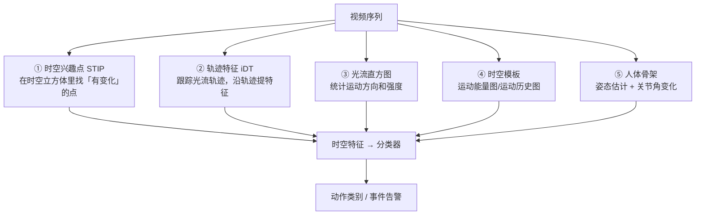

# 第14章 · 时空行为理解

> **白话一句话**：看懂一段视频里**「在演什么」**——是在走路、奔跑、挥手，还是摔倒了。
> **所属层次**：🟥 高层视觉（目标 → 语义）
> **横轴分支**：应用层（依赖 [几何视觉](/branches/geometry/) + [目标检测](/branches/detection/) + [特征匹配](/branches/feature-matching/)）
> 
## 🎮 动手玩一玩本章核心概念

🖱 看光流轨迹：帧间像素运动向量是所有视频行为分析的底层信号

<ClientOnly>
<MathVisualizer initialTab="lk" compact />
</ClientOnly>

**上一篇**：[第13章 广义匹配](/chapters/ch13-matching) ｜ **下一篇**：[第15章 场景解释](/chapters/ch15-scene)

---

## 这一章要解决什么问题

**核心问题**：**一段视频里的人在做什么动作？**

第11章回答了「东西在动」，但「在动」离「在做什么」还差很远：**挥手和擦玻璃都是手在动**。这一章要把时间维度上的运动特征组织起来，识别出**有语义的动作和事件**。

::: tip 一句话理解
**动作识别 = 把「空间外观」和「时间运动」乘起来。** 单看一帧认不出动作，单看运动场也认不出动作，必须两者结合。
:::

---

## 内容地图



**五条路线，粒度从粗到细**：

| 路线 | 核心思想 | 适合 |
|---|---|---|
| **时空模板**（MEI/MHI） | 把整段动作压成一张图 | 单人、固定机位、简单动作 |
| **光流直方图** | 统计运动方向和强度分布 | 快速、粗粒度 |
| **时空兴趣点 STIP** | 找到时空中的「角点」 | 通用动作识别 |
| **轨迹特征 iDT** | 跟踪像素轨迹，沿轨迹提特征 | 真实视频效果最好的传统方法 |
| **骨架姿态** | 先估关节，再看关节角时序 | 隐私友好、鲁棒 |

---

## 代表算法清单

| 算法 | 白话理解 | 年份 | 入口 |
|---|---|---|---|
| **运动能量图 MEI / 运动历史图 MHI** | 把一段动作在时间上「压扁」，运动过的地方留影子 | 1997 | [实战案例](/cases/) |
| **时空兴趣点 STIP** | 把 2D 角点检测扩展到「时空三维」 | 2005 | — |
| **HOG3D / Cuboid** | 在时空小立方体里统计梯度方向 | 2008 | — |
| **光流直方图** | 统计整段视频的运动方向分布 | — | [光流](/branches/geometry/optical-flow) |
| **改进密集轨迹 iDT** | 跟踪大量像素轨迹，沿轨迹提 HOG+HOF+MBH | 2013 | [光流](/branches/geometry/optical-flow) |
| **VIBE / 背景建模** | 先把运动前景分出来 | 2011 | [区域与聚类分割](/branches/segmentation/region-clustering) |
| **OpenPose 类姿态估计** | 先找出人体关节点，再用关节角变化识别动作 | 2017 | — |

---

## 经典论文

| 年份 | 论文 | 作者 | 贡献 |
|---|---|---|---|
| 1997 | *The Recognition of Human Movement Using Temporal Templates* | Bobick & Davis | MEI/MHI 时空模板 |
| 2005 | *On Space-Time Interest Points* | Laptev | 时空兴趣点 STIP |
| 2009 | *Learning Realistic Human Actions from Movies* | Laptev et al. | 好莱坞数据集，动作识别标准基准 |
| 2013 | *Action Recognition with Improved Trajectories* | Wang & Schmid | iDT，传统动作识别的巅峰 |
| 2014 | *Two-Stream Convolutional Networks for Action Recognition* | Simonyan & Zisserman | 双流网络，深度方法的起点（传统 → 神经网络的衔接点） |

> 📌 **本站本体实例**：[光流](/ontology/instances) ｜ [光流概念](/ontology/instances)

---

## 工业上怎么用

| 场景 | 用哪条路线 | 原因 |
|---|---|---|
| **跌倒检测（养老院）** | 骨架姿态 + 时序规则 | 隐私友好、可解释、误报低 |
| **工地违规行为（未戴安全帽/攀爬）** | 检测 + 区域规则 + 短时序 | 多数「行为」其实是「状态 + 区域」的组合 |
| **产线动作合规校验** | 时空模板 + 关键帧比对 | 动作固定、机位固定，模板法最省 |
| **交通事件检测（逆行/违停）** | 轨迹跟踪 + 规则引擎 | 需要的是「轨迹语义」而非动作分类 |
| **体育动作技术分析** | 光流 + 骨架角度 | 需要量化动作细节 |
| **客流行为分析（徘徊/聚集）** | 轨迹聚类 + 密度统计 | 群体行为靠轨迹特征 |

::: tip 一条实用的工程经验
**工业上 90% 的「行为识别」需求，其实不需要真正的动作分类器。** 它们往往是「目标检测 + 跟踪轨迹 + 区域规则 + 持续时间」的组合规则——又稳又好调，还能解释为什么报警。
:::

---

## 工程实现要点

```python
import cv2
import numpy as np

# 经典 iDT 路线的最小骨架（真实项目建议用官方 iDT 代码）
cap = cv2.VideoCapture('video.mp4')
mog = cv2.createBackgroundSubtractorMOG2(history=500, varThreshold=16)

prev_gray = None
tracks = []                      # 沿时间累积的轨迹
for _ in range(int(cap.get(cv2.CAP_PROP_FRAME_COUNT))):
    ok, frame = cap.read()
    if not ok:
        break
    gray = cv2.cvtColor(frame, cv2.COLOR_BGR2GRAY)

    # ① 前景掩膜：只在运动区域提轨迹，省算力
    fg = mog.apply(frame)
    fg = cv2.morphologyEx(fg, cv2.MORPH_OPEN,
                          cv2.getStructuringElement(cv2.MORPH_ELLIPSE, (3, 3)))

    if prev_gray is not None:
        # ② 稠密光流（用前向-后向一致性过滤）
        flow = cv2.calcOpticalFlowFarneback(prev_gray, gray, None,
                                            0.5, 3, 15, 3, 5, 1.2, 0)
        flow_b = cv2.calcOpticalFlowFarneback(gray, prev_gray, None,
                                              0.5, 3, 15, 3, 5, 1.2, 0)
        fb = flow + flow_b
        valid = np.linalg.norm(fb, axis=-1) < 0.5   # 只保留可信光流

        # ③ 沿轨迹提特征：HOF(光流方向直方图) + MBH(运动边界直方图)
        mag, ang = cv2.cartToPolar(flow[..., 0], flow[..., 1])
        # ... 在 15 帧的时空块里做直方图，得到 HOF/MBH 描述子 ...

    prev_gray = gray

# ④ 特征送入 SVM 分类（传统做法）或时序模型
```

::: warning 最常踩的坑
**不做前后向一致性检验的轨迹，误差会随时间累积**，30 帧后轨迹就飘到天上去了。另外**动作识别对「机位」极其敏感**——同一套特征，换一个拍摄角度可能直接失效，工程上要么固定机位，要么先做视角归一化。
:::

---

## 三个常见误区

- **❌ 拿单帧图像分类模型直接处理视频**。丢掉时间信息后，「坐下」和「站起」看起来一模一样。
- **❌ 忽视「背景运动」**。手持拍摄、风吹树动都会污染光流，必须先做全局运动补偿。
- **❌ 追求通用动作分类**。真实工程里限定动作集（只识别 5–10 类特定动作）比做通用识别可靠得多。

---

## 学完这一章你能做什么

✅ 用时空模板 / 光流直方图 / 轨迹特征描述一段动作
✅ 用「检测 + 跟踪 + 规则」搭出可用的行为告警系统
✅ 理解传统动作识别为什么会被双流网络取代

**下一章**：[第15章 场景解释](/chapters/ch15-scene) —— 最后一章：从「一个动作」到「整幅画面的故事」。
