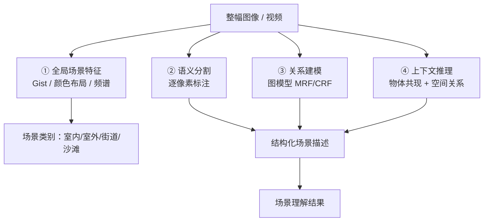

# 第15章 · 场景解释

> **白话一句话**：讲清**「整幅画面的故事」**——这是什么地方、正在发生什么、各个东西之间是什么关系。
> **所属层次**：🟥 高层视觉（目标 → 语义）
> **横轴分支**：应用层（综合所有分支）
> 
## 🎮 动手玩一玩本章核心概念

🖱 拖动 σ 看高斯分布：尺度空间、金字塔、模糊核，场景理解里到处都在用高斯

<ClientOnly>
<MathVisualizer initialTab="gauss" compact />
</ClientOnly>

**上一篇**：[第14章 时空行为理解](/chapters/ch14-activity) ｜ **本篇是章体系的终点**

---

## 这一章要解决什么问题

**核心问题**：**这是什么场景？发生了什么？要素之间是什么关系？**

前面所有章节都在处理「局部」——一个点、一个区域、一个目标、一个动作。这一章要把它们**全部整合成对整幅画面的理解**。它是传统 CV 的**理论最上限**，也是深度学习接管前的最后一站。

::: tip 一句话理解
**场景解释 = 全局特征 + 关系建模。** 它不回答「这是不是人脸」，而回答「这是办公室还是马路」「这个人在柜台前做什么」。
:::

---

## 内容地图



**四件事**：

| 方向 | 回答什么 | 传统代表 |
|---|---|---|
| **全局特征** | 这是哪一类场景 | Gist（全局印象）、颜色直方图、频谱 |
| **语义分割** | 每个像素属于哪一类 | 纹理分类 + MRF 平滑 |
| **关系建模** | 物体之间什么关系 | 图模型、条件随机场 CRF |
| **上下文推理** | 什么是合理的 | 共现统计（「键盘」旁边常是「显示器」） |

---

## 代表算法清单

| 算法 | 白话理解 | 年份 | 入口 |
|---|---|---|---|
| **Gist 场景特征** | 把图缩到极小，看整体「构图印象」 | 2001 | — |
| **空间金字塔匹配 SPM** | 把图分成越来越细的格子，逐层统计词袋 | 2006 | — |
| **纹理分类 + 语义标注** | 逐块判纹理，再拼成像素级标签 | — | [纹理分析](/chapters/ch07-texture) |
| **MRF 马尔可夫随机场** | 每个像素的标签要「和邻居协调」，全局最优 | 1984 | — |
| **CRF 条件随机场** | MRF 的升级版，条件概率建模更灵活 | 2001 | — |
| **GraphCut 分割** | 用图割求全局最优标注 | 2001 | [交互式分割](/branches/segmentation/interactive) |
| **物体共现 + 空间关系** | 「杯子」大概率在「桌子」上 | — | — |

---

## 经典论文

| 年份 | 论文 | 作者 | 贡献 |
|---|---|---|---|
| 2001 | *Modeling the Shape of the Scene: A Holistic Representation of the Spatial Envelope* | Oliva & Torralba | Gist，全局场景特征的经典 |
| 2006 | *Beyond Bags of Features: Spatial Pyramid Matching for Recognizing Natural Scene Categories* | Lazebnik et al. | SPM，场景分类的重要突破 |
| 2001 | *Fast Approximate Energy Minimization via Graph Cuts* | Boykov et al. | 图割，MRF/CRF 求解的实用算法 |
| 2004 | *"GrabCut"* | Rother et al. | 图割在交互式分割上的最佳实践 |
| 2009 | *TextonBoost for Image Understanding* | Shotton et al. | 纹理 + 布局 + 上下文联合的场景理解 |

> 📌 **本站本体实例**：[库：scikit-image](/ontology/instances) ｜ [案例索引](/ontology/instances)

---

## 工业上怎么用

| 场景 | 技术方案 | 说明 |
|---|---|---|
| **场景分类（室内/室外/道路）** | Gist + SPM + SVM | 用于自动选择后续处理策略 |
| **自动驾驶可行驶区域** | 纹理 + 颜色 + MRF | 传统方案，现在被语义分割网取代 |
| **工业车间环境判别** | 全局颜色布局 + 检测结果 | 决定用哪套检测参数 |
| **遥感地块分类** | 纹理 + 光谱 + 空间上下文 | 传统 CV 在遥感仍大量使用 |
| **监控场景异常检测** | 全局特征偏离度 | 和「正常场景」比对找异常 |
| **图像自动归档** | Gist + 颜色 + 元数据 | 相册/素材库自动分类 |

::: warning 坦白说：这一章是传统 CV 最弱的一环
**场景解释在深度学习之前始终没有真正解决**。Gist/SPM 这类传统方法在标准数据集上准确率只有 60%–80%，且对视角、天气、光照极其敏感。**2012 年之后这一块被全面接管**——所以本站把它放在最后，并明确标注「历史价值 > 实用价值」。详见 [传承脉络](/legacy/)。
:::

---

## 工程实现要点

```python
import cv2
import numpy as np
from skimage import feature

# ① Gist 类全局特征的最小版本：多尺度多方向能量
def gist_like(gray, n_scale=3, n_orient=8):
    feats = []
    for s in range(n_scale):
        g = cv2.resize(gray, (gray.shape[1] >> s, gray.shape[0] >> s))
        for o in range(n_orient):
            theta = o * np.pi / n_orient
            k = cv2.getGaborKernel((21, 21), sigma=4, theta=theta,
                                   lambd=10, gamma=0.5, psi=0, ktype=cv2.CV_32F)
            resp = np.abs(cv2.filter2D(g.astype(np.float32), cv2.CV_32F, k))
            # 分 4×4 网格统计平均能量
            h, w = resp.shape
            grid = resp[:h//4*4, :w//4*4].reshape(4, h//4, 4, w//4).mean(axis=(1, 3))
            feats.extend(grid.flatten())
    return np.array(feats)

# ② 空间金字塔匹配（SPM）：1×1 + 2×2 + 4×4 三层
def spm_hist(hist_fn, levels=(1, 2, 4)):
    feats = []
    for L in levels:
        feats.append(hist_fn(L))     # 每层分 L×L 网格统计直方图
    return np.concatenate(feats)

# ③ MRF 式平滑：用高斯/中值滤波近似的后处理
def smooth_labels(label_map, ksize=5):
    return cv2.medianBlur(label_map.astype(np.uint8), ksize)

feat = gist_like(cv2.cvtColor(img, cv2.COLOR_BGR2GRAY))
# → 送入 SVM，输出场景类别
```

::: tip 传统场景理解的「最后一招」
如果非要上传统方法，**最有效的组合是「Gist 全局特征 + 颜色直方图 + SPM 词袋」三特征拼接 + 线性 SVM**。这套组合在 2010 年前后的场景分类竞赛里是标配，训练快、可解释、对样本量要求低。
:::

---

## 三个常见误区

- **❌ 指望传统方法解决通用场景理解**。这是历史给过的答案：做不到。**要在这一块出结果，请直接上深度语义分割/场景图网络。**
- **❌ 把「语义分割」和「实例分割」混淆**。传统方法是**语义级**（所有「人」都是一类，不区分个体），要区分个体得靠检测 + 跟踪。
- **❌ 忽视上下文的价值**。「键盘旁边大概率有显示器」这种共现先验，是传统方法里性价比最高的一块——**加规则比换算法有效**。

---

## 学完这一章你能做什么

✅ 用 Gist / SPM 做场景分类
✅ 用图模型做像素级语义标注
✅ 清楚知道「传统方法的边界在哪里」——这也是进入 [传承脉络](/legacy/) 的入口

---

## 🎓 走完 13 章，你现在站在哪里


**接下来读什么**：

- 🔗 想知道传统方法后来被什么取代 → [传承脉络](/legacy/)
- 🏭 想立刻动手做项目 → [场景反查入口](/scenarios/)
- 🛠 想解决「算法效果不好」的工程问题 → [工程实现层](/branches/engineering/)
- 🧭 想复习双轴全貌 → [学习路径](/learning-path)
