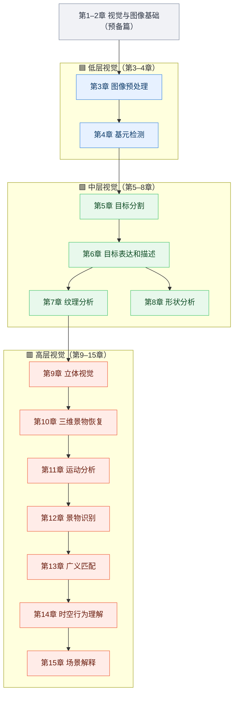

# 📘 章体系导览

> **这是什么**：章毓晋《计算机视觉教程》的**逐章导览**。每一章一页，回答四个问题：**这章管什么？有哪些算法？该读哪篇论文？工业上怎么用？**
>
> **和别的页面什么关系**：章体系是本站的 **纵轴**（按抽象层次从低到高），[六大分支](/branches/) 是 **横轴**（按算法家族切）。一章可以横跨多个分支，一个分支也可以支撑多章——完整映射见 [学习路径](/learning-path)。
>
> **为什么是「从第 3 章开始」？** 教材第 1–2 章是绪论与数字图像基础，属于打地基的预备内容，技术主体确实从第 3 章起。为了不让序列看起来「缺了两章」，我们把这两章的知识整理成 [预备篇 · 第 1–2 章 视觉与图像基础](/chapters/ch01-foundation)，放在章体系最前面。

---

## 三条主线

---

## 章节一览（预备篇 + 13 章）

| 章 | 层次 | 白话一句话 | 代表算法 | 横轴分支 | 导览 |
|---|---|---|---|---|---|
| **第1–2章** 视觉与图像基础 | 🟦 预备 | 图像到底是什么——成像、采样、量化、邻域、颜色 | 灰度化、直方图、连通域、距离度量 | [图像处理](/branches/image-processing/) | [→](/chapters/ch01-foundation) |
| **第3章** 图像预处理 | 🟦 低层 | 把照片「打扫干净」 | 高斯/中值滤波、直方图均衡、形态学 | [图像处理](/branches/image-processing/) | [→](/chapters/ch03-preprocessing) |
| **第4章** 基元检测 | 🟦 低层 | 找出边缘、角点、直线、圆 | Canny、Sobel、Harris、Hough、SIFT 关键点 | [特征检测](/branches/feature-detection/) | [→](/chapters/ch04-primitives) |
| **第5章** 目标分割 | 🟩 中层 | 把目标「抠出来」 | Otsu、区域生长、分水岭、GrabCut | [图像分割](/branches/segmentation/) | [→](/chapters/ch05-segmentation) |
| **第6章** 目标表达和描述 | 🟩 中层 | 给目标「建档立卡」 | 链码、Hu 矩、HOG、SIFT 描述子 | [特征检测](/branches/feature-detection/) + [特征匹配](/branches/feature-matching/) | [→](/chapters/ch06-representation) |
| **第7章** 纹理分析 | 🟩 中层 | 量一量「花纹和手感」 | LBP、GLCM、Gabor、小波 | [特征匹配](/branches/feature-matching/) | [→](/chapters/ch07-texture) |
| **第8章** 形状分析 | 🟩 中层 | 量一量「外形轮廓」 | 傅里叶描述子、形状上下文、骨架、凸包 | [图像分割](/branches/segmentation/) | [→](/chapters/ch08-shape) |
| **第9章** 立体视觉 | 🟥 高层 | 像双眼一样「测距离」 | 立体匹配、视差图、极线矫正 | [几何视觉](/branches/geometry/) | [→](/chapters/ch09-stereo) |
| **第10章** 三维景物恢复 | 🟥 高层 | 从平片还原「立体」 | SfM、光度立体、SFS | [几何视觉](/branches/geometry/) | [→](/chapters/ch10-3d-recovery) |
| **第11章** 运动分析 | 🟥 高层 | 看它「动没动、怎么动」 | 光流、背景差分、KLT/Kalman 跟踪 | [几何视觉](/branches/geometry/) | [→](/chapters/ch11-motion) |
| **第12章** 景物识别 | 🟥 高层 | 认出「这是啥」 | 滑窗、Viola-Jones、HOG+SVM、DPM、BoVW | [目标检测](/branches/detection/) | [→](/chapters/ch12-recognition) |
| **第13章** 广义匹配 | 🟥 高层 | 两幅图「对上号」 | RANSAC、ICP、模板匹配、图匹配 | [特征匹配](/branches/feature-matching/) | [→](/chapters/ch13-matching) |
| **第14章** 时空行为理解 | 🟥 高层 | 看懂「在演什么」 | STIP、光流直方图、iDT 轨迹 | 应用层（[实战案例](/cases/)） | [→](/chapters/ch14-activity) |
| **第15章** 场景解释 | 🟥 高层 | 讲清「整幅画面的故事」 | Gist 场景特征、MRF/CRF、传统语义分割 | 应用层（[实战案例](/cases/)） | [→](/chapters/ch15-scene) |

---

## 三块「章体系没有，但工程必须有」的内容

章体系是**纯理论骨架**。真正落地时，下面三块它一个字没写，本站单独补了：

| 缺口 | 章体系的状态 | 本站补在哪 |
|---|---|---|
| **🛠 工程实现层** | 完全没有 | [工程实现层分支](/branches/engineering/) |
| **🎯 传统检测器族** | 只有「景物识别」四字带过 | [目标检测分支](/branches/detection/) + [Viola-Jones](/branches/detection/viola-jones)、[DPM](/branches/detection/dpm)、[BoVW](/branches/detection/bovw) |
| **🏭 任务场景入口** | 完全没有 | [场景反查入口](/scenarios/) |

---

## 三种读法

- **从零系统学**：预备篇（第1–2章）→ 第3章 → 第4章 → … → 第15章，顺序读一遍，约 6–8 周。
- **带着任务查**：直接去 [场景反查入口](/scenarios/)，反查需要哪几个算法，再跳回对应章。
- **查谱系关系**：去 [六大分支](/branches/) 或 [本体实例索引](/ontology/instances)，看算法之间的演化网络。

> **配套**：看不懂术语查 [术语表](/glossary)；想知道传统方法后来被什么取代，看 [传承脉络](/legacy/)。
