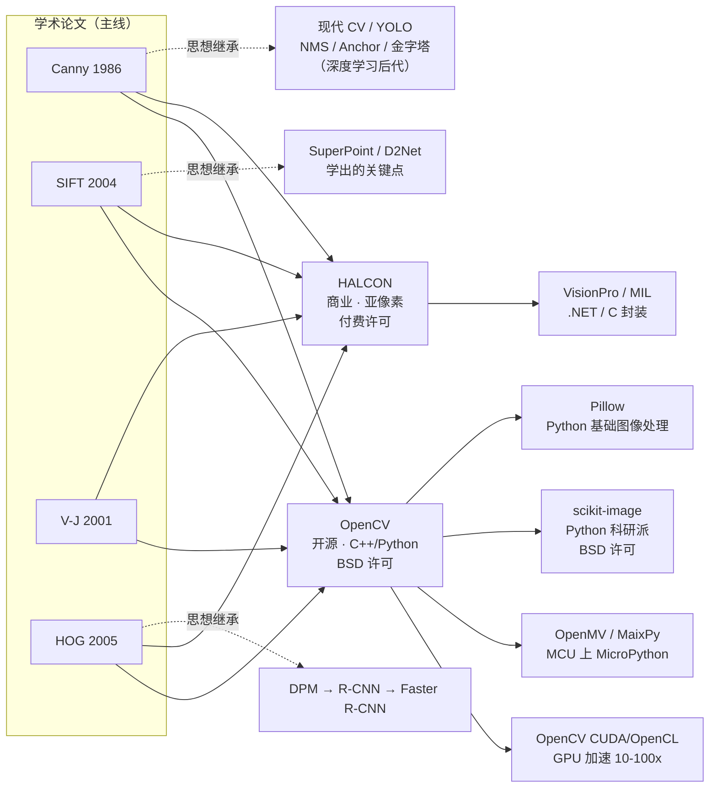

# 🔀 衍生实现总览 · 从 OpenCV 到商业库到现代继承

主线算法（Canny、SIFT、HOG、Viola-Jones 等）是**学术论文定义的标准方法**，但实际工程里这些算法有**多个实现版本、商业包装、硬件移植、以及被深度学习继承**——这些不是"算法本身的演进"，而是**并行的工程/商业/应用路径**。

📌 **定位**：本页收录**不属于算法编号演进**，但在工程实践中极为重要的"衍生实现"。主线是「论文→理论→实现→实战」的知识链路，衍生是「同一份算法被不同团队/厂商/平台**怎么包起来卖/跑/移植**」。

🌳 **五大衍生家族**：

| 家族 | 代表 | 核心问题 |
|---|---|---|
| **开源库家族** | OpenCV、scikit-image、PIL/Pillow、VLFeat | 算法怎么工程化、怎么给开发者调用 |
| **商业机器视觉库** | HALCON、VisionPro、MIL、LabVIEW Vision | 工业级稳定性、亚像素精度、长期支持、付费 |
| **硬件加速/GPU 家族** | OpenCV CUDA、OpenCL、cuDNN 早期算子、NVIDIA NPP | 怎么跑到 GPU/FPGA/ASIC 上提速 10–100 倍 |
| **微控制器/嵌入式家族** | OpenMV、MaixPy、K210 SDK、STM32 版、ESP32 版 | 怎么跑到 KB 级 RAM 的单片机上 |
| **被深度学习继承** | YOLO（继承 NMS/Anchor/金字塔）、SuperPoint（学 SIFT）、DEXTR（交互式分割）| 传统 CV 的思想如何在深度学习里活下来 |

🎯 **里程碑**：
- **OpenCV 1.0 (2006)** 把 Canny/Haar/Hough/SIFT 打包成 C API，让 CV 算法真正进入工业界
- **HALCON (1997 起)** 德国 MVTec 公司，把亚像素边缘、形状匹配、Blob 分析做到工业级稳定——全球 50% 以上高端机器视觉设备用它
- **OpenCV CUDA (2011 起)** 把关键算子 GPU 化，让 1080p 视频的光流/立体匹配能实时
- **OpenMV (2016 起)** 把 Python + MicroPython 跑在 MCU 上，让传统 CV 可以在 50 块钱的板子上跑
- **YOLO (2016 起)** 虽然是深度学习，但 NMS、Anchor、图像金字塔、多尺度——全是传统 CV 留下的思想遗产

🚧 **与主线的边界**：
**衍生 ≠ 算法变体**。算法变体（如 SIFT → SURF → ORB）是**学术层的演进**，走[特征检测分支](/branches/feature-detection/)；衍生实现是**同一算法换了工程包装或平台**——OpenCV 的 Canny 和 HALCON 的 edges_sub_pix，底层都是 Canny 的五个步骤，但代码不是同一份、许可证不同、精度细节有差异。

## 3 分钟电梯演讲

**衍生不是"算法变了"，是"算法怎么落地"**——同一个 Canny：
- 在 OpenCV 里是 `cv2.Canny()`，5 行代码
- 在 HALCON 里是 `edges_sub_pix()`，亚像素精度 + 专有边界处理
- 在 OpenMV 里是 `img.find_edges()`，跑在 STM32H7 上
- 在 GPU 版 OpenCV 里是 `cv2.cuda::CannyEdgeDetector`，1080p 实时
- 在 YOLO 里，Canny 没直接出现，但 YOLO 输出后的**后处理 NMS**就是从 Canny 那步学来的思想

## 为什么单开一栏

### 理由一：工程落地时，"选哪个库"比"选哪个算法"更重要

学术论文讲清楚了 Canny 的五个步骤，但**真正在产线跑**时，你面对的不是论文，是：
- 用 OpenCV 还是 HALCON？——HALCON 贵（license 几万到几十万）但稳定性和技术支持强
- CPU 还是 GPU？——产线 30 FPS 1080p 可能必须上 CUDA
- 是 x86 工控机还是嵌入式板子？——决定你能不能用 OpenCV，还是必须用 C 重写

这些决策**与算法本身无关**，但**决定了项目能不能交付**。

### 理由二：商业库和开源库的精度差异是真实的

同样是 Canny 边缘检测：
- OpenCV 的 `cv2.Canny` 是**像素级**精度，亚像素要自己上
- HALCON 的 `edges_sub_pix` 用专有滤波器能做到 **0.01 像素**精度
- MIL 的 `MedgeAlloc()` 支持硬件 FPGA 加速，延迟微秒级

这种差异在"尺寸测量"这种精度敏感场景里是决定性的。主线算法页里讲不清这种工程差异，需要衍生页补。

### 理由三：硬件移植是独立的知识体系

把 SIFT 从 PC 跑到 K210（RISC-V MCU，8MB 内存）——不是简单的"重新编译"，而是：
- 浮点改定点（Q16.16 格式）
- 算法裁剪（SIFT 的 128 维描述子可能要降到 64 维）
- 内存优化（DoG 金字塔不能在 RAM 里全展开，要流式处理）

这些"裁剪/移植"知识不属于算法本体，但在边缘部署场景里是必知必会。

### 理由四：传统 CV 与深度学习的"血缘关系"需要明确

很多学 YOLO 的人不知道——YOLO 里的 NMS 来自 Canny/Hough 时代；Anchor 来自 Viola-Jones 的"滑窗固定尺寸"思想；图像金字塔来自 SIFT 尺度空间；难例挖掘来自 DPM 的 HNM。**传统 CV 不是被淘汰了，是被深度学习"继承并内化"了**。

这部分血缘关系在 [legacy 传承脉络](/legacy/) 里讲，但衍生总览给一个鸟瞰。

## 五大衍生家族分类

### 家族一：开源库家族

**核心问题**：如何把论文算法变成开发者好用的 API。

| 库 | 主力语言 | 许可 | 特点 |
|---|---|---|---|
| **OpenCV** | C++/Python | BSD 3-Clause | 工业界事实标准，2500+ 算法，覆盖 90% 传统 CV |
| **scikit-image** | Python | BSD | 科研派，API 更 Pythonic，文档极详细 |
| **Pillow (PIL)** | Python | HPND | Python 基础图像处理，比 OpenCV 轻量 |
| **VLFeat** | C/MATLAB | BSD | SIFT/HoG/DPM 等算法的"参考实现"，教学科研常用 |
| **Open3D** | C++/Python | MIT | 3D 视觉点云处理（包含传统 ICP/FPFH 等）|

深入：[OpenCV API 速查](/branches/engineering/opencv-api) · [scikit-image 对比]（待补）

### 家族二：商业机器视觉库

**核心问题**：工业级稳定性、亚像素精度、长期 LTS、销售商技术支持。

| 库 | 厂商 | 语言 | 价格 | 强项 |
|---|---|---|---|---|
| **HALCON** | MVTec（德国）| HDevelop/C++/.NET | 3–30 万/seat | 亚像素测量、3D、深度学习一体化、20+ 年稳定 |
| **VisionPro** | Cognex（美国）| .NET/C# | 5–20 万/seat | 高速定位 PatMax、对接 Cognex 相机 |
| **MIL** | Matrox（加拿大）| C/C++ | 按模块 | 医疗级、硬件加速、Matrox 采集卡配套 |
| **LabVIEW Vision** | NI（美国）| 图形化 | 订阅制 | 虚拟仪器教学/实验室，流水线搭建快 |
| **Open eVision** | Euresys（比利时）| C++/.NET | 1–5 万/seat | 对位、OCR、亚像素匹配性价比高 |

> **选型建议**：预算充足 + 精度/稳定性要求极高（半导体、医药、汽车）→ HALCON；预算有限 + 已有 OpenCV 人才 → OpenCV 自研；只用 Cognex/Matrox 相机 → 用他们自家库。

### 家族三：硬件加速家族

**核心问题**：1080p/4K 视频实时处理，光 CPU 不够。

| 方案 | 平台 | 典型加速比 | 适用算法 |
|---|---|---|---|
| **OpenCV CUDA** | NVIDIA GPU | 5–50× | 光流、立体匹配、Canny、HOG |
| **OpenCV OpenCL** | Intel 核显/AMD GPU/ARM Mali | 3–10× | 通用算子加速（跨平台）|
| **NVIDIA NPP** | NVIDIA GPU | 10–100× | 底层滤波、阈值、形态学（OpenCV CUDA 底层用它）|
| **FPGA 加速** | Xilinx Zynq/Intel FPGA | 10–100× + 微秒延迟 | 工业产线高频检测 |
| **SIMD/Neon 优化** | CPU (SSE/AVX/ARM Neon) | 2–8× | OpenCV 内置 `cv::fastMalloc` + IPP |
| **Halide** | CPU/GPU | 5–20× | 用"算法描述+调度分离"语言自动生成高速代码 |

深入：[性能与算力](/branches/engineering/performance)

### 家族四：微控制器/嵌入式家族

**核心问题**：怎么在 KB–MB 级 RAM、MHz 级 CPU 的板子上跑视觉。

| 平台 | 芯片 | RAM | 典型可跑算法 |
|---|---|---|---|
| **OpenMV** | STM32H7 (480MHz) | 1MB SRAM + 32MB SDRAM | 找色块、找圆、AprilTag、简单二维码、光流 |
| **MaixPy/K210** | K210 RISC-V (400MHz) | 6MB SRAM | KPU 神经网络 + 简单传统 CV 辅助 |
| **ESP32 + 摄像头** | ESP32 (240MHz) | 520KB SRAM | 只能做最基础的颜色追踪、运动检测 |
| **树莓派 Pico + 摄像头** | RP2040 (133MHz) | 264KB SRAM | 极限简化，只能线追踪/色块 |
| **STM32F4/F7 + DCMI** | STM32 (168–216MHz) | 1–2MB | 用 C 手写，基本二值化/连通域 |

> **关键限制**：SIFT/HOG 这种重算法在 MCU 上基本跑不动；能跑的是颜色分割、简单阈值、霍夫圆/线、模板匹配（降分辨率后）。如果需要 SIFT 级别特征，必须升阶到树莓派 4/Jetson Nano 这种带 GB 级 RAM 的板子。

### 家族五：被深度学习继承的思想

**核心问题**：传统 CV 的思想在深度学习时代并没有消失，而是**内化到了网络结构和训练流程里**。

| 传统 CV 概念 | 深度学习里的对应 | 继承关系 |
|---|---|---|
| **非极大值抑制 NMS** | YOLO/Faster R-CNN 输出后仍然要 NMS | 直接沿用（Canny 1986 → YOLO v1-v8）|
| **图像金字塔** | FPN（特征金字塔网络）| 思想继承：多尺度检测 |
| **Anchor/滑窗** | R-CNN/SSD/YOLOv2–v5 的 Anchor | 思想继承：固定尺寸窗口扫描 |
| **Haar 积分图** | 无直接对应，但 Box Filter/深度可分离卷积借鉴了"快速矩形求和" | 思想借鉴 |
| **SIFT 关键点** | SuperPoint/D2Net/DISK（学出的关键点）| 用 CNN 学 SIFT 想手工设计的东西 |
| **HOG 方向直方图** | Edge Boxes、Dense Reference、可变形注意力 | 形状统计 → 卷积核权重 |
| **RANSAC 鲁棒估计** | 仍在用！深度学习拟合本质矩阵后依然用 RANSAC 去离群 | 直接沿用，无可替代 |
| **双线性插值** | 所有网格采样（grid_sample）、RoI Align | 直接沿用 |
| **形态学操作** | 分割 mask 后处理（去噪、填洞、连通域）| 直接沿用，U-Net 输出也逃不开 |
| **相机标定/张正友标定** | 任何 3D 视觉/SLAM 仍用张正友标定，包括深度相机的内外参标定 | 直接沿用 |
| **Lucas-Kanade 光流** | RAFT（深度光流）仍然有迭代的"更新算子"，本质是 LK 的迭代思想 | 思想继承 |

深入：[传承脉络（legacy）](/legacy/)

## 未来演进方向

传统 CV 不是一个"已死"的领域，它仍在三个方向演进：

1. **被深度学习替代的**：通用物体检测、语义分割、人脸识别——这部分传统方法基本退出主流
2. **与深度学习融合的**：
   - 传统 CV 做前/后处理 + 深度学习做识别（最常见）
   - 可微传统算子（让传统算子能进神经网络被梯度更新）
   - 传统几何约束作为深度学习的 loss（如本质矩阵约束、重投影误差）
3. **传统 CV 仍然独占的**：
   - 尺寸测量/计量（亚像素级）
   - 高速产线（微秒级延迟）
   - 极端低算力设备
   - 标定、3D 几何、立体视觉基础
   - 图像预处理（去噪、增强、矫正）

路线预告里会持续追踪这些方向 → [路线预告：未收录的衍生与算法](/derivatives/roadmap)
