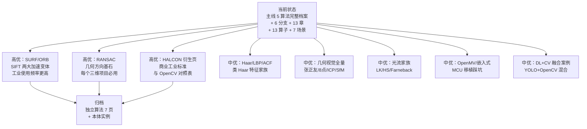

# 🚧 路线预告 · 未收录的衍生与算法

主线已收录的算法（Canny/SIFT/HOG/V-J/DPM/BoVW）和已收录的衍生（OpenCV/HALCON/嵌入式/深度学习继承）**之外**，还有一批**值得追踪但尚未单独成页**的候选——算法、商业库、硬件平台、学习资料。本页作为"观察名单"，说明每个候选的**收录条件、当前状态、预计补全时间**。

📌 **定位**：本页与[衍生总览](./index.md)互补——总览收录**已完成详细页面**的内容，本页收录**尚未完成但计划补全**的候选。任何候选一旦补全独立页面并通过本体校验，会从本页移到总览；

🎯 **三个高优先级候选**：
- **SURF/ORB 独立档案**（SIFT 的两大加速变体，工业使用频率高于 SIFT 本身）
- **RANSAC 几何鲁棒估计档案**（传统 CV 几何方向的基石，与内参标定/对极几何/立体匹配深度绑定）
- **HALCON 独立衍生页**（商业机器视觉事实标准，需要单独讲与 OpenCV 的差异、典型算子对照表）

🚧 **五个中优先级候选**：
- **Haar/类 Haar 特征家族页**（V-J 之外的 Haar 变体：LBP、ACF、ICF 等）
- **几何视觉全量归档**（张正友标定、8点法、ICP、SfM 各补独立算法档案）
- **光流法家族页**（Lucas-Kanade 稀疏光流、Horn-Schunck 稠密光流、Farneback 变体）
- **OpenMV/嵌入式独立页**（MCU 端能跑的算法清单、移植踩坑、内存优化）
- **现代工业深度学习融合案例**（YOLO+传统CV 混合方案：如 YOLO 粗检 + OpenCV 精定位）

🕐 **更新节奏**：每个季度巡检一次——新教材出版、OpenCV 新版本发布、主流芯片 SDK 更新、工业界新趋势，都会触发补全。

## 3 分钟电梯演讲

## 高优先级候选（3 个）

### SURF / ORB 独立档案

**当前状态**：已在 `ontology/instances/algorithms/surf.yaml` 和 `orb.yaml` 有实例占位，算法分支页有介绍，但**没有 7 页式完整档案**（paper/concepts/architecture/source/painpoints/tricks）。

**为什么重要**：
- **SURF** (2006, Bay et al.)：用**积分图 + Haar 小波**替代 SIFT 的 DoG，速度快 3 倍，专利期内是工业首选
- **ORB** (2011, Rublee et al.)：**oFAST 关键点 + rBRIEF 描述子**，完全免费（SIFT/SURF 当初都有专利），是 OpenCV 主推的免费替代，OpenVSLAM、ORB-SLAM 系列全部用它
- 工业界实际使用中 ORB > SURF > SIFT（速度 + 免费）

**收录条件**：
- ✅ 有经典论文（SURF Bay 2006 ECCV, ORB Rublee 2011 ICCV）
- ❌ 独立 7 页档案尚未建立
- ❌ 源码走读 / 算子依赖 / 踩坑清单未整理

**预计补全时间**：下一版本优先补全——会建立 `docs/algorithms/surf/` 和 `docs/algorithms/orb/` 各 7 页。

### RANSAC 几何鲁棒估计独立档案

**当前状态**：在几何分支页和论文实例里有提及，**没有**独立算法档案。

**为什么重要**：
- RANSAC (1981, Fischler & Bolles) 是**几何视觉的基石算法**——它不在"检测"或"描述子"之列，却是所有"有错误数据要拟合模型"的场景的通用解法
- 图像拼接的单应性矩阵计算、立体视觉的基础矩阵估计、三维重建的点云配准、点云平面拟合、直线/圆拟合——**全部用 RANSAC**
- 深度学习时代仍不可替代：SuperPoint+SuperGlue 匹配后仍然要用 RANSAC 求解本质矩阵
- 现代变体：MSAC、MLESAC、PROSAC、RANSAC-1p、USAC、Graph-Cut RANSAC 等

**收录条件**：
- ✅ 论文明确（Fischler & Bolles 1981 CACM）
- ❌ 独立档案未建
- ❌ 与对极几何/立体匹配/ICP 的关系未梳理

**预计补全时间**：与几何视觉全量归档同步补全。

### HALCON 独立衍生页

**当前状态**：衍生总览里有 HALCON 概述，但**没有**独立的算子对照页、性能对比、选型指南。

**为什么重要**：
- 全球机器视觉商业软件**事实标准**——Basler、Cognex、Keyence、海康、大华的高端设备要么用 HALCON，要么用它的竞品
- 亚像素边缘检测 `edges_sub_pix`、形状匹配 `find_shape_model`、Blob 分析、测量算子 都有 OpenCV 里没有的工业级优化
- 从 OpenCV 迁到 HALCON 是很多成熟项目的必经之路，但缺少对照资料

**收录条件**：
- ❌ 独立页未建
- ❌ OpenCV ↔ HALCON 算子对照表未建
- ❌ 价格/许可/迁移指南未整理

**预计补全时间**：中期补全，算子对照表是核心工作量。

## 中优先级候选（5 个）

### 类 Haar 特征家族页（LBP/ACF/ICF）

Haar 不是只有 Viola-Jones 一家，后续发展出：
- **LBP (Local Binary Pattern, 1996)**：局部二值模式，纹理分类极强，人脸识别一度用它
- **ACF (Aggregate Channel Features, 2014)**：通道特征聚合，Dollár 提出，HOG+LUV+梯度幅值多通道，行人检测经典
- **ICF (Integral Channel Features, 2009)**：ACF 前身，积分图加速多通道特征
- **Haar-like 变体**：Tilted Haar、Extended Haar、Joint Haar

**收录理由**：这些是从 Viola-Jones 到深度学习之间的"过渡检测方案"，很多老项目里还在用。

### 几何视觉全量归档（张正友/8点法/ICP/SfM）

几何方向目前有 calibration/epipolar/stereo/sfm 四个子页，但**每个核心算法都还没有独立档案**：
- **张正友标定 (Zhang 2000)**：相机标定事实标准
- **8 点法 (Longuet-Higgins 1981 / Hartley 1997)**：基础矩阵求解
- **ICP (Besl & McKay 1992)**：点云配准迭代最近点
- **SfM (Structure from Motion)**：从图像序列重建三维
- **PnP (Perspective-n-Point)**：从 2D-3D 对应求解相机位姿

**收录理由**：几何方向是传统 CV 唯一至今**深度学习无法直接替代**的领域——标定、对极几何、三维重建，传统方法仍是主流。

### 光流法家族页（LK/HS/Farneback）

目前几何分支有 optical-flow 子页，但独立算法和对比未做：
- **Horn-Schunck (1981)**：稠密光流鼻祖，全局能量最小化
- **Lucas-Kanade (1981)**：稀疏光流，KLT 跟踪核心（OpenCV `calcOpticalFlowPyrLK`）
- **Farneback (2003)**：稠密光流，多项式展开，OpenCV 里最常用的稠密光流算法
- **DIS (2016)**：密集反演搜索，实时稠密光流新方案

**收录理由**：视频分析、运动跟踪、视频插帧、动作识别都离不开光流。

### OpenMV/嵌入式独立页

目前工程实现层讲了性能和流水线，但**具体到某款 MCU 的移植细节**没覆盖：
- OpenMV 的 MicroPython API 局限性（RAM 不够、算子不全）
- K210 KPU 能加速什么、不能加速什么
- ESP32 做视觉的边界在哪
- 移植 SIFT/HOG 到 STM32 的定点化技巧

**收录理由**：IoT、机器人、教育场景里，MCU 视觉需求非常大。

### 深度学习 + 传统 CV 融合案例

纯传统和纯深度学习之外，工业界越来越多是"混合方案"：
- YOLO 粗检 ROI → Canny 亚像素精定位（尺寸测量）
- U-Net 分割 → 形态学 + 连通域后处理（缺陷检测）
- 背景建模（MoG2）→ YOLO 分类（安防）
- SuperPoint 特征 + 传统 RANSAC/RoI 对齐（SLAM）
- 传统 CV 合成数据（OpenCV 渲染）→ 训练深度学习模型

**收录理由**：这是 2026 年工业 CV 的主流范式，不讲混合方案，站点就偏"考古"。

## 低优先级/观察名单

这些方向**值得记录**，但短期内不会建立独立页：

| 候选 | 为什么不现在做 | 观察什么信号 |
|---|---|---|
| **分割方法家族（Watershed/GrabCut/GraphCut）** | 现有 segmentation 分支页已覆盖骨架 | 有具体工业案例需要时补 |
| **老一代目标识别**（Deformable Template、Condensation、Mean-Shift Tracking）| 基本被深度学习淘汰，历史意义 > 工程价值 | 学术综述需要时补 |
| **Halide 语言独立页** | 偏编程语言，非传统 CV 算法本身 | 工业使用率上升时补 |
| **相机 ISP 传统算法**（AWB/AF/AE、Demosaicing、HDR）| 偏硬件/信号处理 | 嵌入式视觉方向扩展时补 |
| **工业相机选型/光源选型** | 偏硬件采购，非算法本体 | 与"工程实践"合并时再考虑 |

## 准入标准

新算法/新衍生页收录到主线，需要满足 **4 条中的任意 3 条**：

1. ✅ **有经典论文或正式出版物**（主流会议/期刊/教材）
2. ✅ **有可复现的开源实现**（OpenCV、scikit-image、作者源码等）
3. ✅ **有明确的工程价值**（工业界有使用案例，或在教学/科研中被广泛引用）
4. ✅ **与现有本体网络有至少 2 条连接**（被其他算法 dependsOn、evolvedFrom 或 appliedIn）

如果只满足 1–2 条，留在本页"观察"；满足 3 条以上移入对应分支/算法/衍生页。

## 你也可以提需求

如果你觉得某个算法应该收录但我们没做：

- 📮 在 GitHub 提 issue（仓库地址将在部署时填写）
- 说明：算法名 / 论文 / 你为什么觉得它重要 / 你愿意帮写哪一页（可选）
- 我们会在两周内评估是否纳入路线

传统 CV 的知识体系 50 年积淀很深，本站的目标是**先覆盖工业界常用的 99%**，再逐步向学术纵深扩展。如果你在工程中发现某块"传统 CV 知识缺失、全网找不到像样资料"的地方，那就是下一个优先补全的方向。
