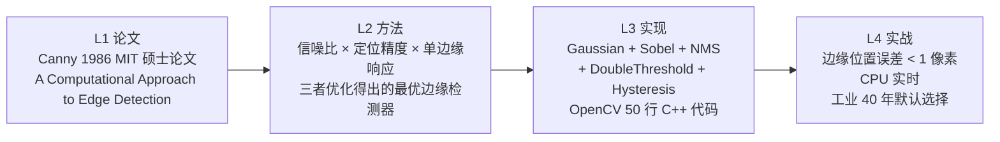

# 第 3 页 · Canny 拆解（传统 CV 算法样板）

**为什么选 Canny 当样板？** 因为它最能体现传统 CV 算法的"标准五件套"结构。
学会读 Canny 这一页，后面 SIFT、HOG、Viola-Jones 的 index 页你都能按同样套路读懂。

## TL;DR

**一句话**：**先高斯模糊去噪 → 算梯度找边 → 非极大值抑制细边 → 双阈值 + 滞后跟踪连边**。
**解决**：Sobel/Roberts 找的边粗、噪点多、断开多。
**代价**：要调两个阈值（低阈值、高阈值），太依赖经验。
**前置阅读**：[第 1 页梯度/邻域概念](./p1-what-is-cv) → [第 2 页 Canny 诞生背景](./p2-six-milestones)

## 3 分钟电梯演讲


五步缺一不可，逻辑非常顺：
- 不模糊 → 噪声会被当成边
- 不算梯度方向 → NMS 没法沿边的法线方向找最大值
- 不做 NMS → 边是 2–3 像素粗，下游没法用
- 不用双阈值 → 要么漏边（阈值高）要么多假边（阈值低）
- 不做滞后 → 弱边全丢，边会断成碎片

## 四层闭环视图



## 核心贡献一览

| 贡献 | 一句话 | 代码落点（OpenCV）|
|---|---|---|
| 高斯预平滑 | 模糊抗噪，σ 决定"看多粗的边" | `cv2.GaussianBlur(img, (5,5), 1.4)` |
| Sobel 梯度 | 同时算出水平/垂直差分 | `cv2.Sobel(blur, CV_16S, 1,0)` / `Sobel(...,0,1)` |
| 非极大值抑制 | 沿梯度方向比左右邻居，只留最大 | `cv::Canny` 内部实现（`.../canny.cpp`）|
| 双阈值 | 高阈值取确定边，低阈值留候选 | API 两个参数：`threshold1`, `threshold2` |
| 滞后跟踪 | 弱边必须 8 邻域内连到强边才保留 | `cv2.Canny` 内部 BFS/DFS 八连通 |

## 五个参数怎么调

你在代码里会写：

```python
edges = cv2.Canny(img, threshold1=50, threshold2=150, apertureSize=3, L2gradient=True)
```

| 参数 | 含义 | 调大调小会怎样 |
|---|---|---|
| `threshold1` | 低阈值（弱边门槛）| 太小 → 噪声变边；太大 → 边断 |
| `threshold2` | 高阈值（强边门槛）| 太小 → 假边多；太大 → 漏边 |
| `threshold1/threshold2` 比例 | 经验上 **1:2 到 1:3** 最稳 | Canny 原文推荐 1:2 或 1:3 |
| `apertureSize` | Sobel 核大小（默认 3）| 要 5/7 时对粗边更敏感但更慢 |
| `L2gradient` | 用 L2 范数算梯度幅值 | True 更精确（默认 False 用 L1 省算力）|

**懒人默认值**：`cv2.Canny(blur, 50, 150)` —— 90% 场景够用。

## 三个常见坑

1. **没做高斯模糊直接 Canny** → 满屏噪点边。**必须**先 `cv2.GaussianBlur`（或者 Canny 内部会做一个 3×3 Sobel 但不够）。
2. **阈值用 127/255** → 太高，只有最强的边留下来，弱边全断。
3. **在彩色图上直接 Canny** → OpenCV 其实接收彩色图但会内部转灰度，建议你自己 `cv2.cvtColor` 先转，避免惊喜。

## 跑一段代码看看

```python
import cv2
import numpy as np

img = cv2.imread("street.jpg")
gray = cv2.cvtColor(img, cv2.COLOR_BGR2GRAY)
blur = cv2.GaussianBlur(gray, (5, 5), 1.4)
edges = cv2.Canny(blur, 50, 150)

cv2.imshow("edges", edges)
cv2.waitKey(0)
```

**预期**：黑底白线的边缘图，物体轮廓被勾勒出来，内部平坦区域是黑的。

## 类比一下

Canny 像警察做"现场描轮廓"：
- ① **先把灰尘擦掉**（高斯模糊）
- ② **找所有反光/跳变的地方**（算梯度）
- ③ **只在反光最亮的那条线上画一笔**（NMS）
- ④ **明确是边的画实线，不确定的画虚线**（双阈值）
- ⑤ **虚线两头如果接着实线就连实，否则擦掉**（滞后跟踪）

最后留下的就是一张干净、连贯的"轮廓线稿"。

## 学完这一页你掌握了什么

- ✅ 传统 CV 算法页的标准五件套：**TL;DR → 电梯演讲图 → 四层闭环 → 贡献表 → 参数/踩坑**
- ✅ Canny 五步流水线为什么每步都不能少
- ✅ `cv2.Canny(50, 150)` 这两个数是什么意思
- ✅ 高斯 → 梯度 → NMS → 双阈值 → 滞后跟踪 的逻辑链

这个套路在下一页的 SIFT/HOG/Viola-Jones 里会反复出现——只是每一步的具体内容换成了"尺度空间""方向直方图""积分图"等新概念，但**骨架一模一样**。

准备好了？下一页 → [第 4 页：SIFT / HOG+SVM / Viola-Jones 各记一句](./p4-other-classics)
