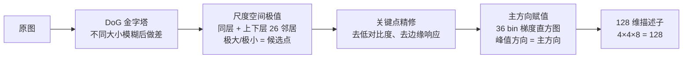
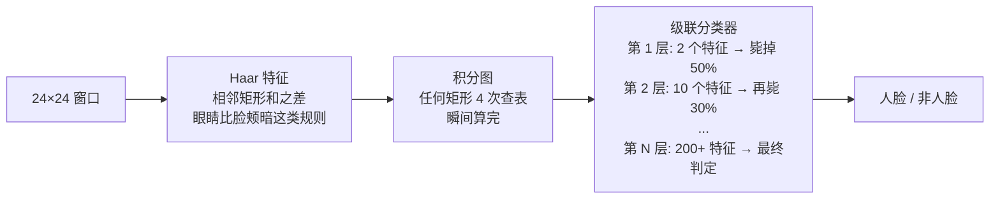
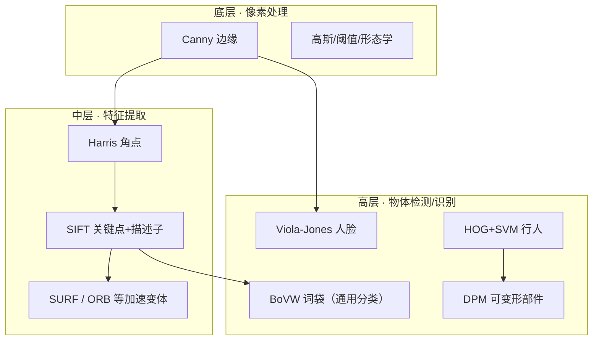

# 第 4 页 · SIFT / HOG+SVM / Viola-Jones 各记一句

学完 Canny 你已经掌握了"读传统 CV 算法页的套路"。这一页把另外三大主力算法用**同样的骨架**讲一遍，但**每个只记最核心的一件事**——因为它们的详细档案在各自的 index 页里，这一页只解决"我什么时候该选谁"的问题。

## 总览对比表

| 算法 | 年份 | 解决什么问题 | 输出什么 | 速度 | 典型场景 |
|---|---|---|---|---|---|
| **Canny** | 1986 | 找边缘 | 二值边缘图 | ⚡️极快 | 边缘提取、预处理 |
| **SIFT** | 2004 | 找"跨尺度跨旋转还能认出来"的点 | N 个关键点 + 128 维描述子 | 🐢较慢（专利期内有 SURF/ORB 替代）| 图像拼接、物体识别、三维重建 |
| **Viola-Jones** | 2001 | 实时检测刚性物体（默认：正脸）| 矩形框 | ⚡️极快（30 FPS on 700MHz CPU）| 实时人脸、摄像头取景框画框 |
| **HOG+SVM** | 2005 | 行人/形状柔性物体检测 | 矩形框（滑窗+分类器）| 🐢中等（需多尺度滑窗）| 行人检测、工业零件识别 |

## SIFT：找"指纹点"

**TL;DR**：用**高斯差分尺度空间**找跨尺度极值点，给每个点算主方向 + 128 维描述子——**不管怎么转、怎么缩、怎么改亮度**，同一个物理点的 128 维向量都能匹配上。

**只记一件事**：SIFT 最牛的不是"找角点"，是**给每个点算一个"数字指纹"**——128 维向量。两张图里的同一个物理位置，即使转了角度、放缩了大小、亮暗变了，这 128 维向量仍然接近。后续靠**向量距离最近**就能匹配。

> **场景**：你想拼全景照片——两张照片 SIFT 各自抽 1000 个点 → 用最近邻匹配 → RANSAC 去掉错配 → 算单应性矩阵 → 拼接完成。这就是所有手机全景模式的传统方案。

深入跳：[SIFT 完整档案](/algorithms/sift/)

## Viola-Jones：三级火箭做实时检测

**TL;DR**：**Haar 特征 + 积分图 + AdaBoost 级联**——三级组合拳，2001 年就在 Pentium III 上跑出 30 FPS 人脸检测。

**只记一件事**：**级联（cascade）** 是 V-J 的灵魂——不是用一个强分类器判一次，而是"像漏斗"：
- 第一关用 2 个最简单的 Haar 特征，**50% 的窗口直接被判"不是人脸"丢掉**——这一步成本极低
- 剩下的窗口进第二关，用 10 个特征，再毙 30%
- 越往后越严格，最后一关用 200+ 特征判最终结果
- **结果**：平均每个窗口只算了几个特征就被毙掉，整体速度比单分类器快几十倍

> **生活比喻**：招聘海选——HR 先用"学历门槛"筛掉一半简历（30 秒/份），再用笔试筛掉一半（10 分钟/份），最后面试筛剩下的（1 小时/份）。如果所有人都面一小时，HR 要累死。

**局限**：只能检"训练时指定过的视角"（默认正脸），侧脸、歪头、戴口罩都不行。Haar 特征太浅，表达不了复杂形状。

深入跳：[Viola-Jones 完整档案](/branches/detection/viola-jones)

## HOG + SVM：形状统计 + 分类器

**TL;DR**：把窗口切成很多小格子（cell），每个格子统计**梯度方向直方图**，拼起来送进 **SVM 分类器**——行人轮廓这种"梯度方向有特殊分布"的物体就能被检出。

**只记一件事**：HOG 不关心"梯度具体多大"，关心**梯度往哪个方向指**——行人的轮廓梯度方向分布很有规律：肩膀是横的、腿是竖的、头是圆的。把这种"方向的形状"统计出来，SVM 就能学会"长这样的就是行人"。

**为什么是 SVM 不是 AdaBoost**：HOG 特征 3780 维，比 Haar 那几个数重得多，AdaBoost 在这种高维稠密特征上不如线性 SVM 稳。

**代价**：要多尺度滑窗、每个窗口都算 HOG → 比 V-J 慢，CPU 上大概 1–5 FPS（2005 年的标准），但精度远高于 V-J。

深入跳：[HOG+SVM 完整档案](/algorithms/hog-svm/) · [DPM 可变形部件模型](/branches/detection/dpm)（HOG 的进化版，能处理弯腰、抬腿的行人）

## 三个算法 vs Canny 的关系

- Canny 是**底层算子**——输出边缘图，下游谁都能用
- SIFT 是**中层特征**——输出关键点+描述子，用来做匹配/拼接/识别
- Viola-Jones 是**高层检测器**——输出"这是人脸"的框
- HOG+SVM 是**高层检测器**——输出"这是行人"的框

这就是传统 CV 的"三层金字塔"——底层处理像素、中层抽特征、高层做识别。章毓晋教材第 3–15 章讲的就是这三层怎么堆起来。

准备好了？最后一页 → [第 5 页：什么时候选传统 CV，什么时候上深度学习](./p5-when-to-use)
