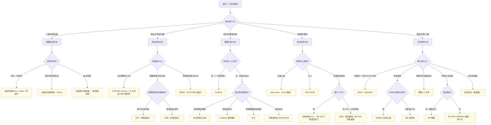

# 算法选型决策树 · 从场景一路点到代码

> 用「7 个起点」的 if-then 流程，把"传统 CV 我到底该用哪个算法"变成可以一步步点的决策树。
>
> 这页不是百科，是**你拿到一个需求之后，10 分钟内能选到第一版可用方案**的导航图。

::: tip 配合阅读
选定之后看 [对比矩阵](/global/compare-matrix) 看结构差异、[基准数据](/global/benchmarks) 看数字、
[故障排查](/global/troubleshooting) 看常见坑。
:::

---

## 一句话总纲

> **先问"我的输入是什么、我要输出什么、我有多少算力"，再选算法。**
> 不要一上来就"SIFT 最牛所以上 SIFT"，那是学生思维——工业界最怕的就是"杀鸡用牛刀"和"杀鸡用水果刀"。

---

## 完整决策流程图

---

## 起点 1：从"任务类型"分岔

**先按输出选分支，再在分支里挑算法**——这比"挑一个万能算法"靠谱 100 倍。

| 你想得到的东西 | 走哪条分支 | 第一站 |
|---|---|---|
| 一张"黑白轮廓"图 | 图像处理 | 看 B1 |
| 图像里"能反复找到的点" | 特征检测 | 看 C1 |
| 把物体从背景里"挖出来" | 图像分割 | 看 D1 |
| 画框标"这里有个人/脸" | 目标检测 | 看 E1 |
| 深度/距离/相机位姿/三维模型 | 几何视觉 | 看 F1 |

::: danger 常见陷阱
不要把"检测"和"分割"混为一谈：
- 要**矩形框** → 检测
- 要**像素级轮廓** → 分割
- 要**二值 mask 再做形态学** → 图像处理
:::

---

## 起点 2：算力预算与硬件档位

| 硬件 | 预算 | 可用算法族 |
|---|---|---|
| MCU / 单片机 (<100 MHz) | <10 ms | 阈值、形态学、连通域、Sobel |
| 低端 ARM (Cortex-A7/Raspberry Pi Zero) | <50 ms | + Otsu、Canny、FAST、LK 稀疏光流、BM 立体、V-J 人脸 |
| 中端 ARM / RPi4 / 手机 | <30 ms@VGA | + ORB、Shi-Tomasi、SGBM、Farnebäck、HOG+SVM |
| x86 i5+ | <100 ms | + SIFT、SURF、K-Means、GrabCut |
| x86 i7+ 多线程 | <300 ms | + Mean Shift、DPM、稠密 ICP、GC 全局立体 |

::: warning 红线
- **MCU 上想跑 ORB/SIFT？想都别想**，内存和算力都不允许
- **想跑 HOG+SVM 行人检测至少要中端 ARM**，低端板子帧率低于 5 没意义
- **SGBM 在 320×240 要 38 ms，640×480 就是 4 倍以上**，注意分辨率预算
:::

---

## 起点 3：数据条件

- **光照极稳定**（实验室/打光工业场景）→ 固定阈值 + 形态学就够了，不要上 Canny 添乱
- **光照有变化但可接受**（室内自然光）→ Otsu + Canny + 自动曝光
- **光照不可控**（室外/阴影/反光）→ 自适应阈值 + CLAHE 均衡 + 颜色空间（HSV/Lab）
- **目标颜色与背景差异大**→ 直接 HSV 颜色阈值（最快最稳），比任何"智能"算法都好
- **有明显噪声**（夜间/高 ISO）→ 中值滤波/双边滤波在前，不能直接 Canny
- **有遮挡**→ 不能靠单一特征，用部件模型（DPM）或深度学习

---

## 起点 4：精度要求 vs 速度要求

| 精度要求\速度要求 | 要实时 (<30 ms) | 准实时 (<200 ms) | 离线可接受 |
|---|---|---|---|
| **粗检即可** | 阈值+形态学 | - | - |
| **一般商用** | ORB/Sobel/Otsu | Canny/GrabCut/SGBM | SIFT |
| **工业测量级** | 不可能 | 标记分水岭 + 亚像素 | SIFT+BA、GC 全局立体 |
| **医疗/测绘** | 不可能 | 不可能 | SIFT 稠密 + 多视角几何 + BA |

---

## 起点 5：可用开发资源

| 资源 | 推荐 |
|---|---|
| 只装了 OpenCV，不想训练 | 所有传统算法都是现成 API，**直接调** |
| 有 Haar/LBP 级联 XML | Viola-Jones 直接 `cv2.CascadeClassifier` |
| 能收集少量样本、想训练检测器 | HOG+SVM，OpenCV 自带 `cv2.HOGDescriptor.train` |
| 有标定板、要做测量 | 张氏标定 + 极线校正 + SGBM |
| 有 GPU/CUDA | 别犹豫，上 YOLO 或深度模型——传统 CV 在 GPU 上优势全失 |

---

## 起点 6：专利与合规要求

- **要商业发布且不付专利费**：ORB/FAST/BRIEF 全家桶、Canny/Sobel/Otsu/Watershed、SGBM（论文开源）、EPnP、Viola-Jones（专利 2021 已过期）
- **SIFT / SURF**：美国专利于 2020/2026 年到期，但部分国家/地区仍有衍生专利风险，商用需法务评估
- **OpenCV nonfree 模块**（SIFT/SURF）：即使专利过期也要注意你的发行版是否默认编译
- **医疗/汽车/金融**：必须有可解释性——传统 CV 天然胜出（每一步能看到），深度学习要额外做可解释性

---

## 起点 7：按"现成案例"起步

- [工业零件缺陷检测](/cases/industrial-defect)
- [嵌入式边缘部署](/cases/edge-deployment)
- [场景反查入口](/scenarios/)

---

## 常见决策陷阱

1. **上来就 SIFT** → 90% 的工业场景用不到尺度+旋转不变，ORB 甚至 Shi-Tomasi 就够。
2. **"GrabCut 万能抠图"** → 只能分前景/背景两类，多物体+颜色相近场景必失败。
3. **"Canny 比 Sobel 好"** → Canny 在均匀光照下可能过杀边缘，Sobel+阈值反而稳。
4. **"Watershed 是自动分割"** → 必须给 marker，不给 marker = 全是过分割噪点。
5. **"LK 光流能做稠密位移"** → LK 是**稀疏**的，稠密位移请用 Farnebäck。
6. **"ICP 给两帧点云就能配"** → ICP 必须有初值，没有初值先粗配（FPFH+RANSAC）。
7. **"双目=SGBM"** → 内存不够就 BM，精度要求高就 GC，SGBM 是"中间档位"不是万能。
8. **"Viola-Jones 能检测任意物体"** → Haar 级联只适合"刚性物体+正面视角"（人脸、车辆），歪一点就漏。
9. **"传统 CV 一定比深度学习省电"** → 同等精度下成立，但如果你在 GPU 上跑，OpenCV 的 GPU 实现未必比 TensorRT 跑小模型省电。
10. **"OpenCV 默认参数就能用"** → 每个参数都是论文作者在自己数据集上调的，你的场景必须重新调。

---

## 一句话推荐（懒人版）

| 场景 | 闭眼选 |
|---|---|
| 工业零件定位+测量 | 标定 + 二值化 + 形态学 + 轮廓 + 几何矩 |
| 二维码/标签识别 | 二值化 + 轮廓筛选 + 透视变换 |
| 人脸门禁（无 GPU） | Viola-Jones 或 HOG+Dlib 68 点 |
| AR 平面跟踪 | Shi-Tomasi + LK 光流（标记）/ ORB-SLAM（无标记） |
| 文档扫描+矫正 | Otsu + 形态学 + Hough 直线 + 透视变换 |
| 双目距离测量 | 张氏标定 + 极线校正 + SGBM |
| 视频稳像 | Farnebäck 稠密光流 + 仿射补偿 |
| 人数统计（传统） | HOG+SVM 或 背景减 + 连通域；推荐直接上 YOLOv8n |
| 人像抠图 | GrabCut（交互）/ 深度学习（自动） |
| SLAM/VR（无 GPU） | ORB-SLAM 系列（ORB 特征） |

---

## 三张对照表联动

- **我已经选了方向但拿不定具体算法** → [对比矩阵](/global/compare-matrix)
- **我想知道在我硬件上具体跑多少帧** → [基准数据](/global/benchmarks)
- **我选好了但跑起来效果差** → [故障排查](/global/troubleshooting)
