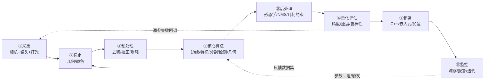

# 数据流全景图 · 从采集到部署一条链串完

> 对应 agent-yolo 的"数据采集→标注→训练→评估→量化→部署→监控"链路。
> 传统 CV 没有"训练权重"这件事，但**同样有一条完整工程链路**：从相机采集到算法上线，
> 每一步都有明确的输入/输出/工具/坑。

---

## 一句话总纲

> **传统 CV 项目的失败，90% 不是算法选错，而是前面的"光"和后面的"阈值"没管好。**
> 别光盯算法，整条链跑通才算成功。

---

## 全景图：一条主链 + 三条反哺

---

## 环节 1：数据采集（Collection）

**输入**：物理世界
**输出**：原始图像帧

| 要素 | 典型选项 | 关键影响 |
|---|---|---|
| 相机 | 工业相机 (GigE/USB3) / 普通摄像头 / 手机 | 分辨率、帧率、动态范围 |
| 镜头 | 定焦/变焦/远心/鱼眼 | 畸变、景深、工作距离 |
| 光源 | 环形光/背光/同轴光/结构光 | **最关键的一步**，决定 80% 的成败 |
| 触发 | 软触发/硬触发/编码器 | 与产线同步，避免运动模糊 |

::: danger 工业红线
**打光比算法重要 10 倍。** 打光没打好，什么 Canny/SIFT 都救不了。
常见错误：用普通室内光、靠窗户自然光、背光和前景没分离、反光没做偏光片处理。
:::

**典型坑**：
- 镜头畸变没评估 → 后续测量全错
- 光源频闪（LED 与快门不同步）→ 图像条纹
- 曝光时间太长 → 运动模糊
- 白平衡自动 → 颜色漂移导致阈值失效

---

## 环节 2：标定（Calibration）

**输入**：原始图像 + 标定板/参照物
**输出**：相机内参/外参/畸变系数/颜色查找表

| 类型 | 工具 | 用途 |
|---|---|---|
| 几何标定 | [张氏标定](/algorithms/zhang-calibration/)（棋盘格） | 求内参 (fx,fy,cx,cy) + 畸变 |
| 手眼标定 | Tsai-Lenz / Park 方法 | 相机到机器人坐标的变换 |
| 颜色标定 | 色卡 (X-Rite) + 3×3 颜色矩阵 | 保证跨设备颜色一致 |
| 立体标定 | [双目+极线校正](/algorithms/sgbm/concepts) | 双目深度测量 |

**验收标准**：重投影误差 < 0.3 像素（几何）、ΔE < 3（颜色）。

---

## 环节 3：预处理（Pre-processing）

**输入**：原始图
**输出**：适合算法消费的"干净图"

| 操作 | 何时用 | 常用算子 |
|---|---|---|
| 去噪 | 高 ISO/夜间/压缩伪影 | 高斯滤波、中值滤波（椒盐）、双边滤波（保边） |
| 色彩空间转换 | 颜色分割/不受亮度影响 | BGR→HSV/Lab/YCrCb |
| 对比度增强 | 光照偏暗/雾/逆光 | 直方图均衡、CLAHE、伽马校正 |
| 几何校正 | 镜头畸变/透视变形 | undistort、warpPerspective |
| 尺寸对齐 | 多相机/金字塔 | resize、warpAffine |
| ROI 裁剪 | 只关心某个区域 | mask、Rect |

::: tip 口诀
"**先几何、再颜色、最后灰度**"。
先把图"摆正"，再把颜色"调正"，最后转灰度做算法——这个顺序能省一半的调参。
:::

---

## 环节 4：核心算法

**输入**：预处理后的图
**输出**：你要的中间结果（边缘/特征/区域/框/位姿）

按分支选，详见 [选型决策树](/global/choose-algorithm)：
- 图像处理：阈值、边缘、形态学
- 特征检测：[Harris](/algorithms/harris/) / [SIFT](/algorithms/sift/) / [ORB](/algorithms/orb/) / [FAST](/algorithms/fast/)
- 特征匹配：BF/FLANN + RANSAC
- 分割：[K-Means](/algorithms/kmeans/) / [Watershed](/algorithms/watershed/) / [GrabCut](/algorithms/grabcut/) / [SLIC](/algorithms/slic/)
- 检测：[Viola-Jones](/algorithms/viola-jones/) / [HOG+SVM](/algorithms/hog-svm/) / [DPM](/algorithms/dpm/)
- 几何：[SGBM](/algorithms/sgbm/) / [LK 光流](/algorithms/lucas-kanade/) / [EPnP](/algorithms/pnpsolver/) / [ICP](/algorithms/icp/)

---

## 环节 5：后处理（Post-processing）

**输入**：算法原始输出（带噪声/假阳性）
**输出**：业务可用的"干净结果"

| 算法常见输出 | 后处理方法 |
|---|---|
| 边缘二值图 | 形态学闭运算连段、连通域筛选面积/长宽比 |
| 特征点 | 比率检验 + RANSAC 剔除外点，响应值 Top-K |
| 分割 mask | 形态学开闭去噪、孔洞填充 (floodFill) |
| 检测框 | NMS 抑制重叠、置信度阈值过滤 |
| 立体视差 | WLS 滤波、左右一致性检查、中值滤波 |
| 点云 | 体素下采样、统计离群点去除、法向估计 |

**关键原则**：业务约束（"零件必须是圆形"、"二维码必须在中心"）都写在后处理里，**不要强迫算法自己做**。

---

## 环节 6：量化评估（Evaluation）

**输入**：算法结果 + ground truth
**输出**：可量化的精度/速度/鲁棒性报告

| 任务类型 | 常用指标 |
|---|---|
| 边缘/分割 | Pixel Accuracy、IoU、Boundary F1 |
| 特征匹配 | 重复率、匹配精度（inlier ratio）、召回 |
| 检测 | Precision/Recall、F1、mAP、FPPI（误检率） |
| 立体/深度 | 视差 bad-pixel 率、RMSE（Middlebury/KITTI） |
| 光流 | EPE（端点误差）、Fl-all（KITTI 指标） |
| 位姿/配准 | 旋转/平移误差、重投影误差、ADD(-S) |
| 速度 | 单帧耗时 ms、FPS、CPU 占用、内存峰值 |

::: tip 传统 CV 特有指标
**"参数稳定性"**：同样参数下换 100 张图成功率多少？
传统算法没有"训练集/测试集"的泛化保证，**参数敏感度**是比 AP 更重要的工程指标。
:::

---

## 环节 7：部署（Deployment）

**输入**：Python 原型
**输出**：产线上的 C++/嵌入式程序

| 目标平台 | 工具链 | 关键注意 |
|---|---|---|
| Windows/Linux x86 | OpenCV C++ + CMake / OpenVINO | 用 Release 编译（-O2/-O3）能提速 3~5 倍 |
| ARM / Raspberry Pi | OpenCV + NEON 编译 | 关闭 IPP/OpenCL 不必要模块，能减到 10MB 以内 |
| Android/iOS | OpenCV for Android/iOS SDK | 注意 NDK 版本、ABI 兼容性 |
| MCU/RTOS | 自己写最小算子（不能用 OpenCV） | 只用 int8/int16，避免 float，别用 malloc |
| FPGA | HLS / Verilog 手写卷积流水线 | 固定窗口大小才能流处理 |

**常见加速手段**：
- SIMD（SSE/NEON）：手写 4/8 通道并行
- ROI 裁剪：只在关心区域跑算法
- 多线程：TBB/OpenMP 并行分块
- 降分辨率：320×240 比 640×480 快 4 倍
- 定点化：float→int8，速度翻 2~3 倍

---

## 环节 8：监控（Monitoring）

**输入**：线上运行结果
**输出**：异常报警、漂移检测、数据集回流

传统 CV 没有"模型老化"的概念，但有 **"光老化"和"硬件老化"**：
- 灯泡老化 → 亮度下降 → 阈值失效
- 镜头落灰/起雾 → 对比度下降 → Canny 不出边
- 机械结构松动 → 外参偏移 → 测量偏差
- 季节变化 → 自然光变化 → 颜色阈值飘

**必须监控的信号**：
1. 图像平均亮度/对比度（硬件健康）
2. 检出率/合格率（算法是否还在工作）
3. 处理耗时（CPU/内存异常）
4. 算法置信度分布（漂移早期信号）

---

## 三条反哺回路详解

### 回路 A：坏样本回流 → 调参/补规则
线上检出失败/误检的图，定期（每周/每月）回来看，调阈值、加后处理规则。
传统 CV 不是"训完就上线"，而是**靠坏样本集驱动迭代**——这一点和深度学习一样重要。

### 回路 B：硬件漂移 → 重新标定
灯泡换了、镜头动了、温度变了导致结构变形，都要重新标定。
**建议周期**：首次上线后 1 周→1 月→3 月→半年，稳定后半年一次。

### 回路 C：性能瓶颈 → 升级加速
上线后发现 CPU 爆/帧率不够，回第 7 环节做加速，或者第 1 环节换更合适的相机/打光。

---

## 端到端时间预算参考

以"工业零件缺陷检测 VGA @ 30 FPS"为例：

| 环节 | 预算 (ms) | 累计 |
|---|---:|---:|
| 采集+传输 | 2 | 2 |
| 几何校正 | 1 | 3 |
| 去噪+ROI 裁剪 | 1 | 4 |
| 阈值+Canny+形态学 | 2 | 6 |
| 轮廓+几何矩特征 | 1 | 7 |
| 缺陷判定规则 | <1 | 8 |
| 结果输出+通讯 | 1 | 9 |
| **剩余余量** | 24 | **33 ms/帧 = 30 FPS 达标** |

::: warning 红线
任何一个环节超预算，都要往回找——**不要给算法自己超 20 ms 的机会**，否则整条链瘫痪。
:::

---

## 常见故障诊断表

| 症状 | 最可能出问题的环节 |
|---|---|
| 图像偏暗/有条纹 | ①采集（光源/曝光） |
| 边缘位置偏移 2-3 像素 | ②标定（畸变/外参） |
| 同一阈值今天可以明天不行 | ①采集（光源老化）/ ③预处理（缺白平衡） |
| 噪声多、边缘碎 | ③预处理（没去噪） |
| 正确目标被漏掉 | ④核心算法（参数/算法本身） |
| 检测框太多假阳性 | ⑤后处理（缺 NMS/几何约束） |
| 上线后速度比测试慢 5 倍 | ⑦部署（Debug 模式、没开优化） |
| 跑一个月后越来越差 | ⑧监控（硬件漂移，要重新标定） |

---

## 数据流与本体关联

链路上的每个环节在本体里都有对应实体：
- ①②：Device / Calibration 实体
- ③⑤：Operator 实体（基础算子）
- ④：Algorithm 实体（核心算法）
- ⑥：Metric / Benchmark 实体
- ⑦⑧：Deployment / CaseStudy 实体

这保证了"每一步用了什么算子/参数/指标"都是可追溯的。

---

## 三张横向页联动

- 链路选什么算法 → [选型决策树](/global/choose-algorithm)
- 算法之间有啥差别 → [对比矩阵](/global/compare-matrix)
- 每环节耗时多少 → [基准数据](/global/benchmarks)
- 出问题怎么修 → [故障排查](/global/troubleshooting)
