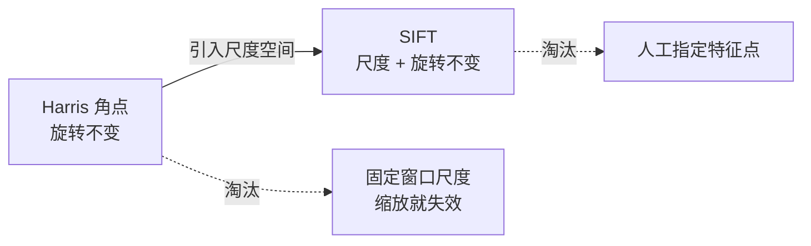
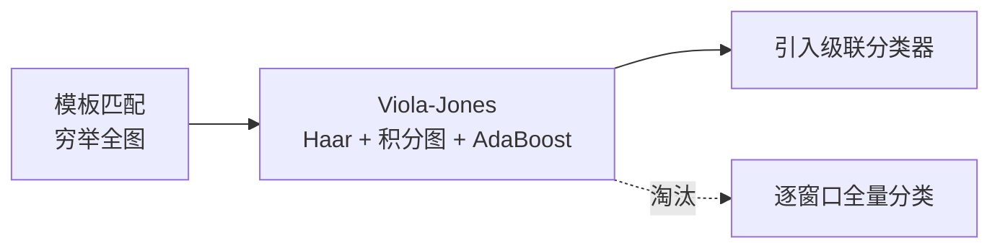
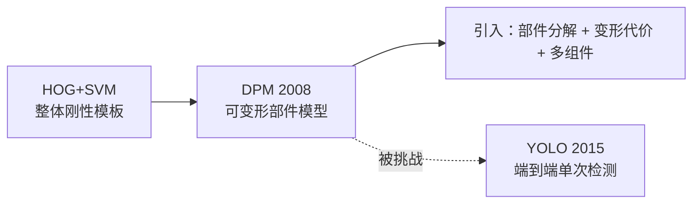
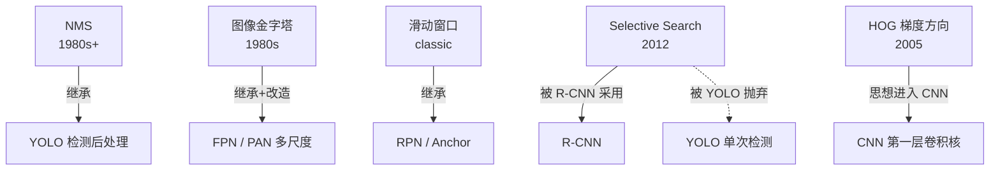

# 技术演化事件

> 每一次演化都是一条 `from → to` 的边，记录**引入了什么、淘汰了什么、为什么**。
> 这正是本体 Schema 里 `Evolution` 实体要建模的东西。

## 图像处理分支的演化

### Sobel → Canny（1968 → 1986）

| 项目 | Sobel | Canny |
|---|---|---|
| 引入 | 梯度卷积核 | 高斯平滑、双阈值、非极大值抑制 |
| 淘汰 | 固定 3×3 核、无去噪 | 单阈值思路 |
| 关键理由 | Sobel 对噪声敏感、边缘粗、容易断 | Canny 把「好边缘」形式化成三条准则：**低误检、定位准、单像素响应** |

::: tip 通俗版
Sobel 是「大概勾个线」，Canny 是「用细笔描得又准又连续，还不会把灰尘当线」。
:::

### 固定阈值 → Otsu 自适应阈值（手工 → 1979）

- **引入**：类间方差最大化，自动求最佳阈值
- **淘汰**：人工试阈值
- **关键理由**：光照一变，固定阈值就废了；Otsu 能自动适应

## 特征检测分支的演化

### Harris → SIFT（1988 → 1999/2004）

- **引入**：DoG 尺度空间、方向直方图、128 维描述子
- **淘汰**：Harris 的固定窗口尺度假设
- **关键理由**：Harris 一旦图像缩放，角点响应就变了；SIFT 用尺度空间解决这个问题

### SIFT → SURF → ORB（2004 → 2006 → 2011）

| 版本 | 引入 | 关键动机 |
|---|---|---|
| SIFT (2004) | 尺度不变 + 旋转不变 + 128 维描述子 | 精度优先，但**慢** |
| SURF (2006) | 积分图、Hessian 近似、64 维描述子 | **加速** SIFT，牺牲少量精度 |
| ORB (2011) | FAST 角点 + BRIEF 描述子 + 方向补偿 | 速度与精度平衡，**实时 SLAM 主力** |

### FAST 的引入与局限

[FAST / AGAST Corner Detector: 十分钟内扔进来 3.14 万亿个角点](https://www.edwardrosten.com/work/rosten_2006_machine.pdf)

- **引入**：圆周 16 像素快速判定，**不做尺度空间**
- **代价**：没有尺度不变性、没有方向，必须配 BRIEF 才能用
- **意义**：让角点检测进入「微秒级」，是 ORB 的基石

## 特征匹配分支的演化

### 最小二乘 → RANSAC（1981）

- **引入**：随机采样 + 一致性检验
- **淘汰**：对所有点做最小二乘
- **关键理由**：只要有 1 个错误匹配，最小二乘就会把整条线带偏；RANSAC 能容忍大量外点

### 特征匹配驱动的图像拼接（2000s）

- **引入**：SIFT 匹配 + RANSAC 求单应矩阵 + 多频段融合
- **关键理由**：全景拍照第一次不依赖三脚架和精确已知相机参数

## 分割分支的演化

### Watershed → MeanShift → GrabCut → GraphCut

| 算法 | 引入 | 淘汰/不足 |
|---|---|---|
| Watershed (1979) | 地形灌水 + 标记控制 | 容易过分割 |
| MeanShift (1995) | 密度聚类 + 带宽自适应 | 慢 |
| GraphCut (2001) | 最小割 + 能量函数 | 需要人工标前景背景 |
| GrabCut (2004) | 矩形框标注 + 高斯混合 + 迭代 | 无需逐像素标注，交互成本最低 |

## 目标检测分支的演化

### 模板匹配 → Viola-Jones（2001）

- **引入**：Haar-like 特征、积分图、AdaBoost 特征选择、级联检测
- **关键理由**：把「毫秒级实时人脸检测」从不可能变成可能

### Viola-Jones → HOG+SVM（2005）

| 版本 | 引入 | 动机 |
|---|---|---|
| Viola-Jones (2001) | Haar 特征 + AdaBoost 级联 | 面向人脸这种**纹理较平滑**的目标 |
| HOG+SVM (2005) | 梯度方向直方图 + 线性 SVM | 面向**行人这种轮廓强**的目标 |

- **关键理由**：Haar 对行人的软轮廓不敏感；HOG 直接描述边缘方向分布，对行人更合适

### HOG+SVM → DPM（2008）

- **引入**：把对象拆成多个可变形部件、Latent SVM 训练
- **意义**：传统手工特征检测的**巅峰**，也是最复杂的一代——复杂到这个程度，逼近了手工设计的性能天花板

## 几何视觉分支的演化

### 经典标定 → 张正友标定法（1999）

- **引入**：平面棋盘格、多视角求解、径向畸变建模
- **淘汰**：需要昂贵三维标定物
- **关键理由**：一张打印的棋盘格就能标定，工业界沿用至今

## 与深度学习的交接

### 传统 → 深度学习的关键交接点

**要点**：YOLO 不是凭空出现的，它是「把传统检测的手工特征换成 CNN 特征，同时保留 NMS、Anchor、多尺度这些传统手艺」的产物。

详见 [传承脉络](/legacy/)。
