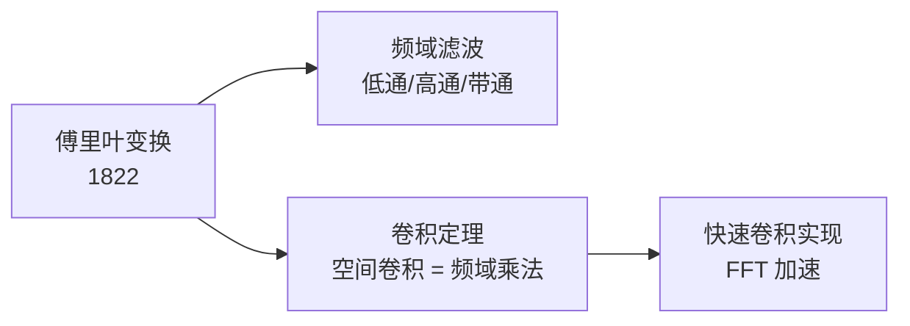
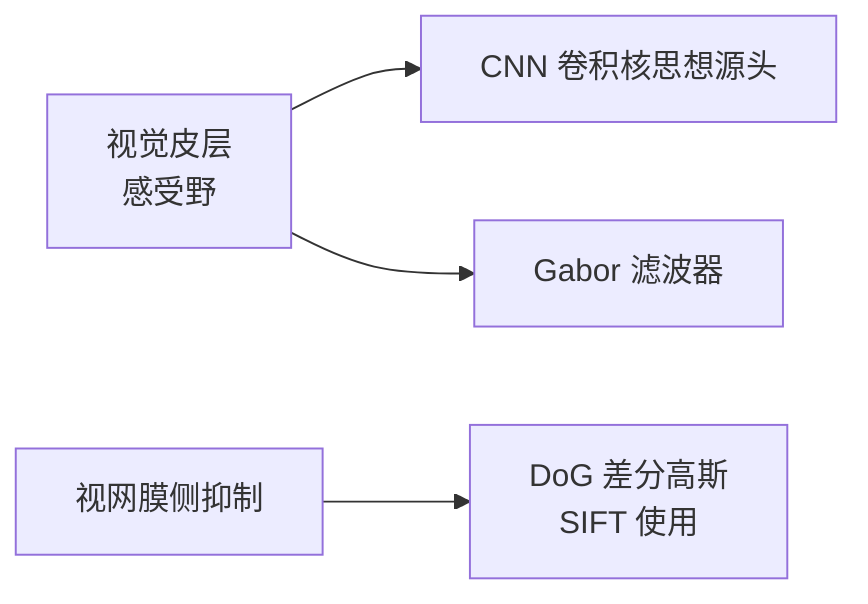
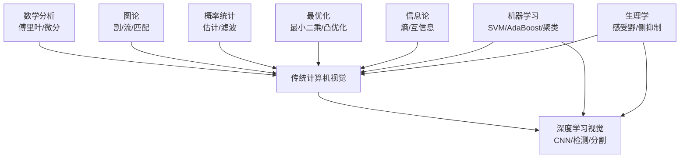

# 外部技术影响

> 传统 CV 不是一个封闭的学科，它大量借用了**其他领域的工具**。
> 这一页记录那些「来自外部、却被传统 CV 发扬光大」的技术。

## 关键外部技术

### 傅里叶变换（来自数学 / 信号处理）

- **在 CV 里的用途**：频域滤波、卷积加速、周期噪声去除
- **典型应用**：去除规则条纹噪声、模板匹配加速

### 图论（来自离散数学）

- **最小割 / 最大流** → GraphCut、GrabCut 分割
- **最短路径** → 智能剪刀（Intelligent Scissors）交互式分割
- **二分图匹配** → 匈牙利算法做多目标跟踪

### 概率统计与鲁棒估计

| 工具 | 在 CV 中的应用 |
|---|---|
| 最大似然估计 | 相机标定参数求解 |
| RANSAC / MSAC / PROSAC | 特征匹配外点剔除 |
| 卡尔曼滤波 | 目标跟踪、SLAM 状态估计 |
| 粒子滤波 | 非高斯跟踪场景 |

### 最优化方法

- **最小二乘 / 高斯牛顿**：光束法平差（Bundle Adjustment）、SFM 优化
- **图优化（Graph Optimization）**：SLAM 后端
- **凸优化 / 线性规划**：能量最小化分割

### 信息论

- **熵** → 图像配准（互信息）、Otsu 阈值法的变体
- **KL 散度** → 直方图匹配

### 机器学习（前深度学习时代）

| 工具 | 在 CV 中的应用 |
|---|---|
| 支持向量机 SVM | HOG+SVM 行人检测、分类器 |
| AdaBoost | Viola-Jones 人脸检测特征选择 |
| 随机森林 | 关键点识别（如 Microsoft Kinect 身体部件分类） |
| 隐变量 SVM（Latent SVM） | DPM 可变形部件模型 |
| K-Means | 特征聚类、颜色量化、Anchor 尺寸聚类 |

### 人体生理学启发

- **Hubel & Wiesel 感受野实验（1959–1962）**：直接启发了后来的卷积神经网络
- **Gabor 滤波器**：模拟视觉皮层简单细胞的响应，用于纹理分析
- **DoG（Difference of Gaussians）**：模拟视网膜侧抑制，被 SIFT 用作尺度空间算子

## 外部技术影响图谱

## 反向输出：传统 CV 影响了谁

传统 CV 不只吸收外部技术，也向外输出：

- **图像处理算子** → 医学影像、遥感、天文图像分析
- **特征匹配** → 摄影测量、无人机测绘、文物数字化
- **目标检测** → 智能交通、安防监控、工业质检
- **几何视觉** → 机器人导航、AR/VR、自动驾驶
- **CNN 的卷积核** → 直接脱胎于视觉皮层研究与 Gabor 滤波器
