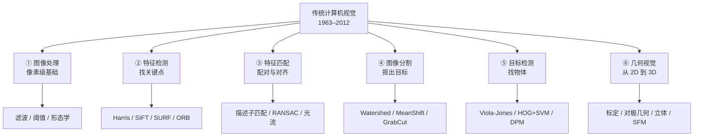
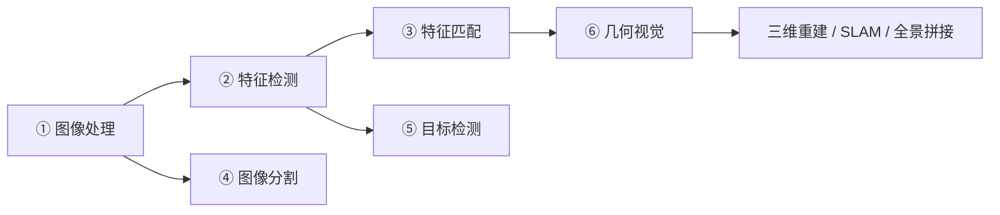
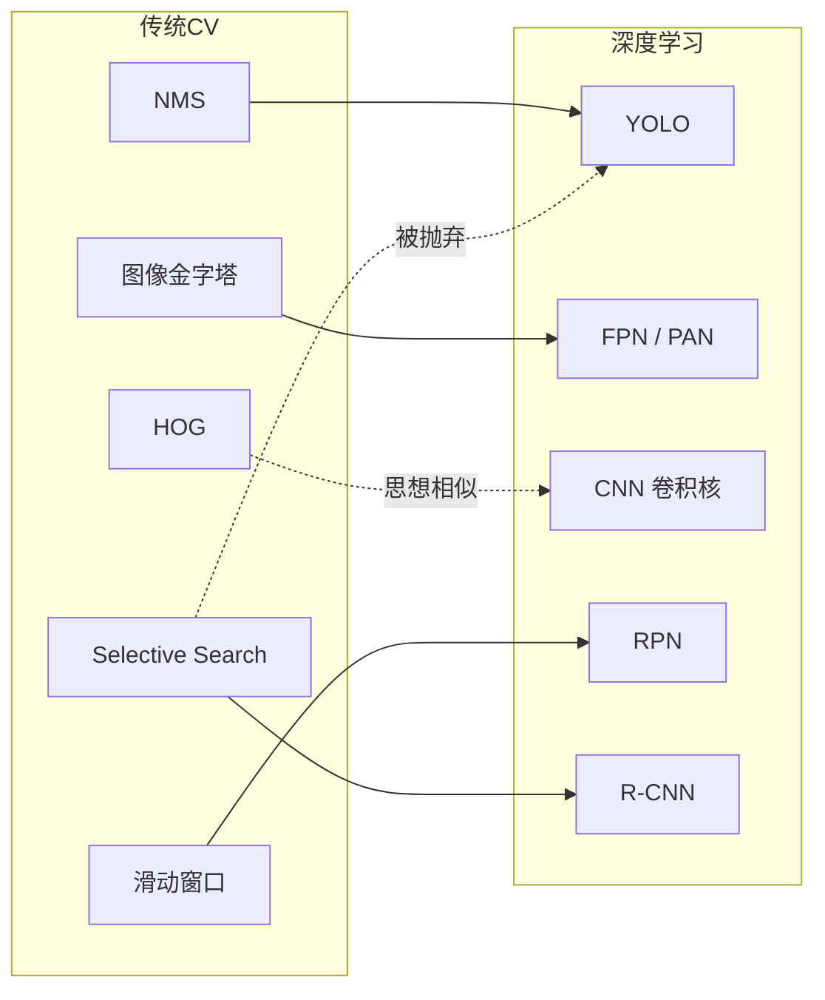
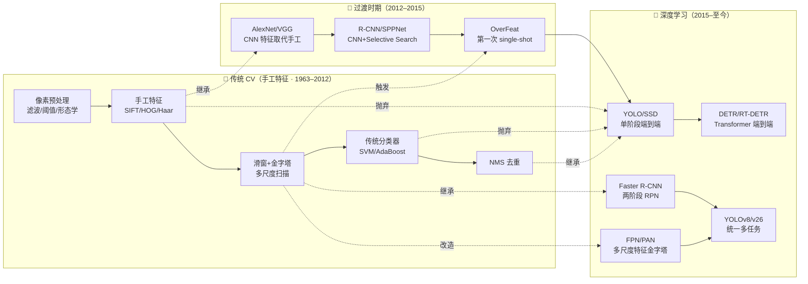
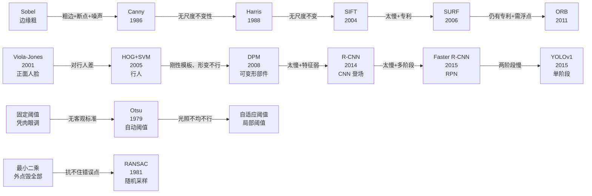

# 传统 CV 家族树

> 传统计算机视觉从 **1963 年 Larry Roberts 的边缘检测论文** 开始，到 **2012 年 AlexNet 引爆深度学习** 为止，走过了约 **50 年**。
> 这 50 年不是零散的算法堆砌，而是一棵有清晰分支、有继承关系的**技术家族树**。

## 一句话总览

传统 CV 的整棵树只有 **六条主干**：

## 六条主干的关系

这六条主干**不是并列的**，而是有依赖顺序：

- **① 图像处理** 是最底层，所有其他分支都要先用它清理图像；
- **② 特征检测** 建立在 ① 之上，用滤波/梯度算子找出稳定的点与边；
- **③ 特征匹配** 依赖 ② 产出的特征点，把它们在两张图间配对；
- **④ 图像分割** 主要依赖 ① 的像素操作，是目标级的粗粒度分割；
- **⑤ 目标检测** 依赖 ② 的手工特征，是「识别 + 定位」；
- **⑥ 几何视觉** 依赖 ③ 的匹配结果，是从 2D 反推 3D 的桥梁。

## 分支谱系详解

### ① 图像处理（1960s–）

| 代表算法 | 年份 | 一句话 |
|---|---|---|
| 卷积 / 相关 | 1960s | 用一个小子窗口在图上滑，做加权求和 |
| Sobel / Prewitt | 1968 | 用差分算水平/垂直方向的明暗变化 |
| 高斯滤波 | — | 给图像「磨皮」，去掉噪点 |
| 中值滤波 | 1970s | 去掉椒盐噪声的利器，保边不模糊 |
| Otsu 阈值 | 1979 | 自动找出黑白分界的最佳阈值 |
| 形态学操作 | 1980s | 腐蚀/膨胀，清理二值图的小毛刺 |
| **Canny 边缘检测** | **1986** | **描边小画家，至今仍是边缘检测标准** |

### ② 特征检测（1988–2011）

| 代表算法 | 年份 | 一句话 |
|---|---|---|
| Harris 角点 | 1988 | 找出图像里「尖角」的位置 |
| **SIFT** | **1999 / 2004** | **尺度不变特征，旋转缩放都不怕** |
| SURF | 2006 | SIFT 的加速版，用积分图提速 |
| FAST | 2006 | 极快的角点检测，用于实时 SLAM |
| ORB | 2011 | FAST + BRIEF，速度与精度平衡，SLAM 主力 |

### ③ 特征匹配（1981–）

| 代表算法 | 年份 | 一句话 |
|---|---|---|
| Lucas-Kanade 光流 | 1981 | 追踪像素在相邻帧间怎么移动 |
| **RANSAC** | **1981** | **从一堆含错匹配里拟合出对的那条线** |
| Brute-Force / FLANN | — | 描述子的暴力/近似最近邻匹配 |
| 图像拼接 | 2000s | 把多张照片缝成全景图 |

### ④ 图像分割（1979–2004）

| 代表算法 | 年份 | 一句话 |
|---|---|---|
| 分水岭 Watershed | 1979 | 把图像当成地形，从低往高灌水淹出区域 |
| MeanShift | 1995 | 让每个像素朝密度最高处漂移做聚类 |
| GraphCut | 2001 | 用图论最小割做分割 |
| **GrabCut** | **2004** | **框一下就能自动抠图，Photoshop 的经典工具** |

### ⑤ 目标检测（2001–2008）

| 代表算法 | 年份 | 一句话 |
|---|---|---|
| **Viola-Jones** | **2001** | **Haar 特征 + 积分图 + AdaBoost，毫秒级人脸检测** |
| **HOG+SVM** | **2005** | **梯度方向直方图 + 支持向量机，行人检测经典** |
| DPM | 2008 | 可变形部件模型，传统检测的巅峰，也被 YOLO 直接挑战 |
| NMS | classic | 非极大值抑制，框去重的通用后处理 |

### ⑥ 几何视觉（1981–1999）

| 代表算法 | 年份 | 一句话 |
|---|---|---|
| 八点法 | 1981 | 从 8 组对应点求基础矩阵 |
| 张正友标定法 | 1999 | 一张棋盘格标定相机内参，工业标准 |
| 立体匹配 SGBM | classic | 左右图找对应，算出深度 |
| SFM | 1992– | 从多张照片重建三维结构与相机位姿 |

## 与深度学习的关键接口

传统 CV 家族树的果实，很多直接成了深度学习的养料：

- **NMS** → YOLO 检测头后的去重
- **图像金字塔** → FPN / PAN 多尺度融合
- **HOG 梯度方向** → CNN 第一层卷积核学到的边缘滤波器
- **滑动窗口** → RPN / Anchor 先验框
- **Selective Search** → 被 R-CNN 采用，但被 YOLO 抛弃

详见 [传承脉络](/legacy/)。

---

## 与深度学习的关系：三代检测方法对比

| 代 | 代表 | 特征提取 | 区域提议 | 分类 | 定位 |
|---|---|---|---|---|---|
| **一：手工特征时代** | Viola-Jones, HOG+SVM, DPM | 手工（Haar/HOG） | 滑窗 / 图像金字塔 | SVM / AdaBoost | DPM 部件 |
| **二：两阶段 CNN** | R-CNN, Fast R-CNN, Faster R-CNN | CNN | Selective Search / RPN | Region-wise Softmax | RoI Pooling |
| **三：单阶段 / 端到端** | YOLO, SSD, DETR | CNN | 内置（grid / anchor / attention） | 网络直接输出 | 网络直接输出 |

### 传统 CV 被深度学习「继承」了什么

| 传统 CV 技术 | 在深度学习中的化身 | 首见于 |
|---|---|---|
| **图像金字塔**（多尺度遍历） | FPN / PANet / BiFPN 多尺度特征融合 | YOLOv3（FPN） |
| **NMS 非极大值抑制** | 检测头后的去重环节（一直保留到 v10 才被替换） | R-CNN 起所有检测器 |
| **滑动窗口** | Anchor 先验框（预设尺度/比例的窗口） | YOLOv2（anchor） |
| **Haar/HOG 梯度特征** | CNN 第一层卷积核（Gabor-like edge detector） | AlexNet |
| **级联分类器**（V-J 的 reject cascade） | Cascade R-CNN 的级联检测头 | Cascade R-CNN / YOLOv8 两阶段 |
| **难例挖掘**（DPM 的 hard negative mining） | OHEM / Focal Loss | Faster R-CNN / RetinaNet |
| **积分图加速** | 无严格等价，但"预计算前缀和"思想仍在 CUDA kernel 里 | — |
| **RANSAC 外点剔除** | 仍在几何深度学习、点云配准中直接使用 | 至今 |

### 传统 CV 被「改造」了什么

| 传统方案 | 深度学习改造 | 差别在哪 |
|---|---|---|
| SIFT/HOG **手工描述子** | CNN **学习到的特征** | 人手设计→数据驱动；描述子维度从 128 涨到 256/512 维向量 |
| 滑动窗口暴力扫描 | RPN / Anchor 网格回归 | 用网络预测"哪里可能有目标"，不用每个位置都算 |
| 图像金字塔逐尺度算 | FPN 特征金字塔（**自顶向下融合**） | 不同尺度共享特征，一次前向拿到多尺度表达 |
| 线性 SVM / AdaBoost 分类 | Softmax / MLP 分类头 | 非线性分类能力大幅提升 |
| DPM 可变形部件 | Deformable Conv / Attention | 部件从 6 个手工定义变成网络学的可变形卷积核 |
| 硬编码 NMS 阈值 | NMS-free 端到端（YOLOv10+/DETR） | 一对一匹配，训练时就让重复框不出现 |
| 相机标定手工拍棋盘格 | NeRF / 自监督深度估计 | 从多视图或视频里自动学，不用标定板 |

### 传统 CV 被「抛弃」了什么

| 传统技术 | 为什么被抛弃 | 替代者 |
|---|---|---|
| SIFT/SURF **描述子** | 有专利 + 对非刚性物体描述差 + 慢 | SuperPoint / DINOv2 / CNN 特征 |
| BoVW 视觉词袋 | 丢失空间信息 + K-means 字典泛化差 | CNN 全卷积特征 + VLAD/NetVLAD |
| DPM 星型部件模型 | 部件数固定、对形变建模太弱 | CNN + Deformable Conv |
| HOG 特征行人检测 | 对视角/光照/遮挡太敏感 | YOLO-Person / RT-DETR |
| Viola-Jones Haar 人脸 | 只能正面人脸、姿态变化就漏 | MTCNN / RetinaFace / YOLO-Face |
| 归一化相关（NCC）模板匹配 | 只能配刚性平移，旋转缩放全瞎 | SIFT 之后被特征匹配取代；如今被 LoFTR 取代 |
| 手工边缘+形态学缺陷检测 | 光照变化就得重调参数 | 小样本缺陷分割网络 |

### 深度学习解决了传统 CV 的哪些硬伤

| 传统痛点 | 深度学习的解法 | 首见于 |
|---|---|---|
| 手工特征泛化差、新场景要重新设计 | CNN 端到端学习特征 | AlexNet 2012 |
| 滑窗太慢（DPM 一张图数秒） | Single-shot 端到端 / RPN 提议 | YOLOv1 / Faster R-CNN |
| 无全局上下文（滑窗只看局部） | 整图一次前向 + 感受野堆叠 | YOLOv1 |
| 小目标召回差（单尺度） | FPN 多尺度融合 | YOLOv3 / FPN |
| Anchor 尺寸要手调 | Anchor-free（中心点/关键点回归） | CornerNet / YOLOv8 |
| NMS 阈值敏感 | NMS-free 一对一匹配 | DETR / YOLOv10 |
| 多任务无法统一（检测/分割/关键点各一套） | 统一骨干多任务头 | YOLOv8 / YOLOv26 |

## 一张图看传统 CV → 深度学习的位置

## 全算法「痛点追踪链」

每个算法都是在解决**上一版的痛点**，而它自己的痛点又催生下一代。这是传统 CV 家族演化的核心驱动力。

每个箭头都能在左侧「痛点追踪」链接里看到上一版的具体坑和这一版怎么解决。

## 经典算法版本逐项对比（完整版）

| 维度 | Sobel | Canny | Otsu | Harris | SIFT | SURF | ORB | Viola-Jones | HOG+SVM | DPM | RANSAC | LK 光流 | 张氏标定 | 霍夫变换 |
|---|---|---|---|---|---|---|---|---|---|---|---|---|---|---|
| **年代** | 1968 | 1986 | 1979 | 1988 | 2004 | 2006 | 2011 | 2001 | 2005 | 2008 | 1981 | 1981 | 2000 | 1962 |
| **任务** | 边缘 | 边缘 | 二值化 | 角点 | 特征点 | 特征点 | 特征点 | 人脸检测 | 行人检测 | 通用检测 | 几何拟合 | 光流跟踪 | 相机标定 | 形状检测 |
| **核心算子** | 3×3 卷积 | 高斯+Sobel+NMS | 类间方差 | 自相关矩阵 | DoG | Hessian 近似 | oFAST+rBRIEF | Haar+积分图 | 梯度直方图 | HOG+部件 | 随机采样 | 灰度守恒 | 棋盘+单应矩阵 | 参数空间投票 |
| **尺度不变** | ❌ | ❌ | ❌ | ❌ | ✅ | ✅ | ⚠️多尺度 | ❌ | ⚠️金字塔 | ⚠️金字塔 | — | ❌ | — | ❌ |
| **旋转不变** | ❌ | ❌ | ❌ | ✅ | ✅ | ✅ | ✅ | ❌ 正面 | ⚠️ | ⚠️ | — | ❌ | — | ❌ |
| **时间复杂度** | O(N) | O(N) | O(N) | O(N) | O(N·M) | O(N) | O(N) | 级联加速 | O(N·w) | O(N·w·p) | O(k·N) | O(N·it) | O(N·img) | O(N·θ) |
| **是否需要训练** | ❌ | ❌ | ❌ | ❌ | ❌ | ❌ | ❌ | ✅ AdaBoost | ✅ SVM | ✅ Latent SVM | ❌ | ❌ | ✅ 标定 | ❌ |
| **典型耗时（640×480）** | <1ms | <1ms | <1ms | <5ms | 50–100ms | 20–50ms | 5–10ms | 20–50ms | 200–500ms | 数秒 | 1–10ms | 5–20ms | 标定秒级/运行时— | 10–50ms |
| **专利** | 无 | 无 | 无 | 无 | 过期 | 有 | 无 | 无 | 无 | 无 | 无 | 无 | 无 | 无 |
| **工业使用频率（今天）** | ⭐⭐⭐⭐⭐ | ⭐⭐⭐⭐⭐ | ⭐⭐⭐⭐⭐ | ⭐⭐⭐⭐ | ⭐⭐⭐ | ⭐⭐ | ⭐⭐⭐⭐⭐ | ⭐⭐（正脸场景） | ⭐⭐（教学） | ⭐（历史） | ⭐⭐⭐⭐⭐ | ⭐⭐⭐⭐ | ⭐⭐⭐⭐⭐ | ⭐⭐⭐⭐ |
| **典型参数** | ksize=3 | σ, T_low/high | — | k=0.04, 阈值 | nOctaves, contrast | hessianThreshold | nfeatures, scaleFactor | scaleFactor, minNeighbors | winSize=64×128, blockSize | nComponents, C | 迭代次数, 阈值 | winSize=21, maxLevel | 棋盘大小 | threshold, ρ/θ 步长 |
| **OpenCV 调用** | `cv2.Sobel` | `cv2.Canny` | `cv2.threshold(THRESH_OTSU)` | `cv2.cornerHarris` | `cv2.SIFT_create` | `cv2.xfeatures2d.SURF_create` | `cv2.ORB_create` | `cv2.CascadeClassifier` | `cv2.HOGDescriptor` | `cv2.dpm.DPMDetector`（已移除） | `cv2.findHomography(RANSAC)` | `cv2.calcOpticalFlowPyrLK` | `cv2.calibrateCamera` | `cv2.HoughLinesP` |

[小白入门](/for-beginners) · [版本档案](/versions/) · [传承脉络（到 YOLO）](/legacy/)
