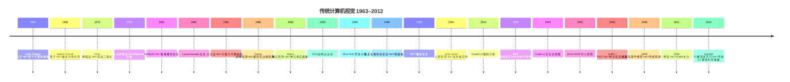

# 发展时间线

> 传统 CV 的 50 年，按时间轴排开，一眼看清每个技术出现的先后顺序。

## 完整时间线

## 分期解读

### 启蒙期（1963–1979）

计算机视觉刚刚诞生，人们还在解决最基础的问题：**怎么把图像的边缘找出来？怎么把图像变成黑白二值？**

- **1963 · Larry Roberts**：博士论文里第一次提出用计算机提取三维物体的边缘，被公认为计算机视觉的起点。
- **1968 · Sobel 算子**：用卷积核算梯度，至今还是教科书第一个边缘检测例子。
- **1979 · Otsu 阈值**：日本学者大津展之提出自动阈值法，解决「怎么自动找出最佳黑白分界」。

### 奠基期（1981–1988）

这一时期的算法几乎都成了「经典中的经典」，至今还在用。

- **1981 · RANSAC**：从含大量错误的数据里拟合模型，是特征匹配、相机标定的基石。
- **1986 · Canny**：把「什么是好的边缘检测」形式化成三个准则并求最优解，成为边缘检测的黄金标准。
- **1988 · Harris 角点**：第一个真正好用的角点检测器。

### 成熟期（1992–2005）

传统 CV 的金矿期，产生了一批「用了几十年都不淘汰」的算法。

- **1999/2004 · SIFT**：尺度不变特征变换，让图像匹配第一次能无视旋转、缩放。
- **1999 · 张正友标定**：一张棋盘格照片标定相机，工业界沿用至今。
- **2001 · Viola-Jones**：首个毫秒级实时人脸检测，让相机自动对焦人脸成为现实。
- **2001 · GraphCut**、**2004 · GrabCut**：图论方法引入分割，Photoshop 的抠图工具。
- **2005 · HOG+SVM**：手工特征的巅峰代表，行人检测经典。

### 巅峰与落幕（2006–2012）

- **2006 · SURF / FAST**：特征检测进入「拼速度」阶段，为实时 SLAM 铺路。
- **2008 · DPM**：可变形部件模型把手工特征做到极致，但复杂场景下依然吃力。
- **2011 · ORB**：速度与精度的平衡点，成为 SLAM 时代主流。
- **2012 · AlexNet**：深度学习登场，传统 CV 作为「主流方法」的时代随之落幕——但它的思想仍在延续。

## 时间线速查表

| 年份 | 技术 | 分支 |
|---|---|---|
| 1963 | Roberts 边缘检测 | 图像处理 |
| 1968 | Sobel / Prewitt | 图像处理 |
| 1979 | Otsu 阈值 | 图像处理 |
| 1979 | Watershed | 分割 |
| 1981 | RANSAC | 匹配 |
| 1981 | Lucas-Kanade 光流 | 匹配 |
| 1981 | 八点法 | 几何 |
| 1986 | **Canny** | 图像处理 |
| 1988 | Harris 角点 | 特征检测 |
| 1992 | SFM | 几何 |
| 1995 | MeanShift | 分割 |
| 1999 | 张正友标定 | 几何 |
| 1999 | SIFT 雏形 | 特征检测 |
| 2001 | Viola-Jones | 目标检测 |
| 2001 | GraphCut | 分割 |
| 2004 | **SIFT 完整版** | 特征检测 |
| 2004 | GrabCut | 分割 |
| 2005 | **HOG+SVM** | 目标检测 |
| 2006 | SURF / FAST | 特征检测 |
| 2008 | DPM | 目标检测 |
| 2011 | ORB | 特征检测 |
| 2012 | AlexNet | 转折点 |
