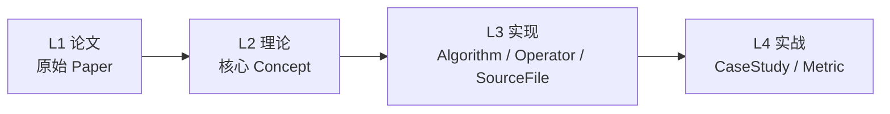
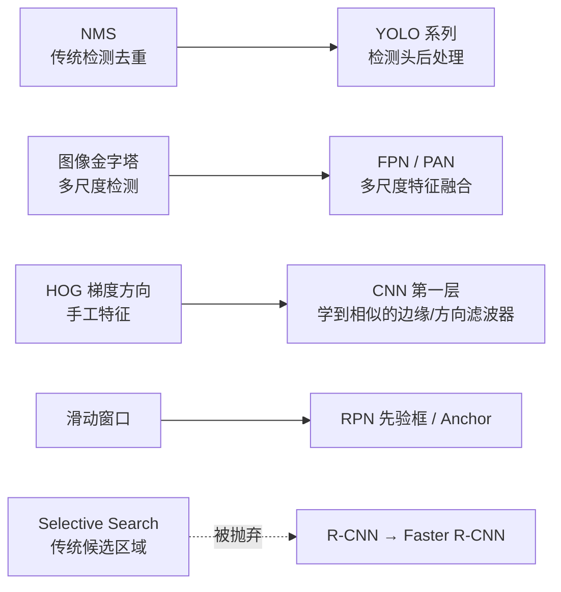

## 🎯 这是什么

`agent-cv` 是一个**传统计算机视觉技术栈的本体论研究站**。它和 `agent-yolo` 用同一套方法论：

> 不是把教程堆在一起，而是先把「传统 CV 知识」本身建模成一个**可校验的本体（Ontology）**，再用文档把这些结构化知识渲染成人能读、机器能查的知识图谱。

它回答的问题是：

- 传统 CV 到底有哪些技术？它们怎么分类？
- 每项技术从哪篇论文来？核心思想是什么？被谁继承、被谁取代？
- 为什么 YOLO 里的 NMS、Anchor、图像金字塔，全都是「传统 CV 的老手艺」？

## 🧱 四层闭环

整个站点按 **L1 论文 → L2 理论 → L3 实现 → L4 实战** 四层组织，每个算法都走完这四层。

  L1 论文 Paper
  L2 理论 Concept
  L3 实现 Implementation
  L4 实战 Practice

## 🌳 全景家族树

下面这张图就是传统 CV 的完整技术谱系，六个分支、每条分支下的代表算法，点击节点可查看名称。

<FamilyTree />

## 🧭 双轴阅读方式

本站采用**双轴设计**，这是和 agent-yolo 最大的结构差异：

- **纵轴 · 学习路径**：按抽象层次从低到高（像素→基元→目标→语义），对齐章毓晋《计算机视觉教程》（预备篇 + 第 3–15 章），适合**系统学习**。见 [🧭 学习路径](/learning-path) 与 [📚 章体系导览](/chapters/)。
- **横轴 · 技术分支**：按算法家族切（图像处理/特征检测/特征匹配/图像分割/目标检测/几何视觉），类似 YOLO 的"版本分支"视角，适合**检索与对比**。见 [🌿 技术分支总览](/branches/)。
- **反查 · 按场景找算法**：从"我要做缺陷检测 / 车牌识别 / 全景拼接"出发反查该用哪些算子，见 [🎯 场景反查](/scenarios/)。
- **落地 · 工程实现层**：算力、延迟、OpenCV 参数与产线管线，横跨六大分支，见 [🔧 工程实现层](/branches/engineering/)。

每一个算法卡片上同时挂两个标签（📘 所属章 / 🌿 所属分支），像地图上的经纬度，帮你快速定位它在知识空间中的位置。

## 🗂️ 六大技术分支

站点的核心内容按「从简单到复杂」的自然学习路径分为六大分支，每个分支都是一套完整的「论文 → 理论 → 实现 → 实战」档案。

<AlgorithmCard name="① 图像处理" airdate="1960s–" family="像素级基础操作" tagline="滤波、阈值、形态学——一切视觉任务的原子单位。" link="/branches/image-processing/" accent="#3b6fd4" />

<AlgorithmCard name="② 特征检测" airdate="1988–2011" family="Harris / SIFT / SURF / ORB" tagline="让机器找到图像里最稳定、最有辨识度的点与边。" link="/branches/feature-detection/" accent="#2fa36b" />

<AlgorithmCard name="③ 特征匹配" airdate="1981–" family="描述子匹配 / RANSAC / 光流" tagline="告诉你两张图的对应点在哪，全景拼接背后的功臣。" link="/branches/feature-matching/" accent="#d98324" />

<AlgorithmCard name="④ 图像分割" airdate="1979–2004" family="Watershed / MeanShift / GrabCut" tagline="把目标从背景里抠出来，证件照换背景的经典解法。" link="/branches/segmentation/" accent="#9b59b6" />

<AlgorithmCard name="⑤ 目标检测" airdate="2001–2008" family="Viola-Jones / HOG+SVM / DPM" tagline="深度学习之前，人们是怎么在图像里找人的。" link="/branches/detection/" accent="#c0392b" />

<AlgorithmCard name="⑥ 几何视觉" airdate="1981–1999" family="标定 / 对极几何 / 立体 / SFM" tagline="从 2D 图像反推 3D 世界，相机标定与三维重建。" link="/branches/geometry/" accent="#16a2a2" />

## 🧪 数学概念互动实验室（CV 小白友好）

觉得卷积、梯度、傅里叶、霍夫、RANSAC、角点、光流这些词太晦涩？先玩这里——
**14 个核心数学/算法概念全部做成互动demo**，拖动滑块就能看效果，不用写代码、不用背公式，玩两遍就懂。

<AlgorithmCard name="🧪 打开数学实验室" airdate="14 个核心概念" family="纯Canvas · 秒开 · 零依赖" tagline="像素/卷积/梯度/高斯/频域/霍夫/RANSAC/角点/光流/形态学… 拖滑块秒懂。" link="/math-lab/" accent="#ff6b6b" />

## 🎮 真实算法 Playground（OpenCV.js 真机跑）

不想装环境、不想写代码？直接在这里**真机跑**传统 CV 算法——底层是 WebAssembly 版 OpenCV，
图片不出浏览器，滑条一拖就能看到 Canny、霍夫圆、ORB 匹配、Viola-Jones 人脸检测的实时效果。

<AlgorithmCard name="🎮 打开算法 Playground" airdate="39 种算法" family="浏览器内 · 零安装 · 不上传" tagline="选图 → 选算法 → 拖参数 → 看结果与耗时，六分支一次体验完。" link="/playgrounds/" accent="#7c5cff" />

## 📚 精选算法档案

**全部 59 个算法**都已写完整套 7 页档案（总览 / 论文 / 概念 / 流程 / 源码 / 踩坑 / 调参）。
下面三个代表算法先睹为快，完整清单见 [算法档案总览](/algorithms/)。

<AlgorithmCard name="Canny 边缘检测" airdate="1986" family="图像处理 · 边缘检测" tagline="自动描边小画家：把照片里所有轮廓清清楚楚勾出来，手机文档扫描靠它。" link="/algorithms/canny/" accent="#3b6fd4" />

<AlgorithmCard name="SIFT 特征匹配" airdate="1999/2004" family="特征检测 · 特征匹配" tagline="认图老专家：旋转、缩放、调亮变暗都能对上，全景拍照靠它。" link="/algorithms/sift/" accent="#2fa36b" />

<AlgorithmCard name="HOG+SVM 行人检测" airdate="2005" family="目标检测 · 行人检测" tagline="路边老保安：只看人形轮廓认人，早年监控门禁的主力。" link="/algorithms/hog-svm/" accent="#c0392b" />

## 🔗 传统 CV 与深度学习的传承

很多人以为传统 CV 和深度学习是两套无关的东西。其实不是——

**YOLO 继承了 NMS / Anchor、改造了 R-CNN、抛弃了 Selective Search** —— 一图看清。

详见 [传承脉络](/legacy/) 章节。

## 🕸️ 知识本体

站点最大的差异化在于：**内容不是散的**。所有算法、算子、论文、应用都被建模成一个可校验的本体：

- **19 种实体类型**：Family、Evolution、Timeline、Chapter、Paper、Concept、Algorithm、Operator、SourceFile、CaseStudy、Metric …
- **显式关系**：`evolvedFrom`、`dependsOn`、`replacedBy`、`appliedIn`、`inheritedBy`
- **JSON Schema 校验**：YAML 实例写错字段会报错，保证知识图谱不会「悄悄错」

详见 [本体 Schema](/ontology/schema)。

---

