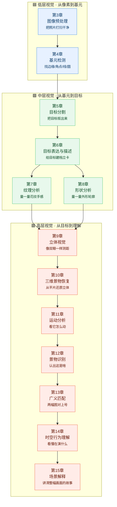

# 🧭 学习路径：从像素到场景

> 这是本站的**纵轴**。横轴是 [六大技术分支](/branches/)（按「算法家族」切），这里按**"抽象层次从低到高"**把传统 CV 从基础到应用排成一条学习路径——直接对齐章毓晋《计算机视觉教程》第 3–15 章的经典框架。
>
> **怎么用？** 如果你是新手，按 ① → ② → ③ 顺着读；如果你要做具体任务，直接跳到对应章；如果你想查某个算法的谱系关系，回到 [六大分支](/branches/) 看横向网络。

---

## 学习路径总图

> 三大层次对应三个难度等级：🟦 低层 = 像素级处理，🟩 中层 = 目标级分析，🟥 高层 = 语义级理解。学完低层就能做预处理，学完中层就能做检测分割，学完高层才谈得上"看懂"。

---

## 🟦 第 ① 层：低层视觉（像素 → 基元）

| 章 | 白话理解 | 核心问题 | 代表算法 | 对应分支 |
|---|---|---|---|---|
| **第3章 图像预处理** | 把照片"打扫干净"：去噪、调亮、矫正畸变 | 怎么让图像变"好用"？ | 高斯滤波、中值滤波、直方图均衡、二值化、形态学开闭运算 | [图像处理](/branches/image-processing/) |
| **[第4章 基元检测](/chapters/ch04-primitives)** | 找出最基础的"零件"：边、角、线、圆 | 像素里哪些地方"有结构"？ | Canny、Sobel、LoG、Harris 角点、SUSAN、霍夫变换、SIFT 关键点 | [特征检测](/branches/feature-detection/) |

**学完这一层你能做什么**：给一张图降噪、增强、找边缘、找直线和圆——工业视觉里 60% 的测量任务就靠这一层。

- 📄 已建档案：[Canny 边缘检测](/algorithms/canny/)

---

## 🟩 第 ② 层：中层视觉（基元 → 目标）

| 章 | 白话理解 | 核心问题 | 代表算法 | 对应分支 |
|---|---|---|---|---|
| **[第5章 目标分割](/chapters/ch05-segmentation)** | 把目标"抠出来"——前景背景分离 | 哪些像素属于同一个物体？ | 阈值分割、区域生长、分水岭、GrabCut、边缘闭合 | [图像分割](/branches/segmentation/) |
| **第6章 目标表达与描述** | 给抠出来的目标"建档立卡" | 怎么把一块区域变成一串特征数？ | 轮廓、区域、边界链码、矩（Hu/Zernike）、HOG、SIFT 描述子 | 特征描述（横切层） |
| **第7章 纹理分析** | 量一量"手感/花纹"——细粒度质感 | 这块区域表面是什么质感？ | LBP、GLCM 共生矩阵、Gabor 滤波、小波纹理 | [特征匹配](/branches/feature-matching/) |
| **第8章 形状分析** | 量一量"外形"——轮廓骨架 | 这个物体长什么样？ | 傅里叶描述子、形状上下文、骨架提取、凸包、最小外接矩形 | 特征描述（横切层） |

**学完这一层你能做什么**：能把图像里的对象**独立出来、描述清楚、和库里的样本比对**——传统分类、检索、OCR 前处理都靠这层。

- 📄 已建档案：[SIFT 特征匹配](/algorithms/sift/)

---

## 🟥 第 ③ 层：高层视觉（目标 → 语义）

| 章 | 白话理解 | 核心问题 | 代表算法 | 对应分支 |
|---|---|---|---|---|
| **[第9章 立体视觉](/chapters/ch09-stereo)** | 像人双眼一样测距离 | 两张视角差多少，算出深度？ | 双目匹配、视差图、极线矫正 | [几何视觉](/branches/geometry/) |
| **第10章 三维景物恢复** | 从单张/多张平片还原立体形状 | 阴影、纹理、运动怎么告诉我们 3D？ | SFS（由明暗得形状）、光度立体、SfM | [几何视觉](/branches/geometry/) |
| **[第11章 运动分析](/chapters/ch11-motion)** | 看它"动没动、怎么动" | 帧之间哪些像素在移动？ | 光流（Lucas-Kanade、Horn-Schunck）、背景差分、跟踪（Meanshift/Kalman） | 几何视觉 + 检测 |
| **[第12章 景物识别](/chapters/ch12-recognition)** | 认出"这是啥"——分类与检测 | 这张图/这个框里是什么物体？ | 滑窗+HOG+SVM、Viola-Jones、DPM、BoVW+SVM、词袋模型 | [目标检测](/branches/detection/) |
| **[第13章 广义匹配](/chapters/ch13-matching)** | 两幅图"对上号"——不只特征点匹配 | 怎么把不同图像、不同模态对应起来？ | RANSAC、ICP、模板匹配、图匹配、点集配准 | [特征匹配](/branches/feature-matching/) |
| **第14章 时空行为理解** | 看懂"在演什么"——动作/事件 | 一段视频里人在做什么动作？ | 时空兴趣点（STIP）、光流直方图、轨迹特征（iDT） | 应用层 |
| **[第15章 场景解释](/chapters/ch15-scene)** | 讲清"整幅画面的故事"——顶层 | 这是什么场景？发生了什么？ | Gist 场景特征、语义分割（传统版）、图模型（MRF/CRF） | 应用层 |

**学完这一层你能做什么**：测距、3D 重建、目标检测、视频行为识别、场景分类——这是传统 CV 能做到的最上限，也是深度学习接管前（2012 年前）的全部家当。

- 📄 已建档案：[HOG+SVM 行人检测](/algorithms/hog-svm/)

---

## 章体系 ↔ 六分支双轴映射表

> 这是本站的核心设计：**章体系是"学习路径纵轴"，六分支是"算法谱系横轴"**。一个算法可能横跨两列（比如 SIFT 既是第4章基元检测的输出，又是第6章描述子的载体）。

|  | 图像处理 | 特征检测 | 特征匹配 | 图像分割 | 目标检测 | 几何视觉 |
|---|---|---|---|---|---|---|
| **[第3章 预处理](/chapters/ch03-preprocessing)** | ✅ 高斯/中值滤波、直方图均衡、形态学 | — | — | — | — | — |
| **[第4章 基元检测](/chapters/ch04-primitives)** | — | ✅ Canny、Sobel、Harris、Hough、LoG、SIFT 关键点 | — | — | — | — |
| **[第5章 目标分割](/chapters/ch05-segmentation)** | ✅ 阈值 | ✅ 边缘闭合 | — | ✅ 区域生长、分水岭、GrabCut | — | — |
| **[第6章 表达描述](/chapters/ch06-representation)** | — | ✅ 关键点定位 | ✅ SIFT/HOG/SURF/BRIEF 描述子 | ✅ 轮廓/矩 | ✅ 特征提取 | — |
| **[第7章 纹理](/chapters/ch07-texture)** | ✅ Gabor 滤波 | — | ✅ LBP、GLCM | ✅ 纹理分割 | ✅ 纹理分类 | — |
| **[第8章 形状](/chapters/ch08-shape)** | — | — | ✅ 形状上下文、傅里叶描述子 | ✅ 主动轮廓 | ✅ 形状匹配 | — |
| **[第9章 立体视觉](/chapters/ch09-stereo)** | ✅ 极线矫正预处理 | ✅ 立体特征点 | ✅ 双目匹配 | — | — | ✅ 视差、深度图 |
| **[第10章 3D 恢复](/chapters/ch10-3d-recovery)** | — | — | ✅ 光度匹配 | — | — | ✅ SfM、SFS |
| **[第11章 运动分析](/chapters/ch11-motion)** | ✅ 背景建模 | ✅ KLT 角点跟踪 | ✅ 光流、轨迹匹配 | ✅ 前景分割 | — | ✅ 运动估计 |
| **[第12章 景物识别](/chapters/ch12-recognition)** | ✅ 归一化 | ✅ 兴趣点采样 | ✅ BoVW 词袋 | ✅ 候选框 | ✅ 滑窗、HOG+SVM、VJ、DPM | — |
| **[第13章 广义匹配](/chapters/ch13-matching)** | ✅ 模板匹配 | — | ✅ RANSAC、ICP、图匹配 | — | — | ✅ 配准 |
| **[第14章 行为理解](/chapters/ch14-activity)** | — | ✅ STIP | ✅ iDT 轨迹 | ✅ 运动前景 | — | ✅ 动作建模 |
| **[第15章 场景解释](/chapters/ch15-scene)** | — | ✅ Gist | ✅ 全局特征 | ✅ MRF/CRF 标注 | — | ✅ 场景几何 |

---

## 章体系没有覆盖、本站必须补上的三块"工程缺口"

章毓晋体系是**纯理论方法骨架**，传统 CV 真正落地必须再补三层：

1. **🛠 工程实现层**：每个算法的 OpenCV 调用、关键参数的物理意义、运行时间、内存占用、能不能跑在 MCU/边缘设备上——见各算法档案的[源码走读](/algorithms/canny/source)和[实战踩坑](/algorithms/canny/painpoints)，以及独立的 [🔧 工程实现层](/branches/engineering/)（含 [OpenCV API 速查](/branches/engineering/opencv-api)、[性能与算力账本](/branches/engineering/performance)、[产线工程化管线](/branches/engineering/pipeline)）。
2. **🎯 传统检测器独立族**：滑窗、积分图、Viola-Jones、HOG+SVM、DPM——章体系只用"景物识别"四个字带过，但工业上这是最常用的一大块，本站[目标检测分支](/branches/detection/)独立成族（[Viola-Jones](/branches/detection/viola-jones)、[DPM](/branches/detection/dpm)、[BoVW](/branches/detection/bovw)）。
3. **🏭 任务场景入口**：按"我要做什么"反查算法——工业缺陷检测、尺寸测量、OCR、车牌、人脸、全景拼接。见 [🎯 场景反查](/scenarios/) 与 [实战案例](/cases/)。

---

## 推荐阅读路径

- **工业检测路径**（最短，2 周上手）：第3章预处理 → 第4章边缘/霍夫 → 第5章阈值分割 → 第8章形状分析 → [工业缺陷案例](/cases/industrial-defect)
- **特征匹配/SLAM 路径**：第3章 → 第4章角点/SIFT → 第6章描述子 → 第13章 RANSAC → 第9章立体 → [SIFT 档案](/algorithms/sift/)
- **目标检测路径**（传统）：第3章 → 第4章 → 第6章 HOG → 第12章滑窗+SVM → [HOG+SVM 档案](/algorithms/hog-svm/) → 第 13 章 → 传承到 [YOLO 一脉](/legacy/)
- **完整学习路径**（系统化）：按第3→15章顺序读，每章配合 [术语表](/glossary) 补概念
