# 传承脉络：传统 CV → 深度学习

> 这是 agent-cv 与 [agent-yolo](https://yejinlei.github.io/agent-yolo/) 的**握手页**。
> 上游六篇论文，下游一个家族。这一页讲清楚：**传统 CV 的哪些东西被继承了下来**。

## 为什么要写这一页

很多人学完传统 CV，会觉得「全是过时的东西」。**这是错的。**

深度学习检测器里，**至少五个核心组件直接来自传统 CV**。不学传统 CV，你看到的只是一堆调参技巧；学了传统 CV，你能看懂每个设计的**动机**。

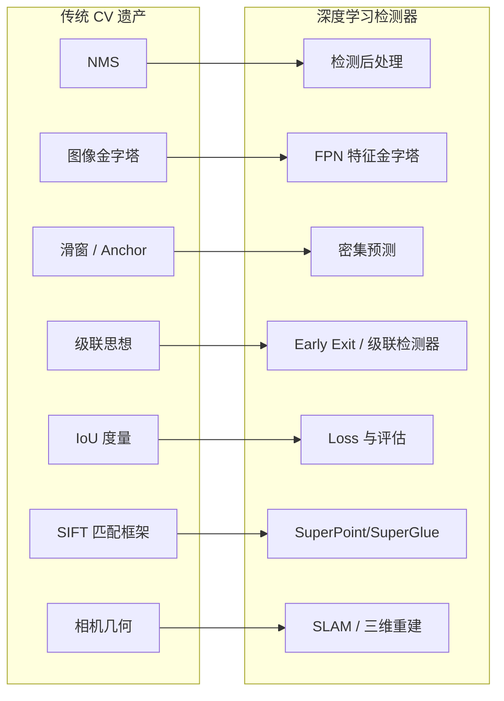

## 传承一：NMS → 检测后处理

### 传统时代

HOG+SVM 在滑窗上会产生大量重叠框，用 NMS 去重。

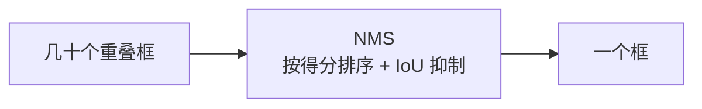

### 深度学习时代

**Faster R-CNN、YOLO、SSD 全部沿用 NMS**。

| 变体 | 改进点 |
|---|---|
| **NMS** | 原始版本 |
| Soft-NMS | 不硬删，降低重叠框的分数 |
| DIoU-NMS | 用 DIoU 代替 IoU，考虑中心距 |
| Class-wise NMS | 按类别分别抑制 |

::: tip 一个从 2005 年活到今天的算法
**NMS 是传统 CV 送给深度学习最直接的礼物**。直到今天，YOLO 的推理输出仍要经过 NMS（部分新版本用 NMS-free 设计，但早期版本全靠它）。
:::

详见 [⑤ 目标检测分支：NMS](/branches/detection/#nms所有检测器都要用的后处理)。

## 传承二：图像金字塔 → FPN

### 传统时代

为了让检测器处理不同大小的目标，**把图像缩放成多个尺度**，每个尺度都跑一遍。

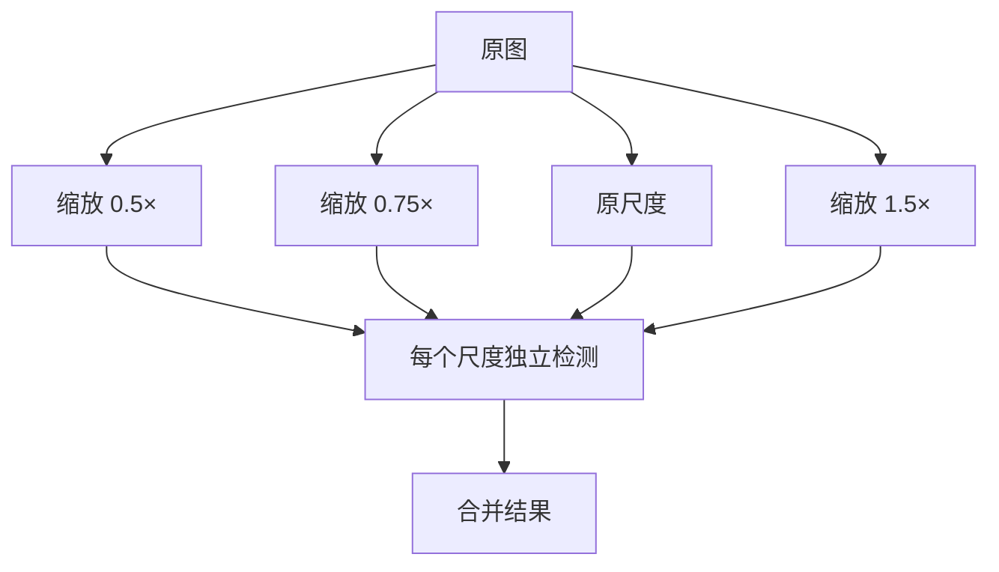

**痛点**：计算量成倍增长，而且小目标在深层特征里早就消失了。

### 深度学习时代

**FPN（Feature Pyramid Network，2017）**：不用缩放图像，而是**直接在卷积网络的不同层级取特征**，自顶向下融合。

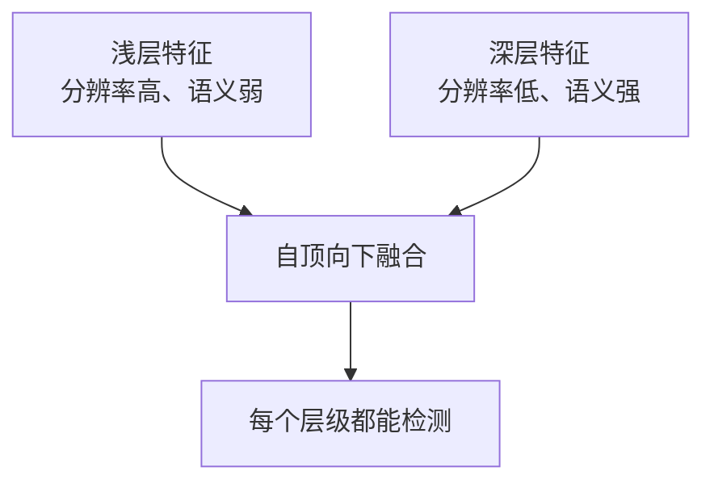

::: tip 思想的延续
**「多尺度必须处理」这个认知来自传统 CV**。FPN 只是换了实现方式：从「缩放图像」变成「复用网络层级」。

代价从「N 倍计算」降到「几乎免费」。
:::

## 传承三：滑窗 → 密集预测 / Anchor

### 传统时代

在每个位置、每个尺度上放一个窗口，逐窗口判断。

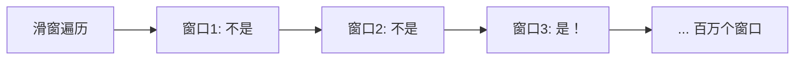

**痛点**：窗口数量百万级，每一个都要提特征 + 分类。

### 深度学习时代

**Anchor 机制（Faster R-CNN，2015）**：在特征图的每个位置预置 K 个不同尺寸/比例的「锚框」，网络直接回归**相对锚框的偏移量**。

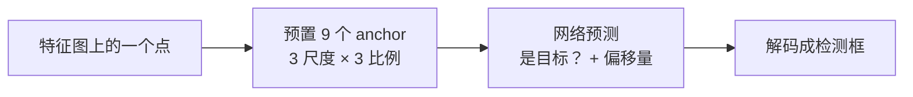

**本质**：滑窗的**参数化**版本。传统滑窗是「穷举位置」，Anchor 是「一个位置预测多个候选」。

| 传统滑窗 | Anchor |
|---|---|
| 物理上移动窗口 | 特征图上一次卷积 |
| 每个位置1个固定尺寸框 | 每个位置 K 个不同形状框 |
| 计算量 O(位置数) | 计算量 O(1) 次卷积 |

**YOLO 的更进一步**：**把检测变成回归问题**，每个网格直接预测框，不再逐窗口分类。

::: tip 一句话
**YOLO 之所以叫 "You Only Look Once"，就是因为传统检测要"看很多次"（滑窗）。**
:::

## 传承四：级联思想 → 现代检测器

### 传统时代

**Viola-Jones 的级联分类器**：用简单的判据快速排除大量负样本。

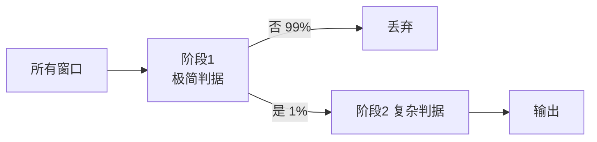

**核心理念**：**大部分计算应该花在"少数可疑样本"上，而不是"平均分配给所有样本"**。

### 深度学习时代

这个思想在多个方向复活：

| 方向 | 实现 |
|---|---|
| **两阶段检测** | RPN 先提候选，再精细分类（Faster R-CNN） |
| **Cascade R-CNN** | 多个 IoU 阈值逐级提升的检测头 |
| **Early Exit** | 浅层就输出高置信度的结果，跳过后续层 |
| **模型级联** | 小模型筛选 → 大模型精判 |

::: tip Viola-Jones 的智慧
**"先便宜地排除，再昂贵地确认"** 是跨越 20 年的通用优化原则，现在还是主流。
:::

## 传承五：IoU → 检测的度量与损失

### 传统时代

IoU **只是评估指标**：判断一个检测框是否命中真值。

### 深度学习时代

IoU 从「指标」变成了**损失函数**：

| 变体 | 改进 |
|---|---|
| **IoU Loss** | 直接把 IoU 当损失优化 |
| **GIoU** | 加入最小闭包区域，解决不相交时梯度为 0 |
| **DIoU** | 加入中心点距离 |
| **CIoU** | 再加长宽比一致性 |
| **EIoU** | 分离长宽比项 |

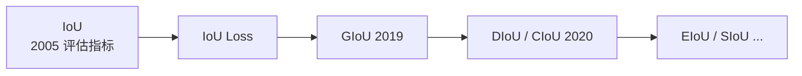

::: tip 有意思的因果
传统 CV 用 IoU 做**评估**；深度学习发现「评估指标也可以当优化目标」，于是 IoU 变成了**损失**。

**这是传统 CV 概念被重新发掘的典型案例**。
:::

## 传承六：SIFT 匹配框架 → 学习式特征

### 传统时代

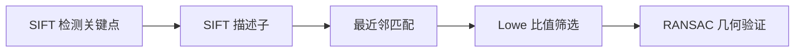

### 深度学习时代

**框架完全没变，只是每一步都换成了学习式实现**：

| 步骤 | 传统 | 学习式 |
|---|---|---|
| 检测关键点 | SIFT / ORB | SuperPoint / R2D2 |
| 描述子 | SIFT 128 维 | SuperPoint 256 维 / D2-Net |
| 匹配 | 最近邻 | SuperGlue（图神经网络） |
| 几何验证 | RANSAC | **仍是 RANSAC** |

::: tip 一个关键观察
**Pipeline 的每一步在传统 CV 里都被研究透了**。深度学习只是把「手工规则」换成「学习参数」，但流程框架是传统 CV 给的。
:::

**这也是为什么学了 SIFT 再学 SuperPoint 会觉得「其实是一回事」**。

详见 [SIFT 完整档案](/algorithms/sift/)。

## 传承七：几何视觉 → 学习式 SLAM 的基础

### 为什么几何视觉最不可替代

深度学习能做的：

- ✅ 从图像估计深度（单目深度估计网络）
- ✅ 估计相机位姿（PoseNet）

但做不到或被限制的：

- ❌ 替代相机标定（内参必须标定）
- ❌ 替代几何一致性约束
- ❌ 替代 BA 优化

**现代 SLAM 系统的典型架构**：

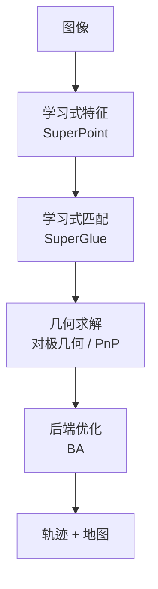

**中间两步是学习式，前后两步是几何式**。传统几何视觉是**不可替代的骨架**。

## 时间轴：从 Roberts 到 AlexNet

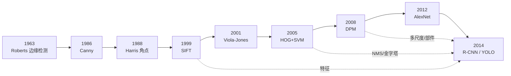

## 一张总图：知识如何流动

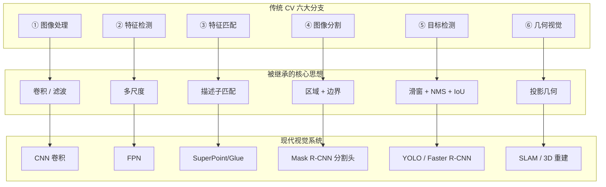

## 哪些真的被淘汰了

::: warning 诚实地说，这些确实过时了
| 内容 | 状态 |
|---|---|
| **手工设计特征**（HOG/Haar 用于通用物体） | 被 CNN 特征取代 |
| **滑动窗口遍历** | 被密集预测 / Anchor 取代 |
| **AdaBoost 级联分类器** | 基本退役 |
| **DPM 潜 SVM** | 退役 |
| **纯传统分割（做通用语义分割）** | 被分割网络取代 |
| **特征点法（纹理丰富场景下的通用匹配）** | 部分被学习式取代 |
:::

::: tip 但这些从未过时
| 内容 | 为什么还在用 |
|---|---|
| **卷积与滤波** | CNN 的基本运算 |
| **Canny / 边缘检测** | 工业视觉、预处理、后处理 |
| **形态学** | 工业视觉必备 |
| **ORB / SIFT** | 嵌入式、无 GPU、SLAM |
| **阈值 / Otsu** | 工业质检标配 |
| **NMS** | 所有检测器的后处理 |
| **相机标定** | 所有真实应用的前提 |
| **对极几何 / PnP / BA** | SLAM 与三维重建的核心 |
| **光流** | 视频跟踪、运动分析 |
:::

## 给两类读者的话

### 如果你在学深度学习视觉

::: tip 不学传统 CV，你会缺失什么
- **看不懂 YOLO 为什么要有 NMS** → 不知道它的祖先是谁
- **不理解 FPN 的动机** → 以为只是"融合特征"的技巧
- **不知道 Anchor 从哪来** → 无法设计自己的 anchor 尺寸
- **无法处理工业落地中的预处理** → 阈值、形态学全不会
- **做不了标定和三维** → 深度图再准也要标定
:::

### 如果你在学传统 CV

::: tip 学完之后往哪走
1. **不要停在"会用 OpenCV 调 API"** → 理解每个算法的**设计动机**
2. **补上几何视觉** → 这是最不可替代的部分
3. **然后看深度学习检测器** → 你会发现"原来都是老朋友"
4. **重点关注 NMS / 金字塔 / 滑窗的现代化身** → 这些是你独有的优势
:::

## 与 agent-yolo 的关系

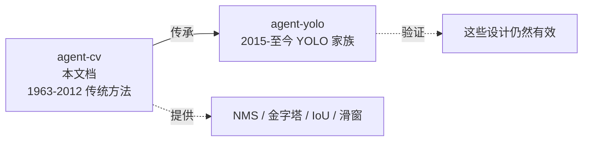

- **agent-cv**（本文档）：研究**技术体系**，横向六大分支，纵向 1963–2012
- **[agent-yolo](https://yejinlei.github.io/agent-yolo/)**：研究**单一算法家族**，纵向 v1–v14

**两个项目的接口就是这一页**。从这里出发：

- 想深入 YOLO 家族 → 去 [agent-yolo](https://yejinlei.github.io/agent-yolo/)
- 想补齐传统技术的地基 → 留在本项目的 [六大分支](/branches/)

## 相关链接

- [⑤ 传统目标检测分支](/branches/detection/)
- [② 特征检测分支](/branches/feature-detection/)
- [⑥ 几何视觉分支](/branches/geometry/)
- [全局演化史](/global/evolutions)
- [时间线](/global/timeline)
