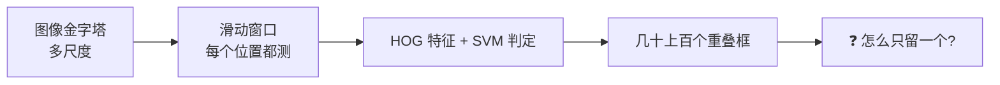
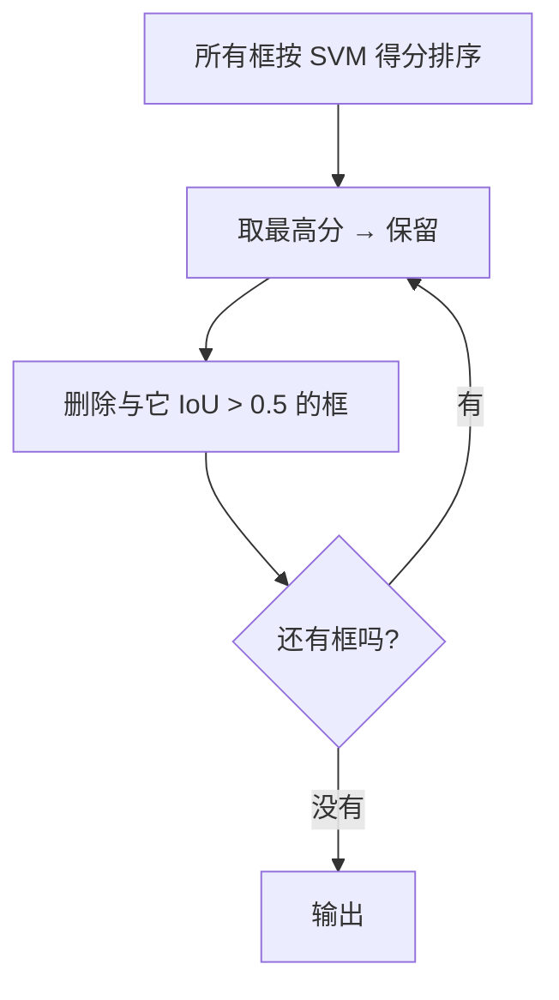
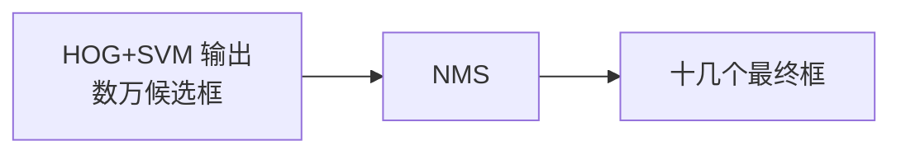
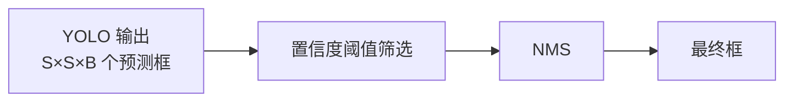
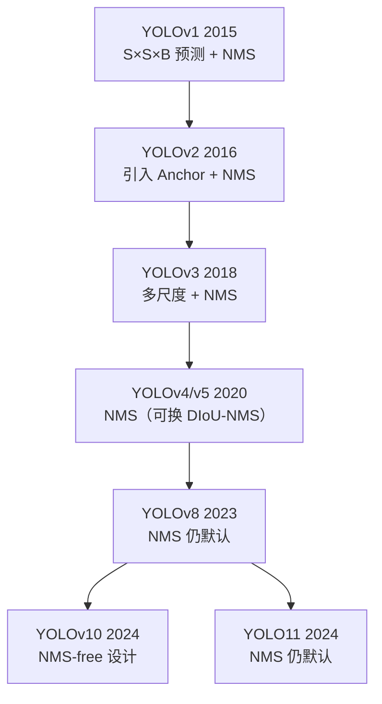
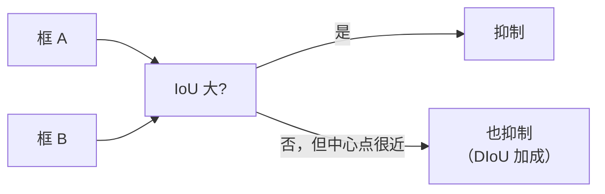
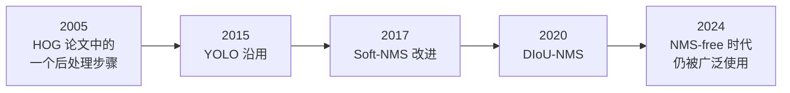

# NMS → YOLO 传承详解

> **一个 2005 年发明的后处理算法，如何活到了今天，并成为 YOLO 推理链上不可缺的一环。**

## 起点：NMS 从哪里来

### 问题背景

2005 年，Dalal 和 Triggs 发表 HOG+SVM 行人检测论文。他们的检测流程是：



**问题**：同一个行人，相邻的几个窗口位置、相邻的几个尺度，**都会判定为"有人"**。结果就是一堆重叠的框。

### NMS 的解法



**就这么简单**。不需要训练，不需要参数（除了一个 IoU 阈值）。

::: tip NMS 为什么能工作
**核心假设**：**正确的检测框得分更高**。

- 越贴近真实位置 → HOG 特征越"标准" → SVM 得分越高
- 相邻的、偏一点的窗口 → 特征不完全匹配 → 得分低

所以**按得分排序 + 只留最高的 + 干掉它旁边的**，就能得到干净的结果。
:::

## 从传统到 YOLO：NMS 的角色变化

### 传统时代：NMS 是「后处理」



**特点**：NMS 处理的框**数量巨大**（数万级），因为几乎所有滑窗位置都可能有响应。

### YOLO 时代：NMS 是「整流器」



**变化**：

| 维度 | 传统 HOG+SVM | YOLO |
|---|---|---|
| 候选框来源 | 穷举滑窗 | 每个网格预测 |
| 候选框数量 | 数万–数十万 | 数百–数千 |
| 每个框的性质 | 独立判定 | 含置信度 + 类别 |
| NMS 的作用 | 去重（大量重复） | **去重 + 跨网格合并同目标** |
| 计算占比 | 很小 | **推理时间的一部分** |

::: tip 为什么 YOLO 也需要 NMS
YOLO 把图像分成 S×S 网格，**每个网格都预测 B 个框**。虽然设计上希望"每个目标只由一个网格负责"，但由于：

1. 目标往往跨越多个网格 → 多个网格都预测它
2. 每个网格的 B 个框可能都指向同一个目标

**所以仍然会有重复框，必须靠 NMS 去重**。
:::

## YOLO 各版本中 NMS 的演化



### 各版本细节

| 版本 | NMS 相关 |
|---|---|
| **v1** | 使用 NMS，因为"one cell one object"设计仍有重叠 |
| **v2** | 引入 Anchor 后候选框更多，NMS 更重要（`iou_thresh=0.45`） |
| **v3** | 多尺度预测，NMS 合并跨尺度重复 |
| **v4** | 引入 **DIoU-NMS** 选项（考虑中心点距离） |
| **v5** | 默认 `iou_thresh=0.45`，提供 `merge_nms` |
| **v8** | 仍用 NMS，但改进了框的解码方式 |
| **v10** | **提出 NMS-free 训练**（一致双分配） |
| **v11** | 仍保留 NMS 作为默认 |

::: tip NMS-free 是什么
YOLOv10 提出「一致双分配（consistent dual assignments）」：训练时让每个目标**只被一个预测负责**，从而推理时不需要 NMS。

**但这不代表 NMS 过时**——大部分 YOLO 版本仍在用，而且 NMS-free 需要专门的训练策略。
:::

## NMS 的现代变体

### 1. Soft-NMS（2017）

**问题**：原始 NMS 硬性删除重叠框。如果两个目标真的挨得很近（比如并排站着的两个人），NMS 会把其中一个删掉。

**解法**：不删除，而是**降低**重叠框的得分。


| 衰减方式 | 公式 |
|---|---|
| 线性 | $s \cdot (1 - \text{IoU})$ |
| 高斯 | $s \cdot e^{-\frac{\text{IoU}^2}{\sigma}}$ |

::: tip Soft-NMS 的优势
**密集场景（人群、车辆）效果明显更好**。代价是稍微慢一点，且需要调 sigma。
:::

### 2. DIoU-NMS（2020）

**问题**：标准 NMS 只考虑 IoU。两个框可能 IoU 不大，但中心点几乎重合，说明很可能检测的是同一个目标。

**解法**：判定条件改为

$$ \text{DIoU} = \text{IoU} - \frac{\rho^2(b, b^{gt})}{c^2} $$

其中第二项是「中心点距离的惩罚」。



**在 YOLOv4 中被广泛采用**。

### 3. Class-wise NMS

**问题**：标准 NMS 不知道类别。如果一个"人"框和一个"自行车"框重叠（人骑车），NMS 会抑制错的。

**解法**：**按类别分别做 NMS**。

```python
# 对每个类别单独做 NMS
for cls in classes:
    keep = nms(boxes[cls], scores[cls])
```

**YOLO 默认就是分类别做 NMS**。

### 4. 其他变体

| 变体 | 改进点 |
|---|---|
| **Cluster-NMS** | 把 NMS 转成矩阵运算，GPU 并行加速 |
| **Matrix-NMS** | 完全向量化 |
| **Fast NMS** | 牺牲一点精度换速度 |
| **WBF（加权框融合）** | 不是选择，而是加权平均多个框 |

## 完整对比表

| 方法 | 年份 | 核心思想 | 优势 | 劣势 |
|---|---|---|---|---|
| **NMS** | 2005 | 贪心删除 | 简单、有效、快 | 密集场景漏检 |
| Soft-NMS | 2017 | 得分衰减 | 密集场景好 | 稍慢，需调参 |
| DIoU-NMS | 2020 | 加中心点惩罚 | 更准 | 稍复杂 |
| Cluster-NMS | 2021 | 矩阵并行 | GPU 快 | 实现复杂 |
| WBF | 2021 | 加权融合 | 集成模型首选 | 不适用单模型 |
| NMS-free | 2024 | 训练时解耦 | 推理无 NMS | 需专门训练 |

## 代码实现

### 从零实现 NMS（理解用）

```python
import numpy as np

def iou(box, boxes):
    """box: [x1, y1, x2, y2]"""
    # 交集
    x1 = np.maximum(box[0], boxes[:, 0])
    y1 = np.maximum(box[1], boxes[:, 1])
    x2 = np.minimum(box[2], boxes[:, 2])
    y2 = np.minimum(box[3], boxes[:, 3])
    inter = np.maximum(0, x2 - x1) * np.maximum(0, y2 - y1)

    # 并集
    area_box = (box[2] - box[0]) * (box[3] - box[1])
    area_boxes = (boxes[:, 2] - boxes[:, 0]) * (boxes[:, 3] - boxes[:, 1])
    union = area_box + area_boxes - inter

    return inter / (union + 1e-6)

def nms(boxes, scores, iou_threshold=0.5):
    """
    boxes: (N, 4)  [x1, y1, x2, y2]
    scores: (N,)
    返回: 保留的索引列表
    """
    order = scores.argsort()[::-1]    # 按得分降序
    keep = []

    while order.size > 0:
        i = order[0]
        keep.append(i)

        if order.size == 1:
            break

        # 算 i 与剩余框的 IoU
        ious = iou(boxes[i], boxes[order[1:]])

        # 保留 IoU <= 阈值的（即不重叠的）
        remaining = np.where(ious <= iou_threshold)[0]
        order = order[remaining + 1]     # +1 因为跳过了 order[0]

    return keep
```

### 用 PyTorch（GPU 加速，YOLO 训练中用）

```python
import torch

def nms_torch(boxes, scores, iou_threshold=0.5):
    """
    boxes: (N, 4)
    scores: (N,)
    """
    keep = []
    order = scores.argsort(descending=True)

    while order.numel() > 0:
        i = order[0].item()
        keep.append(i)

        if order.numel() == 1:
            break

        # 计算 i 与其他框的 IoU
        box_i = boxes[i]
        rest = boxes[order[1:]]

        x1 = torch.max(box_i[0], rest[:, 0])
        y1 = torch.max(box_i[1], rest[:, 1])
        x2 = torch.min(box_i[2], rest[:, 2])
        y2 = torch.min(box_i[3], rest[:, 3])

        inter = (x2 - x1).clamp(min=0) * (y2 - y1).clamp(min=0)
        area_i = (box_i[2] - box_i[0]) * (box_i[3] - box_i[1])
        area_rest = (rest[:, 2] - rest[:, 0]) * (rest[:, 3] - rest[:, 1])
        union = area_i + area_rest - inter

        ious = inter / (union + 1e-6)

        idx = torch.where(ious <= iou_threshold)[0]
        order = order[idx + 1]

    return torch.tensor(keep, dtype=torch.long)
```

### Soft-NMS 实现

```python
def soft_nms(boxes, scores, sigma=0.5, score_threshold=0.001, method='gaussian'):
    """得分衰减式 NMS"""
    N = boxes.shape[0]
    for i in range(N):
        # 找当前最高分的框
        max_pos = i + np.argmax(scores[i:])
        boxes[[i, max_pos]] = boxes[[max_pos, i]]
        scores[[i, max_pos]] = scores[[max_pos, i]]

        # 衰减后面所有框的得分
        ious = iou(boxes[i], boxes[i+1:])
        if method == 'linear':
            decay = np.where(ious > 0.3, 1 - ious, 1)
        else:  # gaussian
            decay = np.exp(-(ious ** 2) / sigma)

        scores[i+1:] *= decay

    keep = np.where(scores > score_threshold)[0]
    return keep
```

## 踩坑清单

::: danger NMS 的五个常见坑

**坑 1：IoU 阈值选不对**
- 太高（0.9）→ 重复框没去干净
- 太低（0.1）→ 挨着的目标被误删
- **建议**：0.45（YOLO 默认）– 0.5

**坑 2：忘了分类别做 NMS**
- 人和自行车重叠时互相抑制 → 丢结果
- **必须分类别**

**坑 3：置信度阈值放太松**
- 大量低分框进入 NMS → 慢且可能误删
- **先做置信度筛选（如 > 0.25），再做 NMS**

**坑 4：框的坐标格式搞错**
- NMS 需要 `[x1, y1, x2, y2]`
- YOLO 输出可能是 `[cx, cy, w, h]` → **必须先转换**

**坑 5：密集场景漏检**
- 并排的目标被互相抑制
- **改用 Soft-NMS 或提高 IoU 阈值**
:::

## NMS 的计算开销

**在 YOLO 推理中，NMS 占多少时间？**

| 场景 | NMS 占比 |
|---|---|
| 大目标、框少 | 1%–3% |
| 中等场景 | 3%–8% |
| **密集小目标（如航拍）** | **10%–25%** |

::: warning 密集场景 NMS 会成瓶颈
框数量 N 时，朴素 NMS 是 O(N²)。

**加速方法**：
1. **先按置信度裁剪**（只留 top-K，如 1000 个）
2. **用矩阵运算**（Cluster-NMS / Matrix-NMS）
3. **用 CUDA 核**（`torchvision.ops.nms`）
:::

## 从 NMS 看传统 CV 的价值



::: tip 三个启示

**① 简单的方法生命力最强**
NMS 没有参数需要学习，没有数学上的深奥之处，却活过了 20 年。

**② 传统 CV 是深度学习的"设计模式库"**
当你设计一个新检测器时，NMS / 金字塔 / 滑窗这些传统方案，都是现成的、经过验证的备选。

**③ 理解源头才能改进**
Soft-NMS、DIoU-NMS、Cluster-NMS 的提出者，都是**先理解原始 NMS 的缺陷**，才做出改进的。
:::

## 延伸阅读

- [⑤ 传统目标检测分支](/branches/detection/#nms所有检测器都要用的后处理)
- [HOG+SVM 完整档案](/algorithms/hog-svm/)
- [传承脉络总览](/legacy/)
- [agent-yolo：YOLO 家族研究](https://yejinlei.github.io/agent-yolo/)
