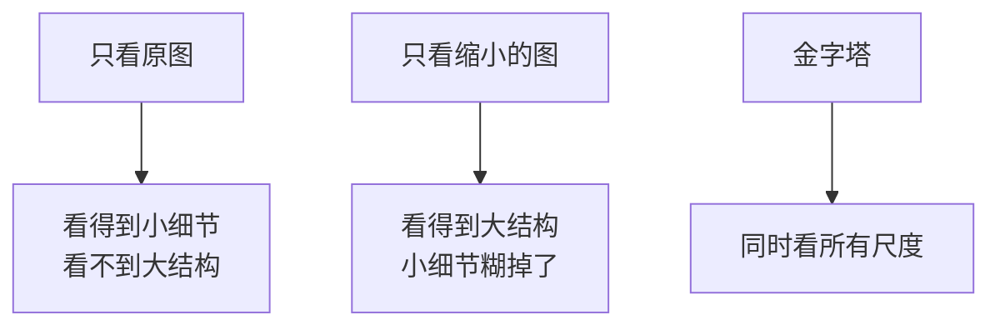
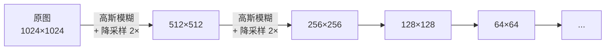
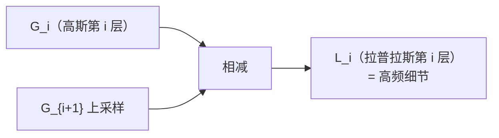
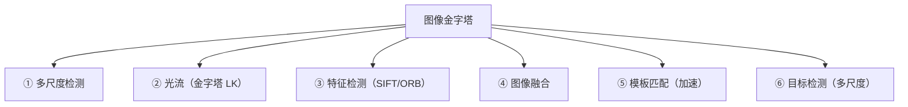
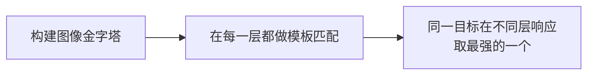
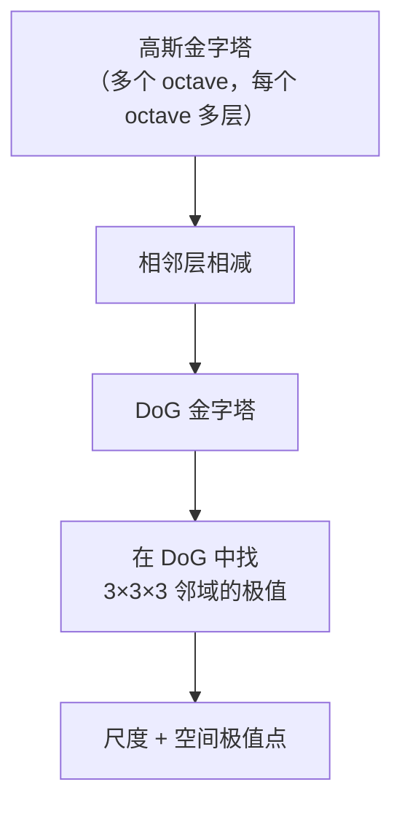
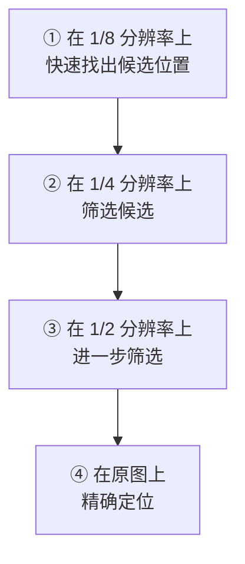
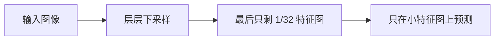
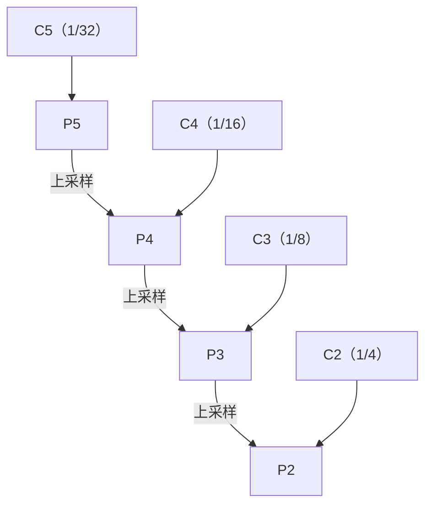
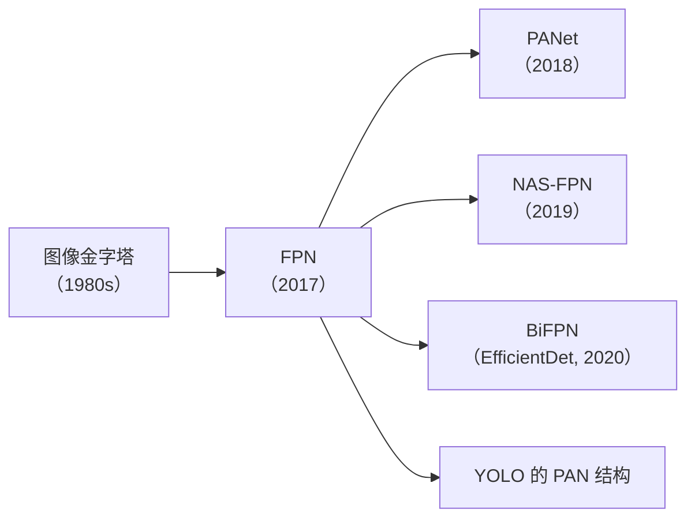

# 图像金字塔：从金字塔到 FPN

> **一句话**：同一个画面，做成从"大图"到"小图"的一摞，让算法能同时看见"森林"和"树叶"。

## 为什么需要金字塔

**任何一个固定尺度的算法，都只能看到"一个尺度"上的东西**。



**生活比方**：看一张世界地图。

- **放大到街道级**：能看到每栋楼，但不知道它在哪个国家
- **缩小到国家地图**：知道它在哪个大洲，但看不见街道
- **同时看多个比例尺**：才能真正理解地理格局

**这就是图像金字塔的作用**。

## ① 高斯金字塔（Gaussian Pyramid）

### 构建方式



**每一步的操作**（这就是著名的 `pyrDown`）：

1. **高斯模糊**（去除高频，防混叠）
2. **隔行隔列采样**（尺寸减半）

```python
# 构建高斯金字塔
img = cv2.imread('image.jpg')
pyramid = [img]

g = img.copy()
for i in range(4):
    g = cv2.pyrDown(g)          # 模糊 + 下采样
    pyramid.append(g)

for i, level in enumerate(pyramid):
    print(f"第 {i} 层: {level.shape[1]}×{level.shape[0]}")
```

::: tip 为什么必须先高斯模糊
**直接隔点采样会混叠（Aliasing）**。

**生活比方**：拍一张细密格子的照片，直接缩小 → 会出现**摩尔纹**（假的粗条纹）。

**原因**：高频细节在降采样后"折叠"成低频假信号。

**高斯模糊的作用**：**先把高频抹掉**（使其低于新采样率的奈奎斯特频率），再降采样就安全了。
:::

### pyrDown vs resize

```python
# 方法一：pyrDown（推荐）
down = cv2.pyrDown(img)        # 内部：高斯模糊 + 降采样

# 方法二：resize（不推荐）
down_bad = cv2.resize(img, (img.shape[1]//2, img.shape[0]//2), 
                       interpolation=cv2.INTER_NEAREST)     # 会混叠！
```

| 方法 | 抗混叠 | 速度 |
|---|---|---|
| `pyrDown` | ✅ 有（内置高斯） | 快 |
| `resize` (INTER_LINEAR) | ⚠️ 部分 | 快 |
| `resize` (INTER_NEAREST) | ❌ 无 | 最快 |

## ② 拉普拉斯金字塔（Laplacian Pyramid）

### 构建方式

**拉普拉斯金字塔 = 高斯金字塔中"上一层减去下一层上采样后的结果"**。



```python
def build_laplacian_pyramid(img, levels=4):
    """构建拉普拉斯金字塔"""
    gaussian = [img]
    for i in range(levels):
        gaussian.append(cv2.pyrDown(gaussian[-1]))

    laplacian = []
    for i in range(levels):
        # 上采样下一层，尺寸对齐
        up = cv2.pyrUp(gaussian[i+1], dstsize=(gaussian[i].shape[1], gaussian[i].shape[0]))
        # 相减得到"细节层"
        lap = cv2.subtract(gaussian[i], up)
        laplacian.append(lap)

    laplacian.append(gaussian[-1])      # 最顶层 = 高斯金字塔的顶层
    return laplacian
```

**每一层代表什么**：

| 层 | 内容 |
|---|---|
| L₀ | **最细的细节**（纹理、边缘） |
| L₁ | 次细的细节 |
| ... | ... |
| Lₙ（顶层） | **低频（整体亮度分布）** |

::: tip 拉普拉斯金字塔的用途
**1. 图像融合（无缝拼接）**

```python
def laplacian_blend(img1, img2, mask, levels=4):
    """拉普拉斯金字塔多频段融合（无缝拼接）"""
    L1 = build_laplacian_pyramid(img1.astype(np.float32), levels)
    L2 = build_laplacian_pyramid(img2.astype(np.float32), levels)

    # 构建掩码金字塔
    Gm = [mask.astype(np.float32)]
    for _ in range(levels):
        Gm.append(cv2.pyrDown(Gm[-1]))

    # 逐层加权融合
    blended = []
    for i in range(levels + 1):
        m = Gm[i]
        m = np.stack([m] * 3, axis=-1) if m.ndim == 2 else m
        blended.append(L1[i] * m + L2[i] * (1 - m))

    # 重建
    result = blended[-1]
    for i in range(levels - 1, -1, -1):
        up = cv2.pyrUp(result, dstsize=(blended[i].shape[1], blended[i].shape[0]))
        result = up + blended[i]

    return np.clip(result, 0, 255).astype(np.uint8)
```

**效果**：**接缝处自然过渡**（因为低频在大的空间尺度上融合，高频在局部融合）。

**2. 图像压缩（类似小波编码）**

只保留显著系数 → 稀疏表示。

**3. 图像增强**

放大某些层的细节层 → 锐化；压缩某些层 → 降噪。
:::

## ③ 金字塔在传统 CV 中的六大用途



### 用途 1：多尺度目标检测

**问题**：模板尺寸固定，但目标有大有小。

**方案**：



```python
def multi_scale_match(image, template, scales=np.linspace(0.5, 1.5, 11)):
    best = None
    for s in scales:
        # 缩放图像（不是缩放模板）
        resized = cv2.resize(image, None, fx=s, fy=s)
        if resized.shape[0] < template.shape[0] or resized.shape[1] < template.shape[1]:
            continue
        res = cv2.matchTemplate(resized, template, cv2.TM_CCOEFF_NORMED)
        _, max_val, _, max_loc = cv2.minMaxLoc(res)
        if best is None or max_val > best[0]:
            best = (max_val, max_loc, s)
    return best
```

::: warning "缩放图像"vs"缩放模板"
**两种做法**：

| 做法 | 优点 | 缺点 |
|---|---|---|
| **缩放图像** | 模板只需算一次特征 | 图像要重复处理 N 次 |
| 缩放模板 | 图像只处理一次 | 模板特征要重算 N 次 |

**理论上等价，实践上**：

- **深度学习时代**：缩放图像（GPU 并行快）
- **传统 CV**：看哪个部分更贵（特征提取 vs 匹配）
- **经典 SIFT**：**缩放图像**（因为 SIFT 特征提取贵，模板只需一次）

**注意**：两者**不完全等价**（因为缩放操作本身会改变图像内容，如插值引入的模糊）。
:::

### 用途 2：金字塔光流

**见 [光流](/branches/geometry/optical-flow) 章节**。

**核心**：粗层估计大运动 → 逐层细化 → 原图得到亚像素精度。

### 用途 3：SIFT / ORB 的尺度空间

**SIFT 的尺度空间就是"高斯金字塔 + 高斯差分（DoG）"**。



**见 [SIFT 算法档案](/algorithms/sift/)**。

### 用途 4：图像融合

**见上文拉普拉斯金字塔部分**。

**经典应用**：

- **全景拼接**（接缝处理）
- **曝光融合**（HDR）
- **医学图像融合**（CT + MRI）
- **多焦图像融合**（显微摄影）

### 用途 5：模板匹配加速（粗到细）

**问题**：大图上做模板匹配，全搜索太慢。

**方案**：



**这就是"由粗到细（Coarse-to-Fine）"搜索**。

**加速比**：如果 1/8 分辨率下搜索区域缩小到 1/64，总计算量可降低 **10–50 倍**。

::: danger 粗到细的陷阱：可能漏掉真实目标
**粗层搜索不精确，可能把真实目标筛掉**。

**解决**：

- 粗层保留**多个**候选（不只是最强的）
- 粗层的匹配阈值要**放宽**
- 用**上界估计**保证不漏（如 SSDA 算法）
:::

### 用途 6：多尺度目标检测

**Viola-Jones（人脸检测）**：**只缩放检测窗口，不缩放图像**。

**HOG + 金字塔**：**缩放图像**（因为 HOG 特征提取时间与图像尺寸成正比）。

**见 [传统检测分支](/branches/detection/)**。

## ④ 尺度空间理论

**尺度空间（Scale Space）不只是"多分辨率金字塔"**，它是一个**连续的理论框架**。

### 核心思想

**让图像跟随一个"尺度参数"变化**：

$$ I(x, y, \sigma) = G(x, y, \sigma) * I(x, y) $$

| 符号 | 含义 |
|---|---|
| $\sigma$ | 尺度参数（高斯核标准差） |
| $G$ | 高斯核 |
| $*$ | 卷积 |

**性质**：

| 性质 | 说明 |
|---|---|
| σ 小 | 保留细节 |
| σ 大 | 只保留大结构 |
| **线性** | 尺度空间是线性的（可以做差分） |
| **因果性** | σ 增大时细节只能消失，不能凭空出现 |

### 高斯核是唯一正确的选择

**Koenderink (1984) 与 Lindeberg (1990) 证明**：

> **高斯核是唯一能生成"线性尺度空间"的核**。

**为什么**：

- 必须**各向同性**（不偏向任何方向）
- 必须**半群性质**：先 σ₁ 再 σ₂ = 直接 σ = √(σ₁²+σ₂²)
- 必须**不产生新的极值**（因果性）

**这三点唯一决定高斯**。

::: tip 尺度空间的深层含义
**"看一个物体的合适尺度，取决于物体的大小"**。

**举例**：看一个人的脸

- 距离 10 m → 人脸可能只有 20×20 像素 → **需要小尺度核**
- 距离 30 cm → 人脸占满画面 → **需要大尺度核**

**SIFT 就是自动化了这个过程**：它在**整个尺度空间里找极值点**，所以同一物体不管远近（尺度）都能被检出。

**这是"尺度不变性"的数学基础**。
:::

### 高斯差分（DoG）

**为什么 SIFT 用 DoG 而不是直接求拉普拉斯？**

$$ DoG = G_{\sigma_2} * I - G_{\sigma_1} * I $$

**定理**：**DoG 是尺度归一化拉普拉斯（LoG）的近似**。

$$ G_{\sigma_2} - G_{\sigma_1} \approx (k-1)\sigma^2 \nabla^2 G $$

**好处**：

| 方法 | 计算量 |
|---|---|
| 直接算 LoG | 对每层做**一次大卷积** |
| **DoG** | **相邻两层的高斯图相减**（减法极便宜） |

**而且高斯金字塔的每层本来就要算** → **DoG 几乎"免费"**。

::: tip 这就是 SIFT 高效的原因之一
**DoG 让"尺度空间极值检测"从一个昂贵的卷积操作，变成了一次图像减法**。

**同时也解释了为什么 `k = 2^(1/s)`**（SIFT 每 octave 用 s 层，层间比例 k，保证 DoG 的最优近似）。
:::

## ⑤ 从金字塔到 FPN

**这是传统 CV 向深度学习的"传承"节点**。

### 问题：深度学习早期的尺度困境

**早期 CNN（如 AlexNet、VGG）**：



**问题**：

- **小目标的特征在深层已经"消失"了**（被下采样抹掉）
- 只在最深层检测 → **小目标检测效果差**

**这跟传统 CV 的"多尺度金字塔"是同一个问题**！

### FPN 的解法（2017）

**特征金字塔网络（Feature Pyramid Network）**：



**关键设计**：

1. **自顶向下路径（Top-down）**：把深层的语义信息**上采样**传给浅层
2. **横向连接（Lateral）**：把浅层的高分辨率特征**融合**进来
3. **每层独立预测**：P2（小目标）、P3、P4、P5（大目标）各输出预测

### 与图像金字塔的本质对比

| | 图像金字塔 | FPN |
|---|---|---|
| 构造层面 | **输入图像**（像素级） | **特征图**（语义级） |
| 计算量 | **N 倍**（每尺度重算一遍网络） | **几乎不增加**（复用已有特征） |
| 内存 | 大 | 中 |
| 效果 | 好 | **更好**（有语义融合） |

::: tip 核心洞察：从"像素金字塔"到"特征金字塔"
**传统 CV 的图像金字塔**：在**输入层**做多尺度。

**FPN**：在**特征层**做多尺度 + 语义融合。

**为什么更好**：

- **图像金字塔的每个尺度是独立的**（各自跑一遍网络）
- **FPN 的特征金字塔是"共享"的**（浅层特征既用于小目标，也上传给深层）
- **FPN 的浅层有了深层语义**（横向连接带来的），**这让小目标检测大幅提升**

**这就是"传承"**：**多尺度的核心思想没变，只是从像素层搬到了特征层**。
:::

### 后续演化



| 方法 | 改进 |
|---|---|
| **PANet** | 加一条"自底向上"路径 |
| **BiFPN** | 加权双向融合 |
| **YOLOv4/v5** | 用 PANet 结构（就是"FPN + 自底向上"） |

::: tip 回头看：YOLO 的 Neck 就是 FPN/PAN
**打开任何 YOLO 的结构图**，中间的 "Neck" 部分：

- **FPN 路径**：自顶向下（传语义）
- **PAN 路径**：自底向上（传位置）

**这和图像金字塔解决的是同一件事**：**让网络同时"看得清小的"和"看得懂大的"**。

**区别只在抽象层次**：一个是像素，一个是特征。
:::

## 常见踩坑

::: danger 坑 1：用 `resize` 代替 `pyrDown`
**现象**：`resize` 缩小后的图有摩尔纹/假纹理，后续处理出错。

**根因**：**`resize` 不做抗混叠滤波**。

**解决**：**用 `cv2.pyrDown`**，或先 `GaussianBlur` 再 `resize`。

**例外**：如果是**上采样**（放大），`resize` 就没这个问题（只是插值问题）。
:::

::: danger 坑 2：`pyrDown`/`pyrUp` 尺寸不整除 2
**现象**：`pyrUp` 后尺寸对不上，相减报错。

**根因**：**奇数的尺寸减半会向下取整**。

**解决**：手动指定目标尺寸：

```python
up = cv2.pyrUp(img_down, dstsize=(img_up.shape[1], img_up.shape[0]))
```

**或者在构建金字塔前先把图像裁成偶数尺寸**。
:::

::: danger 坑 3：金字塔层数太多
**现象**：最顶层的图只有几个像素，或者直接崩溃。

**说明**：`levels` 过大时会超过图像尺寸下限。

**安全上限**：

```python
max_levels = int(np.log2(min(h, w))) - 2      # 保留至少 4×4
```

**一般用 3–5 层就够了**（覆盖 8–32 倍尺度变化）。
:::

::: danger 坑 4：多尺度检测忘了坐标回换算
**现象**：在缩放图上检测到的框，画在原图上位置全错。

**解决**：**坐标要除以缩放比例**。

```python
scale = 0.5
x_img, y_img = int(x_scaled / scale), int(y_scaled / scale)
w_img, h_img = int(w_scaled / scale), int(h_scaled / scale)
```

**这是最常犯也最容易忽略的错误**。
:::

::: danger 坑 5：拉普拉斯金字塔融合后值域溢出
**现象**：融合结果是全白或全黑，或者有奇怪条纹。

**根因**：**拉普拉斯层有负值**，`uint8` 相减会截断到 0。

**解决**：

```python
# ✅ 先转 float32
img_float = img.astype(np.float32)

# 相减用 cv2.subtract（会饱和）或直接 numpy 减（保留负值）
lap = img_float_gauss_i - up_sampled     # ✅ 保留负值
# 重建后
result = np.clip(result, 0, 255).astype(np.uint8)
```

**永远不要在 uint8 上做金字塔减法**。
:::

## 相关链接

- [SIFT 算法档案](/algorithms/sift/)
- [光流](/branches/geometry/optical-flow)
- [特征检测：斑点检测](/branches/feature-detection/blobs)
- [传统目标检测](/branches/detection/)
- [传承脉络总览](/legacy/)
