# 实体类型详解

> Schema v0.1.0 定义了 **19 种实体类型**，按四层闭环分组。
> 每种实体给出：**核心字段、示例、典型用途**。

## 全景图

```mermaid
flowchart TB
  L0["L0 全局"] --> F1["Family"]
  L0 --> F2["Evolution"]
  L0 --> F3["Timeline"]
  L0 --> F4["Chapter"]
  L1["L1 论文"] --> P1["Paper"]
  L2["L2 理论"] --> C1["Concept"]
  L3["L3 实现"] --> A1["Algorithm"]
  L3 --> A2["Operator"]
  L3 --> A3["SourceFile"]
  L4["L4 实战"] --> CS1["CaseStudy"]
  L4 --> CS2["Metric"]
  AUX["附属"] --> X1["Library"]
  AUX --> X2["Application"]
  AUX --> X3["PainPoint"]
  AUX --> X4["Trick"]
  AUX --> X5["Dataset"]
  AUX --> X6["Branch"]
  AUX --> X7["Comparison"]
  AUX --> X8["GlossaryTerm"]
```



## L0 全局层

### Family — 技术家族

描述一个技术家族的谱系与分支。

**核心字段**：`originAlgorithm`、`lineages[]`、`keyThemes[]`、`yearRange`

```yaml
- id: family-classic-cv
  type: Family
  name: "传统计算机视觉"
  originAlgorithm: "algo-roberts-edge"
  yearRange: { start: 1963, end: 2012 }
  lineages:
    - name: "image-processing-line"
      chain: ["algo-roberts-edge", "algo-sobel", "algo-canny"]
    - name: "feature-line"
      chain: ["algo-harris", "algo-sift", "algo-surf", "algo-orb"]
    - name: "detection-line"
      chain: ["algo-viola-jones", "algo-hog-svm", "algo-dpm"]
  keyThemes: ["手工特征", "多尺度", "滑窗检测", "梯度方向", "局部不变性"]
```

### Evolution — 演化事件

描述一次演化，从 A 到 B。

**核心字段**：`from` / `to`、`kind`、`introduced.{concepts, operators, tricks}`、`removed.{...}`、`rationale`、`quantitativeDelta`

```yaml
- id: evolution-sobel-to-canny
  type: Evolution
  from: "algo-sobel"
  to: "algo-canny"
  kind: "version_up"
  introduced:
    concepts: ["concept-optimal-edge-criteria", "concept-nms"]
    operators: ["op-gaussian-blur", "op-double-threshold"]
  removed:
    concepts: ["concept-fixed-threshold"]
  rationale: "Sobel 对噪声敏感、边缘粗易断；Canny 把好边缘形式化为三条准则并求最优解。"
  quantitativeDelta:
    edgeContinuity: { from: "差", to: "好" }
    noiseRobustness: { from: "弱", to: "强" }
```

### Timeline — 时间线

按年份组织的节点序列。

```yaml
- id: timeline-classic-cv
  type: Timeline
  scope: "classic-cv-1963-2012"
  nodes:
    - year: 1963
      algorithm: "algo-roberts-edge"
      milestone: "首个计算机视觉博士论文，边缘检测起点"
    - year: 1986
      algorithm: "algo-canny"
      milestone: "最优化边缘检测准则，沿用至今"
```

### Chapter — 章节

**纵轴学习路径**的一章。与横轴的 `Branch` 正交：`Branch` 按算法家族切（谱系视角），
`Chapter` 按教材抽象层次切（学习视角）。一章会把散落在多个分支里的算法、概念、
论文收拢成一条可顺序阅读的线索。

| 字段 | 含义 |
|---|---|
| `number` | 章序号（3–15，对齐《计算机视觉教程》） |
| `name` | 章名 |
| `plainTalk` | 一句话白话解释，给非专业读者 |
| `level` | `低层` / `中层` / `高层` |
| `coreQuestion` | 这一章要回答的核心问题 |
| `algorithms[]` | 本章涉及的算法实例 ID |
| `concepts[]` | 本章涉及的概念实例 ID |
| `papers[]` | 本章的原始论文实例 ID |
| `docsPath` | 章导览页路径，必须位于 `/chapters/` 下 |
| `prevChapter` / `nextChapter` | 前后章串联，构成顺序学习链 |

```yaml
- id: ch-12-recognition
  type: Chapter
  number: 12
  name: 景物识别
  plainTalk: 认出画面里的东西这是啥——它是人、是车、还是缺陷。
  level: 高层
  branches:
    - branch-detection
  coreQuestion: 图像里有没有目标、在哪、是什么？
  algorithms:
    - algo-viola-jones
    - algo-hog-svm
  docsPath: /chapters/ch12-recognition
  prevChapter: ch-11-motion
  nextChapter: ch-13-matching
```

校验器对 `Chapter` 有两条额外约束：`docsPath` 必须以 `/chapters/` 开头，
且 `prevChapter` / `nextChapter` 不得引用自己。

## L1 论文层

### Paper — 论文

```yaml
- id: paper-canny-1986
  type: Paper
  title: "A Computational Approach to Edge Detection"
  authors: ["John Canny"]
  year: 1986
  venue: "IEEE TPAMI"
  doi: "10.1109/TPAMI.1986.4767851"
  contribution: "提出边缘检测三条最优准则，并给出高斯一阶导近似实现"
  readStatus: "精读"
  plainTalk: "第一次说清楚：什么样的边缘才叫好边缘，然后反推出算法。"
```

## L2 理论层

### Concept — 概念

```yaml
- id: concept-optimal-edge-criteria
  type: Concept
  name: "最优边缘检测三准则"
  oneLiner: "低误检 + 定位准 + 单像素响应，三条一起最优的边缘算子"
  plainTalk: "描边要满足三条：不能把灰尘当线、线要画在真正边界上、一条边只画一条线。"
  formula: "最大化信噪比，同时约束定位精度与单响应"
  belongsTo: "algo-canny"
```

## L3 实现层

### Algorithm — 算法

```yaml
- id: algo-sift
  type: Algorithm
  name: "SIFT 尺度不变特征变换"
  year: 2004
  branch: "branch-feature-detection"
  plainTalk: "认图老专家：旋转、缩放、调亮变暗都能对上，全景拍照靠它。"
  evolvedFrom: "algo-harris"
  dependsOn: ["op-dog", "op-gaussian-blur"]
  replacedBy: []
  papers: ["paper-sift-2004"]
  implementations:
    - lib: "OpenCV"
      func: "cv2.SIFT_create"
  concepts: ["concept-scale-space", "concept-descriptor-128d"]
```

### Operator — 算子

```yaml
- id: op-gaussian-blur
  type: Operator
  name: "高斯滤波"
  formula: "G(x,y) = (1/2πσ²)·e^(-(x²+y²)/2σ²)"
  params:
    - name: "ksize"
      desc: "核大小，必须为奇数"
    - name: "sigmaX"
      desc: "X 方向标准差，越大越模糊"
  opencvFunc: "cv2.GaussianBlur"
  useCases: ["去噪", "尺度空间构建", "边缘检测前平滑"]
  noiseRobustness: "强（对高斯噪声最优）"
```

### SourceFile — 源码文件

```yaml
- id: src-opencv-canny
  type: SourceFile
  repo: "opencv/opencv"
  commit: "4.x"
  path: "modules/imgproc/src/canny.cpp"
  language: "C++"
  annotations:
    - line: 425
      note: "Sobel 求梯度幅值与方向"
    - line: 613
      note: "非极大值抑制按梯度方向插值比较"
```

## L4 实战层

### CaseStudy — 实战案例

```yaml
- id: case-industrial-defect
  type: CaseStudy
  scenario: "工业零件表面缺陷检测"
  algorithmStack: ["op-gaussian-blur", "algo-canny", "op-morphology", "op-contours"]
  hardware: "工业相机 + 工控机 CPU"
  metric: "检出率 98.2%，单帧 12ms"
  pitfalls:
    - "光照不均导致边缘阈值失效，需先做背景校正"
```

### Metric — 指标

```yaml
- id: metric-hog-svm-inria
  type: Metric
  dataset: "INRIA Person"
  inputSize: "64×128"
  accuracy: "missRate 0.11 @ FPPW 1e-4"
  speed: "约 1 FPS（640×480 滑窗）"
  hardware: "CPU"
```

## 附属层

| 实体 | 说明 | 示例 id |
|---|---|---|
| `Library` | 开源库 | `lib-opencv`、`lib-vlfeat`、`lib-dlib` |
| `Application` | 应用场景 | `app-panorama`、`app-orb-slam` |
| `PainPoint` | 踩坑记录 | `pp-canny-threshold-hardcode` |
| `Trick` | 调参技巧 | `trick-otsu-before-canny` |
| `Dataset` | 数据集 | `ds-inria-person`、`ds-middlebury` |
| `Branch` | 技术分支 | `branch-image-processing` 等 6 个 |
| `Comparison` | 算法对比 | `cmp-sift-vs-orb` |
| `GlossaryTerm` | 术语 | `gt-iou`、`gt-homography` |

## 字段命名约定

- **id 前缀统一**：`algo-` / `op-` / `paper-` / `concept-` / `branch-` / `case-` / `app-` / `lib-`
- **引用一律用 id**：不用名称，避免同名不同物
- **年份用数字**：`1986`，不用 `"1986年"`
- **必填字段**：`id`、`type`、`name`（`Paper` 用 `title`）

完整校验规则见 `ontology/schema/*.schema.yaml`。
