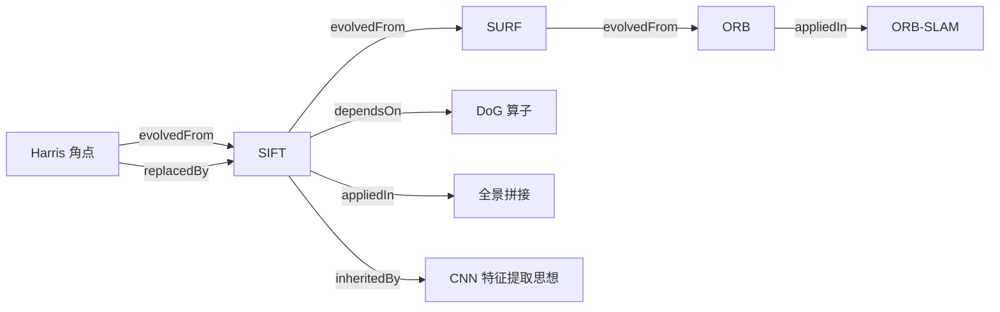

# 关系定义

> 本体里最值钱的东西不是「实体」，而是**实体之间的关系**。
> 关系把散装知识变成图谱。

## 核心关系（6 种）



### 1. `evolvedFrom` — 演化来源

**语义**：算法 B 是在算法 A 的基础上改进而来。

```yaml
- id: algo-sift
  evolvedFrom: "algo-harris"
  evolutionNote: "从固定尺度窗口升级为 DoG 尺度空间"
```

- **方向**：`evolvedFrom` 指向**更早**的算法
- **用途**：生成家族树、演化时间线
- **注意**：这是「直接血统」，不是「思想相似」

### 2. `dependsOn` — 依赖

**语义**：算法 B 的实现里**直接调用了** A（或算子 A）。

```yaml
- id: algo-canny
  dependsOn:
    - "op-gaussian-blur"
    - "op-sobel-gradient"
    - "op-non-max-suppression"
```

- **方向**：`dependsOn` 指向**被调用方**
- **用途**：生成依赖图，回答「改一个算子会影响哪些算法」
- **和 evolvedFrom 的区别**：`dependsOn` 是代码级依赖，`evolvedFrom` 是思想级血缘

### 3. `replacedBy` — 被替代

**语义**：在某个场景下，算法 A 被 B 取代。

```yaml
- id: algo-sift
  replacedBy: "algo-surf"
  replacedScope: "速度敏感场景"
  replacedReason: "SIFT 太慢，SURF 用积分图加速"
```

- **方向**：`replacedBy` 指向**替代者**
- **必须带范围**：`replacedBy` 不是绝对的，要写清在什么条件下被替代
- **用途**：回答「为什么现在都用 ORB 不用 SIFT」

### 4. `appliedIn` — 应用于

**语义**：算法 A 被用于应用场景 B。

```yaml
- id: algo-hog-svm
  appliedIn:
    - "app-pedestrian-detection"
    - "app-video-surveillance"
```

- **方向**：算法 → 应用
- **用途**：从应用反查技术栈

### 5. `inheritedBy` — 被继承（跨范式）

**语义**：传统 CV 的东西被深度学习继承。

```yaml
- id: op-nms
  inheritedBy:
    - "dl-yolo-detection-head"
  inheritanceNote: "YOLO 检测头后处理直接复用 NMS"
- id: op-image-pyramid
  inheritedBy:
    - "dl-fpn"
  inheritanceNote: "多尺度思想从手工金字塔迁移到特征金字塔"
```

- **方向**：传统 → 深度学习
- **用途**：这是 [传承脉络](/legacy/) 章节的数据来源，也是本站最重要的差异化

### 6. `contrastsWith` — 对比

**语义**：两个算法互为对照，常被拿来比较。

```yaml
- id: algo-sift
  contrastsWith:
    - target: "algo-orb"
      dimensions: ["速度", "精度", "是否尺度不变", "专利"]
```

- **方向**：双向
- **用途**：生成对比表

## 关系一览表

| 关系 | 从 | 到 | 方向性 | 用途 |
|---|---|---|---|---|
| `evolvedFrom` | 新算法 | 旧算法 | 单向 | 家族树、演化 |
| `dependsOn` | 算法 | 算子/算法 | 单向 | 依赖图 |
| `replacedBy` | 旧算法 | 新算法 | 单向（带范围） | 替代分析 |
| `appliedIn` | 算法 | 应用 | 单向 | 技术栈反查 |
| `inheritedBy` | 传统 | 深度学习 | 单向 | 传承脉络 |
| `contrastsWith` | 算法 | 算法 | 双向 | 对比表 |

## 关系强度与置信度

不是所有关系都一样可靠，所以每条关系都可以带置信度：

```yaml
- id: algo-hog-svm
  inheritedBy:
    - target: "dl-cnn-first-layer"
      strength: "conceptual"     # conceptual | direct | disputed
      note: "HOG 与 CNN 第一层卷积核学到的方向滤波器高度相似，但不是直接移植"
```

| strength | 含义 |
|---|---|
| `direct` | 有明确文献/代码证据的直接继承 |
| `conceptual` | 思想层面相似，无明显直接继承 |
| `disputed` | 学界有争议，谨慎引用 |

## 为什么关系要带「范围」和「置信度」

因为传统 CV 的很多说法在民间会**过度简化**：

- 说「SIFT 被 ORB 取代了」——**不准确**，是「在实时 SLAM 场景下被 ORB 取代，在精度优先的离线场景 SIFT 依然更好」
- 说「HOG 等于 CNN 第一层」——**不准确**，是「思想层面相似，HOG 是手工设计的，CNN 是学出来的」

把范围和置信度写进本体，就能避免文档传播错误结论。这也是「本体论研究」和「随便写教程」最大的区别。
