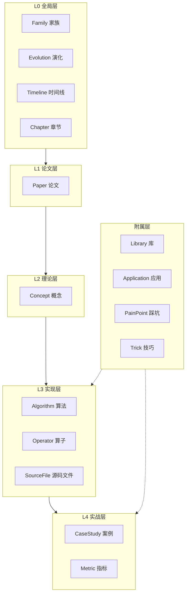

# 知识本体 Schema

> `agent-cv` 的核心不是「文档站」，而是**知识本体（Ontology）**。
> 文档只是本体的一种渲染形式。这一节讲清楚我们怎么把「传统 CV 知识」建模成机器可校验的结构。

## 为什么要本体

如果把每个算法都写成一篇散装 Markdown：

- 想查「SIFT 影响了谁」→ 只能全文搜索，容易漏
- 想查「哪些算法依赖高斯滤波」→ 没有显式关系，查不了
- 想有人接手维护 → 命名、字段全靠自觉，越来越乱

**本体解决的问题**：先把知识的**结构与关系**定义清楚，再用 Schema 强制校验，最后渲染成文档与图谱。

## 设计原则

1. **不是 OWL，不追求形式化完备**：我们用 JSON Schema + YAML 实例，**够用、可校验、人写得动**。
2. **四层闭环**：所有实体必须能挂到「论文 → 理论 → 实现 → 实战」的某一层。
3. **关系显式化**：算法之间的继承、依赖、替代关系必须写成字段，不能只靠人读。
4. **渐进式覆盖**：Schema 先定，实例逐步填；没填的字段允许留空，但**填错的字段一定报错**。

## 四层闭环



## 实体类型总览（19 种）

### L0 全局层（4 种）

| 实体 | 作用 | 核心字段 |
|---|---|---|
| `Family` | 技术家族的谱系与分支 | `originAlgorithm`、`lineages[]`、`keyThemes[]`、`yearRange` |
| `Evolution` | 一次演化事件 from → to | `from`、`to`、`kind`、`introduced`、`removed`、`rationale`、`quantitativeDelta` |
| `Timeline` | 按年份组织的节点序列 | `scope`、`nodes[{year, algorithm, milestone}]` |
| `Chapter` | 纵轴学习路径的一章 | `number`、`name`、`plainTalk`（白话版）、`level`、`coreQuestion`、`algorithms[]`、`concepts[]`、`docsPath` |

### L1 论文层（1 种）

| 实体 | 作用 | 核心字段 |
|---|---|---|
| `Paper` | 原始论文元数据 | `title`、`authors[]`、`year`、`venue`、`doi`、`contribution`、`readStatus` |

### L2 理论层（1 种）

| 实体 | 作用 | 核心字段 |
|---|---|---|
| `Concept` | 算法的核心概念 | `name`、`oneLiner`、`plainTalk`（通俗版）、`formula`、`belongsTo` |

### L3 实现层（3 种）

| 实体 | 作用 | 核心字段 |
|---|---|---|
| `Algorithm` | 一个完整算法 | `name`、`year`、`branch`、`branch`、`evolvedFrom`、`dependsOn`、`replacedBy`、`papers[]`、`implementations[]` |
| `Operator` | 原子级算子 | `name`、`formula`、`params[]`、`opencvFunc`、`useCases`、`noiseRobustness` |
| `SourceFile` | 源码文件走读 | `repo`、`commit`、`path`、`language`、`annotations[]` |

### L4 实战层（2 种）

| 实体 | 作用 | 核心字段 |
|---|---|---|
| `CaseStudy` | 落地案例 | `scenario`、`algorithmStack[]`、`hardware`、`metric`、`pitfalls[]` |
| `Metric` | 性能指标 | `dataset`、`inputSize`、`accuracy`、`speed`、`hardware` |

### 附属层（8 种）

| 实体 | 作用 |
|---|---|
| `Library` | 开源库（OpenCV、VLFeat、dlib…） |
| `Application` | 应用场景（工业质检、SLAM…） |
| `PainPoint` | 踩坑记录 |
| `Trick` | 调参 / 工程技巧 |
| `Dataset` | 数据集（VOC、COCO、Middlebury…） |
| `Branch` | 六大技术分支 |
| `Comparison` | 算法对比 |
| `GlossaryTerm` | 术语表条目 |

## YAML 实例长什么样

以 Canny 算法为例（`ontology/instances/algorithms/canny.yaml`）：

```yaml
id: algo-canny
type: Algorithm
name: "Canny 边缘检测"
year: 1986
branch: branch-image-processing
plainTalk: "自动描边小画家：把照片里所有东西的轮廓用细黑笔描出来，还不会把灰尘当轮廓。"
evolvedFrom: "algo-sobel"
dependsOn:
  - "op-gaussian-blur"
  - "op-non-max-suppression"
  - "op-double-threshold"
replacedBy: []
papers:
  - "paper-canny-1986"
implementations:
  - lib: "OpenCV"
    func: "cv2.Canny"
concepts:
  - "concept-optimal-edge-criteria"
  - "concept-nms"
```

## 校验机制

用 JSON Schema 校验 YAML 实例。写错字段（例如把 `year` 写成字符串）会直接报错：

```bash
# 伪代码：实例校验
$ python validate.py ontology/instances/algorithms/canny.yaml
✅ canny.yaml 通过校验（Algorithm, 8 个必填字段齐全）
```

这样保证：**知识图谱不会悄悄地错**。错了一定在写入时就被拦下。

## 目录结构

```
ontology/
├── schema/              # JSON Schema 定义
│   ├── algorithm.schema.yaml
│   ├── operator.schema.yaml
│   ├── paper.schema.yaml
│   ├── library.schema.yaml
│   └── application.schema.yaml
└── instances/           # YAML 实例数据
    ├── algorithms/      # 算法实例
    ├── operators/       # 算子实例
    ├── papers/          # 论文实例
    └── applications/    # 应用实例
```

详见 [实体类型详解](/ontology/entity-types) 与 [关系定义](/ontology/relations)。
