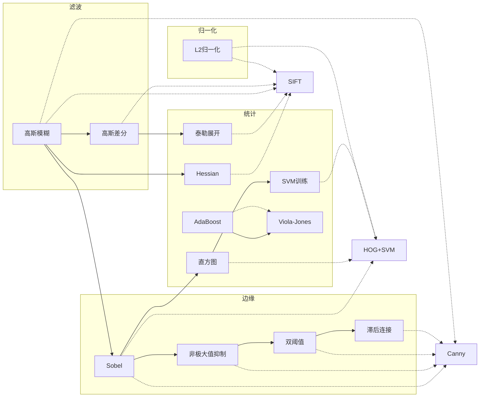

# 算子词典（Operators）

::: tip 🧱 什么是「算子」？
算子是比算法更小的**原子积木**。一个完整算法（比如 Canny）= 多个算子按特定顺序串起来（高斯模糊 → Sobel → 非极大值抑制 → 双阈值 → 滞后连接）。

- **算法**（Algorithm）：解决一类完整问题的完整流程，有论文、有历史、有"家族谱系"
- **算子**（Operator）：可复用的原子操作，像乐高积木一样被多个算法反复借用

做工程时，"知道用哪个算子、调哪个参数"比"知道哪个算法"更常被用到——因为调参、复现、排错，最终都落在算子这一层。
:::

## 算子分类

**按类别分组**：

### 🔵 滤波类（filter）—— 处理像素邻域、改变图的"清晰度"

| 算子 | 一句话 | 被哪些算法使用 |
|---|---|---|
| [高斯模糊 op-gaussian-blur](/operators/gaussian-blur) | 给照片磨皮，按钟形曲线平均邻居 | Canny、SIFT |
| [高斯差分 DoG op-dog](/operators/dog) | 两次模糊相减，筛出特定尺寸的斑点 | SIFT |

### 🟢 边缘类（edge）—— 检测或处理"明暗变化"

| 算子 | 一句话 | 被哪些算法使用 |
|---|---|---|
| [Sobel 算子 op-sobel](/operators/sobel) | 左右上下比亮度差，找边的方向和强度 | Canny、HOG |
| [非极大值抑制 op-non-max-suppression](/operators/non-max-suppression) | 把粗线削成单像素细线 | Canny |
| [滞后连接 op-hysteresis-tracking](/operators/hysteresis-tracking) | 从强边缘出发顺藤摸瓜接上弱边缘 | Canny |

### 🟡 点运算类（point-operation）—— 每个像素独立处理

| 算子 | 一句话 | 被哪些算法使用 |
|---|---|---|
| [双阈值判定 op-double-threshold](/operators/double-threshold) | 两道门槛：明确的直接判，中间的待定 | Canny |
| [L2 归一化 op-l2-normalization](/operators/l2-normalization) | 向量除以自己的长度，消除整体亮暗 | HOG、SIFT |
| [自适应阈值 op-adaptive-threshold](/operators/adaptive-threshold) | 每个像素按邻居亮度单独划及格线 | 文档扫描、OCR |

### 🟣 统计类（statistical）—— 对一批像素做汇总/拟合/学习

| 算子 | 一句话 | 被哪些算法使用 |
|---|---|---|
| [直方图统计 op-histogram](/operators/histogram) | 数一数每种亮度/方向有多少像素 | HOG、Otsu |
| [Hessian 矩阵 op-hessian](/operators/hessian) | 看一个地方是凸/凹/马鞍，找斑点 | SIFT、SURF |
| [泰勒展开 op-taylor-expansion](/operators/taylor-expansion) | 用抛物线找谷底，做亚像素精化 | SIFT |
| [AdaBoost 集成学习 op-adaboost](/operators/adaboost) | 三个臭皮匠顶个诸葛亮，弱分类器加权成强分类器 | Viola-Jones |
| [SVM 训练 op-svm-training](/operators/svm-training) | 画一条离两边都最远的分界线 | HOG+SVM |

## 怎么看每个算子页

每个算子页按下面的结构写：

1. **白话比喻**：用生活例子讲"它到底在干什么"
2. **参数与调参经验**：每个关键参数怎么调、常见坑
3. **OpenCV 调用**：一行代码告诉你用哪个函数、参数顺序
4. **被谁用**：哪些算法依赖它
5. **复杂度/可分离性**：能不能加速、在不在原地做
6. **典型场景**：什么时候该想到它
7. **常见坑**：工程中最容易犯的错

## 算子之间的关系图

## 从算子反查算法

> 「我现在就想做个模糊+找边」—— 按下面走：

- 只想**平滑降噪** → [高斯模糊](/operators/gaussian-blur) → 配合 Canny / SIFT
- 只想**找边缘** → [Sobel](/operators/sobel) → 不够精细时升级到 [Canny](/algorithms/canny/)
- 想**找斑点/兴趣点** → [Hessian](/operators/hessian) + [DoG](/operators/dog) → 升级到 [SIFT](/algorithms/sift/)
- 想**做目标检测** → [HOG+SVM](/algorithms/hog-svm/)（用 [直方图](/operators/histogram)+[SVM 训练](/operators/svm-training)）或 [Viola-Jones](/branches/detection/viola-jones)（用 [AdaBoost](/operators/adaboost)）
- 文档光照不均 → [自适应阈值](/operators/adaptive-threshold)
- 光线变化烦 → [L2 归一化](/operators/l2-normalization)

::: warning 🔗 导航提示
算子词典是「从下往上」看的——从原子操作理解原理。
如果你是入门，建议先按[章体系（纵轴）](/chapters/)顺序学，遇到具体不懂的算子再回来查。
:::
