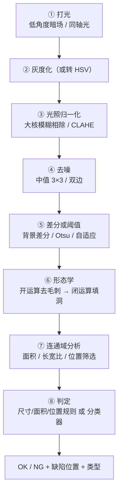

# 🏭 工业缺陷检测

> **任务类型**：有 / 无判定 + 缺陷定位 + 缺陷分型
> **典型节拍**：100–600 件/分钟 ｜ **典型精度要求**：检出率 > 99%，误报率 < 1%
> **涉及章**：第3章（预处理）、第5章（分割）、第7章（纹理）、第8章（形状）

---

## 先明确你要检测什么

**缺陷检测不是一个任务，而是一族任务。** 不同类型的缺陷，算法链完全不同：

| 缺陷类型 | 表现 | 首选思路 |
|---|---|---|
| **尺寸类**（缺料、多料） | 轮廓与标准不符 | 轮廓提取 + 几何量比对 |
| **表面类**（划痕、脏污） | 局部亮度/纹理异常 | 背景归一化 + 差分 + 形态学 |
| **结构类**（缺牙、断线） | 结构缺失 | 投影分析 / 连通域计数 |
| **颜色类**（色差、混料） | 颜色偏离 | HSV 空间 + 色差阈值 |
| **位置类**（偏移、装反） | 位置/方向错误 | 模板匹配 + 位置校验 |

::: tip 第一步永远是分类缺陷
**别一上来就写算法。** 先把缺陷归类，再选算法链。把「表面类」当「尺寸类」处理是新手最常犯的方向性错误。
:::

---

## 通用算法链（表面类缺陷）



**每一步为什么这么排**：

| 步骤 | 为什么不能省 |
|---|---|
| **① 打光** | 低角度暗场能让「划痕」亮起来，明场打光下划痕可能完全看不见 |
| **③ 光照归一化** | 大核模糊相除能消除「镜头暗角」「光源不均」，是让同一个阈值在全图通用的前提 |
| **⑤ 差分** | 比起「缺陷长什么样」，「和正常样品差在哪」更容易量化 |
| **⑥ 形态学** | 去掉单像素噪点，同时把断裂的缺陷连成完整区域 |
| **⑦ 连通域** | 从「像素」升级到「缺陷对象」，才能筛「多大算缺陷」 |

---

## 完整代码

```python
import cv2
import numpy as np

def inspect(gray, template_gray=None, params=None):
    """
    表面缺陷检测（差分法）
    gray          : 待检图（灰度）
    template_gray : 标准样品图（可选；有则用差分，无则用局部异常检测）
    """
    p = {'norm_ksize': 61, 'blur_ksize': 3,
         'min_area': 40, 'max_area': 20000,
         'k': 3.0}                                # k: 阈值 = 均值 + k·标准差

    # ① 光照归一化：大核模糊估计背景，相除得到均匀图
    bg = cv2.GaussianBlur(gray, (p['norm_ksize'], p['norm_ksize']), 0)
    norm = cv2.divide(gray.astype(np.float32), bg.astype(np.float32) + 1e-6,
                      scale=128)

    # ② 去噪
    norm = cv2.medianBlur(norm.astype(np.uint8), p['blur_ksize'])

    # ③ 缺陷响应
    if template_gray is not None:
        # 和标准样品差分（要求已配准）
        diff = cv2.absdiff(norm, template_gray.astype(np.float32).astype(np.uint8))
    else:
        # 无样品：用「局部均值的偏移」当异常度
        blur = cv2.GaussianBlur(norm, (0, 0), 9)
        diff = cv2.absdiff(norm, blur)

    # ④ 自适应阈值选择
    if template_gray is not None:
        _, mask = cv2.threshold(diff, 25, 255, cv2.THRESH_BINARY)
    else:
        thr = diff.mean() + p['k'] * diff.std()
        _, mask = cv2.threshold(diff, thr, 255, cv2.THRESH_BINARY)

    # ⑤ 形态学：开运算去毛刺，闭运算连接断裂
    k_open = cv2.getStructuringElement(cv2.MORPH_ELLIPSE, (3, 3))
    k_close = cv2.getStructuringElement(cv2.MORPH_ELLIPSE, (7, 7))
    mask = cv2.morphologyEx(mask, cv2.MORPH_OPEN, k_open)
    mask = cv2.morphologyEx(mask, cv2.MORPH_CLOSE, k_close)

    # ⑥ 连通域筛选
    n, labels, stats, centroids = cv2.connectedComponentsWithStats(mask, 8)
    defects = []
    for i in range(1, n):
        area = stats[i, cv2.CC_STAT_AREA]
        if not (p['min_area'] <= area <= p['max_area']):
            continue
        x, y, w, h = (stats[i, cv2.CC_STAT_LEFT], stats[i, cv2.CC_STAT_TOP],
                      stats[i, cv2.CC_STAT_WIDTH], stats[i, cv2.CC_STAT_HEIGHT])
        defects.append({
            'bbox': (x, y, w, h),
            'area': int(area),
            'center': tuple(np.round(centroids[i], 1)),
            'aspect': round(max(w, h) / (min(w, h) + 1e-6), 2),
        })

    return {'ok': len(defects) == 0, 'defects': defects, 'mask': mask}
```

---

## 各缺陷类型的判定规则

```python
# 尺寸类：轮廓几何量比对
def check_dimension(cnt, mm_per_px, spec):
    rect = cv2.minAreaRect(cnt)
    w_mm = rect[1][0] * mm_per_px
    h_mm = rect[1][1] * mm_per_px
    return all(lo <= v <= hi for v, (lo, hi) in
               zip((w_mm, h_mm), (spec['w'], spec['h'])))

# 结构类：投影分析（判断缺牙 / 断线）
def check_structure(mask, axis=1, min_peak_ratio=0.3):
    """按列（或行）求和，看是否有规律的黑洞"""
    proj = mask.sum(axis=axis) / 255
    thresh = proj.max() * min_peak_ratio
    peaks = (proj > thresh).astype(int)
    # 统计「连续有料区段」的个数，和标准个数比对
    segments = []
    start = None
    for i, v in enumerate(peaks):
        if v and start is None:
            start = i
        elif not v and start is not None:
            segments.append((start, i)); start = None
    if start is not None:
        segments.append((start, len(peaks)))
    return segments
```

---

## 打光方案对照

| 缺陷 | 推荐打光 | 为什么 |
|---|---|---|
| **划痕 / 凹坑** | **低角度暗场** | 让凹凸处产生高亮，平面保持暗 |
| **脏污 / 印错** | 环形明场 | 均匀照明，对比度差异才看得见 |
| **缺料 / 多料** | **背光** | 物体变剪影，轮廓最清晰 |
| **气泡 / 内部缺陷** | 背光 + 偏振片 | 去除表面反光，看到内部 |
| **高反光金属件** | 同轴光 / 穹顶光 | 消除镜面反射造成的过曝 |
| **颜色分选** | 高显色指数白光 | 保证颜色还原准确 |

---

## 参数经验值

| 参数 | 经验值 | 说明 |
|---|---|---|
| 光照归一化核 | 图像宽度的 1/10 ~ 1/20 | 太小小不掉光照不均，太大跟不上变化 |
| 中值滤波 | 3×3 | **别超过 5×5**，会抹掉小缺陷 |
| 差分阈值 | 20–40（uint8） | 取决于对比度，用 `mean + k·std` 自适应更稳 |
| 最小缺陷面积 | 40 px | 小于这个当噪点；按「物理最小缺陷 × 像素当量²」反算 |
| 开运算核 | 3×3 椭圆 | 再大就会吃掉真缺陷 |
| 闭运算核 | 5×5 ~ 9×9 椭圆 | 用来连接断裂的缺陷 |

---

## 五个必踩的坑

::: warning 坑 1：指望一个阈值通吃全图
**必错。** 光照不均、镜头暗角、工件位置微移都会让阈值失效。
**解法**：先做光照归一化（大核模糊相除），再做阈值；或者干脆用自适应阈值。
:::

::: warning 坑 2：形态学核开太大，把小缺陷一起「清」了
开运算核如果开到 7×7，2×2 像素的针孔缺陷直接消失。
**解法**：核尺寸必须和「最小可接受缺陷尺寸」关联，「开运算核 < 最小缺陷尺寸」。
:::

::: warning 坑 3：用「绝对阈值」而不是「相对判定」
产品亮度批次间有差异，绝对阈值这周好用下周就失效。
**解法**：判定用**相对量**——相对标准样品、相对周围背景、相对于图像统计量。
:::

::: warning 坑 4：没有 NG 图留存，出问题无法复盘
产线报警了，但你不知道当时到底是什么样。
**解法**：**所有 NG 图 + 中间结果自动存档**，这是调参和复盘的唯一依据。
:::

::: warning 坑 5：忽略了「节拍」
算法在 PC 上跑 300 ms，产线节拍 200 ms——直接废掉。
**解法**：**先测节拍，再定方案**。节拍紧就缩分辨率、缩 ROI、换更快的算法链。
:::

---

## 性能参考

| 环节 | 典型耗时（1280×960，CPU 单核） |
|---|---|
| 光照归一化（大核高斯） | 8–15 ms |
| 中值滤波 3×3 | 2–4 ms |
| 阈值 + 形态学 | 3–6 ms |
| 连通域 | 2–5 ms |
| **合计** | **约 15–30 ms** |

**完全满足 100–600 件/分钟**（节拍 100–600 ms），且**不需要 GPU**。这就是传统 CV 在产线上的核心竞争力。

---

## 相关页面

- 🎯 [场景反查入口](/scenarios/)
- 🏭 [完整工业缺陷检测案例（97.2% 检出率）](/cases/industrial-defect)
- 🛠 [产线工程化：打光/标定/触发](/branches/engineering/pipeline)
- 📘 [第5章 目标分割](/chapters/ch05-segmentation)
- 📘 [第8章 形状分析](/chapters/ch08-shape)
