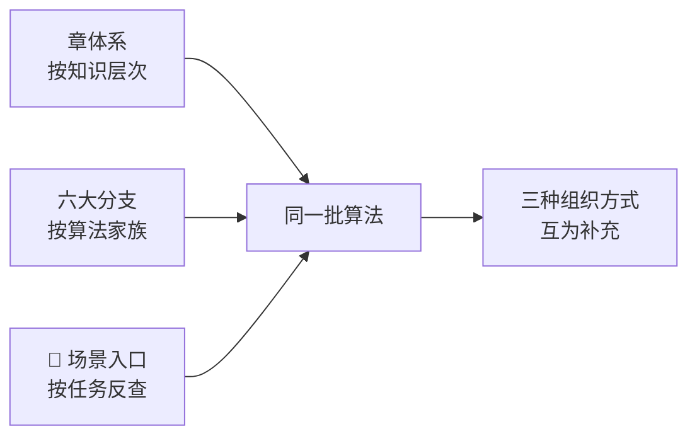

# 🎯 场景反查入口

> **这一页解决一个问题**：「我要做 XX 检测，该用哪些算法？」
>
> 章体系是按**知识层次**组织的（第3章→第15章），分支是按**算法家族**组织的（图像处理 / 特征检测 / …）。但真实工作里，工程师拿到的是**任务**，不是算法名。这一页就是**从任务反查算法**的入口。

---

## 为什么需要这一页

**举个例子**：客户说「我要检测螺丝有没有缺牙」。你需要的知识散落在：

- 第3章（预处理去噪、打光）
- 第4章（边缘 + 霍夫/轮廓）
- 第5章（阈值分割把螺丝抠出来）
- 第8章（形状分析判断「牙」的数量）
- [工程实现层](/branches/engineering/)（打光、标定、节拍）

**场景入口就是把这条线提前串好**，让你不用自己拼。

---

## 六大高频场景

| 场景 | 核心任务 | 首选算法链 | 入口 |
|---|---|---|---|
| **🏭 工业缺陷检测** | 有无缺陷 / 缺陷分型 | 打光 → 滤波 → 背景差分/阈值 → 形态学 → 连通域 → 面积/形状判定 | [→](/scenarios/defect-inspection) |
| **📐 工业尺寸测量** | 亚像素级尺寸/位置 | 标定 → 亚像素边缘 → 拟合直线/圆 → 尺寸计算 | [→](/scenarios/measurement) |
| **📄 文档 OCR** | 文字区域定位与预处理 | 灰度 → 光照归一化 → 二值化 → 倾斜校正 → 版面分析 | [→](/scenarios/ocr-document) |
| **🚗 车牌识别** | 车牌定位 + 字符切分 | 边缘/颜色定位 → 形态学 → 透视校正 → 投影切分 | [→](/scenarios/license-plate) |
| **👤 人脸检测** | 实时人脸定位 | Viola-Jones 级联 / HOG+SVM | [→](/scenarios/face-recognition) |
| **🔭 全景拼接** | 多图无缝拼接 | 特征匹配 → 比值检验 → RANSAC 单应 → 融合 | [→](/scenarios/panorama) |

---

## 场景 → 算法 → 章 的完整对照

| 场景 | 用到的主要算法 | 涉及章 |
|---|---|---|
| 工业缺陷检测 | 高斯/中值滤波、背景差分、Otsu、形态学、连通域、LBP | 第3、5、7章 |
| 工业尺寸测量 | 标定、亚像素边缘、Hough 直线、最小二乘拟合、圆度 | 第3、4、8、9章 |
| 文档 OCR | 伽马校正、CLAHE、自适应阈值、形态学、投影分析、倾斜校正 | 第3、5、8章 |
| 车牌识别 | 边缘检测、形态学、颜色分割、透视变换、投影切分 | 第3、4、5、8章 |
| 人脸检测 | Haar+AdaBoost 级联、HOG+SVM、NMS | 第12章 |
| 全景拼接 | SIFT/ORB、FLANN、Lowe 比值、RANSAC、单应矩阵 | 第4、6、13章 |
| 条码/二维码 | 边缘、形态学、Hough、透视校正 | 第3、4、5章 |
| 目标跟踪 | 背景差分、KLT、光流、Kalman | 第11章 |
| 三维测量 | 标定、立体匹配、结构光、点云配准 | 第9、10章 |
| 表面形貌检测 | 光度立体、法向积分 | 第10章 |

---

## 怎么用这一页

**三步走**：

1. **先看「核心任务」** —— 你究竟要输出什么？（是「有/无」？还是「几分之几毫米」？还是「是什么类别」？）
2. **再看「首选算法链」** —— 按顺序搭起来，这个顺序不是随意的，越靠前越基础。
3. **最后跳去对应章和分支** —— 把每一步的参数细节补上。

::: tip 一个通用的判断口诀
| 你要输出的东西 | 优先考虑 |
|---|---|
| **有 / 无**（合格/不合格） | 阈值 + 形态学 + 面积统计（够用就别复杂化） |
| **多少毫米** | 标定 + 亚像素边缘 + 几何拟合 |
| **是什么（几类里选一个）** | 特征描述子 + 分类器（SVM / 最近邻） |
| **在哪**（多目标、位置） | 模板匹配 / 检测器 / 连通域 |
| **多少个** | 连通域计数 + 面积筛除（配分水岭切粘连） |
| **三维形状** | 标定 + 立体/结构光/光度立体 |

:::

---

## 配套案例（真实项目级）

| 案例 | 内容 |
|---|---|
| 🏭 [工业零件缺陷检测](/cases/industrial-defect) | 完整产线方案：打光、算法链、97.2% 检出率、180 ms |
| 🚀 [嵌入式边缘部署](/cases/edge-deployment) | 3.5 W 功耗、无 GPU 方案的实际踩坑与实测数据 |

> **注意**：场景页给的是**算法选型与流程**，案例页给的是**完整项目（含打光、标定、通信、稳定性）**。两者配合看。
