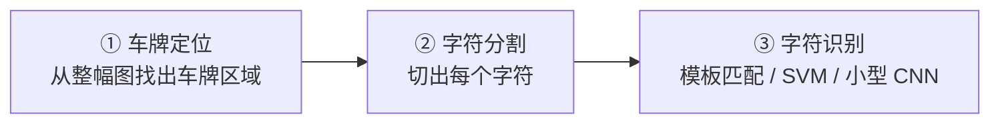

# 🚗 车牌识别（定位部分）

> **任务类型**：车牌区域定位 + 透视校正 + 字符切分
> **典型要求**：定位准确率 > 98%，整体耗时 < 50 ms（无 GPU）
> **涉及章**：第3章（预处理）、第4章（边缘/直线）、第5章（分割）、第8章（形状）

---

## 传统车牌识别的三段式



**这一页重点讲 ① 和 ②** —— 这是传统 CV 的主战场。③ 识别部分现代做法基本都用轻量 CNN，传统模板匹配只在高对比、标准字体场景可用。

::: tip 关键认知
**车牌定位的准确率直接决定整个系统的上限。** 定位错了，后面识别再准也没用。而**「车牌定位」正是传统 CV 方法最能打的地方**——车牌有极其明确的先验：矩形、有边框、有特定颜色、有密集的垂直边缘（字符）。
:::

---

## 三条定位路线

| 路线 | 原理 | 优点 | 缺点 |
|---|---|---|---|
| **边缘+形态学** | 车牌字符产生密集垂直边缘 → 形态学闭运算连成块 | **通用性最强**，不依赖颜色 | 背景有密集边缘时误报 |
| **颜色分割** | 蓝牌/绿牌/黄牌在 HSV 空间特征明确 | **极快**，准确率高 | 换牌照类型要重调参数 |
| **MSER / 连通域** | 字符是高对比度稳定区域 | 抗光照变化 | 计算量略大 |

**工程建议**：**颜色 + 边缘双通道验证**——颜色给出候选，边缘密度做确认，准确率最高。

---

## 路线 A：边缘 + 形态学（最通用）

```python
import cv2
import numpy as np

def locate_plate_by_edge(img):
    """边缘+形态学定位车牌（不依赖颜色，适用各类车牌）"""
    gray = cv2.cvtColor(img, cv2.COLOR_BGR2GRAY)

    # ① 高斯去噪（车牌字符是高频，不能过度模糊）
    blur = cv2.GaussianBlur(gray, (5, 5), 0)

    # ② Sobel 求「垂直边缘」——车牌字符产生强垂直边缘
    grad_x = cv2.Sobel(blur, cv2.CV_16S, 1, 0, ksize=3)
    grad_x = cv2.convertScaleAbs(grad_x)          # 取绝对值转 uint8

    # ③ 二值化（Otsu）
    _, bw = cv2.threshold(grad_x, 0, 255, cv2.THRESH_BINARY + cv2.THRESH_OTSU)

    # ④ 形态学：用「扁长」结构元把密集垂直边缘连成块
    #    车牌匹配宽高比约 3–5，所以核要横长、竖短
    k = cv2.getStructuringElement(cv2.MORPH_RECT, (17, 5))
    morph = cv2.morphologyEx(bw, cv2.MORPH_CLOSE, k)

    # ⑤ 连通域筛选（按宽高比 + 面积）
    cnts, _ = cv2.findContours(morph, cv2.RETR_EXTERNAL, cv2.CHAIN_APPROX_SIMPLE)
    candidates = []
    for c in cnts:
        x, y, w, h = cv2.boundingRect(c)
        if h == 0:
            continue
        aspect = w / h
        area = w * h
        # 车牌宽高比经验范围 2.5–5.5，面积不能太小
        if 2.5 <= aspect <= 5.5 and area > 800:
            candidates.append((x, y, w, h, aspect))
    return candidates, grad_x, morph
```

**参数含义**：

| 参数 | 作用 | 建议 |
|---|---|---|
| 形态学核 `(17, 5)` | 横向连接字符边缘 | **宽 = 预料字符间距的 2–3 倍**，高略小于字符高 |
| 宽高比范围 | 过滤非车牌 | 2.5–5.5（国内蓝牌约 3.14） |
| 面积下限 | 去掉噪点 | 按图像尺寸定，一般 > 800 px |

---

## 路线 B：颜色分割（最快，需按牌照类型调）

```python
import cv2
import numpy as np

def locate_plate_by_color(img, plate_type='blue'):
    """按颜色定位车牌。HSV 的 H 分量对光照不敏感，是颜色分割的关键。"""
    hsv = cv2.cvtColor(img, cv2.COLOR_BGR2HSV)

    # 各类型车牌的 HSV 范围（需按你的相机和光源实测微调！）
    ranges = {
        # 蓝牌：底色蓝，H 约 100–124
        'blue':  ((100, 60, 50), (124, 255, 255)),
        # 黄牌：底色黄，H 约 20–34
        'yellow': ((20, 60, 60), (34, 255, 255)),
        # 绿牌（新能源）：H 约 40–90（具体按实测）
        'green': ((40, 40, 40), (90, 255, 255)),
        # 白牌：低饱和 + 高亮度
        'white': ((0, 0, 180), (180, 40, 255)),
    }
    lo, hi = ranges[plate_type]
    mask = cv2.inRange(hsv, np.array(lo), np.array(hi))

    # 形态学：闭运算填洞，开运算去噪
    k = cv2.getStructuringElement(cv2.MORPH_RECT, (5, 5))
    mask = cv2.morphologyEx(mask, cv2.MORPH_CLOSE, k)
    mask = cv2.morphologyEx(mask, cv2.MORPH_OPEN, k)

    cnts, _ = cv2.findContours(mask, cv2.RETR_EXTERNAL, cv2.CHAIN_APPROX_SIMPLE)
    candidates = []
    for c in cnts:
        x, y, w, h = cv2.boundingRect(c)
        if h == 0:
            continue
        aspect, area = w / h, w * h
        if 2.5 <= aspect <= 5.5 and area > 800:
            candidates.append((x, y, w, h, aspect))
    return candidates, mask
```

::: warning HSV 范围必须实测
**上面给的范围只是起点，绝对不能直接用在生产环境。** 不同相机、不同光源、不同曝光下 HSV 值差异很大。**必须用你自己的实拍图取色，标定范围。** 建议做法：采集 100 张图，统计车牌区域的 H 分量直方图，取覆盖 95% 的区间。
:::

---

## 路线 C：双通道融合（推荐工程方案）

```python
def locate_plate_robust(img, plate_type='blue'):
    """颜色给候选 + 边缘密度做确认，准确率最高"""
    cand_color, _ = locate_plate_by_color(img, plate_type)
    gray = cv2.cvtColor(img, cv2.COLOR_BGR2GRAY)

    def edge_density(x, y, w, h):
        """车牌区域内应该有大量垂直边缘（字符），背景区域没有"""
        roi = gray[y:y+h, x:x+w]
        if roi.size == 0:
            return 0.0
        gx = cv2.convertScaleAbs(cv2.Sobel(roi, cv2.CV_16S, 1, 0, ksize=3))
        _, bw = cv2.threshold(gx, 0, 255, cv2.THRESH_BINARY + cv2.THRESH_OTSU)
        return bw.mean() / 255.0

    verified = []
    for (x, y, w, h, aspect) in cand_color:
        # 车牌区域边缘密度通常 > 0.2（字符密集）
        if edge_density(x, y, w, h) > 0.2:
            verified.append((x, y, w, h, aspect))

    # 按面积排序，取最大的几个
    verified.sort(key=lambda b: -b[2] * b[3])
    return verified[:3]
```

---

## 透视校正：把斜车牌掰正

**这一步是提升识别率的关键**：拍到的车牌常带倾斜和透视变形，不校正的话字符切分会失败。

```python
import cv2
import numpy as np

def correct_perspective(img, bbox):
    """把车牌区域校正成标准水平矩形"""
    x, y, w, h = bbox
    roi = img[y:y+h, x:x+w]

    # ① 在 ROI 内找车牌的四个角（用最小面积矩形）
    gray = cv2.cvtColor(roi, cv2.COLOR_BGR2GRAY)
    _, bw = cv2.threshold(gray, 0, 255, cv2.THRESH_BINARY + cv2.THRESH_OTSU)
    cnts, _ = cv2.findContours(bw, cv2.RETR_EXTERNAL, cv2.CHAIN_APPROX_SIMPLE)
    if not cnts:
        return roi
    c = max(cnts, key=cv2.contourArea)
    rect = cv2.minAreaRect(c)
    box = cv2.boxPoints(rect)                    # 4 个角点
    box = np.array(sorted(box, key=lambda p: (p[1], p[0])), np.float32)

    # ② 排序四角：左上、右上、右下、左下
    rect_pts = order_points(box)

    # ③ 计算目标矩形尺寸（常用 440×140，标准车牌比例）
    W, H = 440, 140
    dst = np.array([[0, 0], [W, 0], [W, H], [0, H]], np.float32)

    M = cv2.getPerspectiveTransform(rect_pts, dst)
    warped = cv2.warpPerspective(roi, M, (W, H))
    return warped

def order_points(pts):
    """把四个点排成：左上、右上、右下、左下"""
    rect = np.zeros((4, 2), np.float32)
    s = pts.sum(axis=1)
    rect[0] = pts[np.argmin(s)]              # 左上：和最小
    rect[2] = pts[np.argmax(s)]              # 右下：和最大
    d = np.diff(pts, axis=1).ravel()
    rect[1] = pts[np.argmin(d)]              # 右上：差最小
    rect[3] = pts[np.argmax(d)]              # 左下：差最大
    return rect
```

::: warning 别忘了「旋转 180°」的情况
如果车是倒着开的（或者相机装反了），车牌是上下颠倒的。**工程上通常做法**：先按正常流程处理，同时算一个「上下翻转」的分支，把两个结果都送去识别，取置信度高的那个。成本很低，但能避免整帧漏检。
:::

---

## 字符切分

```python
import cv2
import numpy as np

def split_plate_chars(plate_img, expected=7):
    """
    切分车牌字符。中国蓝牌：1 汉字 + 1 字母 + 5 位（共 7 个）
    新能源绿牌：8 个
    """
    gray = cv2.cvtColor(plate_img, cv2.COLOR_BGR2GRAY)
    # 车牌底色是深色（蓝/黑），字符是白色 → 先转「字符为白」
    _, bw = cv2.threshold(gray, 0, 255, cv2.THRESH_BINARY + cv2.THRESH_OTSU)
    # 判断底色：如果白像素超过一半，说明底色被判成白了，需要反色
    if bw.mean() > 127:
        bw = 255 - bw

    # 垂直投影
    proj = bw.sum(axis=0) / 255.0
    thresh = max(1.0, proj.max() * 0.15)
    is_char = proj > thresh

    chars = []
    start = None
    for i, v in enumerate(is_char):
        if v and start is None:
            start = i
        elif not v and start is not None:
            chars.append((start, i))
            start = None
    if start is not None:
        chars.append((start, len(is_char)))

    # 过滤过窄的（可能是圆点或边框）
    h = bw.shape[0]
    chars = [c for c in chars if (c[1] - c[0]) > h * 0.08]

    # 合并过近的（汉字常被切成两半）
    merged = []
    for c in chars:
        if merged and c[0] - merged[-1][1] < h * 0.05:
            merged[-1] = (merged[-1][0], c[1])
        else:
            merged.append(c)

    # 如果切出的数量不对，按等分兜底
    if len(merged) != expected:
        w = plate_img.shape[1]
        step = w / expected
        merged = [(int(i * step), int((i + 1) * step)) for i in range(expected)]

    return merged
```

---

## 完整流程

```python
def recognize_plate(img, plate_type='blue'):
    # ① 定位（双通道融合）
    candidates = locate_plate_robust(img, plate_type)
    if not candidates:
        return {'ok': False, 'reason': 'plate_not_found'}

    x, y, w, h, _ = candidates[0]

    # ② 透视校正
    plate = correct_perspective(img, (x, y, w, h))

    # ③ 字符切分
    chars = split_plate_chars(plate)

    # ④ 逐个字符识别（模板匹配 / SVM / 轻量 CNN）
    # ... 这里交给识别模块 ...
    result = [crop(plate, c) for c in chars]

    return {'ok': True, 'bbox': (x, y, w, h), 'plate_img': plate, 'chars': result}
```

---

## 五个必踩的坑

::: warning 坑 1：颜色范围直接抄网上的
**必失效。** 每台相机、每种光源下的 HSV 值都不同。**必须用实拍图标定范围**，并用 95% 分位数取区间。
:::

::: warning 坑 2：形态学核做成正方形
正方核会把「字符之间」也连起来，导致车牌区域被填成一整块（甚至和背景连在一起）。
**解法**：核必须是**扁长**的（如 17×5），契合车牌的横向结构。
:::

::: warning 坑 3：忘了做透视校正，直接切字符
倾斜/梯形的车牌，投影切分必然失败。
**解法**：**先校正再切分**，这一步对识别率的提升比换更好的识别模型大得多。
:::

::: warning 坑 4：只在白天调好了参数
夜间车灯、过曝、逆光会让颜色和边缘特征完全改变。
**解法**：**日夜双参数组**（用图像平均亮度自动切换），或者主动补光（红外补光对车牌反光效果很好）。
:::

::: warning 坑 5：忽视「车牌反光」和「车牌脏污」
反光会让蓝色区域直接变成白色高光，颜色分割失效；脏污会让字符断裂。
**解法**：反光靠**偏振片 + 调整补光角度**；脏污靠**边缘路线兜底**（边缘分割不依赖颜色）。
:::

---

## 相关页面

- 🎯 [场景反查入口](/scenarios/)
- 📘 [第4章 基元检测](/chapters/ch04-primitives)
- 📘 [第5章 目标分割](/chapters/ch05-segmentation)
- 📘 [第8章 形状分析](/chapters/ch08-shape)
- 📹 [形态学操作](/branches/image-processing/morphology)
- 📹 [单应变换与透视校正](/branches/geometry/homography)
