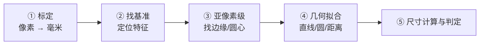

# 📐 工业尺寸测量

> **任务类型**：亚像素级尺寸 / 位置 / 角度测量
> **典型精度要求**：±0.01 mm（像素当量 0.02 mm/px 时需亚像素）
> **涉及章**：第3章（预处理）、第4章（边缘/直线/圆）、第8章（形状）、第9章（标定）

---

## 测量的核心逻辑



**关键认知**：测量任务的**精度上限由标定决定，不由算法决定**。像素当量 0.02 mm/px，就算算法做到 0.1 像素精度，绝对精度也就 0.002 mm——但那是理想值；实际标定误差通常是瓶颈。

---

## ① 标定：像素当量怎么算

**三种常见做法**：

| 方法 | 做法 | 精度 |
|---|---|---|
| **标准量块 / 标尺** | 拍已知尺寸物体，算比例 | ±1% 量级，够多数产线 |
| **标定板（棋盘格）** | `cv2.calibrateCamera` 同时求内参和畸变 | ±0.1%，能矫正畸变 |
| **视觉标定块** | 带多个已知间距的标记点，一图多约束 | ±0.05%，最高 |

```python
import cv2
import numpy as np

# ---- 方法 A：量块标定（最常用） ----
def calibrate_by_block(img_path, block_mm=20.0):
    img = cv2.imread(img_path, 0)
    _, bw = cv2.threshold(img, 0, 255, cv2.THRESH_BINARY + cv2.THRESH_OTSU)
    cnts, _ = cv2.findContours(bw, cv2.RETR_EXTERNAL, cv2.CHAIN_APPROX_SIMPLE)
    c = max(cnts, key=cv2.contourArea)

    # 亚像素级边距：用最小外接矩形
    rect = cv2.minAreaRect(c)
    px_size = max(rect[1])                     # 像素宽度
    mm_per_px = block_mm / px_size
    return mm_per_px

# ---- 方法 B：棋盘格标定（要矫正畸变时必须） ----
def calibrate_by_chess(pattern=(9, 6), square_mm=5.0):
    objp = np.zeros((pattern[0] * pattern[1], 3), np.float32)
    objp[:, :2] = np.mgrid[0:pattern[0], 0:pattern[1]].T.reshape(-1, 2) * square_mm
    objpoints, imgpoints = [], []
    for f in calib_images:
        g = cv2.cvtColor(cv2.imread(f), cv2.COLOR_BGR2GRAY)
        ok, corners = cv2.findChessboardCorners(g, pattern)
        if not ok:
            continue
        corners = cv2.cornerSubPix(g, corners, (11, 11), (-1, -1),
            (cv2.TERM_CRITERIA_EPS + cv2.TERM_CRITERIA_MAX_ITER, 30, 0.001))
        objpoints.append(objp); imgpoints.append(corners)
    ret, K, D, _, _ = cv2.calibrateCamera(objpoints, imgpoints,
                                          g.shape[::-1], None, None)
    return K, D
```

::: warning 标定漂移是精度最大的隐形杀手
温度变化、镜头松动、振动、更换镜头都会让标定失效。**产线必须规定「每班次首件复检标定」**，并把标定时间戳写进每份检测报告。
:::

---

## ② 亚像素级边缘

**为什么必须亚像素**：`cv2.Canny` 的输出是整数像素坐标。当像素当量是 0.02 mm 时，1 个像素的量化误差就是 0.02 mm——**已经超过了 ±0.01 mm 的精度要求**。

**解法**：在粗定位的边缘附近，用**灰度插值**求「梯度最大」的精确位置。

```python
import cv2
import numpy as np

def subpixel_edge_1d(profile, method='parabolic'):
    """
    一维灰度剖面上求亚像素边缘位置
    profile : 沿垂直于边缘方向的灰度采样（float 数组，长度 >= 5）
    method  : 'parabolic' 抛物线拟合 / 'centroid' 质心法
    """
    profile = profile.astype(np.float32)
    grad = np.abs(np.diff(profile))            # 一阶差分近似梯度
    i_max = int(np.argmax(grad))
    if i_max < 1 or i_max >= len(grad) - 1:
        return float(i_max)

    if method == 'parabolic':
        # 用三个点拟合抛物线，取顶点
        y0, y1, y2 = grad[i_max - 1], grad[i_max], grad[i_max + 1]
        denom = (y0 - 2 * y1 + y2)
        if abs(denom) < 1e-12:
            return float(i_max)
        delta = 0.5 * (y0 - y2) / denom
        return i_max + delta
    else:
        # 质心法：用梯度大于阈值部分的加权质心
        w = np.where(grad > 0.5 * grad.max(), grad, 0)
        return float((np.arange(len(w)) * w).sum() / (w.sum() + 1e-9))

def measure_edge_distance(gray, x, y, direction=(1, 0), search=20):
    """在两个点之间沿 direction 方向采样，返回亚像素边缘位置（示例）"""
    xs = np.round(x + np.arange(search) * direction[0]).astype(int)
    ys = np.round(y + np.arange(search) * direction[1]).astype(int)
    profile = gray[ys, xs]
    return subpixel_edge_1d(profile)
```

---

## ③ 几何拟合：从点到线、到圆

**测量的本质是几何拟合**——边缘点只是手段，最终要的是「这条线在哪」「这个圆多大」。

```python
import cv2
import numpy as np

# ---- 拟合直线（最小二乘） ----
def fit_line(points):
    pts = np.asarray(points, np.float32).reshape(-1, 2)
    vx, vy, x0, y0 = cv2.fitLine(pts, cv2.DIST_L2, 0, 0.01, 0.01).flatten()
    # 转成 ax + by + c = 0
    a, b, c = vy, -vx, vx * y0 - vy * x0
    norm = np.hypot(a, b)
    return a / norm, b / norm, c / norm

# 点到直线的距离（用于平行度 / 间距测量）
def point_line_dist(px, py, line):
    a, b, c = line
    return abs(a * px + b * py + c)

# ---- 拟合圆（最小二乘） ----
def fit_circle(contour):
    pts = np.asarray(contour, np.float32).reshape(-1, 2)
    (cx, cy), r = cv2.minEnclosingCircle(pts)   # 最小外接圆（有偏）
    # 更准：代数最小二乘
    x, y = pts[:, 0], pts[:, 1]
    A = np.stack([x, y, np.ones_like(x)], 1)
    bb = x ** 2 + y ** 2
    sol, *_ = np.linalg.lstsq(A, bb, rcond=None)
    cx2, cy2 = sol[0] / 2, sol[1] / 2
    r2 = np.sqrt(sol[2] + cx2 ** 2 + cy2 ** 2)
    return (cx2, cy2), r2

# ---- 两平行线的距离（板厚测量） ----
def parallel_distance(line1, line2, sample_pt):
    """沿 line1 的法向，测到 line2 的距离"""
    a1, b1, c1 = line1
    px, py = sample_pt
    n = np.array([a1, b1])
    # 从 sample_pt 沿法向走到 line2
    t = -(a1 * px + b1 * py + line2[2]) / (a1 * line2[0] + b1 * line2[1] + 1e-12)
    p2 = np.array([px, py]) + t * n
    return np.linalg.norm(p2 - np.array([px, py]))
```

---

## 完整测量流程示例

```python
import cv2
import numpy as np

def measure_outer_size(gray, mm_per_px, spec):
    """测外轮廓的长宽（典型「零件尺寸」任务）"""
    # ① 分割
    _, bw = cv2.threshold(gray, 0, 255, cv2.THRESH_BINARY + cv2.THRESH_OTSU)
    k = cv2.getStructuringElement(cv2.MORPH_ELLIPSE, (3, 3))
    bw = cv2.morphologyEx(bw, cv2.MORPH_CLOSE, k)

    # ② 找主轮廓
    cnts, _ = cv2.findContours(bw, cv2.RETR_EXTERNAL, cv2.CHAIN_APPROX_NONE)
    if not cnts:
        return {'ok': False, 'reason': 'no_object'}
    cnt = max(cnts, key=cv2.contourArea)

    # ③ 亚像素细化：对轮廓点做曲线拟合（fitEllipse / fitLine 均可）
    rect = cv2.minAreaRect(cnt)
    (cx, cy), (w_px, h_px), angle = rect
    w_mm, h_mm = w_px * mm_per_px, h_px * mm_per_px

    # ④ 判定（公差带）
    ok_w = spec['w'][0] <= w_mm <= spec['w'][1]
    ok_h = spec['h'][0] <= h_mm <= spec['h'][1]

    return {
        'ok': ok_w and ok_h,
        'width_mm': round(w_mm, 3),
        'height_mm': round(h_mm, 3),
        'angle_deg': round(angle, 2),
        'contour': cnt,
    }
```

---

## 精度提升的六个手段（按性价比排序）

| 手段 | 提升幅度 | 成本 |
|---|---|---|
| **① 标定复检（每班次）** | 消除系统性偏差，**最有效** | 低 |
| **② 亚像素边缘** | 从 1 px 到 0.1 px | 低 |
| **③ 加大镜头放大倍率**（缩视野） | 直接减小像素当量 | 中（要换镜头） |
| **④ 背光透射打光** | 边缘对比度大幅提升 | 低 |
| **⑤ 多帧平均** | 噪声降低 √N 倍 | 低（牺牲节拍） |
| **⑥ 温度补偿** | 消除热膨胀影响 | 高 |

::: tip 优先序
**先做①②④（几乎免费）→ 再做③⑤ → 最后才考虑⑥。** 90% 的测量精度问题在前三项就能解决。
:::

---

## 四个必踩的坑

::: warning 坑 1：用 Canny 的边缘直接测尺寸
Canny 的边缘位置**依赖阈值**，阈值变一点边缘就整体内外漂移，尺寸系统性偏差。**测量必须用「灰度梯度极值」或「亚像素拟合」，不能用二值化边缘。**
:::

::: warning 坑 2：`minAreaRect` 被单个噪点带偏
`minAreaRect` 是「最小外接矩形」，**一个突起的噪点就能把整个框撑大**。
**解法**：先 `approxPolyDP` 简化轮廓，或用 RANSAC 拟合四条边。
:::

::: warning 坑 3：标定和测量的条件不一致
标定时物体在正中、光照最好；测量时物体在边缘、光照变暗——**畸变和光照都会引入误差**。
**解法**：标定位姿要覆盖实际工作区域；有畸变必须做畸变矫正。
:::

::: warning 坑 4：忘了「被测物本身的公差」
工件自身有加工公差、有毛刺、有倒角。**测量结果波动往往来自工件本身的公差，而不是算法。**
**解法**：先做重复性测试（同一工件测 30 次），确定测量系统的重复精度，再看它是否满足要求。
:::

---

## 相关页面

- 🎯 [场景反查入口](/scenarios/)
- 🛠 [产线工程化：标定流程](/branches/engineering/pipeline)
- 📘 [第4章 基元检测](/chapters/ch04-primitives)
- 📘 [第8章 形状分析](/chapters/ch08-shape)
- 📘 [第9章 立体视觉（三角测量与深度）](/chapters/ch09-stereo)
- 📄 [Canny 完整档案](/algorithms/canny/)（理解边缘定位的关键）
