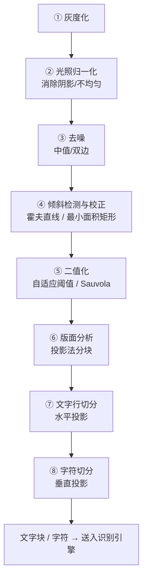

# 📄 文档 OCR 前处理

> **任务类型**：文字区域定位 + 图像质量归一化（为 OCR 引擎准备「好读」的图）
> **典型要求**：字符切分准确率 > 99%，倾斜 < 0.5°
> **涉及章**：第3章（预处理）、第5章（分割）、第8章（形状/投影分析）

---

## 一个关键认知

**现代 OCR 引擎（Tesseract、PaddleOCR 等）本身很强，但「垃圾进、垃圾出」。** 文档 OCR 项目里，**前处理质量决定最终准确率**——同一个引擎，好的前处理能把准确率从 70% 提到 95%+。

**这一页讲的是「怎么把一张随手拍的文档照片，变成引擎喜欢的样子」。**

---

## 完整流程



---

## ① 光照归一化：拍文档的头号敌人

手机拍文档最常见的问题是**「一边亮、一边暗」**——中间有个亮斑或阴影。**全局阈值在这种图上彻底失效。**

```python
import cv2
import numpy as np

def normalize_illumination(gray, ksize=None):
    """
    用「大核形态学闭运算」估计背景，相除得到均匀图。
    对文档图像，闭运算比高斯模糊更合适（不会有边缘渗色）。
    """
    if ksize is None:
        # 核要明显大于文字笔画宽度（一般 > 文字高度的 3 倍）
        ksize = int(max(gray.shape) * 0.05) | 1          # 保证奇数
    kernel = cv2.getStructuringElement(cv2.MORPH_ELLIPSE, (ksize, ksize))
    bg = cv2.morphologyEx(gray, cv2.MORPH_CLOSE, kernel)
    norm = cv2.divide(gray.astype(np.float32), bg.astype(np.float32) + 1e-6,
                      scale=255)
    return np.clip(norm, 0, 255).astype(np.uint8)

# 另一条路线：CLAHE（限制对比度的自适应直方图均衡）
def clahe_enhance(gray, clip=3.0, grid=(8, 8)):
    return cv2.createCLAHE(clipLimit=clip, tileGridSize=grid).apply(gray)
```

::: tip 闭运算 vs 高斯模糊
**文档用「闭运算」估计背景更好**：闭运算会把文字「填满」，得到纯背景；而高斯模糊会把文字晕开，相除后文字边缘会产生光晕。**这是文档处理区别于一般图像处理的一个关键细节。**
:::

---

## ② 倾斜校正：三种方法

```python
import cv2
import numpy as np

# ---- 方法 A：霍夫直线（适合有表格线/边框的文档） ----
def deskew_hough(binary):
    edges = cv2.Canny(binary, 50, 150, apertureSize=3)
    lines = cv2.HoughLines(edges, 1, np.pi / 180, threshold=200)
    if lines is None:
        return 0.0
    angles = []
    for rho, theta in lines[:, 0]:
        deg = np.degrees(theta) - 90
        if -45 < deg < 45:                    # 只统计接近水平的线
            angles.append(deg)
    return float(np.median(angles)) if angles else 0.0

# ---- 方法 B：最小面积矩形（适合整块文档区域） ----
def deskew_minarea(binary):
    cnts, _ = cv2.findContours(binary, cv2.RETR_EXTERNAL, cv2.CHAIN_APPROX_SIMPLE)
    if not cnts:
        return 0.0
    c = max(cnts, key=cv2.contourArea)
    angle = cv2.minAreaRect(c)[2]
    # 归一到 [-45, 45]
    if angle > 45:
        angle -= 90
    return angle

# ---- 方法 C：投影法（最通用、最稳） ----
def deskew_projection(gray, angle_range=(-10, 10), step=0.1):
    """
    旋转不同角度，看「水平投影」的方差——文字倾斜时投影最平，
    摆正时每一行的黑像素会集中在少数行，方差最大。
    """
    best_angle, best_score = 0.0, -1
    _, bw = cv2.threshold(gray, 0, 255, cv2.THRESH_BINARY_INV + cv2.THRESH_OTSU)
    h, w = bw.shape
    for ang in np.arange(angle_range[0], angle_range[1] + step, step):
        M = cv2.getRotationMatrix2D((w / 2, h / 2), ang, 1.0)
        rot = cv2.warpAffine(bw, M, (w, h), flags=cv2.INTER_NEAREST)
        proj = rot.sum(axis=1).astype(float)
        score = proj.var()                    # 方差越大越「摆正」
        if score > best_score:
            best_score, best_angle = score, ang
    return best_angle

# 应用旋转
def rotate(gray, angle):
    h, w = gray.shape
    M = cv2.getRotationMatrix2D((w / 2, h / 2), angle, 1.0)
    return cv2.warpAffine(gray, M, (w, h),
                          flags=cv2.INTER_CUBIC,
                          borderMode=cv2.BORDER_REPLICATE)
```

**选哪种**：

| 情况 | 推荐方法 |
|---|---|
| 有清晰表格线 / 文档边框 | 方法 A（霍夫）**最快** |
| 整块文档区域 | 方法 B（最小面积矩形） |
| **什么都不确定 / 通用** | **方法 C（投影法）最稳** |

---

## ③ 二值化：为什么自适应 + Sauvola

**文档二值化的黄金标准是 Sauvola**（局部均值 + 局部标准差），但 OpenCV 没有内置，通常用 `adaptiveThreshold` 近似。

```python
import cv2
import numpy as np

# ---- A：自适应阈值（OpenCV 内置，够用） ----
def binarize_adaptive(gray, block=35, C=10):
    return cv2.adaptiveThreshold(gray, 255,
        cv2.ADAPTIVE_THRESH_GAUSSIAN_C, cv2.THRESH_BINARY,
        blockSize=block | 1, C=C)

# ---- B：Sauvola 局部阈值（效果最好，速度慢些） ----
def binarize_sauvola(gray, window=25, k=0.2, r=128.0):
    """
    T(x,y) = m(x,y) * [1 + k * (s(x,y)/r - 1)]
    m 是局部均值，s 是局部标准差，r 是动态范围，k 是经验系数
    """
    gray = gray.astype(np.float32)
    if window % 2 == 0:
        window += 1
    mean = cv2.boxFilter(gray, -1, (window, window), normalize=True)
    sq = cv2.boxFilter(gray * gray, -1, (window, window), normalize=True)
    std = np.sqrt(np.maximum(sq - mean * mean, 0))
    thresh = mean * (1 + k * (std / r - 1))
    return (gray > thresh).astype(np.uint8) * 255

# ---- C：局部 Otsu（分块后各自 Otsu） ----
def binarize_local_otsu(gray, tiles=4):
    h, w = gray.shape
    out = np.zeros_like(gray)
    for i in range(tiles):
        for j in range(tiles):
            ys, ye = h * i // tiles, h * (i + 1) // tiles
            xs, xe = w * j // tiles, w * (j + 1) // tiles
            blk = gray[ys:ye, xs:xe]
            if blk.size == 0:
                continue
            _, b = cv2.threshold(blk, 0, 255, cv2.THRESH_BINARY + cv2.THRESH_OTSU)
            out[ys:ye, xs:xe] = b
    return out
```

**参数速查**：

| 方法 | 关键参数 | 建议 |
|---|---|---|
| `adaptiveThreshold` | `blockSize` | **必须 > 文字高度的 2 倍**，一般 25–51 |
| `adaptiveThreshold` | `C` | 5–15，越大越「激进」（字更粗） |
| Sauvola | `window` | 15–35 |
| Sauvola | `k` | **0.2 是经典值**；0.1 保留更多细节，0.3 更抗噪 |

---

## ④ 版面分析与切分

```python
import cv2
import numpy as np

def split_lines(binary, min_gap=3):
    """水平投影切分文字行"""
    inv = 255 - binary                         # 文字为白
    proj = inv.sum(axis=1) / 255               # 每行文字像素数
    thresh = max(1, proj.max() * 0.02)
    is_text = proj > thresh
    lines = []
    start = None
    for i, v in enumerate(is_text):
        if v and start is None:
            start = i
        elif not v and start is not None:
            if i - start >= 3:                 # 太矮的当噪点
                lines.append((start, i))
            start = None
    if start is not None:
        lines.append((start, len(is_text)))
    # 合并间距过小的段
    merged = []
    for seg in lines:
        if merged and seg[0] - merged[-1][1] < min_gap:
            merged[-1] = (merged[-1][0], seg[1])
        else:
            merged.append(seg)
    return merged

def split_chars(binary_line, min_w=2):
    """垂直投影切分字符"""
    inv = 255 - binary_line
    proj = inv.sum(axis=0) / 255
    thresh = max(1, proj.max() * 0.03)
    is_char = proj > thresh
    chars = []
    start = None
    for i, v in enumerate(is_char):
        if v and start is None:
            start = i
        elif not v and start is not None:
            if i - start >= min_w:
                chars.append((start, i))
            start = None
    if start is not None:
        chars.append((start, len(is_char)))
    return chars
```

::: warning 切分不是必须的
**现代 OCR 引擎（PaddleOCR、Tesseract LSTM 模式）多数不需要你手动切字符**——它们自己会做。**只有老式 OCR（Tesseract 7 识别器）或特定场景（手写体、票据模板）才需要手动切分。** 别把力气花在引擎已经做好的事情上。
:::

---

## 一套完整的可运行流水线

```python
import cv2
import numpy as np

def preprocess_document(img_path, debug=False):
    """文档 OCR 前处理完整流程"""
    img = cv2.imread(img_path)
    gray = cv2.cvtColor(img, cv2.COLOR_BGR2GRAY)

    # ① 光照归一化
    norm = normalize_illumination(gray)

    # ② 去噪（去椒盐 + 保边）
    denoised = cv2.medianBlur(norm, 3)
    denoised = cv2.bilateralFilter(denoised, 5, 50, 50)

    # ③ 倾斜校正（投影法最稳）
    angle = deskew_projection(denoised)
    if abs(angle) > 0.2:
        denoised = rotate(denoised, angle)

    # ④ 二值化
    binary = binarize_adaptive(denoised, block=35, C=10)

    # ⑤ 去小噪点（但要保留标点符号，核别太大）
    k = cv2.getStructuringElement(cv2.MORPH_ELLIPSE, (2, 2))
    binary = cv2.morphologyEx(binary, cv2.MORPH_OPEN, k)

    if debug:
        cv2.imwrite('debug_norm.png', norm)
        cv2.imwrite('debug_binary.png', binary)
        print(f'校正角度: {angle:.2f}°')

    return {'gray': denoised, 'binary': binary, 'angle': angle}
```

---

## 五个必踩的坑

::: warning 坑 1：先二值化再做光照归一化
**顺序错了。** 二值化时如果光照不均，暗的地方整块变黑、亮的地方字消失——而这时归一化已经晚了。
**正确顺序**：光照归一化 → 去噪 → 倾斜校正 → **最后**二值化。
:::

::: warning 坑 2：`adaptiveThreshold` 的 blockSize 设太小
blockSize 小于文字高度时，**文字笔画内部会被判成背景**，字变成空心的。
**解法**：`blockSize` 至少是文字高度的 2 倍；先用连通域估计一下文字高度。
:::

::: warning 坑 3：去噪核开太大，标点符号消失
中文的句号、逗号只有几个像素，`medianBlur(5)` 就能把它们抹掉。
**解法**：文档去噪**最多用 3×3**，或者用双边滤波（保边）。
:::

::: warning 坑 4：有表格线时不先去线，识别全是乱码
表格线会被切分算法当成「一行字符」。
**解法**：用形态学**提取长直线**（长条型结构元提取水平/垂直线）再相减去掉。
:::

::: warning 坑 5：忘了做「透视校正」
拍文档常常是斜着拍的（梯形失真），直接二值化后**每行字的宽度都不一样**，切分必然失败。
**解法**：先找文档的四角 → 四点透视变换 `cv2.getPerspectiveTransform` 变换成标准矩形。
:::

---

## 相关页面

- 🎯 [场景反查入口](/scenarios/)
- 📘 [第3章 图像预处理](/chapters/ch03-preprocessing)
- 📘 [第5章 目标分割](/chapters/ch05-segmentation)
- 📹 [阈值分割：Otsu 与自适应](/branches/image-processing/thresholding)
- 📹 [形态学操作：去线/去噪](/branches/image-processing/morphology)
