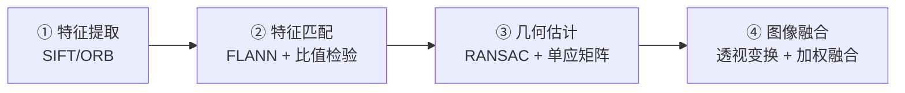

# 🔭 全景图像拼接

> **任务类型**：多张重叠图像 → 一张无缝全景
> **典型要求**：接缝处无重影，几何对齐误差 < 1 像素
> **涉及章**：第4章（特征）、第6章（描述子）、第13章（匹配）、第9章（几何）

---

## 拼接的四步骨架



::: tip 核心认知
**全景拼接 = 特征匹配 + 单应矩阵 + 融合。** 其中「几何估计」是成败关键：**匹配对里只要有 20% 是错的，不做 RANSAC 直接算单应，结果一定是一团扭曲的图像。**
:::

---

## 完整代码（可运行）

```python
import cv2
import numpy as np

def stitch_two(img1, img2, ratio=0.75, ransac_thr=5.0):
    """
    拼接两张图。img1 为基准（左），img2 待变换（右）。
    """
    gray1 = cv2.cvtColor(img1, cv2.COLOR_BGR2GRAY)
    gray2 = cv2.cvtColor(img2, cv2.COLOR_BGR2GRAY)

    # ---------- ① 特征提取（SIFT 精度高，ORB 快） ----------
    sift = cv2.SIFT_create(nfeatures=0, contrastThreshold=0.04)
    kp1, d1 = sift.detectAndCompute(gray1, None)
    kp2, d2 = sift.detectAndCompute(gray2, None)
    if d1 is None or d2 is None or len(kp1) < 4 or len(kp2) < 4:
        return None

    # ---------- ② 匹配 + Lowe 比值检验 ----------
    bf = cv2.BFMatcher()
    raw = bf.knnMatch(d1, d2, k=2)
    good = [m for m, n in raw if m.distance < ratio * n.distance]
    if len(good) < 4:
        return None

    src = np.float32([kp1[m.queryIdx].pt for m in good]).reshape(-1, 1, 2)
    dst = np.float32([kp2[m.trainIdx].pt for m in good]).reshape(-1, 1, 2)

    # ---------- ③ RANSAC 求单应矩阵 ----------
    H, mask = cv2.findHomography(dst, src, cv2.RANSAC, ransac_thr)
    if H is None:
        return None
    inliers = int(mask.sum())
    if inliers < 10:
        return None                       # 内点太少，结果不可信

    # ---------- ④ 透视变换 + 画布计算 ----------
    h1, w1 = img1.shape[:2]
    h2, w2 = img2.shape[:2]

    # 算 img2 变换后的四角，确定画布范围
    corners2 = np.float32([[0, 0], [w2, 0], [w2, h2], [0, h2]]).reshape(-1, 1, 2)
    warped_corners = cv2.perspectiveTransform(corners2, H).reshape(-1, 2)
    corners1 = np.float32([[0, 0], [w1, 0], [w1, h1], [0, h1]]).reshape(-1, 2)
    all_corners = np.vstack([corners1, warped_corners])

    xmin, ymin = np.int32(all_corners.min(axis=0) - 0.5)
    xmax, ymax = np.int32(all_corners.max(axis=0) + 0.5)
    W, Hh = xmax - xmin, ymax - ymin

    # 平移矩阵，把负坐标搬回正区间
    T = np.array([[1, 0, -xmin], [0, 1, -ymin], [0, 0, 1]], np.float64)

    warped2 = cv2.warpPerspective(img2, T @ H, (W, Hh))
    warped1 = cv2.warpPerspective(img1, T, (W, Hh))

    # ---------- ⑤ 融合（线性加权，消除接缝） ----------
    result = blend_linear(warped1, warped2)
    return {'result': result, 'H': H, 'inliers': inliers, 'matches': len(good)}

def blend_linear(a, b):
    """
    简单叠加 + 羽化。生产环境建议用多频段融合（拉普拉斯金字塔）。
    """
    # 生成权重：距离图像边界越远权重越高
    def weight(img):
        g = cv2.cvtColor(img, cv2.COLOR_BGR2GRAY)
        mask = (g > 0).astype(np.float32)
        mask = cv2.distanceTransform(mask.astype(np.uint8), cv2.DIST_L2, 3)
        return mask

    wa, wb = weight(a), weight(b)
    wa = cv2.GaussianBlur(wa, (0, 0), 5)
    wb = cv2.GaussianBlur(wb, (0, 0), 5)
    wsum = wa + wb + 1e-6

    out = (a.astype(np.float32) * wa[..., None] +
           b.astype(np.float32) * wb[..., None]) / wsum[..., None]
    return np.clip(out, 0, 255).astype(np.uint8)
```

---

## 最省事的做法：直接用 OpenCV 的 Stitcher

```python
import cv2

def stitch_many(images, mode=cv2.Stitcher_PANORAMA):
    """
    直接调用 OpenCV 的高层拼接器（内部已实现完整流程）
    Stitcher_PANORAMA : 适合全景（相机旋转）
    Stitcher_SCANS    : 适合扫描拼接（平面平移）
    """
    stitcher = cv2.Stitcher_create(mode)
    status, pano = stitcher.stitch(images)

    if status == cv2.Stitcher_OK:
        return {'ok': True, 'pano': pano}
    errors = {
        cv2.Stitcher_ERR_NEED_MORE_IMGS: '需要更多图像（重叠不足）',
        cv2.Stitcher_ERR_HOMOGRAPHY_EST_FAIL: '单应估计失败（匹配点不足或全错）',
        cv2.Stitcher_ERR_CAMERA_PARAMS_ADJUST_FAIL: '相机参数调整失败',
    }
    return {'ok': False, 'reason': errors.get(status, f'未知错误 {status}')}
```

::: tip 该用高层 API 还是自己写
**先用 `cv2.Stitcher`。** 它内部已经实现了「特征 + 匹配 + RANSAC + 曝光补偿 + 多频段融合」的完整流程，效果通常比手写的好。
**什么时候自己写**：需要控制中间过程（如只想要单应矩阵）、需要特定的失败处理逻辑、或者要做「已知相机标定的精确拼接」。
:::

---

## 四个关键参数

| 参数 | 作用 | 建议 |
|---|---|---|
| **Lowe `ratio`** | 比值检验阈值 | **0.75 是经典值**；0.6 更严（匹配少但准），0.8 更松（特写/重复纹理时用） |
| **RANSAC `ransacReprojThreshold`** | 内点判定阈值（**像素**） | **3–5**；太小剔除太多，太大会放错 |
| **`Stitcher_PANORAMA` vs `_SCANS`** | 模型类型 | 相机旋转 → PANORAMA；平面平移（扫描）→ SCANS |
| **重叠率** | 相邻图的重叠比例 | **至少 30%**，低于此匹配点不够 |

---

## 五个必踩的坑

::: warning 坑 1：不做 RANSAC 直接用全部匹配算单应
**必错。** 匹配对里通常有 30–70% 是错的（尤其是有重复纹理时），一个错匹配就能把单应矩阵拉歪。
**解法**：`cv2.findHomography(src, dst, cv2.RANSAC, 5.0)`，并**检查内点数**（< 10 直接放弃）。
:::

::: warning 坑 2：重复纹理导致大面积误匹配
**典型的失败场景**：拍一面有规律格子砖的墙、或者拍一片叶子都长得一样的树。所有特征点看起来都「像」，匹配结果全是错的。
**解法**：提高 `ratio` 严格度（降到 0.6）；或者用更大的特征邻域；工程上最有效的是**增加重叠率 + 拍的时候避免纯重复纹理区域**。
:::

::: warning 坑 3：曝光不一致，接缝处一条明显的亮度分界
不同图自动曝光不同，直接拼出来会有一道「亮度断崖」。
**解法**：`cv2.Stitcher` 默认会做曝光补偿；手写的话需要**先做亮度直方图匹配**，再用多频段（拉普拉斯金字塔）融合。
:::

::: warning 坑 4：忘了算画布范围，图像被裁掉
直接 `warpPerspective(img2, H, (w1+w2, h1+h2))` 会因为负坐标把图裁掉一部分。
**解法**：先 `perspectiveTransform` 算出变换后四角，确定画布尺寸和平移量（见上面代码的 ④）。
:::

::: warning 坑 5：视差导致「近处对不齐」
单应矩阵假设「场景是同一平面或相机纯旋转」。**如果相机是平移的（视差存在），近处物体和远处物体不可能同时对齐**——近处会重影。
**解法**：拍摄时**尽量让相机绕光心旋转**（不要平移）；有视差必须用多平面/深度分层拼接。
:::

---

## 工业与生活中的用法

| 场景 | 说明 |
|---|---|
| **手机全景照片** | 相机旋转拍摄 + 实时拼接 |
| **文档大幅面扫描**（拍多次拼一张） | 用 `Stitcher_SCANS`，注意必须是平面 |
| **PCB / 大尺寸工件全检** | 分视野拍多张，拼成完整大图再检测 |
| **监控大场景 | 多相机视野拼接监控墙 |
| **显微图像拼接** | 通过位移台移动样品拼图 |
| **古籍/字画数字化** | 高分辨率分区拍摄后拼接 |

::: tip 一个实用的工程变体
**「标定好的固定机位拼接」不需要特征匹配。** 如果相机位置固定、已知标定参数，直接算出每张图的单应即可拼接——**又快又稳，没有匹配失败的风险**。工业上大尺寸工件全检基本都用这种方式。
:::

---

## 相关页面

- 🎯 [场景反查入口](/scenarios/)
- 📘 [第13章 广义匹配](/chapters/ch13-matching)
- 📄 [SIFT 完整档案（特征匹配主力）](/algorithms/sift/)
- 📹 [单应变换与透视校正](/branches/geometry/homography)
- 📹 [鲁棒估计：RANSAC 详解](/branches/feature-matching/robust-estimation)
- 📹 [描述子匹配](/branches/feature-matching/descriptors)
